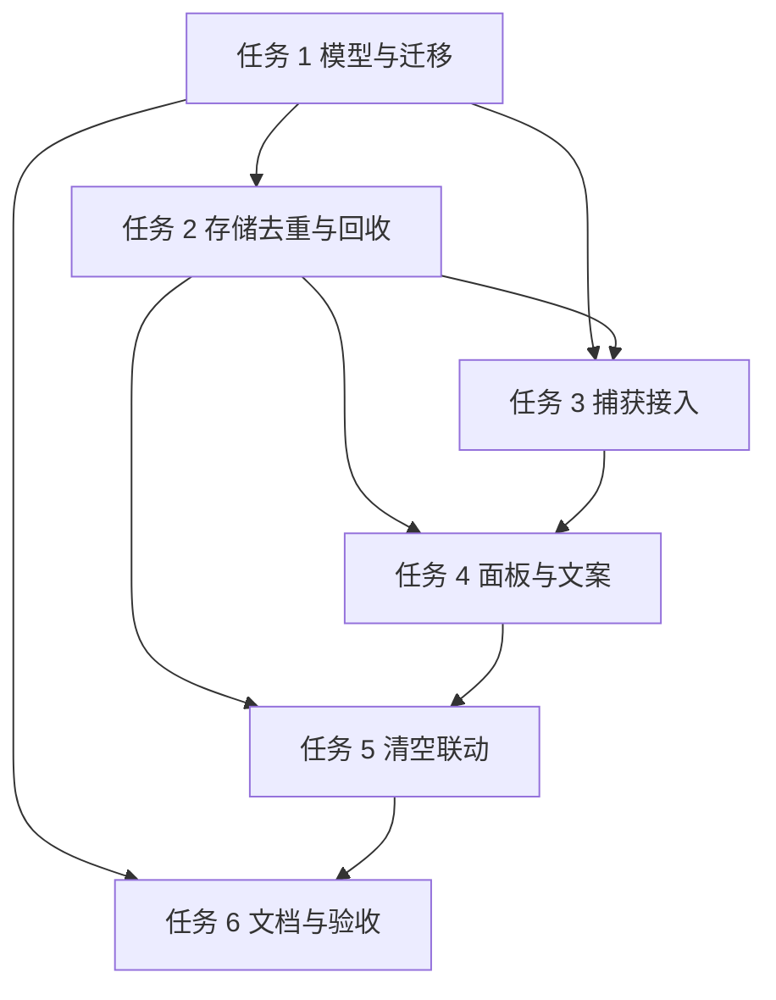

# 剪贴板历史：图片与复制文件条目 实施计划

**目标：** 剪贴板历史把图片与复制的文件作为独立条目保存与展示，图片字节只落盘、数据库只存元数据，旧 v3 历史平滑迁移，中英文案齐全。
**架构：** 新增 `ClipboardImageStore` 统一图片落盘、哈希、尺寸探测与缩略图；`clipboard_item` 增加 5 个可空列，v4 迁移把旧缓存目录中的图片型 `file` 行转为 `type='image'`；Watcher 在后台串行队列捕获图片；Storage 负责哈希去重、`maxDays` 保留与 500 MB 容量淘汰；Panel 按类型渲染 32/48 pt 行高并回写图片。
**技术栈：** Swift 6.4 / macOS 14+ / GRDB 7 / AppKit / ImageIO / CryptoKit / UniformTypeIdentifiers；不新增 SwiftPM 依赖。
**计划状态：** 待批准
**项目状态：** planned（批准后改 active）
**更新：** 2026-11-04
**分支：** master（trunk，无任务分支）
**依据：** 用户需求 2026-11-04（允许按调研裁剪或补充，须写明不做的项与决定人）；`AGENTS.md`；`.claude/CLAUDE.md`；`.agent/profile.yaml`；`.agent/rules/testing.md`

## 现状证据

| 事实 | 证据 |
|---|---|
| 图片当前被写成 `type='file'`，文件落在 `~/.cache/utility/clip/clip_<epoch>.png`，DB 里存 `{"path": ...}` | `Sources/Clipboard/ClipboardWatcher.swift:63-67`、`:123-140` |
| 面板只认 `file/file_batch/html` 的 16 pt 图标，没有 image 分支，回车粘贴也没有 image 分支 | `Sources/Clipboard/ClipboardPanelController.swift:193-255`、`:102-141` |
| `show()` 会删除 clip 目录中创建超过 1 天的文件，与 `maxDays=3` 冲突 | `Sources/Clipboard/ClipboardPanelController.swift:158-171` |
| 本机真实库 14 条旧图片行只有 6 个文件仍存在，8 条已指向不存在的文件 | `sqlite3 ~/.config/utility/data.sqlite` + `ls ~/.cache/utility/clip` |
| 旧库存在真实复制文件行（如 `~/Downloads/iShot_*.png`），不能按扩展名一刀切转图片 | 同上 |
| `clipboard_item` 现有列：`id/timestamp/type/content/application/search_text`，迁移已到 v3 | `Sources/Core/Database.swift:25-93`；`grdb_migrations` 含 v1/v2/v3 |
| 剪贴板数据库只被 Storage 与菜单“清空剪贴板”写入；清空动作目前只删行，不删图片文件 | `Sources/Clipboard/ClipboardStorage.swift:16-78`；`Sources/Core/MenuBarManager.swift:627-632` |
| i18n 唯一数据源是 `Sources/Resources/<lang>.json`，Swift 访问器自动生成 | `Sources/Core/L10nKeys.swift:37-41`；`scripts/gen-l10n.py`；`scripts/check-l10n-contract.py` |
| `quality.test_level: basic`，仓库无 SwiftPM 测试 target，`tests/` 为空 | `.agent/profile.yaml`；`Package.swift`；`ls tests` |
| 现有隔离 E2E 脚本用临时 HOME 跑真实二进制并检查 `data.sqlite`，可复用该模式验证迁移 | `scripts/e2e-isolated.sh:1-120` |

## 非目标

- 不做图片 OCR、文字提取、大图预览或图片编辑。决定人：规划者（用户已授权按调研裁剪）。
- 不做跨设备同步、云端备份。决定人：规划者（用户已授权按调研裁剪）。
- 不新增配置项；20 MB 单图上限、500 MB 总容量、96 px 缩略图写常量。决定人：规划者（用户已授权按调研裁剪）；代价是用户不可调，增强档再议。
- 不改 `text/html/file/file_batch` 的 `content` 编码，文件路径仍存 JSON。决定人：规划者（用户已授权按调研裁剪）；降低迁移面。
- 不新增 SwiftPM 测试 target；迁移用隔离脚本验证，交互用 L3 手工验收。依据：`.agent/profile.yaml` 的 `quality.test_level: basic` 与仓库现状。
- 不恢复已经被历史清理删除的旧图片字节。依据：本机 14 条旧图片行仅 6 个文件存在，文件已不在磁盘，无法恢复。
- 不做缩略图落盘。决定人：规划者（用户已授权按调研裁剪）；用 NSCache 内存缓存，上限 32 MB。

## 全局约束

- 平台 macOS 14+，Swift 6.4，保持 `Package.swift` 现有依赖集合。
- 新增图片入口只允许用系统框架 ImageIO、CryptoKit、UniformTypeIdentifiers，禁止引入第三方图片库。
- 用户可感知文案只改 `Sources/Resources/zh-Hans.json` 与 `en.json`；`Sources/Core/L10nKeys.swift` 由 `scripts/gen-l10n.py` 生成，禁止手改。
- 占位符只允许 `{name}`、`{name:d}`、`{name:.Nf}`；两种语言的 key 与占位符集合必须一致。
- 代码注释、日志、内部错误消息用英文，单段注释不超过 80 字。
- 删除文件一律 `FileManager.trashItem`；禁止 `removeItem` 删除缓存图片。
- 所有路径从 `AppPaths` 派生，禁止硬编码个人目录。
- `clipboard_item` 的写入只允许经 `ClipboardStorage`；MenuBarManager 的裸 SQL 必须移除。
- 跨模块交互走 EventBus，禁止 MenuBarManager 直接持有 Clipboard 模块实例。
- 提交必须获得用户明确授权；未授权时任务停在验证，不执行 `git commit`。
- 格式化用 `xcrun swift-format lint --recursive --configuration .swift-format Sources`。

## 复杂度追踪

无。未违反 `AGENTS.md` / `.claude/CLAUDE.md` 硬规则。

## 假设

- 假设 A1：图片粘贴回写为图片数据（`NSImage` 写入粘贴板），不写文件 URL；若用户需要“粘贴为文件”，改 T4 的 `paste` image 分支。
- 假设 A2：Finder 复制的 `.png/.jpg` 文件视为「文件」条目，只有粘贴板仅含图像数据时才视为「图片」；若用户要求文件图片也合并为图片条目，需重开 T3 优先级。
- 假设 A3：旧图片条目按 `maxDays` 自然过期，不额外立即清理；若用户要迁移后立即清空旧数据，改 T2 的 `cleanupExpired` 调用点。
- 假设 A4：旧图片文件缺失时保留条目并显示占位，不删除行；若用户要求删除不可用条目，改 T1 迁移规则。
- 假设 A5：面板宽度 312 pt 保持不变，图片缩略图 36×36 pt，图片行高 48 pt；若视觉验收不通过，改 T4 的布局常量。

有误现在纠正；否则按此继续。

## 项目约定

| 日期 | 约定 | 来源 |
| --- | --- | --- |
| 2026-11-04 | 范围可按调研裁剪或补充，但每条「不做」必须写明决定人 | 用户 |
| 2026-11-04 | 只读调研，唯一允许写入的是计划文件本身 | 用户 |
| 2026-11-04 | 删除文件移到废纸篓；未明确授权不提交 | `AGENTS.md` 常驻约束 |
| 2026-11-04 | 修改模块前读对应架构文档；本功能涉及 `panel-ui.md` 与 `overview.md` | `AGENTS.md` 加载策略 |

## 取舍

| 决策 | 代价 | 什么证据会让我改主意 |
|---|---|---|
| 图片元数据放新增列（`file_path/content_hash/byte_size/pixel_width/pixel_height`），不放 `content` JSON | 需要 v4 表结构迁移；旧代码降级时忽略新列 | 出现迁移耗时超预算或旧客户端写入冲突 |
| 迁移用「复制」旧图片文件到新目录，不移动 | 旧图最多多占一份磁盘；迁移耗时增加 | 迁移超过 3 s，或磁盘占用超 500 MB |
| 缺失文件的旧图片行保留，`file_path=NULL` | 最多 3 天内出现不可粘贴的占位条目 | 用户反馈占位条目干扰选择 |
| 缩略图按需生成 + NSCache，不落盘 | 滚动时重复解码；进程重启后重算 | 500 条图片滚动出现明显卡顿 |
| 图片捕获放后台串行队列 | 引入与保留清理的时序问题，需要去重兜底 | 日志出现并发重复插入 |

## 交付分档

| 阶段 | 范围 | 交付标准 |
|---|---|---|
| MVP | 任务 1-4 | 旧库可迁移；图片落盘且面板显示缩略图与尺寸；复制的文件显示文件名；图片可粘贴回应用；中英文案齐全 |
| 完整版 | 任务 1-6 | 菜单清空联动删除图片文件；README 同步；迁移脚本、构建、i18n、格式检查全过；L3 手工验收通过 |
| 增强 | 后续 | 上限可配置、缩略图落盘、缺失图片交互（删除/重试）、图片预览；不阻塞本次验收 |

## 存储与迁移

| 场景 | 行为 |
|---|---|
| 首次运行（无 `data.sqlite`） | 依次执行 v1-v4 建表；`clipImageDir` 在首次写入图片时创建；不做备份 |
| 有旧格式数据（v3） | 迁移前用 `VACUUM INTO` 生成 `~/.config/utility/data.sqlite.pre-v4.bak`（已存在则跳过）；v4 增加 5 个可空列与 `content_hash` 索引；把路径位于 `AppPaths.clipCacheDir` 且文件名为 `clip_<数字>.<图片扩展名>` 的 `type='file'` 行转为 `type='image'`；可读文件复制到 `clipImageDir/<id>.<ext>`，超过 20 MB 或复制失败则保留原路径；文件不存在则 `file_path=NULL` 并保留行；原文件不删除 |
| 数据文件解码失败 | `content` JSON 无法解析的 `file` 行保持原样，不猜测转换；数据库本身无法打开时沿用现有 SQLite 打开失败行为，不新增兜底 |
| 旧版本程序写回 | 旧二进制不认识新列，GRDB 写入时忽略；旧二进制会继续产生 `type='file'` 的图片行，再次升级时 v4 已应用、不会二次迁移，这些行按文件条目展示；可接受，记录在文档 |

## 性能与资源预算

| 项 | 上限 | 超限行为 | 验收基线 |
|---|---|---|---|
| 单张图片捕获 | 20 MB | 跳过并记录 `[Clipboard] image skipped: too large`，不新增行 | 20 MB PNG 的哈希、尺寸探测、落盘在后台队列内 ≤300 ms |
| 图片缓存总容量 | 500 MB | 按 `timestamp` 升序删除最老图片行，文件进废纸篓，直到 ≤500 MB | 插入后总大小查询 ≤500 MB |
| 缩略图内存 | 32 MB / 200 项 | NSCache 自动淘汰 | 连续滚动 200 条图片不出现内存告警 |
| 单次清理 | 500 个文件 | 分页：本次处理 500 个，下次继续 | 面板打开耗时增加 ≤100 ms |
| 迁移耗时 | 3 s / 200 张或 200 MB | 记录耗时日志后继续，不中断迁移 | 隔离脚本首启 ≤3 s |
| 轮询间隔 | 0.3 s | 沿用现有配置，不调整 | 与当前行为一致 |

## 文件结构

| 文件 | 动作 | 职责 |
|---|---|---|
| `Sources/Clipboard/ClipboardImageStore.swift` | 新建 | 图片校验、SHA-256、尺寸探测、落盘、旧文件复制、缩略图、移入废纸篓 |
| `Sources/Clipboard/ClipboardItem.swift` | 修改 | 增加图片元数据字段与 CodingKeys |
| `Sources/Clipboard/ClipboardStorage.swift` | 修改 | 哈希去重、保留期、容量淘汰、清空、孤儿清理 |
| `Sources/Clipboard/ClipboardWatcher.swift` | 修改 | 图片捕获接入后台队列；删除旧图片缓存清理 |
| `Sources/Clipboard/ClipboardPanelController.swift` | 修改 | 图片缩略图行、文件名展示、图片粘贴、清空订阅 |
| `Sources/Core/Database.swift` | 修改 | v4 前备份与 v4 迁移注册 |
| `Sources/Core/Constants.swift` | 修改 | `clipImageDir`、`ClipboardLimits` |
| `Sources/Core/AppEvent.swift` | 修改 | 新增 `clearClipboard` 事件 |
| `Sources/Core/MenuBarManager.swift` | 修改 | 清空动作改为发事件，移除裸 SQL |
| `Sources/Core/L10nKeys.swift` | 修改（生成） | 由 `gen-l10n.py` 生成新访问器 |
| `Sources/Resources/zh-Hans.json` | 修改 | 中文文案基线 |
| `Sources/Resources/en.json` | 修改 | 英文文案 |
| `scripts/check-clipboard-migration.sh` | 新建 | 临时 HOME 构造 v3 库并验证 v4 迁移 |
| `README.md` | 修改 | 英文功能与存储说明 |
| `README.zh.md` | 修改 | 中文功能与存储说明 |
| `.claude/docs/architecture/overview.md` | 修改 | 组件表中补一句 ClipboardImageStore 职责 |

## 依赖图

## 任务

### 任务 1：数据模型、v4 迁移与图片存储原语

**文件**

- 新建：`Sources/Clipboard/ClipboardImageStore.swift`
- 修改：`Sources/Clipboard/ClipboardItem.swift:5-41`
- 修改：`Sources/Core/Database.swift:10-18`、`:74-95`
- 修改：`Sources/Core/Constants.swift:27-45`、`:136-147`
- 新建：`scripts/check-clipboard-migration.sh`

**接口**

- 消费：`AppPaths.clipCacheDir`、`AppPaths.clipImageDir`、`ClipboardLimits`
- 产出：
  - `struct ClipboardImageInfo { let sha256: String; let byteSize: Int; let pixelWidth: Int?; let pixelHeight: Int?; let fileExtension: String }`
  - `ClipboardImageStore.inspect(data: Data, typeIdentifier: String?) -> ClipboardImageInfo?`
  - `ClipboardImageStore.write(data: Data, itemID: String, fileExtension: String) throws -> String`
  - `ClipboardImageStore.copyLegacyFile(at path: String, itemID: String, fileExtension: String) throws -> String`
  - `ClipboardImageStore.thumbnail(path: String, maxPixel: Int) -> NSImage?`
  - `ClipboardImageStore.trash(paths: [String])`
  - `ClipboardItem.filePath: String?`、`contentHash: String?`、`byteSize: Int?`、`pixelWidth: Int?`、`pixelHeight: Int?`，CodingKeys 映射 `file_path`、`content_hash`、`byte_size`、`pixel_width`、`pixel_height`

**迁移规则**

- `AppDatabase.setup()` 在 `migrator.migrate` 前读取 `migrator.appliedIdentifiers(db)`：含 `v3` 且不含 `v4` 且 `data.sqlite` 存在时，执行 `VACUUM INTO '<configDir>/data.sqlite.pre-v4.bak'`；备份已存在则跳过；备份失败记 `[Database] pre-v4 backup failed: <error>` 后继续。
- v4 执行：`ALTER TABLE clipboard_item ADD COLUMN file_path TEXT`、`content_hash TEXT`、`byte_size INTEGER`、`pixel_width INTEGER`、`pixel_height INTEGER`；`CREATE INDEX IF NOT EXISTS idx_clipboard_hash ON clipboard_item(content_hash)`。
- 回填：遍历 `SELECT id, content, application FROM clipboard_item WHERE type = 'file'`；路径的父目录标准化后等于 `AppPaths.clipCacheDir` 且文件名匹配 `^clip_\d+\.(png|tiff|tif|jpeg|jpg|heic|gif|webp|bmp)$` 才算旧图片。
- 文件存在：`inspect` 得到真实格式、哈希、尺寸；≤20 MB 时复制到 `clipImageDir/<id>.<ext>`，否则 `file_path` 保留原路径、`content_hash` 置空；更新 `type='image'`、`content=X''`、`application=NULL` 与新列。
- 文件不存在：更新 `type='image'`、`content=X''`、`file_path=NULL`，保留行。
- 无法解析 JSON 或路径不在 `clipCacheDir`：不改该行。
- 迁移结束记录 `[Database] v4 migrated images: <n>, missing files: <n>`。

**验收**

- [ ] 隔离脚本构造的 4 类旧行迁移后：可读图片行 `type='image'`、`length(content)=0`、`file_path` 指向存在文件；缺失文件行 `type='image'` 且 `file_path IS NULL` 仍存在。
- [ ] 真实复制文件行（路径不在 `clipCacheDir`）仍为 `type='file'`；文本与 HTML 行不变。
- [ ] `data.sqlite.pre-v4.bak` 在迁移前生成；第二次启动不重复迁移。

**验证**

- 命令：`swift build`
- 期望：构建成功，无 warning
- 命令：`bash scripts/check-clipboard-migration.sh`
- 期望：末行 `clipboard migration v4: PASS`

**依赖 / 规模**：无 / M

- [ ] 步骤 1：写 `scripts/check-clipboard-migration.sh`，在临时 HOME 构造 v3 库与 1×1 PNG，断言 v4 行为，先运行确认失败（`no such column: file_path` 或断言不成立）
- [ ] 步骤 2：在 `Constants.swift` 增加 `AppPaths.clipImageDir` 与 `ClipboardLimits`
- [ ] 步骤 3：在 `ClipboardItem.swift` 增加 5 个可选字段与 CodingKeys
- [ ] 步骤 4：实现 `ClipboardImageStore.inspect/write/copyLegacyFile/thumbnail/trash`
- [ ] 步骤 5：在 `Database.swift` 增加备份逻辑与 v4 迁移
- [ ] 步骤 6：运行脚本确认 PASS，再跑 `xcrun swift-format lint --recursive --configuration .swift-format Sources`
- [ ] 步骤 7：等用户明确授权后提交（未授权则停在此）

### 任务 2：存储层哈希去重、保留与磁盘回收

**文件**

- 修改：`Sources/Clipboard/ClipboardStorage.swift:16-79`

**接口**

- 消费：`ClipboardImageStore.trash(paths:)`、`ClipboardItem.contentHash/filePath/byteSize`
- 产出：
  - `public func imageID(hash: String) throws -> String?`
  - `public func add(_ item: ClipboardItem) throws`（签名不变）
  - `public func clearAll() throws`
  - `@discardableResult public func cleanupExpired() throws -> Int`
  - `@discardableResult public func sweepOrphans() throws -> Int`
  - `public func imageFilePaths() throws -> [String]`

**行为**

- `add`：`type == "image"` 时先按 `content_hash` 查重；命中则 `UPDATE timestamp` 并返回；未命中执行插入。插入后在同一 `db.write` 内删除 `timestamp < now - maxDays*86400` 的行并收集其 `file_path`；随后按图片 `byte_size` 总和从旧到新删行直到 ≤500 MB。文件移入废纸篓在事务外执行。
- `clearAll`：读取所有图片 `file_path`，`DELETE FROM clipboard_item`，事务外批量 `trash`。
- `cleanupExpired`：对全部类型执行保留期删除，对图片执行容量淘汰；返回移入废纸篓的文件数。
- `sweepOrphans`：列出 `clipImageDir` 文件，与 `SELECT file_path` 的 basename 集合比对；未被引用且修改时间早于 60 秒的文件移入废纸篓；每次最多 500 个。
- 非图片类型的去重逻辑保持现状（文本按 `search_text`，其余按 `content` 字节比较）。

**验收**

- [ ] 同一 `content_hash` 连续插入两次只有 1 行，第二次只更新时间戳。
- [ ] 超过 `maxDays` 的行被删除，且对应图片文件出现在废纸篓。
- [ ] 图片总字节超过 500 MB 时从最老行开始淘汰，淘汰后 `SUM(byte_size) <= 524288000`。
- [ ] `clearAll` 只处理 `clipImageDir` 内被 DB 引用的文件，不触碰用户文件。

**验证**

- 命令：`swift build`
- 期望：构建成功
- 命令：`bash scripts/check-clipboard-migration.sh`
- 期望：迁移脚本仍 PASS（证明 v4 后的 Storage 读写不破坏旧数据）

**依赖 / 规模**：任务 1 / S

- [ ] 步骤 1：在 `ClipboardStorage` 增加 `imageID(hash:)`，复用现有 `db.read`
- [ ] 步骤 2：改 `add`，图片分支走哈希去重，非图片分支保持原逻辑
- [ ] 步骤 3：抽出 `expireLocked(db:)` 与 `enforceImageCapLocked(db:)`，在写事务内只做 DB 操作
- [ ] 步骤 4：事务外调用 `ClipboardImageStore.trash(paths:)`
- [ ] 步骤 5：实现 `clearAll`、`cleanupExpired`、`sweepOrphans`、`imageFilePaths`
- [ ] 步骤 6：`swift build` 与迁移脚本复跑通过

### 任务 3：捕获接入，图片落盘并移除旧清理

**文件**

- 修改：`Sources/Clipboard/ClipboardWatcher.swift:37-96`、`:100-161`

**接口**

- 消费：`ClipboardImageStore.inspect(data:typeIdentifier:)`、`ClipboardImageStore.write(data:itemID:fileExtension:)`、`ClipboardStorage.imageID(hash:)`、`ClipboardStorage.add(_:)`、`ClipboardStorage.moveToTop(_:)`、`ClipboardStorage.cleanupExpired()`
- 产出：`type='image'` 的 `ClipboardItem`，`content` 为空 `Data()`，图片文件位于 `clipImageDir/<id>.<ext>`

**行为**

- `check()` 的优先级保持：文件 URL → 图像数据 → HTML → 文本。
- 图像分支：在主线程取出 `imageData`、匹配的 pasteboard type、`pasteboardOwner()`，派发到串行队列 `DispatchQueue(label: "clipboard.image.capture", qos: .utility)`。
- 后台：`inspect` 返回 nil（损坏或不支持）则记 `[Clipboard] image skipped: unreadable`；`byteSize > 20 MB` 则记 `[Clipboard] image skipped: too large`；哈希命中 `imageID` 则 `moveToTop` 并返回；否则 `write` 落盘，构造 `ClipboardItem(id:type:"image",content:Data(),application:owner)` 并写入元数据后 `add`。
- 落盘或写库失败：记日志，不新增行；若文件已写入，由 `sweepOrphans` 后续回收。
- 删除 `storeImageFromData(_:)`、`cleanupOldClips()`；文件插入成功后调用 `try? storage.cleanupExpired()`。
- `storeFiles` 行为不变：单文件 `type='file'`、多文件 `type='file_batch'`，`content` 仍为 `{"path"}` / `{"paths"}`。

**验收**

- [ ] 粘贴板只有图像数据时新增 1 条 `type='image'`，`SELECT length(content)` 为 0，`file_path` 指向 `clipImageDir` 内存在文件。
- [ ] 同一图片连续复制两次只有 1 行，第二次时间戳前移。
- [ ] Finder 复制单文件/多文件仍生成 `file`/`file_batch`，路径 JSON 不变。

**验证**

- 命令：`swift build`
- 期望：构建成功
- 手工（L3）：Preview 打开一张 PNG → `cmd+c` → 打开剪贴板面板 → 出现图片条目；`sqlite3 ~/.config/utility/data.sqlite "SELECT type, file_path FROM clipboard_item ORDER BY timestamp DESC LIMIT 1"`
- 期望：`image|<绝对路径>`，路径文件存在

**依赖 / 规模**：任务 1、任务 2 / M

- [ ] 步骤 1：增加串行捕获队列与 `captureImage(data:type:owner:)`
- [ ] 步骤 2：把 `check()` 的图像分支改为派发
- [ ] 步骤 3：删除 `storeImageFromData` 与 `cleanupOldClips`
- [ ] 步骤 4：在文件插入后调用 `cleanupExpired`
- [ ] 步骤 5：`swift build`，再按验收手工复制一次图片与一次文件

### 任务 4：面板缩略图、文件名、图片粘贴与中英文案

**文件**

- 修改：`Sources/Clipboard/ClipboardPanelController.swift:30-34`、`:91-98`、`:102-141`、`:145-177`、`:193-304`、`:306-326`
- 修改：`Sources/Resources/zh-Hans.json`（`clipboard` 命名空间）
- 修改：`Sources/Resources/en.json`（`clipboard` 命名空间）
- 修改（生成）：`Sources/Core/L10nKeys.swift:37-41`

**接口**

- 消费：`ClipboardImageStore.thumbnail(path:maxPixel:)`、`ClipboardStorage.cleanupExpired()`、`ClipboardStorage.sweepOrphans()`、`ClipboardItem.filePath/pixelWidth/pixelHeight`
- 产出：`private func paste(item: ClipboardItem) -> Bool`；`selectItem()` 只在返回 true 时发 `PanelEvent.requestPaste`

**行为**

- 行高：`type == "image"` 返回 48，其余返回 32。
- 单元格：`showIcon` 包含 `image`；图片缩略图 36×36，位于 `x=26,y=6`；文本标签 `x=70,y=16`；数字圆圈在 48 pt 行内垂直居中。
- 图片缩略图：`ClipboardImageStore.thumbnail(path:maxPixel:96)`；文件不存在或解码失败显示系统符号 `photo`，文案 `L10n.Clipboard.imageMissing`。
- 图片文本：有宽高显示 `L10n.Clipboard.imageDimensions(width:height:)`，否则 `L10n.Clipboard.image`。
- 文件文本：从 `content` JSON 取路径，单文件显示 `lastPathComponent`；多文件显示 `L10n.Clipboard.fileMore(name:count:)`，`count = paths.count - 1`；解析失败回退 `L10n.Clipboard.file` / `fileCount`。
- 图片粘贴：`NSImage(contentsOfFile:)` 失败返回 false；成功 `pb.clearContents()` + `pb.writeObjects([image])` + `skipCurrentChange()` 返回 true；`selectItem()` 成功后才 `moveToTop` 与发 `requestPaste`。
- `show()`：删除 `:158-171` 的 1 天清理块；改为先 `try? clipboardStorage.cleanupExpired()` 与 `try? clipboardStorage.sweepOrphans()`，再加载 `items`。
- 新增文案（zh-Hans / en 必须同 key 同占位符）：
  - `clipboard.image`：`图片` / `Image`
  - `clipboard.image_missing`：`图片文件已丢失` / `Image file missing`
  - `clipboard.image_dimensions`：`{width:d} × {height:d}` / `{width:d} × {height:d}`
  - `clipboard.file_more`：`{name}（另有 {count:d} 个文件）` / `{name} (+{count:d} more)`

**验收**

- [ ] 图片行高 48，显示 36×36 缩略图与 `宽 × 高`；缺失文件显示 `photo` 符号与「图片文件已丢失」。
- [ ] 回车把图片粘贴到 TextEdit 成功并关闭面板；多文件条目显示「首文件名（另有 N 个文件）」。
- [ ] `python3 scripts/gen-l10n.py --check` 与 `python3 scripts/check-l10n-contract.py` 均退出 0。

**验证**

- 命令：`swift build`
- 期望：构建成功
- 命令：`python3 scripts/gen-l10n.py && python3 scripts/gen-l10n.py --check && python3 scripts/check-l10n-contract.py`
- 期望：两条检查均通过
- 手工（L3）：打开面板查看文本/HTML/文件/图片四类行，复制图片到 TextEdit，再清空后复核

**依赖 / 规模**：任务 1、任务 2、任务 3 / M

- [ ] 步骤 1：在 `zh-Hans.json` 与 `en.json` 增加 4 个 key
- [ ] 步骤 2：运行 `python3 scripts/gen-l10n.py` 重新生成 `L10nKeys.swift`
- [ ] 步骤 3：改 `displayText` 与单元格布局，加入 image 分支
- [ ] 步骤 4：改 `paste` 返回 Bool，`selectItem` 按结果决定是否关闭
- [ ] 步骤 5：删除 `show()` 的 1 天清理，接入 `cleanupExpired`/`sweepOrphans`
- [ ] 步骤 6：跑 l10n 检查与 `swift build`

### 任务 5：清空剪贴板联动图片文件

**文件**

- 修改：`Sources/Core/AppEvent.swift:11-16`
- 修改：`Sources/Core/MenuBarManager.swift:627-632`
- 修改：`Sources/Clipboard/ClipboardPanelController.swift:30-34`

**接口**

- 消费：`ClipboardStorage.clearAll()`
- 产出：`AppEvent.clearClipboard`（新增 case，无 payload）

**行为**

- `MenuBarManager.clearClipboard()` 改为 `EventBus.shared.publish(AppEvent.clearClipboard)`，删除裸 SQL。
- `ClipboardPanelController` 初始化时订阅 `AppEvent.clearClipboard`：`try? clipboardStorage.clearAll()`、`items = []`、`tableView.reloadData()`。
- `clearAll` 已由任务 2 保证同时把被引用图片移入废纸篓。

**验收**

- [ ] 点击菜单“清空剪贴板”后 `SELECT COUNT(*) FROM clipboard_item` 为 0，`clipImageDir` 内被引用文件全部移入废纸篓。
- [ ] `clipImageDir` 之外的文件数量与内容不变。

**验证**

- 命令：`swift build`
- 期望：构建成功
- 手工（L3）：记下 `ls ~/.cache/utility/clip/images | wc -l`，菜单清空后复查文件数与废纸篓

**依赖 / 规模**：任务 2、任务 4 / S

- [ ] 步骤 1：`AppEvent` 增加 `case clearClipboard`
- [ ] 步骤 2：`MenuBarManager` 改为发事件
- [ ] 步骤 3：`ClipboardPanelController` 增加订阅与清空处理
- [ ] 步骤 4：`swift build` 后手工验证一次

### 任务 6：文档与端到端验收

**文件**

- 修改：`README.md:106-126`
- 修改：`README.zh.md:106-126`
- 修改：`.claude/docs/architecture/overview.md:19`

**接口**

- 消费：无
- 产出：文档描述与最终证据记录

**行为**

- README 英文与中文各补一段：图片存放于 `~/.cache/utility/clip/images/`，数据库只存元数据；单图 20 MB、总容量 500 MB、保留期跟随 `clipboard.maxDays`；旧 v3 数据首次启动自动迁移并生成 `data.sqlite.pre-v4.bak`。
- `overview.md` 组件表补 `ClipboardImageStore` 一行职责。
- 汇总验证证据：命令、退出码、迁移脚本输出尾部、L3 手工截图或日志路径，写入交付说明（不新建报告文件）。

**验收**

- [ ] README 中英文描述一致，均包含存储路径、20 MB、500 MB、迁移备份名。
- [ ] `bash scripts/check-clipboard-migration.sh`、`bash scripts/run-tests.sh`、`swift build`、格式检查全部通过。
- [ ] 6 项 L3 手工清单完成并留有证据：图片捕获、图片粘贴、文件单条、文件批量、缺失图片占位、菜单清空。

**验证**

- 命令：`bash scripts/check-clipboard-migration.sh && bash scripts/run-tests.sh && swift build`
- 期望：全部退出 0
- 命令：`xcrun swift-format lint --recursive --configuration .swift-format Sources`
- 期望：无输出，退出 0

**依赖 / 规模**：任务 1-5 / S

- [ ] 步骤 1：更新 `README.md` 与 `README.zh.md` 的 Clipboard 小节
- [ ] 步骤 2：更新 `overview.md` 组件表
- [ ] 步骤 3：跑完整验证命令并记录输出尾部
- [ ] 步骤 4：按 6 项手工清单验收并记录证据级别
- [ ] 步骤 5：等用户明确授权后提交

## 检查点

### 检查点 A（任务 1-3 后）

- [ ] `swift build` 通过
- [ ] `bash scripts/check-clipboard-migration.sh` 输出 PASS
- [ ] `sqlite3 ~/.config/utility/data.sqlite "SELECT type, count(*) FROM clipboard_item GROUP BY type"` 中图片为独立 `image` 行
- [ ] 手工复制一张图片与一个文件，DB 行与磁盘文件对应正确

### 检查点 B（任务 4-5 后）

- [ ] `swift build` 通过
- [ ] `python3 scripts/gen-l10n.py --check` 与 `python3 scripts/check-l10n-contract.py` 通过
- [ ] 面板四类行显示正常，图片可粘贴回应用
- [ ] 菜单清空后 DB 为空且图片文件进入废纸篓

### 检查点 C（任务 6 后）

- [ ] `bash scripts/run-tests.sh` 全过
- [ ] 格式检查无输出
- [ ] 6 项 L3 手工清单完成，证据路径已记录
- [ ] README 中英同步完成

## 未覆盖输入类

| 输入或条件 | 期望行为 | 对应测试任务 |
|---|---|---|
| 空粘贴板 | 不新增行，不崩溃 | 任务 3 手工 |
| 超过 20 MB 的图片 | 跳过并记日志，现有历史不变 | 任务 3 手工 + 日志断言 |
| 损坏或无法解码的图片数据 | `inspect` 返回 nil，跳过 | 任务 3 手工 |
| 旧图片文件缺失 | 保留 `type='image'`、`file_path=NULL`，面板显示占位 | 任务 1 脚本、任务 4 手工 |
| 旧 `content` JSON 损坏 | 保持 `type='file'` 原样，不迁移 | 任务 1 脚本 |
| 同一图片重复复制 | 只保留 1 行并置顶 | 任务 2、任务 3 |
| 10 倍数据（500 张 1 MB 图片） | 面板打开 ≤300 ms，总容量 ≤500 MB | 任务 2 预算、任务 4 手工 |
| `excludeApps` 命中的应用 | 不记录 | 任务 3（现有逻辑） |
| 缓存目录无写权限 | 记日志，不新增坏行，不崩溃 | 任务 1、任务 3 |
| 数据库写锁冲突 | 沿用 `busy timeout 5 s`，失败后下次轮询重试 | 任务 2 |

## 风险与回滚

| 风险 | 影响 | 缓解 | 回滚 |
|---|---|---|---|
| 旧图片文件已被现有 1 天清理删除（本机 14 条仅 6 个文件存在） | 中 | 缺失行保留并显示占位，不删除条目；新逻辑不再按 1 天清理 | 无需回滚；迁移不改原文件 |
| 迁移误判真实复制文件为图片 | 低 | 同时要求父目录等于 `clipCacheDir`、文件名匹配 `clip_<数字>.<图片扩展名>`；旧文件采用复制不移动 | 停应用，`mv ~/.config/utility/data.sqlite.pre-v4.bak ~/.config/utility/data.sqlite`，删除同目录 `-wal`/`-shm` 后重启 |
| 旧文件扩展名与实际格式不符 | 低 | ImageIO 嗅探实际类型并写正确扩展名 | 同上恢复备份；原文件仍在旧目录 |
| 图片处理阻塞主线程 | 中 | 后台串行队列 + 20 MB 上限 | 把 `captureImage` 改回在 `check()` 同步执行（回退任务 3 步骤 2） |
| 磁盘膨胀 | 中 | `maxDays` + 500 MB 上限 + 孤儿清理 | 调低 `ClipboardLimits.maxImageStoreBytes` 并重启，或菜单清空 |
| 面板行高与复用导致文本行错位 | 中 | 四类行逐一手工验收；图片与文本使用不同 identifier | `heightOfRow` 恢复固定 32，图片改用 16 pt 图标（回退任务 4 步骤 3） |
| 清空只删 DB 不删文件 | 中 | 任务 5 走 `clearAll` 联动；孤儿清理兜底 | 恢复 `MenuBarManager` 原裸 SQL（不推荐） |
| 降级旧版本显示 `(?)` 且图片不可粘贴 | 低 | 文档记录；旧版不会破坏新列 | 仅恢复备份到新版本；不承诺旧版本可读图片条目 |
| i18n 占位符或 key 不一致 | 低 | `check-l10n-contract.py` 阻断 | 撤回对应 JSON 改动并重跑生成 |
| 迁移中途崩溃 | 低 | GRDB 迁移事务 + 迁移前备份 + 孤儿清理 | 恢复 `data.sqlite.pre-v4.bak` 后重启 |
| 并发重复图片 | 低 | 哈希去重为 best-effort，未加唯一索引 | 无操作；重复行不影响功能，按保留期过期 |

风险条数：11。

## 开放问题

- 无。所有阻塞决策已转化为假设 A1-A5；若任一假设被推翻，按「取舍」表重开对应任务，不静默改实现。

## 批准记录

- 状态：待批准
- 批准人：
- 批准时间：

## 交接

- 当前位置：规划完成，未改任何源码
- 下一步动作：批准后从任务 1 开始，先写 `scripts/check-clipboard-migration.sh` 并确认失败
- 未决问题：无
