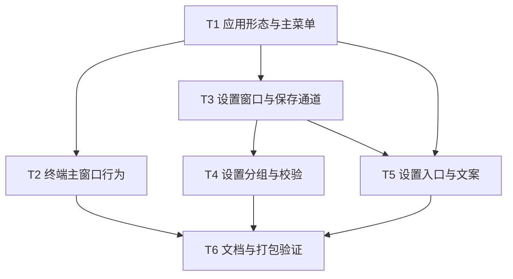

# Utility GUI 化重构实施计划

**目标：** 把 Utility 从纯菜单栏 accessory 应用改造成默认带 Dock 图标与主菜单的标准 macOS 应用，终端窗口作主窗口，并提供可视化设置窗口。
**背景：** 当前启动固定 `setActivationPolicy(.accessory)`，打包写死 `LSUIElement`，没有主菜单与设置界面；用户要求按 GUI 应用形态重构，旧计划已作废。
**架构：** 按 `app.hideDockIcon` 与主窗口是否活跃选择 regular / accessory（窗口关闭才隐藏 Dock 图标）；终端窗口复用为主窗口；设置窗口用 SwiftUI `Form` 承载在 `NSHostingController` 中，经 `ConfigManager.apply(_:)` 写回 `config.yaml`。
**技术栈：** Swift 5.9、macOS 14、AppKit、SwiftUI（仅设置窗口）、Yams、GRDB，不新增依赖与 target。
**计划状态：** 已批准，执行中
**依据：** 用户 2026-11-04 决议（作废旧计划、包含设置窗口）；现状代码见本文各任务 `file:line`。

本文回答一个问题：怎样在不重写剪贴板、翻译、知识、Stage 面板的前提下，让 Utility 具备正常 GUI 应用形态与可视化设置。

## 非目标

- 不重写现有 `NSPanel` 面板与 `PanelManager` 面板栈，四个功能面板行为保持不变。
- 不新增 Workspace 侧边栏主窗口；终端窗口继续承担主窗口职责，工作区改造见 `.agent/plans/2026-11-04-terminal-workspace/`，与本计划互不依赖。
- 不改 tmux 终端后端、会话存储与恢复。
- 不改 Python / agent-gateway 侧代码。
- 不改 CLI 分支（`Sources/App/main.swift:3-9`）。
- 不做多 SPM target 拆分，不新增测试 target。
- 设置窗口不覆盖 `ai`、`mcp`、`modelProxy`、`tasks`、`prompts`、`rss.feeds`、`knowledge.topics`，这些仍走配置编辑器。

## 全局约束

- 最低 macOS 14，沿用 `Package.swift` 单 `executableTarget`。
- 用户可见文案只走 `Sources/Resources/<lang>.json`，Swift 访问器由 `scripts/gen-l10n.py` 生成，禁止手改 `L10nKeys.swift`。
- 代码注释、日志、内部错误消息用英文；配置注释与 README 保持现有语言。
- 配置默认值三处一致：属性初值、`decodeIfPresent` 兜底、`default-config.yaml`。
- 热键只在启动时 `registerAllHotkeys()` 注册；设置窗口修改热键后必须提示重启。
- 面板零引用 `PanelManager`，跨模块只走 `EventBus`。
- 所有删除操作改为移动到废纸篓；本计划代码不包含删除用户文件。
- 未获用户明确批准，不提交、不打包、不部署。

## 复杂度追踪

无。

## 假设

- 假设 A1（最脆弱）：`.nonactivatingPanel` 面板在 regular 应用下仍能获取键盘输入。若不成立，回退 `app.hideDockIcon: true` 并追加面板激活时序任务，该任务不在本计划范围。
- 假设 A2：终端窗口足以作为主窗口，不新增独立主窗口。
- 假设 A3：设置窗口只覆盖常用配置项，其余仍通过现有配置编辑器修改。
- 假设 A4：用户接受设置保存后 `config.yaml` 注释丢失；保存前自动备份，窗口内提示。
- 假设 A5：`config.yaml` 缺少 `app` 段时按 `hideDockIcon=false`、`showTerminalOnLaunch=true` 处理。

## 取舍

| 决策 | 代价 | 什么证据会让我改主意 |
|---|---|---|
| 终端窗口作为主窗口 | 没有独立主界面；后续工作区改造要另做 | 用户要求侧边栏、多标签工作区或独立主窗口 |
| 运行时 `setActivationPolicy` 而不是只靠 Info.plist | `hideDockIcon=true` 时启动瞬间仍会闪现 Dock 图标 | 用户不接受闪现，需改为两个打包变体 |
| 设置窗口用 SwiftUI + `NSHostingController` | 引入 SwiftUI 生命周期，外观与 AppKit 面板不完全一致 | 出现窗口无法聚焦、崩溃或布局错乱 |
| 保存整份 `AppConfig` 重编码 | YAML 注释丢失、键顺序变化 | 用户要求保留注释，需改为逐行修补 |
| 设置项只覆盖常用分组 | 高级配置仍需打开配置文件 | 用户要求可视化编辑 MCP / 模型代理 |

## 交付分档

| 阶段 | 范围 | 交付标准 |
|---|---|---|
| MVP | T1-T2 | 默认 regular 启动、主菜单、终端主窗口可用，可独立验收 |
| 完整版 | T1-T6 | 设置窗口、保存与校验、入口、i18n、文档与打包验证全部通过 |
| 增强 | 后续 | 设置项扩展到 MCP / 模型代理；不在本次范围 |

## 存储与迁移

本计划只新增 `config.yaml` 的 `app` 段，不新增数据库表。

| 场景 | 行为 |
|---|---|
| 首次运行（无配置文件） | `writeDefault()` 编码 `AppConfig()`，自动写入 `app` 段与默认值 |
| 旧配置缺少 `app` 段 | 解码走 `decodeIfPresent` 兜底，不报错、不改写文件 |
| 配置解码失败 | 沿用现状：启动通知报错，内存使用默认配置，不覆盖原文件 |
| 旧版本程序写回 | 旧版本不识别 `app` 段，`save()` 重编码时会丢掉该段；升级后回到默认值 |
| 旧版本读到新数据 | 旧版本解码忽略未知 `app` 键，不影响启动；不会改写文件 |
| 配置含未知顶层键（如 `search`） | 保存时合并保留原值，不阻止写入；顶层以下不处理 |
| 设置保存前 | 原文件复制为 `config.yaml.bak`，覆盖同一文件，不删除任何文件 |
| 设置保存后需回滚 | 退出 Utility，执行 `cp ~/.config/utility/config.yaml.bak ~/.config/utility/config.yaml`，再启动 |

## 性能与资源预算

| 项 | 上限 | 超限行为 | 验收基线 |
|---|---|---|---|
| 设置窗口打开 | 300 ms（主线程） | 无重试；超过 1 s 记 `[Settings] open slow` 日志 | 冷启动后点设置入口，窗口 300 ms 内可见 |
| 配置保存 | 200 ms（文件 ≤ 1 MB） | 超过 1 MB 抛错、不写盘、窗口显示错误 | 默认配置保存一次，`config.yaml` 在 200 ms 内更新完成 |
| 配置文件大小 | 1 MB | 拒绝保存并提示 | 粘贴大于 1 MB 的内容到设置窗口不会写盘 |

## 文件结构

| 文件 | 动作 | 职责 |
|---|---|---|
| `Sources/Core/AppBehaviorConfig.swift` | 新建 | `app` 段配置类型与解码兜底 |
| `Sources/App/AppActivation.swift` | 新建 | 激活策略唯一入口与主窗口活跃状态 |
| `Sources/App/AppMainMenu.swift` | 新建 | 应用主菜单构建与语言切换重建 |
| `Sources/App/SettingsWindowController.swift` | 新建 | 设置窗口生命周期与单例入口 |
| `Sources/App/SettingsView.swift` | 新建 | 分组设置表单与操作按钮 |
| `Sources/App/SettingsModel.swift` | 新建 | 配置副本、校验、保存与状态提示 |
| `Sources/Core/ConfigTypes.swift` | 修改 | `AppConfig` 增加 `app` 段 |
| `Sources/Core/ConfigManager.swift` | 修改 | 新增 `apply(_:)`、备份与未知键合并 |
| `Sources/Core/HotkeyManager.swift` | 修改 | 暴露热键格式校验 |
| `Sources/App/AppDelegate.swift` | 修改 | 激活策略、主菜单、启动主窗口、Dock 唤起 |
| `Sources/Terminal/TerminalWindowController.swift` | 修改 | 可最小化；regular 下不自动恢复窗口 |
| `Sources/Core/MenuBarManager.swift` | 修改 | 菜单栏新增设置入口 |
| `scripts/package-utility.sh` | 修改 | 删除 `LSUIElement` |
| `Sources/Resources/default-config.yaml` | 修改 | 新增 `app` 段与注释 |
| `Sources/Resources/zh-Hans.json`、`en.json` | 修改 | 主菜单与设置文案 |
| `Sources/Core/L10nKeys.swift` | 生成 | 由 `gen-l10n.py` 生成，不手改 |
| `README.md`、`AGENTS.md`、`.claude/CLAUDE.md` | 修改 | 应用形态说明 |
| `.claude/docs/architecture/panel-ui.md` | 修改 | 激活策略、主窗口与设置窗口行为 |

## 依赖图

## 任务索引

详细步骤、接口与验收见同目录 `tasks.md`。

| 编号 | 标题 | 依赖 | 规模 |
|---|---|---|---|
| T1 | 应用形态、配置段与主菜单 | 无 | M |
| T2 | 终端主窗口与常规应用行为 | T1 | S |
| T3 | 设置窗口骨架与保存通道 | T1 | M |
| T4 | 设置分组与校验 | T3 | M |
| T5 | 设置入口与中英文案 | T1、T3 | S |
| T6 | 文档同步与打包验证 | T2、T4、T5 | S |

## 检查点

### 检查点 A（T1-T2 后）

- [ ] `swift build` 通过。
- [ ] 默认启动出现 Dock 图标、Cmd+Tab 入口与三组主菜单。
- [ ] 启动展示终端窗口；`Cmd+W` 后应用不退出，点 Dock 图标可恢复；`Cmd+H` 后 1.5 s 内窗口不自动出现。
- [ ] 菜单栏图标、全局热键、剪贴板/翻译/知识/Stage 面板行为不变。

### 检查点 B（T3-T5 后）

- [ ] 主菜单 `Cmd+,` 与菜单栏「设置…」打开同一个窗口实例。
- [ ] 修改终端字号并保存后，`config.yaml` 更新、`.bak` 存在且为新会话使用新字号。
- [ ] `hideDockIcon` 保存后即时生效，无需重启。
- [ ] 非法数值与未知顶层键被拒绝，`config.yaml` mtime 不变。
- [ ] `gen-l10n.py --check` 与 `check-l10n-contract.py` 通过。

### 检查点 C（T6 后）

- [ ] `bash scripts/run-tests.sh` 全过。
- [ ] 打包脚本成功，`.app` 的 `Info.plist` 无 `LSUIElement`。
- [ ] 三档证据按 L1 / L2 / L3 分别记录，未完成项单列。

## 未覆盖输入类

| 输入或条件 | 期望行为 | 对应任务 |
|---|---|---|
| `hideDockIcon=true` 时打开设置窗口 | 窗口可见，无 Dock 图标、无应用菜单栏 | T3 |
| tmux 未安装且启动主窗口 | 窗口显示缺失提示，不崩溃 | T2 |
| `config.yaml` 不可写 | 保存失败显示错误，内存配置不变 | T3 |
| 热键格式非法 | 保存被拒并提示具体字段，文件不变 | T4 |
| 配置文件含未知顶层键（如 `search`） | 合并保留该键后正常保存 | T3 |
| 语言切到 `en` | 主菜单、设置窗口与菜单栏入口即时刷新 | T5 |
| 配置文件缺少 `app` 段 | 使用默认值，启动不报错 | T1 |
| 连续两次打开设置窗口 | 复用同一实例，配置从磁盘重新加载 | T3 |

## 风险与回滚

| 风险 | 影响 | 缓解 | 回滚 |
|---|---|---|---|
| regular 下 nonactivating 面板收不到键盘输入 | 高 | 检查点 A 优先 L3 验证剪贴板与翻译面板 | 将 `~/.config/utility/config.yaml` 的 `app.hideDockIcon` 改为 `true` 并重启 |
| OCR 遮罩在 regular 下 ESC 拦截异常 | 中 | `panel-ui.md` 已记录该路径按 `LSUIElement` 设计；检查点 A 验证 OCR 选区退出 | 将 `app.hideDockIcon` 改为 `true` 并重启 |
| 设置保存丢失 YAML 注释与键顺序 | 中 | 保存前写 `config.yaml.bak`；未知顶层键合并保留 | `cp ~/.config/utility/config.yaml.bak ~/.config/utility/config.yaml` 后重启 |
| SwiftUI 与 AppKit 生命周期冲突 | 中 | 用 `NSHostingController`，不用 `Settings` scene | 删除 `SettingsView.swift` 的 SwiftUI 内容，改为纯 AppKit 表单（T3 接口不变） |
| `Cmd+H` 被终端窗口自动恢复逻辑抵消 | 中 | regular 下跳过 `scheduleRestoreCheck` | 将 `scheduleRestoreCheck` 的 guard 条件改为只判断 `wantsVisible` |
| 打包漏资源导致启动崩溃 | 高 | 沿用打包脚本硬失败校验 | 回退 `scripts/package-utility.sh` 并重打旧包 |
| 热键修改后不生效 | 低 | 设置窗口标注「修改后需重启」 | 重启应用 |
| `hideDockIcon=true` 启动瞬间闪现 Dock 图标 | 低 | 文档说明 | 用户改用默认 `false` |

## 开放问题

无。两处旧计划的 `NEEDS CLARIFICATION` 已由用户 2026-11-04 决议关闭：旧计划作废，设置窗口纳入本期。

## 批准记录

- 状态：已批准，执行中
- 批准人：用户
- 批准时间：2026-11-04
