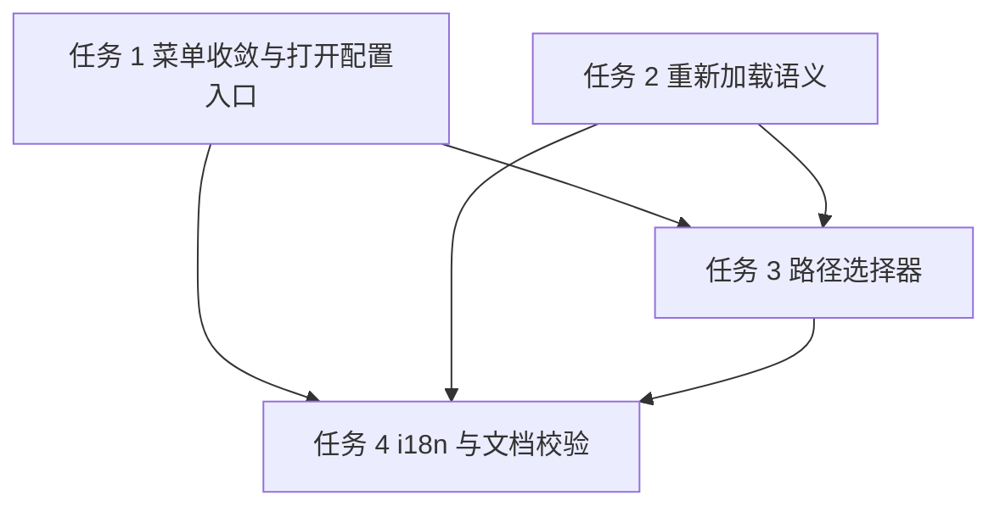

# 菜单与设置收敛实施计划

**目标：** 菜单栏只保留「设置」入口，把打开配置文件移进设置窗口，并让设置里的目录/文件字段可以选择路径。
**背景：** 当前菜单首三项是「重载配置」「设置」「打开配置」；设置窗口底部已有重新加载与保存，却没有打开配置文件的入口；终端工作目录与 Shell 只能手打。用户 2026-11-04 要求收敛入口并补选择器。
**架构：** 删除 `MenuBarManager.buildMenu` 里的重载与打开配置项，设置窗口新增「打开配置文件」按钮，经 `EventBus` 新增事件转给 `MenuBarManager` 复用现有 `ConfigEditorWindowController`；设置底部「重新加载」改为真正热重载；工作目录与 Shell 用 `NSOpenPanel` 选择。
**技术栈：** Swift 5.9、macOS 14、SwiftUI（设置窗口）、AppKit `NSOpenPanel`、Yams，不新增依赖。
**计划状态：** 待批准
**依据：** 用户 2026-11-04 需求与三项拍板（保留下拉语言、只留设置窗口重载按钮、选择器只覆盖现有界面字段）；现状代码见各任务 `file:line`；GUI 化前置计划见 `.agent/plans/2026-11-04-gui-refactor/plan.md`（已批准，状态执行中）。

## 非目标

- 不改语言控件样式：用户 2026-11-04 拍板保留现有下拉 `Picker`（`SettingsView.swift:22-29`）。
- 不把 `mcp.qdrantPath`、`mcp.knowledgeBasePath` 等未上界面的路径配置加进设置：用户拍板本次只覆盖现有字段。
- 不改热键注册时机；设置里改热键仍需重启（沿用 `settings.field_restart_hint`）。
- 不改配置编辑器本身的校验、保存、⌘↩ 行为。
- 不改 Python / agent-gateway 侧代码。
- 不删除 `Sources/Core/ConfigEditorWindowController.swift`，只改入口。

## 全局约束

- 用户可见文案只走 `Sources/Resources/<lang>.json`；`L10nKeys.swift` 由 `scripts/gen-l10n.py` 生成，禁止手改。
- 代码注释、日志、内部错误消息用英文。
- 配置默认值三处一致：属性初值、`decodeIfPresent` 兜底、`default-config.yaml`；本计划不改配置字段，不涉及。
- 跨模块通信走 `EventBus`，设置窗口禁止直接持有 `MenuBarManager` 或 `ConfigEditorWindowController`。
- 未获用户明确批准，不提交、不打包、不部署。

## 复杂度追踪

无。

## 假设

- 假设 A1：设置窗口底部「重新加载」按钮可以承担原菜单「重载配置」的职责，用户接受先重载再保存的流程。若不成立，改为在设置窗口单独加「应用磁盘配置」按钮。
- 假设 A2：`NSOpenPanel` 在 SwiftUI `.sheet`/普通窗口中用 `runModal()` 可直接工作，不需要额外 `NSViewController` 承载。
- 假设 A3：`terminal.shell` 选 `/bin` 或 `/usr/bin` 下的可执行文件；选择器不校验可执行位，启动失败沿用现有「终端启动失败」通知。
- 假设 A4：菜单删除后 `menu.reload_config`、`menu.open_config` 两个键仍可复用；「打开配置文件」按钮沿用 `menu.open_config` 文案，不新增同义键。

## 取舍

| 决策 | 代价 | 什么证据会让我改主意 |
|---|---|---|
| 菜单只留「设置」 | 原 `⌘R` 热重载快捷键消失；用户要先开设置 | 用户反馈重载太慢，要求恢复快捷键 |
| 设置「重新加载」改为真正热重载 | 行为从「只读回表单」变为「立即重建服务」，可能比预期重 | 重载触发 MCP/Proxy 重启造成中断，用户要求拆成两个按钮 |
| 打开配置编辑器经 `EventBus` 转发 | 多一次事件跳转与一处订阅生命周期 | 出现菜单未初始化时事件丢失 |
| 选择器只覆盖工作目录与 Shell | `mcp.*` 路径仍要手改配置 | 用户要求补齐其他路径配置 |
| 复用 `menu.open_config` 文案 | 键名带 `menu.` 前缀却用于设置 | 后续 i18n 清理要求按键分组迁移 |

## 交付分档

| 阶段 | 范围 | 交付标准 |
|---|---|---|
| MVP | T1-T2 | 菜单只剩设置；设置可打开配置文件；重新加载真正生效 |
| 完整版 | T1-T4 | 路径选择器、i18n、构建与脚本校验、README 同步全部完成 |
| 增强 | 后续 | 扩展更多路径配置、快捷键恢复；不阻塞本次验收 |

## 存储与迁移

本计划不改配置结构、不新增数据库表、不写新文件。

| 场景 | 行为 |
|---|---|
| 首次运行（无数据文件） | 不变，沿用 `ConfigManager.load()` 写默认配置 |
| 有旧格式数据 | 不涉及 |
| 数据文件解码失败 | 不变，沿用现有启动报错与内存默认值 |
| 旧版本程序写回 | 不涉及 |
| 旧版本读到新数据 | 不涉及 |

## 性能与资源预算

| 项 | 上限 | 超限行为 | 验收基线 |
|---|---|---|---|
| 设置窗口打开 | 1 s | 超过写 `debugLog("[Settings] open slow ...")`，已有实现 | 打开不卡主线程 |
| 重新加载配置 | 沿用 `ConfigManager.load()` 同步耗时 | 抛错时设置窗口显示失败文案，不改内存配置 | 失败后菜单与窗口仍可用 |
| 目录选择器 | 用户手动关闭即返回 | 取消时不改字段 | 取消后原值保持不变 |

## 文件结构

| 文件 | 动作 | 职责 |
|---|---|---|
| `Sources/Core/AppEvent.swift` | 修改 | 新增打开配置编辑器事件 |
| `Sources/Core/MenuBarManager.swift` | 修改 | 删除两个菜单项、订阅新事件、保留配置编辑器单实例 |
| `Sources/App/SettingsView.swift` | 修改 | 新增打开配置文件按钮、路径选择器、重新加载按钮改调新方法 |
| `Sources/App/SettingsModel.swift` | 修改 | 新增真正热重载方法 |
| `Sources/Resources/zh-Hans.json` | 修改 | 新增选择按钮与重载失败文案 |
| `Sources/Resources/en.json` | 修改 | 同步英文文案 |
| `Sources/Core/L10nKeys.swift` | 生成 | 由 `scripts/gen-l10n.py` 重新生成 |
| `README.md` | 修改 | 菜单说明与配置编辑段落同步 |
| `README.zh.md` | 修改 | 同上 |

## 依赖图

## 任务

### 任务 1：菜单只留设置，打开配置移进设置

**文件**

- 修改：`Sources/Core/MenuBarManager.swift:6-8,55-77,594-618,620-630`
- 修改：`Sources/Core/AppEvent.swift:11-16`
- 修改：`Sources/App/SettingsView.swift:139-148`

**接口**

- 消费：`EventBus.shared.publish(_ key: some Hashable, payload: Any? = nil)`
- 产出：`AppEvent.openConfigEditor`；`MenuBarManager` 订阅该事件后调用现有 `openConfigEditor()`，复用 `ConfigEditorWindowController` 单实例与 `finishConfigReload()` 回调

**验收**

- [ ] 状态栏菜单第一项为「设置」，其后直接是分隔线与「开机启动」，不再出现「重载配置」「打开配置」
- [ ] 设置窗口底部出现「打开配置文件」按钮，点击打开现有配置编辑器
- [ ] 配置编辑器保存后菜单标题与 RSS/Tasks 状态仍刷新（`finishConfigReload` 未失效）

**验证**

- 命令：`swift build`，随后 `grep -c "reloadConfig\|openConfigItem" Sources/Core/MenuBarManager.swift || true`
- 期望：构建成功；grep 计数为 `0`

**依赖 / 规模**：无 / S

- [ ] 步骤 1：在 `AppEvent` 增加 `case openConfigEditor`
- [ ] 步骤 2：`MenuBarManager` 删除 `reloadItem`、`openConfigItem` 属性及 `buildMenu` 中的创建与 add 调用；删除 `@objc reloadConfig()`（无入口后无调用者，`grep -rn "reloadConfig" Sources` 为空）
- [ ] 步骤 3：`refreshAllTitles()` 删除 `reloadItem.title`、`openConfigItem.title` 两行
- [ ] 步骤 4：`MenuBarManager` 初始化时订阅 `AppEvent.openConfigEditor`，回调内 `MainActor.assumeIsolated { self?.openConfigEditor() }`
- [ ] 步骤 5：`SettingsView` 按钮行增加 `Button(L10n.Menu.openConfig) { EventBus.shared.publish(AppEvent.openConfigEditor) }`
- [ ] 步骤 6：`swift build` 通过，等待用户手工验证

### 任务 2：设置「重新加载」改为真正热重载

**文件**

- 修改：`Sources/App/SettingsModel.swift:27-32`
- 修改：`Sources/App/SettingsView.swift:142`

**接口**

- 消费：`ConfigManager.shared.reload() throws`（内部 `load()` 发布 `configDidLoad`）
- 产出：`SettingsModel.reloadFromDisk() -> Void`，失败写入 `status = .failed(String)`

**验收**

- [ ] 设置窗口点「重新加载」后，磁盘上已修改的配置立即应用（MCP/Proxy 按现有 `configDidLoad` 逻辑处理），表单显示磁盘值
- [ ] 配置文件 YAML 非法时，设置窗口显示「重新加载失败：…」，内存配置保持原样

**验证**

- 命令：`swift build`
- 期望：构建成功

**依赖 / 规模**：任务 1 / XS

- [ ] 步骤 1：`SettingsModel` 新增 `reloadFromDisk()`，内部 `do { try ConfigManager.shared.reload(); config = ConfigManager.shared.config; status = .idle } catch { status = .failed(...) }`
- [ ] 步骤 2：`SettingsView` 的「重新加载」按钮改调 `model.reloadFromDisk()`
- [ ] 步骤 3：新增 `settings.reload_failed` 文案后 `swift build` 通过

### 任务 3：工作目录与 Shell 加路径选择器

**文件**

- 修改：`Sources/App/SettingsView.swift:112-116`

**接口**

- 消费：`model.config.terminal.workingDirectory`、`model.config.terminal.shell` 的 `Binding<String>`
- 产出：私有视图方法 `chooseDirectory(title:current:apply:)` 与 `chooseFile(title:current:apply:)`；均为 `@MainActor`，用 `NSOpenPanel`

**验收**

- [ ] 工作目录行有「选择…」按钮，只能选目录，选中后填入绝对路径
- [ ] Shell 行有「选择…」按钮，只能选文件，初始目录为当前 Shell 所在目录或 `/bin`
- [ ] 两个选择器点「取消」时字段原值不变

**验证**

- 命令：`swift build`
- 期望：构建成功；运行后手工点选目录与 `/bin/zsh`

**依赖 / 规模**：任务 1、任务 2 / S

- [ ] 步骤 1：在 `SettingsView` 增加 `chooseDirectory` / `chooseFile` 私有方法，`NSOpenPanel.runModal() == .OK` 时才写回 `Binding`
- [ ] 步骤 2：`workingDirectory` 的 `TextField` 改为 `HStack { TextField; Button(L10n.Settings.choose) { chooseDirectory(...) } }`
- [ ] 步骤 3：`shell` 同样改为 `HStack`，按钮调 `chooseFile`，`directoryURL` 取 `(current as NSString).deletingLastPathComponent`，为空时用 `/bin`
- [ ] 步骤 4：`swift build` 通过，等待用户手工验证

### 任务 4：i18n、生成脚本与文档同步

**文件**

- 修改：`Sources/Resources/zh-Hans.json:20-21,213-252`
- 修改：`Sources/Resources/en.json:20-21`
- 生成：`Sources/Core/L10nKeys.swift`
- 修改：`README.md:329-330,677`
- 修改：`README.zh.md:284-285,629`

**接口**

- 消费：`python3 scripts/gen-l10n.py` 读取 JSON 生成访问器
- 产出：`L10n.Settings.choose`、`L10n.Settings.reloadFailed(message:)`

**验收**

- [ ] `zh-Hans.json` 与 `en.json` 键集合一致，新增 `settings.choose`、`settings.reload_failed`
- [ ] `scripts/gen-l10n.py --check` 与 `scripts/check-l10n-contract.py` 均通过
- [ ] 两份 README 的菜单图只保留「设置」，配置编辑段落改为「设置 → 打开配置文件」

**验证**

- 命令：`python3 scripts/gen-l10n.py && python3 scripts/gen-l10n.py --check && python3 scripts/check-l10n-contract.py`
- 期望：生成成功，两个检查退出码为 0

**依赖 / 规模**：任务 1、任务 2、任务 3 / S

- [ ] 步骤 1：两份 JSON 同时新增 `settings.choose`（中文「选择…」/ 英文 `Choose…`）与 `settings.reload_failed`（中文「重新加载失败：{message}」/ 英文 `Reload failed: {message}`）
- [ ] 步骤 2：运行 `python3 scripts/gen-l10n.py` 重新生成 `L10nKeys.swift`
- [ ] 步骤 3：运行两个检查脚本，失败则先修 JSON 再重跑
- [ ] 步骤 4：更新 `README.md` 与 `README.zh.md` 的菜单图与配置编辑说明，删除 `⌘R` 重载描述
- [ ] 步骤 5：`swift build` 通过，交给用户手工验证，不提交

## 检查点

### 检查点 A（任务 1-2 后）

- [ ] `swift build` 成功
- [ ] 状态栏菜单只剩「设置」一个配置入口
- [ ] 设置窗口能打开配置编辑器；「重新加载」能在外部改配置后生效

### 检查点 B（任务 3-4 后）

- [ ] 目录与文件选择器可用，取消不改值
- [ ] `gen-l10n.py --check`、`check-l10n-contract.py` 退出码为 0
- [ ] README 两份与界面一致

## 未覆盖输入类

| 输入或条件 | 期望行为 | 对应测试任务 |
|---|---|---|
| 工作目录选择器选中不存在的路径 | 无法发生：`NSOpenPanel` 只返回已存在路径；手打非法路径仍走 `TerminalShell.resolvedWorkingDirectory` 回退家目录 | 无（现有行为） |
| Shell 选择器选中非可执行文件 | 允许保存；新建终端时启动失败并弹通知 | 任务 3 手工验证 |
| 配置文件 YAML 非法时点重新加载 | 显示失败文案，内存配置不变 | 任务 2 |
| 配置编辑器保存失败 | 沿用现有校验弹窗，菜单不刷新 | 任务 1 |

## 风险与回滚

| 风险 | 影响 | 缓解 | 回滚 |
|---|---|---|---|
| 删除菜单项后 `refreshAllTitles` 残留引用 | 编译失败 | 任务 1 步骤 3 同步删除；`swift build` 兜底 | `git checkout -- Sources/Core/MenuBarManager.swift` |
| 「重新加载」语义变化让用户误以为会写回文件 | 中 | 按钮文案不变，失败文案明确；README 写明「重载磁盘配置」 | 恢复 `SettingsModel.reload()` 只读表单调用 |
| 设置窗口打开编辑器时 `MenuBarManager` 尚未初始化 | 事件无人接收，按钮无反应 | `MenuBarManager` 在 `MenuBar.shared` 单例初始化时即订阅；设置窗口由同一入口创建 | 改为设置窗口直接持有编辑器实例 |
| i18n 键删除与代码不同步 | 启动缺键日志或检查脚本失败 | 任务 4 保留 `menu.open_config` 键，只新增不改名 | 还原两份 JSON 与 `L10nKeys.swift` 重新生成 |
| NSOpenPanel 在 SwiftUI 视图内阻塞 | 界面短暂无响应 | 选择器为模态、用户主动触发，可接受 | 改为 `.fileImporter` |

## 开放问题

- 无。三项拍板已在规划期确认。

## 批准记录

- 状态：待批准
- 批准人：
- 批准时间：
