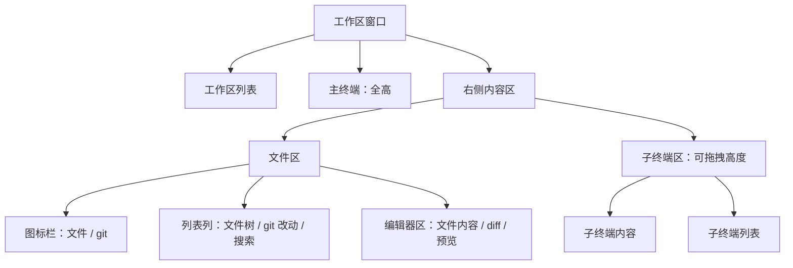
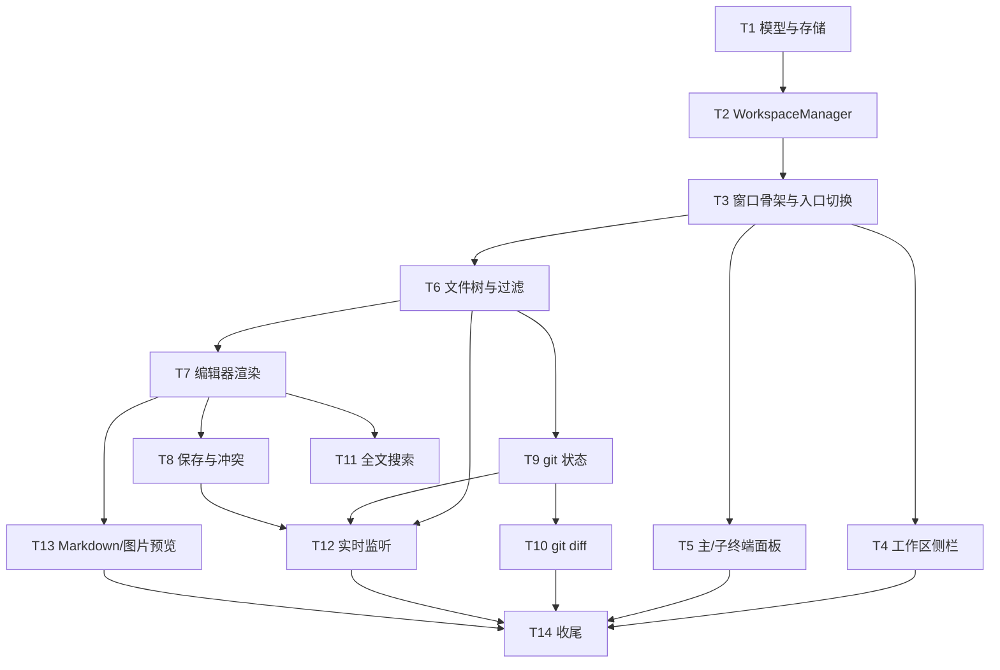

# 终端改造为工作区实施计划

**目标：** 把终端窗口升级为 VS Code 形态的工作区窗口：左侧工作区列表、中部主终端、右侧文件与 git 面板、右下多子终端，全部围绕当前工作区文件夹。
**架构：** 保留 tmux 单一后端与 SwiftTerm 视图；新增工作区模型、存储、会话编排与五区窗口；文件树、编辑器、git、搜索全部用 AppKit 与现有 `TerminalShell.run` 实现，不新增 SPM 依赖。
**技术栈：** Swift 5.9、macOS 14、AppKit、SwiftTerm 1.99+、Yams、GRDB。
**计划状态：** 已作废（2026-11-05 用户拍板；由 `.agent/plans/2026-11-05-terminal-workspace/` 取代）
**依据：** 用户 2026-11-04 需求与布局图（工作区列表 | 主终端 | 图标栏 | 文件/diff 列表 | 内容区，右下子终端区 + 子终端列表）；前置计划 `.claude/plans/2026-11-04-gui-refactor/tasks.md`。

## 前置条件

- 用户选择 GUI 重构优先：`2026-11-04-gui-refactor` 的 64 个任务全部完成并验收后，才开始执行本计划。
- 执行前核对 `git status` 与 GUI 计划；`AppDelegate.swift`、`MenuBarManager.swift`、`Sources/Terminal/*` 出现计划外改动时先停下重排任务。
- 本计划不修改 GUI 重构计划文件，两者无目录重叠。

## 非目标

- 不做语法高亮，文件编辑器为纯文本 + 行号（用户 2026-11-04 定）。
- 不做 git 写操作，不提供 add / restore / commit（用户 2026-11-04 定）。
- 不做每工作区独立窗口、不做多根工作区（用户布局图隐含单窗口多工作区）。
- 不做 HTML 预览与 PDF 预览；Markdown 与常见位图（png/jpg/jpeg/gif/tiff/heic/webp）纳入本期（用户 2026-11-04 定）。
- 不做标签页式编辑器，右侧只有一个编辑器区（布局图）。
- 不做远程 / SSH 工作区、不做 Docker 工作区（本计划自定）。
- 不改 tmux 后端协议、不改 SwiftTerm 依赖版本（现有终端文档约束）。

## 全局约束

- macOS 14 下限，沿用单 `executableTarget`，不新增 target 与 SPM 依赖。
- 用户可见文案只走 `Sources/Resources/<lang>.json`；`L10nKeys.swift` 由 `scripts/gen-l10n.py` 生成，禁止手改；占位符只用 `{name}` / `{name:d}`。
- 代码注释、日志、内部错误消息用英文；配置注释与 README 保持项目既有语言。
- 配置默认值三处一致：属性初值、`init(from:)` 的 `decodeIfPresent` 兜底、`default-config.yaml`。
- 所有文件删除一律移动到废纸篓；本期只在用户移除工作区时删除配置条目，不删除用户磁盘文件。
- 未经用户明确允许不提交、不推送。
- 文件操作使用绝对路径；关键路径从 `AppPaths.configDir` 派生，不硬编码个人目录。
- 证据分级：L1 构建/符号、L2 日志/CLI 断言、L3 真实窗口交互。每个任务验收标注级别，未达 L3 的列出待验项。

## 复杂度追踪

无。

## 假设

- A1（最脆弱）：GUI 重构计划完成后，`AppDelegate` 以常规应用形态启动并复用终端窗口；本计划在其窗口上扩展布局。若 GUI 计划未完成，本计划只落盘不执行。
- A2：工作区路径是本机可读写的普通目录，不做网络卷与权限提升。
- A3：文件编辑器只处理 UTF-8（含 BOM）；其他编码只读并提示。用户未提出多编码需求。
- A4：tmux 会话 detach 后继续存活，`utility-term-<id>` 命名与恢复语义不变。
- A5：工作区会话总数沿用 `terminal.maxSessions`（默认 20）限制，主终端每个工作区固定 1 个。
- A6：全文搜索按大小写不敏感、固定上限 500 行结果，超出显示截断提示。
- A7：图片预览上限 20MB，超过显示只读提示；SVG 按文本文件处理，不做图片预览。

## 现状证据

| 事实 | 位置 |
|---|---|
| 终端窗口为单会话侧栏 + 终端容器 | `Sources/Terminal/TerminalWindowController.swift:129-233` |
| 会话由 `TerminalManager` 单例管理，窗口用回调闭包通信 | `Sources/Terminal/TerminalManager.swift:4-79` |
| 会话元数据存 `terminal-sessions.json`，`backend` 字段必须继续写 | `Sources/Terminal/TerminalSessionStore.swift:3-27` |
| tmux 唯一后端，`prepare` / `launch` / `currentPaths` / `liveIDs` 可直接复用 | `Sources/Terminal/TerminalBackend.swift:120-195` |
| 终端配置段与默认值 | `Sources/Core/ConfigTypes.swift:85-111`、`Sources/Resources/default-config.yaml:338-348` |
| 窗口入口调用点 | `Sources/App/AppDelegate.swift:77`、`AppDelegate.swift:229`、`Sources/Core/MenuBarManager.swift:154` |
| 深色主题色板已覆盖编辑器与终端 | `Sources/Core/Styles/VSTheme.swift:4-35` |
| 配置编辑器已有可见行高亮调度模式可参考 | `Sources/Core/ConfigEditorWindowController.swift:224-290` |
| CLI 子命令注册位置 | `Sources/CLI/UtilityCLI.swift:11-19` |
| 中文终端文案 | `Sources/Resources/zh-Hans.json:77-87` |

## 布局

窗口从左到右分为工作区列表、主终端、右侧内容区；右侧内容区再上下分为文件区与子终端区。



- 顶层 `NSSplitView(vertical)`：侧栏 | 主终端 | 右侧内容区。
- 右侧内容区 `NSSplitView(vertical)`：文件区（上）| 子终端区（下），下方面板高度可拖拽。
- 文件区 `NSSplitView(horizontal)`：图标栏（44pt）| 列表列（240pt）| 编辑器区（flex）。
- 子终端区 `NSSplitView(horizontal)`：终端内容（flex）| 子终端列表（180pt）。
- 所有分隔条可拖拽；尺寸按工作区保存到 `workspaces.json`。

## 数据模型

```swift
struct WorkspaceLayout: Codable, Equatable {
    var sidebarWidth: CGFloat = 220
    var rightPaneWidth: CGFloat = 560
    var fileListWidth: CGFloat = 240
    var subTerminalHeight: CGFloat = 260
    var subListWidth: CGFloat = 180
}

struct Workspace: Codable, Equatable, Identifiable {
    let id: String
    var name: String
    let path: String
    var mainSessionID: String
    var subSessionIDs: [String]
    var selectedSubSessionID: String?
    var layout: WorkspaceLayout
    let createdAt: Date
}
```

- `workspaces.json` 存 `[Workspace]`，原子写、ISO8601 日期、`.sortedKeys`。
- `terminal-sessions.json` 的 `StoredTerminalSession` 增加可选 `workspaceID: String?` 与 `role: String?`（`main` / `sub`）；旧版解码忽略未知键，`backend` 继续写。
- 迁移：`workspaces.json` 不存在时，把 `terminal-sessions.json` 按 `cwd` 精确分组，每组建一个工作区；组内 `createdAt` 最早者为主终端，其余为子终端；迁移前把 `terminal-sessions.json` 复制为 `terminal-sessions.json.bak`，旧文件保留不删。

## 文件结构

| 文件 | 动作 | 职责 |
|---|---|---|
| `Sources/Workspace/Workspace.swift` | 新建 | `Workspace`、`WorkspaceLayout`、会话角色枚举、迁移分组纯函数 |
| `Sources/Workspace/WorkspaceStore.swift` | 新建 | `workspaces.json` 读写与迁移备份 |
| `Sources/Workspace/WorkspaceManager.swift` | 新建 | 工作区 CRUD、主/子会话编排、恢复、通知、路径轮询 |
| `Sources/Workspace/WorkspaceWindowController.swift` | 新建 | 五区布局、分隔条尺寸、窗口生命周期、未保存提示 |
| `Sources/Workspace/WorkspaceSidebarView.swift` | 新建 | 工作区列表、新建/重命名/移除入口、路径缺失标记 |
| `Sources/Workspace/SubTerminalPane.swift` | 新建 | 子终端内容容器 + 竖向会话列表 |
| `Sources/Workspace/FileTreeModel.swift` | 新建 | 懒加载文件树、忽略规则、名称过滤 |
| `Sources/Workspace/FileExplorerPane.swift` | 新建 | 图标栏、列表列（文件树 / git / 搜索）、刷新入口 |
| `Sources/Workspace/FileEditorPane.swift` | 新建 | 编辑器区宿主、文件内容与 diff 切换、未保存标记 |
| `Sources/Workspace/LineNumberRulerView.swift` | 新建 | `NSRulerView` 行号绘制 |
| `Sources/Workspace/FileDocument.swift` | 新建 | 读取、编码判定、脏标记、保存冲突检测 |
| `Sources/Workspace/GitService.swift` | 新建 | 只读 `git status` / `git diff` 解析 |
| `Sources/Workspace/WorkspaceSearchService.swift` | 新建 | 全文搜索遍历与结果模型 |
| `Sources/Workspace/WorkspaceFileWatcher.swift` | 新建 | FSEvents 监听、去抖、忽略路径过滤 |
| `Sources/Workspace/FilePreviewView.swift` | 新建 | Markdown `WKWebView` 预览与位图 `NSImageView` 预览 |
| `Sources/Terminal/TerminalManager.swift` | 移废纸篓 | 由 `WorkspaceManager` 取代 |
| `Sources/Terminal/TerminalWindowController.swift` | 移废纸篓 | 由 `WorkspaceWindowController` 取代 |
| `Sources/Terminal/TerminalSessionStore.swift` | 修改 | 增加 `workspaceID` / `role` 可选字段 |
| `Sources/Core/ConfigTypes.swift` | 修改 | 增加 `WorkspaceConfig` 与 `app.workspace` 解码 |
| `Sources/Resources/default-config.yaml` | 修改 | 新增 `workspace` 段 |
| `Sources/CLI/WorkspaceCheckCommand.swift` | 新建 | 只读诊断：工作区摘要与迁移 dry-run |
| `Sources/CLI/UtilityCLI.swift` | 修改 | 注册 `workspace-check` 子命令 |
| `Sources/App/AppDelegate.swift` | 修改 | 入口改为 `WorkspaceManager.shared` |
| `Sources/Core/MenuBarManager.swift` | 修改 | 菜单入口改为 `WorkspaceManager.shared` |
| `Sources/Resources/zh-Hans.json`、`en.json` | 修改 | 工作区、文件、git、搜索、冲突文案 |
| `Sources/Core/L10nKeys.swift` | 生成 | 运行 `gen-l10n.py` |
| `.claude/docs/architecture/terminal.md` | 修改 | 工作区布局、存储、监听、编辑器约束 |
| `AGENTS.md`、`.claude/CLAUDE.md` | 修改 | 模块表与不变量 |
| `README.md`、`README.zh.md` | 修改 | 功能说明 |

## 依赖图



## 任务索引

任务细节、接口、步骤与验证命令见同目录 `tasks.md`。

| 编号 | 任务 | 依赖 | 规模 |
|---|---|---|---|
| T1 | 工作区模型、配置、存储与迁移 | 无 | S |
| T2 | `WorkspaceManager` 会话编排与恢复 | T1 | M |
| T3 | 工作区窗口骨架与入口切换 | T2 | M |
| T4 | 工作区侧栏交互 | T3 | S |
| T5 | 主终端与子终端面板 | T3 | M |
| T6 | 文件树、名称过滤与列表列 | T3 | M |
| T7 | 文件编辑器渲染 | T6 | M |
| T8 | 编辑保存、未保存提示与冲突 | T7 | M |
| T9 | git 状态列表 | T6 | S |
| T10 | git diff 查看 | T9 | S |
| T11 | 工作区全文搜索 | T7 | M |
| T12 | 实时监听与刷新 | T6、T8、T9 | M |
| T13 | Markdown 与图片预览 | T7 | M |
| T14 | i18n、文档、打包与回归 | T4、T5、T10、T12、T13 | S |

## 检查点

- 检查点 A（T1-T3）：构建通过；工作区窗口显示侧栏 + 主终端；重启后工作区与会话恢复；`workspace-check` 输出正确迁移结果。
- 检查点 B（T4-T5）：工作区新建/重命名/移除可用；主终端与多个子终端默认 cwd 为工作区路径；底部面板可拖拽。
- 检查点 C（T6-T8）：文件树懒加载与名称过滤；编辑器可改可存；未保存切换弹提示；外部修改冲突提示。
- 检查点 D（T9-T10）：git 改动列表分组正确；点击文件显示着色 diff；非 git 目录为空状态。
- 检查点 E（T11-T12）：全文搜索结果可点击定位；外部改文件后文件树与 git 列表自动刷新。
- 检查点 F（T13）：Markdown 预览与源码切换；位图正确显示；超大图片显示提示。
- 检查点 G（T14）：l10n 契约、构建、打包、真实窗口回归全部通过。

## 未覆盖输入类

| 输入或条件 | 期望行为 | 对应任务 |
|---|---|---|
| 工作区路径被删除或改名 | 侧栏标红，打开时提示，不自动移除 | T4 |
| 非 git 目录 | git 面板显示空状态，文件树照常 | T9 |
| 空目录 | 文件树显示空状态 | T6 |
| 二进制文件 | 编辑器显示只读提示，不渲染乱码 | T7 |
| 大于 `maxFileSizeMB` 的文件 | 只读提示，不加载 | T7 |
| 非 UTF-8 文本 | 只读并提示编码不支持 | T7 |
| Markdown 文件 | 默认预览，可切换源码编辑 | T13 |
| 位图文件 | 图片预览，不进入文本编辑器 | T13 |
| 损坏图片或超过 20MB 的图片 | 显示加载失败或大小提示 | T13 |
| 外部修改且编辑器有未保存内容 | 保存时弹覆盖 / 重新加载 / 取消 | T8 |
| 外部修改且编辑器无改动 | 自动重载 | T12 |
| 同名文件夹的两个工作区 | 允许，按 id 区分，名称可重命名 | T4 |
| 搜索关键词为空或超长 | 空关键词不执行；超长按普通字符串处理 | T11 |
| 搜索结果超过 500 行 | 截断并显示提示 | T11 |
| tmux 未安装 | 工作区窗口仍打开，终端显示缺失提示 | T3 |
| 删除当前选中的工作区 | 确认后结束会话，选中相邻工作区 | T4 |
| 终端进程崩溃退出 | 会话从列表移除，主终端自动重建 | T2 |

## 风险与回滚

| 风险 | 影响 | 缓解 | 回滚 |
|---|---|---|---|
| 多层 `NSSplitView` 切换工作区时尺寸抖动 | 中 | 固定 holdingPriority，切换后 async 应用尺寸；视图常驻只换容器 | 保留旧窗口文件直到 T3 验收通过；回退为单终端窗口 |
| 旧会话迁移分组错误导致会话丢失 | 高 | 迁移前备份 `.bak`；`workspace-check` dry-run；旧 json 不删 | 删除 `workspaces.json`，用 `.bak` 恢复后重启 |
| git / 文件读取阻塞主线程 | 高 | 全部走后台队列，主线程只回填 UI | 单任务回退，不影响已交付视图 |
| FSEvents 被构建产物刷屏 | 中 | 忽略路径前缀过滤 + 0.5s 去抖 + 标记自身写入 | 关闭监听（T12 可独立回退） |
| 与 GUI 重构计划漂移 | 高 | 执行前核对两份计划与 `git status` | 暂停执行，先合并 GUI 计划变更 |
| 编辑器大文件占用内存 | 中 | 5MB 上限、二进制检测、diff 5000 行截断 | 降低上限配置项 |
| Markdown 预览加载外部资源或脚本 | 中 | 复用内嵌 `marked.umd.js`，禁止网络请求，链接交系统打开 | 退回源码编辑模式 |
| 大图加载占用内存 | 中 | 20MB 上限，超过只提示不加载 | 降低预览上限 |

## 开放问题

无。布局、编辑能力、保存策略、高亮范围、git 范围、搜索、刷新、删除语义均已在规划期确认。

## 批准记录

- 状态：待批准
- 批准人：
- 批准时间：
