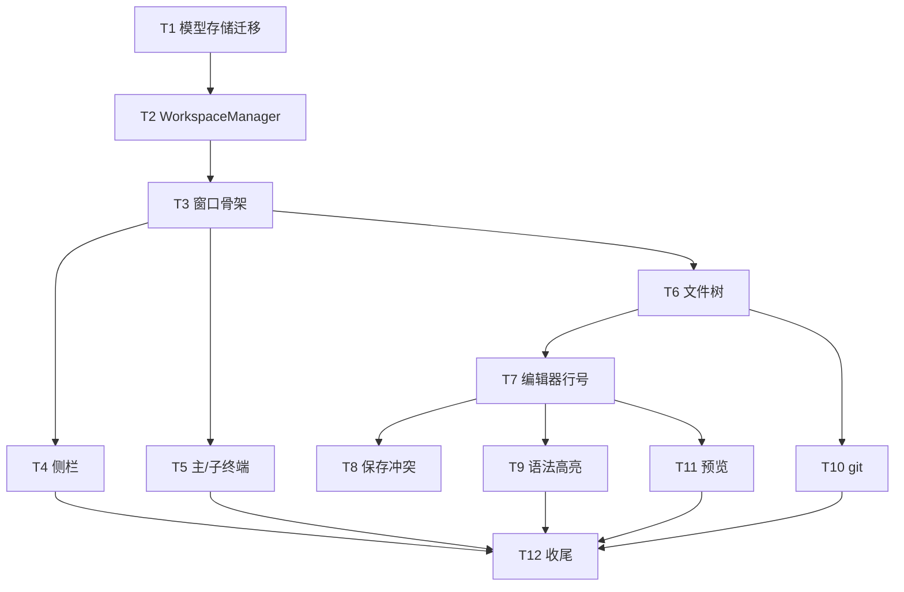

# 终端改造为工作区实施计划

**目标：** 把终端窗口改造成 VS Code 形态的工作区窗口：左侧工作区列表、中部主终端、右侧文件/git 面板与内容区、底部多子终端，全部围绕当前工作区目录。
**背景：** 现状是「220pt 会话侧栏 + 单终端容器」的固定布局（`Sources/Terminal/TerminalWindowController.swift:134-232`），会话平铺、没有工作区概念，文件与 git 必须切到其他应用。GUI 化重构（Dock、主菜单、设置窗口）已于 2026-11-04 落地（`Sources/App/AppDelegate.swift:31-32`、`Sources/App/AppActivation.swift:15-22`），本计划在其之上继续。
**架构：** 新增 `Sources/Workspace/`：`WorkspaceStore` 维护 `workspaces.json` 真源，`WorkspaceManager` 接管会话编排与 tmux 生命周期，`WorkspaceWindowController` 用四层 `NSSplitView` 组装五区。文件树、编辑器、高亮、git、预览都围绕当前工作区路径，耗时操作全部离开主线程。
**技术栈：** Swift 5.9、macOS 14、AppKit、SwiftTerm 1.99+、Yams、GRDB，不新增 SPM 依赖与 target。
**计划状态：** 已批准，执行中（T1-T8 完成）
**依据：** 用户 2026-11-05 三项拍板（旧计划作废、范围 T1-T12、不等 GUI 验收）；合并方案 `~/.claude/plans/synthetic-puzzling-lemon.md`；终端约束 `.claude/docs/architecture/terminal.md`；现状代码 `file:line` 见各任务。

## 非目标

- 不做 git 写操作（add / restore / commit / push）——用户 2026-11-04 定。
- 不做每工作区独立窗口、多根工作区——用户布局图（单窗口多工作区）决定。
- 不做标签页式编辑器，右侧只有一个编辑器区——用户布局图决定。
- 不做 HTML / PDF 预览——用户 2026-11-04 定，仅 Markdown 与常见位图。
- 不改 tmux 后端协议、不改 SwiftTerm 依赖版本——`terminal.md:6` 与现有依赖决定。
- 全文搜索列入增强档；FSEvents 自动刷新已于 2026-11-05 按用户要求补做。
- 不动 Python / agent-gateway 侧代码——仓边界，见 `CLAUDE.md`「未来规划」。

## 全局约束

- macOS 14 下限，单 `executableTarget`，不新增依赖（`Package.swift:13-26`）。
- 用户可见文案只走 `Sources/Resources/<lang>.json`；`L10nKeys.swift` 由 `scripts/gen-l10n.py` 生成，禁止手改；占位符只用 `{name}` / `{name:d}` / `{name:.Nf}`。
- 配置默认值三处一致：属性初值、`init(from:)` 的 `decodeIfPresent` 兜底、`default-config.yaml`。
- 热键只在启动时 `registerAllHotkeys()` 注册，本计划不新增热键。
- 主线程不做文件枚举、git、图片解码；后台完成后只回主线程更新 UI。
- 所有删除操作移到废纸篓；本计划不删除用户文件。
- 未获明确批准，不提交、不打包、不部署。
- 证据分级按 TST-07：L1 存在性、L2 脚本或日志断言、L3 真实交互。

## 复杂度追踪

无。

## 假设

- A1（最脆弱）：切换工作区时重建 tmux 客户端不会丢失输出与通知。tmux 会话保活，OSC 由 pane 产生，客户端重连后继续转发（`terminal.md:9`、`terminal.md:23`）。若不成立（重连丢历史或通知），改为全部工作区视图常驻；代价是 WindowServer 抬升，需按 T5 的对照数据重新评估。
- A2：GUI 化已落地的窗口生命周期（关闭只隐藏、`AppActivation` 切 Dock 图标、accessory 模式失焦兜底）可以原样搬到新窗口控制器（`TerminalWindowController.swift:19-55`、`248-311`）。若不成立，暂留旧控制器并行，先修生命周期再移除。
- A3：四层 `NSSplitView` 在 1120×680 最小尺寸内仍可用。若不成立，把文件区与子终端区合并为可切换的单栏。

## 取舍

| 决策 | 代价 | 什么证据会让我改主意 |
|---|---|---|
| 只挂载当前工作区 | 后台工作区不产生 OSC 通知；切换时重新 attach 有首帧开销 | 用户要求后台工作区也弹通知；或 attach 出现明显闪烁 |
| `workspaces.json` 为真源 + 旧文件双写 | 两份数据需要保持一致 | 旧版兼容期结束；或双写出现归属错乱 |
| 全局一份 `WindowLayout` | 切换工作区时分割条位置相同 | 用户要求每个工作区独立布局 |
| 自研语法高亮（正则 + 关键字表） | 不如 TextMate 语法完整 | 用户要求完整主题或语法覆盖 |
| git 只读 | 不能提交 | 用户明确要求提交能力 |
| 纯 AppKit 编辑器 | 无 LSP、补全、跳转 | 用户要求补全或跳转 |
| 崩溃草稿存缓存，不用系统自动保存 | 多一份明文副本，需自管淘汰 | 用户不希望磁盘出现未提交内容副本（2026-11-05 定） |
| 外部改动检查放在激活、切换、保存前，不挂 FSEvents | 提示延迟到下一次激活或保存 | 用户要求实时提示 |

## 交付分档

| 阶段 | 范围 | 交付标准 |
|---|---|---|
| MVP | T1-T5 | 选目录建工作区；主/子终端 cwd 正确；底部可拖；重启恢复 |
| 完整版 | T1-T12 | 文件树、编辑、行号、高亮、保存冲突、外部改动检测、崩溃草稿恢复、git、Markdown/图片预览全部可用 |
| 增强 | 后续 | 全文搜索、diff 行号、更多语言、工作区排序 |

## 存储与迁移

| 场景 | 行为 |
|---|---|
| 首次运行（无 `workspaces.json`、无旧会话） | 空文档；首次新建工作区时落盘 |
| 无 `workspaces.json`、有旧会话 | 先 `cp terminal-sessions.json terminal-sessions.json.bak`，按标准化 `cwd` 分组，组内最早 `createdAt` 为主终端，其余为子终端 |
| `workspaces.json` 解码失败 | 原文件改名为 `workspaces.json.corrupt-<timestamp>`，从 `terminal-sessions.json` 重建，记录 `[Workspace] rebuild reason=corrupt` |
| 旧版本程序写回 | 旧版只读 `terminal-sessions.json` 数组，忽略未知键，但写回会丢 `workspaceID` / `role`；新版启动按会话 id 先归属，找不到 id 的按 `cwd` 归入已有工作区或新建 |
| 旧版本读到新数据 | 旧版完全不读 `workspaces.json`；`terminal-sessions.json` 仍是数组且 `backend: "tmux"` 保留，旧版能恢复全部会话，只丢失工作区分组。降级步骤：退出 App → `mv ~/.config/utility/workspaces.json ~/.Trash/` → 用旧版启动；恢复步骤：从废纸篓移回并用新版启动 |
| 用户删除 `workspaces.json` | 下次启动按迁移规则从 `terminal-sessions.json` 重建；`.bak` 只在首次迁移前写一次，不覆盖 |
| 编辑器崩溃（`kill -9`、断电） | 重启扫描 `~/.cache/utility/editor-drafts/`，按原文件 fingerprint 比对，弹「恢复 / 丢弃 / 对比」；不自动写回原文件 |
| 草稿文件损坏 | 解码失败的草稿改名 `.corrupt-<timestamp>`，不影响其他草稿与正常编辑 |

## 性能与资源预算

| 项 | 上限 | 超限行为 | 验收基线 |
|---|---|---|---|
| 编辑器加载 | 5 MB 或 2 万行 | 只读提示，不加载 | 超限文件不阻塞主线程 |
| 语法高亮 | 1 MB 或 2 万行 | 关闭高亮，保留纯文本 | 可见 300 行着色 ≤8ms，输入延迟 <50ms |
| 单行高亮 | 2000 字符 | 该行跳过着色 | 不触发整文件重算 |
| 图片预览 | 20 MB | 提示不加载 | 后台解码，主线程不卡顿 |
| git status | 5 秒 / 2 MB | 终止进程并提示 | 大仓库窗口仍可操作 |
| git diff | 10 秒 / 2 MB / 5000 行 | 截断并提示 | 同上 |
| 目录枚举 | 单目录 2000 条 | 只显示前 2000 条并提示 | 后台加载，展开不卡顿 |
| 子终端数量 | `terminal.maxSessions`（默认 20） | 拒绝创建并通知一次 | 与现有行为一致（`TerminalManager.swift:88-94`） |
| 布局写盘去抖 | 300ms | 连续拖动只写一次 | 拖动结束落盘 |
| git 刷新去抖 | 400ms | 连续变化只刷新一次 | 结果哈希不变不重绘 |
| 高亮去抖 | 编辑 100ms、滚动 50ms | 合并多次触发 | 输入法 `hasMarkedText` 时跳过 |
| 草稿快照 | 脏缓冲 2 秒去抖；20 份 / 50 MB | 超限按最后修改时间淘汰最旧 | 保存或丢弃后草稿立即删除 |
| 外部改动检查 | 窗口激活、切换文件、保存前各一次 stat | 指纹变化才在后台重算哈希 | 5 MB 文件保存前哈希不阻塞输入 |
| 路径轮询 | 2 秒 | 沿用现有定时器 | 窗口不可见时轮询跳过（`TerminalManager.swift:301`） |

## 文件结构

| 文件 | 动作 | 职责 |
|---|---|---|
| `Sources/Workspace/WorkspaceModel.swift` | 新建 | 文档、工作区、布局、角色模型与纯函数迁移 |
| `Sources/Workspace/WorkspaceStore.swift` | 新建 | `workspaces.json` 读写、备份、损坏隔离 |
| `Sources/Workspace/WorkspaceMigration.swift` | 新建 | 旧会话 → 工作区文档的纯函数 |
| `Sources/Workspace/WorkspaceManager.swift` | 新建 | 会话编排、tmux 生命周期、持久化、恢复 |
| `Sources/Workspace/WorkspaceWindowController.swift` | 新建 | 工作区窗口、布局应用、生命周期 |
| `Sources/Workspace/WorkspaceSplitView.swift` | 新建 | 分割条颜色与最小尺寸约束 |
| `Sources/Workspace/WorkspaceSidebarView.swift` | 新建 | 工作区列表与 CRUD 入口 |
| `Sources/Workspace/TerminalHostView.swift` | 新建 | 主终端视图挂载与空状态 |
| `Sources/Workspace/SubTerminalPane.swift` | 新建 | 底部子终端内容 + 竖向会话列表 |
| `Sources/Workspace/FileTreeModel.swift` | 新建 | 懒加载目录树、排序与忽略规则 |
| `Sources/Workspace/FileExplorerPane.swift` | 新建 | 文件区容器，Files / Git 切换 |
| `Sources/Workspace/WorkspaceActivityBar.swift` | 新建 | 44pt 图标栏 |
| `Sources/Workspace/FileDocument.swift` | 新建 | 文件读写、编码、CRLF/BOM、dirty 与冲突 |
| `Sources/Workspace/FileEditorPane.swift` | 新建 | 编辑器容器、保存、预览切换 |
| `Sources/Workspace/EditorDraftStore.swift` | 新建 | 崩溃草稿快照、恢复与淘汰 |
| `Sources/Workspace/LineNumberRulerView.swift` | 新建 | 行号标尺 |
| `Sources/Workspace/SyntaxHighlighter.swift` | 新建 | 可见范围正则着色与去抖 |
| `Sources/Workspace/SyntaxDefinitions.swift` | 新建 | 语言关键字、字符串、注释、数字规则 |
| `Sources/Workspace/GitService.swift` | 新建 | 后台执行 status / diff 并解析 |
| `Sources/Workspace/GitStatusModel.swift` | 新建 | staged / unstaged / untracked 分组模型 |
| `Sources/Workspace/GitPane.swift` | 新建 | git 状态列表 |
| `Sources/Workspace/DiffView.swift` | 新建 | diff 着色显示 |
| `Sources/Workspace/ImagePreviewView.swift` | 新建 | 位图预览与降级提示 |
| `Sources/Core/ProcessRunner.swift` | 新建 | 带超时与输出上限的子进程执行 |
| `Sources/Core/PathRules.swift` | 新建 | 忽略目录单一来源 |
| `Sources/Components/MarkdownPreviewView.swift` | 新建 | 共享 Markdown 渲染视图 |
| `Sources/CLI/WorkspaceCheckCommand.swift` | 新建 | 迁移、往返、树、高亮、git 的 L2 验证入口 |
| `Sources/Terminal/TerminalSessionStore.swift` | 修改 | 会话增加可选 `workspaceID` / `role` |
| `Sources/Core/ConfigTypes.swift` | 修改 | 新增 `WorkspaceConfig` 与解码 |
| `Sources/Resources/default-config.yaml` | 修改 | 新增 `workspace` 段 |
| `Sources/CLI/UtilityCLI.swift` | 修改 | 注册 `workspace-check` |
| `Sources/App/AppDelegate.swift` | 修改 | 启动、热键、退出改接 `WorkspaceManager` |
| `Sources/Core/MenuBarManager.swift` | 修改 | 菜单入口改接 `WorkspaceManager` |
| `Sources/Scanner/ScannerConfig.swift` | 修改 | 复用 `PathRules` |
| `Sources/Knowledge/KnowledgeMarkdownView.swift` | 修改 | 复用共享 `MarkdownPreviewView` |
| `Sources/Core/Styles/VSTheme.swift` | 修改 | 编辑器与 diff 颜色、等宽字体常量 |
| `Sources/Terminal/TerminalManager.swift` | 移废纸篓 | T3 验收后移除 |
| `Sources/Terminal/TerminalWindowController.swift` | 移废纸篓 | T3 验收后移除 |

## 依赖图

## 任务

| 编号 | 标题 | 依赖 | 规模 |
|---|---|---|---|
| T1 | 工作区模型、配置、存储与迁移 | 无 | M |
| T2 | `WorkspaceManager` 会话编排 | T1 | M |
| T3 | 工作区窗口骨架与入口切换 | T2 | M |
| T4 | 工作区侧栏 CRUD | T3 | S |
| T5 | 主终端与子终端面板 | T3 | M |
| T6 | 文件树与路径规则 | T3 | M |
| T7 | 编辑器与行号 | T6 | M |
| T8 | 保存、冲突与未保存提示 | T7 | M |
| T9 | 语法高亮 | T7 | M |
| T10 | git 状态与 diff | T6 | M |
| T11 | Markdown 与图片预览 | T7 | M |
| T12 | i18n、文档、打包与回归 | T4/T5/T9/T10/T11 | S |

各任务交付物：

- T1：`workspaces.json` 真源与 CLI 验证入口。
- T2：会话可编排、可恢复、可持久化。
- T3：新窗口替换旧终端窗口，旧管理器退场。
- T4：新建、重命名、移除工作区。
- T5：多子终端与切换，底部高度可拖。
- T6：目录浏览与忽略规则。
- T7：文本编辑与行号。
- T8：安全保存与冲突处理。
- T9：12 种扩展名的语法着色。
- T10：只读 git 状态与 diff。
- T11：Markdown 与图片预览。
- T12：可发布的中英文案、文档与打包验证。

任务细节、接口、验收与验证命令见同目录 `tasks.md`。

## 检查点

### 检查点 A（T1-T2 后）

- [x] `swift build` 通过，`workspace-check` 全部子命令可运行。
- [x] 旧会话 fixture 迁移为工作区，`.bak` 生成，`roundtrip: ok`。
- [x] 不启动 GUI 也能验证编排逻辑（CLI 与日志）。

### 检查点 B（T3-T5 后，MVP）

- [x] 新窗口替换旧终端窗口，热键、菜单、关闭隐藏、Dock 图标行为一致。
- [x] 选目录建工作区，主终端与子终端 cwd 正确，重启恢复。
- [x] 旧 `TerminalManager` / `TerminalWindowController` 已移废纸篓，构建无引用。

### 检查点 C（T6-T8 后）

- [ ] 目录树可展开，双击打开文本文件，行号对齐。
- [ ] 保存、未保存提示、外部修改冲突三条路径可用。
- [ ] 编辑中强制退出后重启能恢复草稿，原文件未被改写。
- [ ] 外部改动：干净文件自动重载，脏文件弹横幅，删除后保存走另存为。

### 检查点 D（T9-T11 后）

- [ ] 高亮、git 状态与 diff、Markdown 与图片预览全部可用。
- [ ] 大文件与大图降级提示正确。

### 检查点 E（T12 后）

- [x] `swift build`、`run-tests.sh`、l10n 检查、`package-utility.sh` 全部通过。
- [ ] 打包产物可启动，中英文案完整。

## 未覆盖输入类

| 输入或条件 | 期望行为 | 对应任务 |
|---|---|---|
| 工作区目录被删除或移动 | 侧栏标红，终端与文件区提示路径不存在，不崩溃 | T4 |
| tmux 未安装 | 窗口内空状态文案 + 一次系统通知（沿用现状） | T3、T5 |
| 子终端数量达到上限 | 拒绝创建并通知一次 | T5 |
| 二进制、非 UTF-8、超 5MB 文件 | 只读提示，不进入编辑器 | T7 |
| 无权限目录 | 展开时提示，不阻塞其他目录 | T6 |
| 无 HEAD 的 git 仓库 | diff 退回 `--cached` 与普通 diff | T10 |
| 损坏图片、超过 20MB 图片 | 提示，不加载 | T11 |
| 旧版写回会话文件 | 按 id / cwd 重新归属 | T2 |
| 编辑中 App 崩溃或断电 | 重启后恢复到最后一次快照，原文件不被改写 | T8 |
| 草稿超过保留上限 | 按最后修改时间淘汰最旧，启动时提示清理数量 | T8 |
| 打开期间文件被外部修改（无本地改动） | 窗口激活时自动重载，保留滚动位置 | T8 |
| 打开期间文件被外部修改（有本地改动） | 顶部横幅提示「重新加载 / 保留我的 / 对比」，不打断输入 | T8 |
| 打开期间文件被删除或重命名 | 横幅提示并保留缓冲，⌘S 改走另存为 | T8 |
| 布局 JSON 非法值 | 钳制到最小尺寸与屏幕可见区，非法回默认 | T3 |

## 风险与回滚

| 风险 | 影响 | 缓解 | 回滚 |
|---|---|---|---|
| 迁移导致会话丢失 | 高 | `.bak`、dry-run、旧文件不删、双写、`backend` 必写 | 退出 App，`mv ~/.config/utility/workspaces.json ~/.Trash/`，`cp ~/.config/utility/terminal-sessions.json.bak ~/.config/utility/terminal-sessions.json`，重启 |
| 多层 `NSSplitView` 尺寸抖动 | 中 | 全局布局、视图常驻、300ms 去抖、`isApplyingLayout` 防回写 | 删除 `workspaces.json` 的 `layout` 键或整份文件，重启回默认 |
| SwiftTerm 重新挂载空白 | 高 | 统一 `attach(view:)`：移除旧父视图 → 加约束 → `layoutIfNeeded` → `makeFirstResponder`；attach 前按容器尺寸预置 frame（`terminal.md:10`） | 回退 T5 的挂载方式，恢复旧 `showTerminal` 逻辑；判据为 `stty size` 与窗口行列不一致 |
| 后台会话拖高 WindowServer | 中 | 只挂载当前工作区；切走即 detach | 若仍抬升，改为切换时销毁视图、只保留 tmux |
| 主线程阻塞 | 高 | 文件枚举、git、图片解码、cwd 轮询全后台；结果带 generation token 丢弃过期回调；`ProcessRunner` 超时 | 关闭对应功能开关或回退该任务提交 |
| 编辑冲突丢失数据 | 高 | 原子写、保存前 stat、未保存三选、退出拦截、保留 BOM/CRLF | 冲突时保留缓冲区，禁止覆盖；文件级恢复用 Time Machine 或 `git checkout -- <path>` |
| 崩溃丢失未保存内容 | 高 | 脏缓冲 2 秒快照到缓存；恢复必须用户确认，不自动写回原文件 | 删除 `~/.cache/utility/editor-drafts/` 后重启；原文件始终只由用户保存动作写入 |
| 草稿泄漏敏感内容 | 中 | 只存在用户缓存目录；保存或丢弃即删；上限 20 份 / 50 MB | 清空 `~/.cache/utility/editor-drafts/` 后重启 |
| 外部修改覆盖本地改动 | 高 | 激活、切换、保存前检查；保存前比对内容哈希；冲突必须三选 | 冲突时先保留缓冲快照，再允许重新加载；文件级恢复用 Time Machine 或 `git checkout -- <path>` |
| Markdown 外部资源 | 低 | CSP 只允许 `file:` / `data:`，链接外跳 | 回退到 WKWebView 默认策略前先加白名单 |
| 旧版兼容 | 中 | `terminal-sessions.json` 结构与 `backend` 字段保持不变 | 测试旧版恢复路径；不通过就停止发布 |

## 开放问题

- 无。

## 批准记录

- 状态：已批准
- 批准人：用户
- 批准时间：2026-11-05
