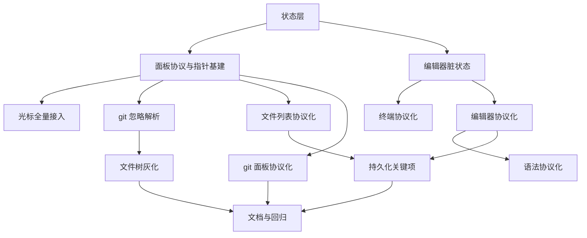

# 工作区协议化与状态层实施计划

**目标：** 把终端工作区的解析、状态与渲染拆成三层，五个面板走同一套协议，修掉 ⌘Z 脏状态、点击无手型光标、git 忽略文件不灰化三个用户可见问题。
**背景：** 当前各面板各自取数、各自持状态（`FileExplorerPane.swift:25-34`、`GitPane.swift:22-29`、`FileEditorPane.swift:16-46`），同一处逻辑改四遍；`FileEditorPane.textDidChange` 无条件置脏（`FileEditorPane.swift:731-737`）；全仓没有任何 `NSCursor` 处理（`grep -rn "NSCursor|resetCursorRects" Sources` 为空）；文件树不识别 `.gitignore`（`FileTreeModel.swift:27-59`）。
**架构：** 新增 `WorkspaceStateStore` 作为唯一状态源，面板只实现 `render(_ snapshot:)`；解析层输出纯数据（git porcelain、语法 token、目录扫描），不碰视图；指针手型由 `PointerButton` / `PointerRowView` 统一提供。
**技术栈：** Swift 5.9、AppKit、SwiftPM，无新增第三方依赖。
**计划状态：** 待批准
**依据：** 用户 2026-11-05 需求「工作区封装、解析、渲染实现分离、所有可点击的鼠标手指状态」；架构文档 [工作区架构](.claude/docs/architecture/workspace.md)；用户拍板记录见 `.agent/decisions.md`。

## 非目标

- 不更换编辑器内核，保留 `NSTextView`（用户 2026-11-05 选择，见本计划「取舍」）。
- 不做多光标、代码折叠、小地图（`NSTextView` 方案不提供，属本次取舍的代价）。
- 不做任何 git 写入操作，只读 status 与 diff（2026-11-04 用户拍板）。
- 不改 tmux 会话编排与恢复逻辑，`WorkspaceManager` 职责不变。
- 不改 Python 层与 MCP 服务。
- 不改知识面板；它复用 `MarkdownPreviewView`，本次只保持接口兼容。

## 全局约束

- 平台 macOS 14+，Swift 5.9；不新增 SwiftPM 依赖。
- 视图不取数：文件读取、git 命令、目录扫描只发生在解析层或面板控制器，`render` 里禁止出现 `Process`、`Data(contentsOf:)`。
- 状态只在主线程写：后台任务回主线程后再调用 `WorkspaceStateStore.update`。
- 跨模块通信走 EventBus 或状态层，视图不直接持有另一面板的引用（CLAUDE.md「解耦」）。
- i18n 唯一数据源 `Sources/Resources/<lang>.json`，改后跑 `scripts/gen-l10n.py` 与两个检查脚本；占位符只用 `{name}` 风格。
- 代码注释、日志、测试名一律英文（`.claude/rules/code-language.md`）。
- 删除文件一律移到废纸篓，不执行 `rm`。
- 未经用户明确同意不执行 `git commit`。

## 复杂度追踪

无。本计划不违反 `AGENTS.md`、`CLAUDE.md` 中的硬规则。

## 假设

- 假设「git 隐藏的文件/文件夹」指被 `.gitignore` 忽略的路径，与 VS Code 灰化对象一致。若不成立而是指点号隐藏文件，只改 T6：对 `name.hasPrefix(".")` 的节点灰化，其余任务不受影响。
- 假设 `git status --ignored=traditional` 输出形如 `!! dir/` 的目录记录，不逐文件展开。若实测逐文件输出，T5 需把同前缀路径折叠为目录集合，再交给 T6。
- 假设编辑器工具栏按钮的手型光标失败原因是窗口内其他视图反复改写光标，而非按钮自身。T2 的取证步骤会证实或推翻；推翻时改用 T2 步骤 5 的备选方案。

## 取舍

| 决策 | 代价 | 什么证据会让我改主意 |
|---|---|---|
| 用一个 `WorkspaceSnapshot` 结构承载全部面板状态 | 新增一个面板要改快照类型，所有实现重新编译 | 面板数量超过 8 个，或出现需要独立渲染频率的面板 |
| 文件树节点仍由面板自持，快照只放忽略集合、选中、展开 | 树节点没做到纯渲染，跨窗口复用仍需改造 | 需要把树状态持久化或复用到第二个窗口 |
| 脏状态用整篇文本比较，不用编辑计数 | 每次去抖比较整篇文本，5 MB 文件多耗约 1 ms | 实测 5 MB 文件输入延迟超过 16 ms |
| git 忽略信息搭 `git status --ignored` 的车 | 巨型仓库 status 变慢，最长等 5 秒超时 | status 超时率超过 10%，改为按需 `git check-ignore` |

## 交付分档

| 阶段 | 范围 | 交付标准 |
|---|---|---|
| MVP | 任务 1-4 | 状态层可观测、⌘Z 回原文件后脏点消失、所有按钮与列表行显示手型光标 |
| 完整版 | 任务 1-12 | 五个面板协议化、git 忽略灰化、关键状态跨启动恢复、自动化验证通过 |
| 增强 | 任务 13 之后 | 把协议复用到知识面板与预览，支持多窗口；不阻塞本次验收 |

## 存储与迁移

| 场景 | 行为 |
|---|---|
| 首次运行（无 `workspaces.json`） | 创建空文档，版本号写 2，首次落盘沿用 `WorkspaceStore.save` 的原子写 |
| 有旧格式数据（`version == 1`） | 首次写入前复制一份 `workspaces.json.bak`（仅保留最近一份），旧文件不删，`ui` 字段取默认值 |
| 数据文件解码失败 | 改名 `workspaces.json.corrupt-<时间戳>`，按现有 `WorkspaceStore` 逻辑重建并写日志 |
| 旧版本程序写回 | 旧版本忽略 `ui` 字段，读得到工作区与布局，只是丢失展开、光标、滚动、列表页签 |
| 旧版本读到新数据 | 显示为工作区正常、`ui` 全部默认；写回时 `ui` 被丢弃但不破坏其他字段；恢复命令 `cp ~/.config/utility/workspaces.json.bak ~/.config/utility/workspaces.json` |

## 性能与资源预算

| 项 | 上限 | 超限行为 | 验收基线 |
|---|---|---|---|
| 脏状态判定 | 输入后 150 ms 去抖 | 编辑中不判定，等下一次稳定 | 5 MB 文件单次比较不超过 1 ms |
| 整篇文本比较 | 每次 1 次 | 撤销/重做后立即补一次，不等去抖 | 输入 100 字符无可感知卡顿 |
| git status 命令 | 5 s（沿用 `ProcessRunner`） | 超时按无仓库处理，文件树不灰化并写日志 | 超时不阻塞文件树显示 |
| git 刷新去抖 | 400 ms | 期间多次触发合并为一次 | 保存后一次刷新只起一个进程 |
| 状态通知到渲染 | 16 ms | 面板各自比对子状态，不相等才刷新 | 切换列表页签无可见延迟 |
| 持久化展开路径 | 2000 条 | 超出按先入先出丢弃 | 超限只丢最旧记录，不丢整个文件 |
| 光标重算 | 布局或滚动后各 1 次 | 不在鼠标移动时重算 | 列表滚动无可感知光标抖动 |

## 文件结构

| 文件 | 动作 | 职责 |
|---|---|---|
| `Sources/Workspace/State/WorkspaceSnapshot.swift` | 新建 | 面板标识、焦点、各面板子状态结构 |
| `Sources/Workspace/State/WorkspaceStateStore.swift` | 新建 | 唯一状态源，变更去重后通知订阅者 |
| `Sources/Workspace/State/WorkspaceUIState.swift` | 新建 | 可持久化的界面状态与钳制规则 |
| `Sources/Workspace/Protocol/WorkspacePanel.swift` | 新建 | 面板协议：身份、焦点目标、渲染入口 |
| `Sources/Components/PointerControls.swift` | 新建 | 手型光标的按钮与行视图基类 |
| `Sources/Core/Debug/CursorTrace.swift` | 新建 | DEBUG 下记录光标设置调用栈的取证开关 |
| `Sources/Workspace/GitStatusProvider.swift` | 新建 | 单一在途的 git 状态提供者，供 Git 面板与文件树共用 |
| `Sources/Workspace/SyntaxProvider.swift` | 新建 | 语法定义与着色策略的协议化出口 |
| `Sources/Workspace/FileDocument.swift` | 修改 | 增加保存基线，提供 `isDirty(currentText:)` |
| `Sources/Workspace/FileEditorPane.swift` | 修改 | 脏状态重算、协议渲染、光标、状态写入 |
| `Sources/Workspace/FileExplorerPane.swift` | 修改 | 忽略灰化行、行视图光标、协议渲染 |
| `Sources/Workspace/GitPane.swift` | 修改 | 消费 `GitStatusProvider`，协议渲染 |
| `Sources/Workspace/SubTerminalPane.swift` | 修改 | 协议渲染、行视图光标 |
| `Sources/Workspace/WorkspaceWindowController.swift` | 修改 | 建 store、分发给面板、焦点入口 |
| `Sources/Workspace/WorkspaceModel.swift` | 修改 | `Workspace` 增加 `ui` 字段，文档版本升 2 |
| `Sources/CLI/WorkspaceCheckCommand.swift` | 修改 | 新增 `--dirty`、`--ui`，扩展 `--git` 输出 |

## 依赖图

## 任务

任务明细、接口签名、验收与步骤见 [tasks.md](tasks.md)。

| 任务 | 标题 | 规模 | 依赖 |
|---|---|---|---|
| T1 | 统一状态层与快照类型 | M | 无 |
| T2 | 面板协议、指针基建与光标根因取证 | M | T1 |
| T3 | 手型光标全量接入 | M | T2 |
| T4 | 编辑器脏状态与撤销一致 | M | T1 |
| T5 | git 忽略路径解析与统一状态提供者 | M | T2 |
| T6 | 文件树忽略灰化渲染 | M | T5 |
| T7 | 终端面板协议化 | S | T4 |
| T8 | 文件列表面板协议化 | M | T2 |
| T9 | Git 面板协议化 | S | T5 |
| T10 | 编辑面板协议化 | M | T4 |
| T11 | 语法协议化 | S | T10 |
| T12 | 关键状态持久化与迁移 | M | T8、T10 |
| T13 | 文档、回归与打包 | S | T6、T9、T12 |

## 检查点

### 检查点 A（T1-T4，MVP）

- [ ] `swift build` 与 `bash scripts/run-tests.sh` 通过。
- [ ] `.build/debug/utility workspace-check --dirty <临时文件>` 输出 `baseline: false`、`appended: true`、`restored: false`。
- [ ] 手测：编辑后按 ⌘Z 回到原内容，标题脏点消失、草稿被删除。
- [ ] 手测：文件树行、git 行、子终端行、活动栏按钮、编辑器工具栏按钮悬停均为手型。

### 检查点 B（T5-T6）

- [ ] `.build/debug/utility workspace-check --git <含 .gitignore 的目录>` 输出 `ignored:` 计数与样例路径。
- [ ] 手测：被忽略的文件与文件夹显示深灰色，可展开，不影响点击打开。
- [ ] 非 git 仓库目录不灰化、不报错。

### 检查点 C（T7-T10）

- [ ] 四个面板都实现 `WorkspacePanel`，`render` 内无 `Process`、无文件读取。
- [ ] 切换工作区、切换列表页签、开关子终端，界面与改造前一致。
- [ ] `grep -rn "render(_ snapshot" Sources/Workspace` 命中 5 处面板实现。

### 检查点 D（T11-T12）

- [ ] `.build/debug/utility workspace-check --ui <workspaces.json>` 输出版本 2 与各工作区 `ui` 字段。
- [ ] 重启后展开目录、当前文件、列表页签、光标位置恢复。
- [ ] 用 `version: 1` 文件启动不崩溃，首次保存后生成 `.bak`。

### 检查点 E（T13）

- [ ] `bash scripts/run-tests.sh` 全过，`scripts/gen-l10n.py --check`、`scripts/check-l10n-contract.py` 通过。
- [ ] `scripts/package-utility.sh` 产物可启动，资源 bundle 存在。

## 未覆盖输入类

| 输入或条件 | 期望行为 | 对应任务 |
|---|---|---|
| 工作区目录为空 | 文件树显示空提示，git 页显示非仓库提示 | T6、T9 |
| 非 git 仓库 | 不灰化、角标不显示、不报错 | T5 |
| 目录含符号链接 | 扫描跳过，不灰化也不报错 | T6 |
| 单目录超过 2000 条 | 截断并显示底部提示，灰化仍生效 | T6 |
| `.gitignore` 忽略整个大目录 | 目录灰化，不展开子项也保持灰色 | T6 |
| 文件被外部删除时保存 | 走另存为，脏状态保持 | T4 |
| 5 MB 文件连续输入 | 去抖 150 ms 后判定，无卡顿 | T4 |
| 切换工作区时有脏文档 | 先确认再切换，取消时状态不变 | T8、T12 |
| `workspaces.json` 中 `ui` 字段类型错误 | 整份文档解码失败改名 `.corrupt-*`，按旧逻辑重建 | T12 |

## 风险与回滚

| 风险 | 影响 | 缓解 | 回滚 |
|---|---|---|---|
| 手型光标仍被其他视图覆盖（历史 6 次失败） | 中 | T2 先用 `UTILITY_CURSOR_TRACE=1` 取证，再决定改哪一层；备选方案见 T2 步骤 5 | `git checkout -- Sources/Components/PointerControls.swift`，删除新建文件，界面回到箭头光标但功能不变 |
| 协议化把面板行为改坏 | 高 | 每面板单独迁移、单独验收；检查点 C 前后各跑一次全量手测 | `git checkout -- Sources/Workspace/<面板文件>.swift`，状态层保留不影响旧逻辑 |
| 状态层与现有回调双通道导致界面不一致 | 中 | T8 起逐个删除中间回调，检查点 C 用 `grep` 断言无残留 | 恢复被删回调所在文件到迁移前版本 |
| `git status --ignored` 在巨型仓库超时 | 中 | 5 秒超时降级为不灰化并记录 `[Git] ignored timed out` | 改 `GitService.status` 参数去掉 `--ignored=traditional`，灰化随之关闭 |
| 持久化版本 2 被旧版覆盖丢 `ui` | 低 | 首次升级写 `.bak`，文档写明 | `cp ~/.config/utility/workspaces.json.bak ~/.config/utility/workspaces.json` 后重启 |
| 文本比较在超大文件上拖慢输入 | 低 | 只在 150 ms 去抖后比较；超过 `maxFileSizeMB` 的文件本就不加载 | 把去抖改为 300 ms 并改为哈希比较 |

## 开放问题

- 旧计划 `.agent/plans/2026-11-05-terminal-workspace/tasks.md` 的 T12（i18n、文档、打包与回归）仍未勾选，本计划 T13 覆盖同一范围。需用户确认：以本计划 T13 收尾并作废旧 T12，还是先单独收尾旧 T12 再开工本计划。未确认前不进入实现。

## 批准记录

- 状态：待批准
- 批准人：
- 批准时间：
