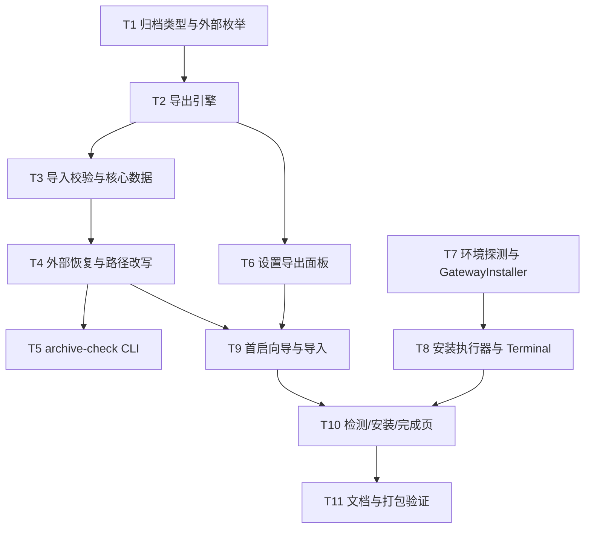

# 换机迁移与首启安装引导实施计划

**目标：** 旧机器在设置里导出用户数据 ZIP（含笔记、知识卡、RSS 产出），新机器首次启动时导入，随后自动检测并安装依赖（含 Homebrew），迁移后配置、记忆、知识库与工作区可直接使用。
**背景：** 当前换机只能手工拷贝 `~/.config/utility/`（本机约 720 MB，含 venv、WAL 与密钥），外部笔记目录还要另行拷贝；容易带走坏 venv、丢 WAL、泄漏密钥。首启没有引导，依赖缺失只在 `debug.log` 里可见。
**架构：** 新增 `ConfigArchive` 负责导出/校验/导入（含外部目录与路径重映射）；`SettingsView` 增加导出面板；首启判据为 `config.yaml` 不存在，弹窗在 `ConfigManager.load()` 之前完成可选导入，再进入依赖检测与安装；Homebrew 缺失时经用户确认后打开 Terminal 执行官方安装脚本。
**技术栈：** Swift 5.9、AppKit + SwiftUI、GRDB 7.12、Yams、ArgumentParser，无新增第三方依赖。
**计划状态：** 已批准（2026-11-06）
**依据：** 用户 2026-11-06 需求与五项拍板（换机迁移、核心数据、确认后自动安装、笔记整目录导出、原路径优先+可选新路径、冲突由用户选）；`.claude/plans/portability.md` 的 Phase 1–3 设计（该文件无计划状态与批准记录，本次只复用设计，不视为已批准前置）；`CLAUDE.md` 仓边界与面板/配置不变量。

## 非目标

- 不做本机多套配置档案切换（用户 2026-11-06 选择「换机迁移」）。
- 不打包 Qdrant 向量库与 fastembed 模型缓存（用户选择「核心数据」；模型可重新下载）。
- 不迁移工作区引用的项目代码目录，只迁移工作区配置与会话；项目路径变化由用户自行准备（用户未要求迁移项目代码）。
- 不改 agent-gateway 仓、MCP 服务协议与 Python 源码（仓边界，`CLAUDE.md`）。
- 不做公证、分发与自动更新（沿用 `portability.md` 非目标）。
- 不删除迁移包中未包含的现有文件（如 `token_usage.sqlite` 保持原样）。
- 不自动填入旧机器密钥：默认剥离，显式勾选才携带（沿用 `portability.md` 口径）。
- 不跟随符号链接：外部目录中的 symlink 跳过并记录，避免越界与循环（安全默认）。

## 全局约束

- 平台 macOS 14+；Swift 5.9；不新增 SwiftPM 依赖。
- i18n 唯一数据源 `Sources/Resources/<lang>.json`，改后运行 `scripts/gen-l10n.py`，占位符只用 `{name}` 风格。
- 代码注释、日志、内部错误消息一律英文（`.claude/rules/code-language.md`）。
- 删除一律 `FileManager.trashItem`；临时目录可移入废纸篓，禁止 `rm`。
- 文件操作使用绝对路径；持久化路径统一经 `AppPaths`，测试通过参数注入临时根目录。
- 配置唯一消费入口仍是 `ConfigManager`；归档层只改写用户显式重映射的三个路径键。
- 视图不取数：探测、枚举、安装全部在后台队列，主线程只更新 UI。
- 跨模块通信走 EventBus；导入导出逻辑不持有任何 NSView。
- 调用外部命令一律参数数组，不拼 shell 字符串；需要 shell 的仅 Homebrew 官方脚本，且先展示内容并确认。
- 未经用户明确允许不执行 `git commit`。

## 复杂度追踪

无。本计划不违反 `AGENTS.md`、`CLAUDE.md` 的硬规则。

## 假设

- 假设首次启动判据是 `~/.config/utility/config.yaml` 不存在；若导入包已写入该文件，则视为已完成初始化。
- 假设新机器已通过 DMG 安装 app，且能访问 PyPI 与 HuggingFace；离线时安装项失败但 app 仍可启动。
- 假设笔记目录可能很大且位于受保护位置；用户需有目标目录写权限，否则导入时改选新路径。
- 假设路径重写只涉及 `mcp.knowledgeBasePath`、`knowledge.likedSaveDir`、`rss.daily.outputDir` 三个键。
- 假设 fastembed 缓存目录名为 `models--<org>--<name>`（本机实测 `models--jinaai--jina-embeddings-v2-base-zh`）。
- 假设 `DatabaseReader.backup(to:)` 能在源库被运行中实例写入时得到一致快照（GRDB 官方在线备份语义）。

## 取舍

| 决策 | 代价 | 什么证据会让我改主意 |
| --- | --- | --- |
| 导出整棵笔记目录 | 隐私面与包体变大；需体积提示与排除规则 | 用户改为仅知识卡与 RSS |
| 外部目录默认按原路径恢复 | 新机器可能没有该路径或权限 | 更多用户选择统一收编到配置目录 |
| 冲突逐角色选择跳过/覆盖 | 多一步交互，不能完全一键 | 用户要求默认策略、不再询问 |
| 路径变更时改写三个配置键 | 可能与用户在 `agent-gateway.yaml` 中的旧值不一致 | 出现其他组件也持久化同一路径 |
| Homebrew 经 Terminal 安装 | 离开 app、需管理员密码、无 in-app 进度 | 找到无 TTY 也能装且可审计的方案 |
| 导出用 ZIP + `ditto` | 无增量、不可断点续传 | 用户要求增量或包体经常超过 8 GB |
| SQLite 用 GRDB `backup(to:)` | 需要重新打开源库、逐库耗时 | 实测备份被长写事务阻塞超过 120 s |

## 交付分档

| 阶段 | 范围 | 交付标准 |
| --- | --- | --- |
| MVP | T1–T6 | 设置内可导出含笔记的完整用户数据 ZIP；`archive-check` 往返校验通过 |
| 完整版 | T1–T10 | 首启可导入（含外部目录与冲突选择）+ 依赖检测 + 确认安装 + 进度日志；L2 全过 |
| 增强 | 后续 | 设置内导入、增量导出、安装取消、Homebrew 安装进度回传 |

## 存储与迁移

| 场景 | 行为 |
| --- | --- |
| 首次运行（无数据文件） | 显示首启弹窗；`config.yaml` 由 `ConfigManager.load()` 写入默认值 |
| 有旧格式数据 | 归档格式此前不存在；`config.yaml`、`agent-gateway.yaml` 原样保留，不做格式迁移 |
| 数据文件解码失败 | manifest 缺失/版本不符/校验和不符时拒绝导入，staging 与正式目录均不写入 |
| 旧版本程序写回 | 导出包是离线文件，旧版本不感知；不做双向同步 |
| 旧版本读到新数据 | `formatVersion > 1` 直接拒绝并提示升级；恢复用 `~/.config/utility.backup-<时间戳>` 覆盖 |
| 外部路径存在且可写 | 默认恢复到原路径；同名文件按用户选择的跳过/覆盖处理 |
| 外部路径不存在或无权限 | 弹目录选择，记录新路径，并改写对应配置键 |
| 外部目录部分失败 | 保留已复制文件与备份，报告失败清单，可重试 |

## 性能与资源预算

| 项 | 上限 | 超限行为 | 验收基线 |
| --- | --- | --- | --- |
| 单个 SQLite 备份 | 120 s | 中止整个导出，删除临时包 | 18 MB `memory_graph.sqlite` < 2 s |
| 外部目录枚举 | 80 s 或 100,000 文件 | 中止导出并提示缩小范围 | 180 MB 笔记目录 < 5 s |
| 整体导出（含压缩） | 600 s | 中止并保留日志 | 核心数据 + 180 MB 笔记 < 90 s |
| 解压 + 校验 | 300 s | 中止导入，保留 staging | 核心包 < 20 s |
| 冲突扫描 | 60 s | 跳过冲突明细，按「跳过已存在」处理 | 10,000 文件 < 5 s |
| 依赖探测单项 | 5 s | 该项标记「检测超时」 | 6 项总耗时 < 30 s |
| `brew install` | 900 s | 终止进程，标记失败可重试 | 失败日志含退出码 |
| wheel + extras 安装 | 沿用 `GatewayInstaller` 120/180/900/60 s | 写 `.agent-gateway-broken` | 成功后 import 校验通过 |
| 嵌入模型下载 | 1800 s | 终止并标记失败，不阻塞启动 | 下载完成打印 `model-ready` |
| 导出包体积 | 8 GB | 拒绝导出并提示缩小范围 | 核心包 < 1 GB |
| 日志界面缓冲 | 2000 行 | 丢弃最旧行 | 滚动流畅，无主线程卡顿 |

## 文件结构

| 文件 | 动作 | 职责 |
| --- | --- | --- |
| `Sources/Core/Archive/ArchiveTypes.swift` | 新建 | 范围、清单、外部目录、错误类型 |
| `Sources/Core/Archive/ArchiveScope.swift` | 新建 | 按配置计算可选范围与文件清单 |
| `Sources/Core/Archive/ArchiveExternal.swift` | 新建 | 外部目录枚举、排除、symlink 与冲突扫描 |
| `Sources/Core/Archive/ConfigArchive.swift` | 新建 | 导出、校验、导入、备份、回滚与路径改写 |
| `Sources/Core/CommandRunner.swift` | 新建 | 带超时与流式输出的子进程封装 |
| `Sources/Core/EnvironmentProbe.swift` | 新建 | Homebrew/tmux/Python/CLT 探测 |
| `Sources/App/Export/ExportModel.swift` | 新建 | 导出选项、体积估算、进度与错误状态 |
| `Sources/App/Export/ExportSheet.swift` | 新建 | 设置内导出面板 |
| `Sources/App/Setup/SetupModel.swift` | 新建 | 首启步骤、依赖项与状态机 |
| `Sources/App/Setup/SetupProbe.swift` | 新建 | 依赖检测与模型缓存判据 |
| `Sources/App/Setup/SetupInstaller.swift` | 新建 | 确认后的 brew/pip/模型安装与 Terminal 拉起 |
| `Sources/App/Setup/SetupWindowController.swift` | 新建 | 首启模态窗口 |
| `Sources/App/Setup/SetupImportView.swift` | 新建 | 导入、外部路径与冲突选择 |
| `Sources/App/Setup/SetupCheckView.swift` | 新建 | 检测、安装与完成页 |
| `Sources/CLI/ArchiveCheckCommand.swift` | 新建 | 导出/导入/往返校验 CLI |
| `Sources/App/SettingsView.swift` | 修改 | 增加「数据与迁移」区块与 sheet |
| `Sources/App/AppDelegate.swift` | 修改 | 首启钩子，置于 `ConfigManager.load()` 之前 |
| `Sources/MCP/GatewayInstaller.swift` | 修改 | 注入进度、强制 Python ≥ 3.12、复用 CommandRunner |
| `Sources/MCP/MCPProcessManager.swift` | 修改 | `pythonCheck()` 改用 `EnvironmentProbe` |
| `Sources/CLI/UtilityCLI.swift` | 修改 | 注册 `archive-check` |
| `Sources/Resources/zh-Hans.json` | 修改 | 新增 `export.*`、`setup.*` 文案 |
| `Sources/Resources/en.json` | 修改 | 同上 |
| `Sources/Core/L10nKeys.swift` | 生成 | `gen-l10n.py` 生成，禁止手改 |
| `scripts/run-tests.sh` | 修改 | 增加 archive 往返检查 |
| `.claude/docs/architecture/portability.md` | 新建 | 归档格式、外部路径、首启流程与回滚 |
| `README.md` / `README.zh.md` | 修改 | 新机器迁移步骤 |

## 依赖图

## 任务

### 任务 1：归档类型、范围与外部目录枚举

**文件**

- 新建：`Sources/Core/Archive/ArchiveTypes.swift`、`Sources/Core/Archive/ArchiveScope.swift`、`Sources/Core/Archive/ArchiveExternal.swift`

**接口**

- 产出：`ArchiveScope: String, CaseIterable, Codable { config, memory, knowledge, local, terminal, notes, usage }`
- 产出：`ExternalRole: String, Codable { notes, liked, rss }`
- 产出：`ExternalDir { role: ExternalRole; originalPath: String; archivePath: String; fileCount: Int; bytes: Int }`
- 产出：`ArchiveManifest { formatVersion; appVersion; createdAt; includesSecrets; scope; files; external: [ExternalDir]; sourcePaths }`
- 产出：`ArchiveScope.available(in:)`、`defaultSelection(in:)`
- 产出：`ArchiveExternal.enumerate(root:excluding:)`、`ArchiveScope.resolveExternalDirs(config:)`

**验收**

- [ ] `.notes` 默认勾选，包含整棵笔记目录；`liked`、`rss` 位于笔记目录内时不重复打包
- [ ] 位于笔记目录外的 `likedSaveDir`、`rss.daily.outputDir` 作为独立角色打包
- [ ] 枚举跳过 `.git/`、`.DS_Store`、`.trash/`、`*.tmp`、`*.lock` 与符号链接，跳过数写日志
- [ ] `knowledge.enabled == false` 时不返回 `.knowledge`；`terminal.enabled == false` 时不返回 `.terminal`

**验证**

- 命令：`swift build`
- 期望：构建通过；T5 的 `archive-check scopes` 输出与上述一致

**依赖 / 规模**：无 / M

- [ ] 步骤 1：写类型与范围映射
- [ ] 步骤 2：实现外部目录解析、嵌套去重与排除规则
- [ ] 步骤 3：`swift build` 通过
- [ ] 步骤 4：提交

### 任务 2：导出引擎

**文件**

- 新建：`Sources/Core/Archive/ConfigArchive.swift`、`Sources/Core/CommandRunner.swift`

**接口**

- 消费：`ArchiveOptions`、`ArchiveScope.members`、`ArchiveExternal.enumerate`
- 产出：`ConfigArchive.export(options:config:configDir:appVersion:destination:log:) throws -> ArchiveManifest`
- 产出：`ArchiveError { invalidManifest, checksumMismatch, pathTraversal, schemaMismatch, sizeLimit, fileLimit, backupFailed, writeFailed, timeout }`

**验收**

- [ ] 导出包含 `manifest.json`、`config/`、`data/`、`external/<role>/`
- [ ] manifest 记录每个外部角色的原绝对路径、文件数与字节数
- [ ] `includesSecrets == false` 时两份配置文件内所有 `apiKey` 值为空字符串
- [ ] 超过 8 GB、10 万文件或单项超时则中止，不留下半成品 ZIP

**验证**

- 命令：`BIN="$(swift build --show-bin-path)/utility"; "$BIN" archive-check roundtrip`
- 期望：`roundtrip: ok`（T5 完成后）

**依赖 / 规模**：T1 / M

- [ ] 步骤 1：实现成员收集与 staging 布局
- [ ] 步骤 2：SQLite 用 `Configuration(readonly: true)` + `backup(to:)`
- [ ] 步骤 3：外部目录逐文件复制并累计体积/文件数
- [ ] 步骤 4：剥离密钥：`config.yaml` 用 Yams 解析/写回，`agent-gateway.yaml` 用 JSON 递归置空 `apiKey`
- [ ] 步骤 5：写 manifest，`ditto -c -k --norsrc` 生成 ZIP
- [ ] 步骤 6：实现体积、文件数与磁盘空间预检
- [ ] 步骤 7：提交

### 任务 3：导入校验与核心数据应用

**文件**

- 修改：`Sources/Core/Archive/ConfigArchive.swift`

**接口**

- 产出：`ConfigArchive.validate(archive:configDir:) throws -> ArchiveImportPlan`
- 产出：`ConfigArchive.applyCore(_ plan:configDir:) throws -> URL`（返回备份目录）
- 产出：`ArchiveImportPlan { stagingDir; manifest; files; externalRoot: URL }`

**验收**

- [ ] 校验失败时正式目录零写入，staging 保留供排查
- [ ] 每个 SQLite import 前比对表名集合（排除 `sqlite_%`），差异时拒绝并列出表名
- [ ] 成功后 `~/.config/utility.backup-<yyyyMMddHHmmss>/` 存在；失败自动从备份恢复
- [ ] 不删除未入选的现有文件；`mcp-venv/` 始终保留

**验证**

- 命令：`"$BIN" archive-check roundtrip`
- 期望：输出 `validate: ok`、`apply-core: ok`

**依赖 / 规模**：T2 / M

- [ ] 步骤 1：`ditto -x -k` 解压到临时 staging
- [ ] 步骤 2：校验 `formatVersion == 1`、相对路径无 `..`/绝对路径、sha256 与字节数
- [ ] 步骤 3：比对 SQLite 表名集合
- [ ] 步骤 4：备份现有配置目录（跳过 venv/WAL/SHM/staging），再逐文件替换
- [ ] 步骤 5：失败回滚并保留 staging
- [ ] 步骤 6：提交

### 任务 4：外部目录恢复与配置路径改写

**文件**

- 修改：`Sources/Core/Archive/ConfigArchive.swift`、`Sources/Core/Archive/ArchiveExternal.swift`

**接口**

- 产出：`ExternalRestoreDecision { role; destination: URL; policy: .skipExisting/.overwrite }`
- 产出：`ConfigArchive.scanConflicts(plan:) -> [ExternalConflict]`（角色、目标、同名数）
- 产出：`ConfigArchive.applyExternal(decisions:plan:backup:) throws`
- 产出：`ConfigArchive.rewriteConfigPaths(configFile:remaps:) throws`
- 路径键映射：`notes → mcp.knowledgeBasePath`、`liked → knowledge.likedSaveDir`、`rss → rss.daily.outputDir`

**验收**

- [ ] 目标为原路径且存在时直接合并；目标缺失时使用用户选定路径
- [ ] 跳过策略保留目标同名文件；覆盖策略先备份被覆盖文件再写入
- [ ] 目标路径与 manifest 原路径不同时，只有对应配置键被改写
- [ ] 复制中途失败时报告已完成清单，可重试，不删除目标已有文件

**验证**

- 命令：`"$BIN" archive-check roundtrip --remap notes=<tmp>/notes`
- 期望：`apply-external: ok`，导入后 `knowledgeBasePath` 等于新路径

**依赖 / 规模**：T3 / M

- [ ] 步骤 1：实现冲突扫描与决策结构
- [ ] 步骤 2：实现跳过/覆盖复制与覆盖备份
- [ ] 步骤 3：实现三个配置键的 Yams 改写
- [ ] 步骤 4：实现失败报告与重试入口
- [ ] 步骤 5：提交

### 任务 5：`archive-check` CLI

**文件**

- 新建：`Sources/CLI/ArchiveCheckCommand.swift`
- 修改：`Sources/CLI/UtilityCLI.swift:8-17`、`scripts/run-tests.sh`

**接口**

- 子命令：`scopes`、`export`、`import`、`roundtrip`
- 关键参数：`--root`、`--out`、`--scope`、`--secrets`、`--remap role=path`、`--external-policy skip|overwrite`、`--dry-run`
- 输出：每行 `key: value`，失败退出码非 0

**验收**

- [ ] `roundtrip` 含外部笔记目录：导出后导入到第二份根目录，逐文件 sha256 一致
- [ ] `--remap notes=<path>` 后导入配置的 `knowledgeBasePath` 指向新路径
- [ ] `--dry-run` 不写目标目录
- [ ] `run-tests.sh` 新增 `6/6 archive-check` 且全过

**验证**

- 命令：`swift build && BIN="$(swift build --show-bin-path)/utility" && "$BIN" archive-check roundtrip && bash scripts/run-tests.sh`
- 期望：`roundtrip: ok`，脚本全部 PASS

**依赖 / 规模**：T4 / S

- [ ] 步骤 1：实现四个子命令与参数
- [ ] 步骤 2：roundtrip 使用 `mktemp` 临时根目录，结束后移入废纸篓
- [ ] 步骤 3：接入 `run-tests.sh`
- [ ] 步骤 4：提交

### 任务 6：设置内导出面板

**文件**

- 新建：`Sources/App/Export/ExportModel.swift`、`Sources/App/Export/ExportSheet.swift`
- 修改：`Sources/App/SettingsView.swift:124-159`、两份语言 JSON

**接口**

- 消费：`ConfigArchive.export`、`ArchiveScope.available`、`resolveExternalDirs`
- 产出：`ExportModel.estimateSizes()`、`export(destination:)`

**验收**

- [ ] 设置底部出现「数据与迁移」与「导出用户数据…」，点击弹出 sheet
- [ ] 笔记项默认勾选并显示体积；未启用知识/终端时隐藏对应选项
- [ ] 数据项全不勾选时「导出」禁用；至少一项必选
- [ ] 导出中显示逐文件日志与进度，完成后可「在访达中显示」

**验证**

- 命令：`swift build && python3 scripts/gen-l10n.py --check && python3 scripts/check-l10n-contract.py`
- 期望：构建与两项 i18n 检查通过

**依赖 / 规模**：T2 / M

- [ ] 步骤 1：实现 `ExportModel` 与体积估算
- [ ] 步骤 2：实现 sheet、选项与 `NSSavePanel`
- [ ] 步骤 3：接入 `SettingsView`，补 `export.*` 文案并生成 `L10nKeys.swift`
- [ ] 步骤 4：手动导出一次，检查包内无 venv/WAL 且含 `external/notes`
- [ ] 步骤 5：提交

### 任务 7：环境探测与 GatewayInstaller 改造

**文件**

- 先读：`.claude/docs/architecture/python-runtime.md`、`.claude/docs/architecture/config.md`
- 新建：`Sources/Core/EnvironmentProbe.swift`；复用 `Sources/Core/CommandRunner.swift`
- 修改：`Sources/MCP/GatewayInstaller.swift:27-110`、`Sources/MCP/MCPProcessManager.swift:236-283`

**接口**

- 产出：`CommandRunner.run(_ arguments: [String], timeout: TimeInterval, env: [String: String]?, onLine: ((String) -> Void)?) -> CommandResult`
- 产出：`EnvironmentProbe.resolvePython(atLeast: (Int, Int)) -> PythonResolution?`
- 产出：`EnvironmentProbe.homebrewPath()`、`xcodeCLTPath()`、`tmuxPath()`
- 产出：`GatewayInstaller.install(progress: (String) -> Void) -> Bool`，`ensureInstalled` 保持原签名

**验收**

- [ ] venv 解释器存在但 `pyvenv.cfg` 版本 < 3.12 时，旧 venv 移入废纸篓并重建
- [ ] 找不到 ≥ 3.12 解释器时写 broken 标记，日志含 `brew install python@3.12`
- [ ] 安装过程每步输出命令与退出码，`GatewayInstaller` 仍保持全部超时
- [ ] `MCPProcessManager.pythonCheck()` 不再使用 `command -v python3` 作为版本判据

**验证**

- 命令：`swift build`
- 期望：构建通过；启动日志出现 `[Gateway] interpreter: <path> (<version>)`

**依赖 / 规模**：无（与 T1 并行） / M

- [ ] 步骤 1：抽取 `CommandRunner` 并让 `GatewayInstaller` 复用
- [ ] 步骤 2：实现 `EnvironmentProbe` 的候选路径与版本解析
- [ ] 步骤 3：改造 venv 创建与重建逻辑
- [ ] 步骤 4：接入进度回调
- [ ] 步骤 5：提交

### 任务 8：依赖安装执行器与 Homebrew 拉起

**文件**

- 新建：`Sources/App/Setup/SetupProbe.swift`、`Sources/App/Setup/SetupInstaller.swift`

**接口**

- 产出：`SetupItemID { xcodeCLT, homebrew, python, tmux, gateway, embedder }`
- 产出：`SetupProbe.check(config:configDir:) -> [SetupItem]`
- 产出：`SetupInstaller.install(items:config:venvPython:log:completion:)`
- 产出：`SetupInstaller.openHomebrewInstaller() throws`：写临时 `.command`，`open -a Terminal`

**验收**

- [ ] Homebrew 缺失时展示官方脚本全文与来源 URL，经确认后打开 Terminal 执行；app 不阻塞
- [ ] Xcode CLT 缺失时在该行提示「Homebrew 安装会一并触发」
- [ ] tmux 仅在 `terminal.enabled` 时列为必需；嵌入模型按 `models--<org>--<name>` 判定
- [ ] 每步日志形如 `[Setup] <command>`、`[Setup] exit <code>`，并写入 `debug.log`

**验证**

- 命令：`swift build`
- 期望：构建通过；日志前缀与退出码齐全

**依赖 / 规模**：T7 / M

- [ ] 步骤 1：实现六项探测（单项 5 s 超时）
- [ ] 步骤 2：实现 Homebrew 临时脚本与 Terminal 拉起
- [ ] 步骤 3：实现 brew Python/tmux、pip、模型安装顺序
- [ ] 步骤 4：模型下载用 venv python + `TextEmbedding(model_name:cache_dir:)`
- [ ] 步骤 5：安装后重新探测并返回最终状态
- [ ] 步骤 6：提交

### 任务 9：首启向导骨架与导入步骤

**文件**

- 新建：`Sources/App/Setup/SetupModel.swift`、`Sources/App/Setup/SetupWindowController.swift`、`Sources/App/Setup/SetupImportView.swift`
- 修改：`Sources/App/AppDelegate.swift:23-76`

**接口**

- 产出：`SetupModel` 四步状态机 `importConfig → check → install → done`
- 产出：`SetupWindowController.shared.runFirstLaunch() -> Void`（模态）
- 消费：`ConfigArchive.validate/scanConflicts/applyCore/applyExternal/rewriteConfigPaths`

**验收**

- [ ] `config.yaml` 不存在时启动显示向导；存在时不显示
- [ ] 选择 ZIP 后展示 manifest 摘要与外部目录体积，校验失败可重试且正式目录无残留
- [ ] 外部目录逐角色选择原路径或新路径，并选择跳过/覆盖；覆盖前提示备份
- [ ] 关闭向导后 `ConfigManager.load()` 读取导入或默认配置，后续启动流程不变

**验证**

- 命令：`swift build && bash scripts/run-tests.sh`
- 期望：构建与脚本通过；隔离 HOME 启动日志含 `[Setup]` 且 `config.yaml` 生成

**依赖 / 规模**：T4、T6 / M

- [ ] 步骤 1：实现状态机与窗口生命周期
- [ ] 步骤 2：实现导入选择、摘要、校验与冲突扫描
- [ ] 步骤 3：实现外部路径与冲突决策 UI，调用 `applyExternal` 与路径改写
- [ ] 步骤 4：在 `AppDelegate.applicationDidFinishLaunching` 最前面插入首启判断与模态调用
- [ ] 步骤 5：提交

### 任务 10：检测、安装与完成页

**文件**

- 新建：`Sources/App/Setup/SetupCheckView.swift`
- 修改：`Sources/App/Setup/SetupModel.swift`、`Sources/App/Setup/SetupWindowController.swift`、两份语言 JSON

**接口**

- 消费：`SetupProbe.check`、`SetupInstaller.install`、`openHomebrewInstaller`
- 产出：检测表、安装确认、进度条与日志面板；完成后关闭向导

**验收**

- [ ] 六项依赖显示状态、版本与路径；「重新检测」可用
- [ ] 缺失项确认后执行安装；Homebrew 项跳转 Terminal 并提示安装后重新检测
- [ ] 安装进度与日志实时刷新，失败项可重试
- [ ] 完成后窗口关闭，`AppDelegate` 继续既有启动流程

**验证**

- 命令：`swift build && python3 scripts/gen-l10n.py --check && python3 scripts/check-l10n-contract.py`
- 期望：构建与 i18n 检查通过

**依赖 / 规模**：T8、T9 / M

- [ ] 步骤 1：实现检测表与重新检测
- [ ] 步骤 2：实现安装确认、进度与日志面板
- [ ] 步骤 3：实现完成页与窗口关闭
- [ ] 步骤 4：补 `setup.*` 文案并重新生成 `L10nKeys.swift`
- [ ] 步骤 5：提交

### 任务 11：文档、状态与打包验证

**文件**

- 新建：`.claude/docs/architecture/portability.md`
- 修改：`README.md`、`README.zh.md`、`CLAUDE.md`（架构文档表加一行）、`.agent/status.md`

**接口**

- 无

**验收**

- [ ] 文档写明包结构、外部目录、冲突策略、密钥默认策略、备份位置与恢复命令
- [ ] README 给出旧机导出、新机首启导入、外部路径选择、依赖安装的完整步骤
- [ ] 打包产物启动正常，资源 bundle 存在

**验证**

- 命令：`bash scripts/run-tests.sh && SIGNING_IDENTITY=<sha1> bash scripts/package-utility.sh`
- 期望：脚本全过；DMG 内 `Utility.app` 可启动（注意打包会自增 `VERSION`）

**依赖 / 规模**：T10 / S

- [ ] 步骤 1：写 `portability.md` 并更新文档索引
- [ ] 步骤 2：更新两份 README 与 `.agent/status.md`
- [ ] 步骤 3：跑完整验证与打包
- [ ] 步骤 4：提交

## 检查点

### 检查点 A（T1–T5 后）

- [ ] `swift build` 通过
- [ ] `archive-check roundtrip` 输出 `roundtrip: ok`
- [ ] `--remap notes=<tmp>` 后配置路径改写正确
- [ ] `bash scripts/run-tests.sh` 全过
- [ ] 临时根目录导出包内无 venv、WAL、SHM

### 检查点 B（T6 后）

- [ ] 设置窗口可导出含笔记目录的数据包
- [ ] 勾选项按配置启停显示正确，笔记项显示体积
- [ ] 密钥默认剥离，勾选后保留
- [ ] 导出耗时与包体符合预算

### 检查点 C（T7–T10 后）

- [ ] 隔离 HOME 首次启动出现向导
- [ ] 导入包后可读到记忆、知识库与笔记文件
- [ ] 外部路径缺失时可改选，冲突可选择跳过/覆盖
- [ ] 缺失依赖可检测、可确认安装、失败可重试
- [ ] Homebrew 缺失时可打开 Terminal 执行官方脚本
- [ ] 已有配置的机器不出现向导，启动流程不变

### 检查点 D（T11 后）

- [ ] 文档与实现一致
- [ ] 打包产物启动正常
- [ ] 用户 L3 手测通过后提交

## 未覆盖输入类

| 输入或条件 | 期望行为 | 对应测试任务 |
| --- | --- | --- |
| ZIP 缺少 manifest | 拒绝导入，提示「不是有效的 Utility 数据包」 | T5 dry-run / T9 |
| 文件被篡改 | sha256 不符，拒绝且零写入 | T5 |
| 包内路径含 `../` | 拒绝并记录路径 | T5 |
| 当前 DB 表集合与包内不同 | 拒绝并列出差异表 | T5 |
| 笔记目录含符号链接 | 跳过并计数，不跟随 | T5 |
| 外部目录不存在 | 弹目录选择，选定后改写配置 | T9 |
| 外部目录无写权限 | 提示权限不足，允许改选路径 | T9 |
| 外部同名文件 | 按角色选择跳过或覆盖；覆盖前备份 | T4/T9 |
| 笔记文件超过 10 万 | 导出中止并提示缩小范围 | T2 |
| 用户取消新路径选择 | 跳过该角色数据，核心数据已导入 | T9 |
| Homebrew 缺失 | 展示脚本并确认后打开 Terminal | T8/T10 |
| Terminal 安装被取消 | app 不阻塞，重新检测仍显示缺失 | T10 |
| 模型下载超时/断网 | 标记失败，允许重试，app 继续启动 | T8 |

## 风险与回滚

| 风险 | 影响 | 缓解 | 回滚 |
| --- | --- | --- | --- |
| 导入包覆盖后 app 无法启动 | 高 | 导入前备份；校验全部通过才写入 | `ditto ~/.config/utility.backup-<ts>/ ~/.config/utility/` 后重启 |
| 跨版本 schema 不兼容 | 高 | 表名集合比对，不一致拒绝 | 不产生写入，换同版本包 |
| 外部目录覆盖误伤 | 高 | 默认跳过；覆盖前逐文件备份 | 从备份目录恢复被覆盖文件 |
| 配置路径改写错误 | 高 | 只改写重映射的三个键；改写前备份 `config.yaml` | 用备份的 `config.yaml` 覆盖并重启 |
| 笔记目录过大或含隐私 | 中 | 体积提示、排除 VCS/缓存、默认勾选可取消 | 重新导出不含笔记的包 |
| 导出时读到不一致快照 | 中 | GRDB `backup(to:)` 在线备份 | 重新导出 |
| 密钥泄漏 | 高 | 默认置空 `apiKey`，manifest 标注 | 重新导出不含密钥包 |
| 安装长任务卡住 | 中 | 每步超时 + 可终止进程 | 写 broken 标记，重启后重试 |
| Homebrew 安装失败或取消 | 中 | Terminal 保持输出，app 可重新检测 | 重新执行官方脚本或手动安装 |
| 首启向导阻塞启动 | 中 | 探测 5 s/项，安装有上限；可跳过 | 移走 `config.yaml` 可重新触发 |
| venv 被旧 Python 重建 | 高 | `pyvenv.cfg` 版本判据，< 3.12 移入废纸篓 | 从废纸篓恢复旧 venv |
| 备份占用磁盘 | 低 | 备份排除 `mcp-venv`；预检空间 | 移走 `~/.config/utility.backup-*` |

## 开放问题

- 无。范围与外部路径策略已在规划期由用户拍板；其余默认值写在本计划「取舍」与「非目标」。

## 批准记录

- 状态：已批准
- 批准人：用户
- 批准时间：2026-11-06
