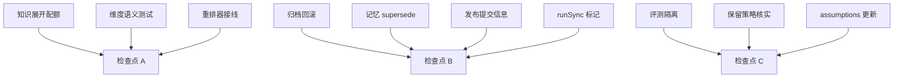

# 审查遗留项修复实施计划

**目标：** 关闭 2026-11-09 项目审查中用户指定的 10 项待办，重点修复知识补货截断、重排器失效、归档导入不回滚与输出完整性标记。
**背景：** 审查报告 `/Users/yuanyxh/Documents/selfdata/notes/Review/2026-11-09/` 列出 4 个 P2 与 6 个 P3；用户逐项确认要处理，其中第 2 项明确为「无 project 时忽略 project 维度」，第 3 项明确要下载模型并接线，第 8 项明确要统一隔离所有评测脚本。
**架构：** 跨 `utility`（Swift）与 `agent-gateway`（Python）两仓；检索/知识链路改 gateway，归档/进程/发布改 utility，发布提交信息由脚本输出，记忆与 skill 假设清单单独维护。
**技术栈：** Swift 5.9 / macOS 14 / SPM；Python 3（gateway `.venv`）；ONNX Runtime；SQLite。
**计划状态：** 已执行，待用户测试
**依据：** `/Users/yuanyxh/Documents/selfdata/notes/Review/2026-11-09/{03,08,10,12,16}.md`；用户 2026-11-09 指令。

## 非目标

- 不把记忆维度从硬过滤降级为 boost，也不回填 5358 条存量记忆（用户确认只保证「未传 project 时不按 project 过滤」，该语义现已实现）。
- 不调整 `api_usage` 90 天与 `tool_output_log` 5 天的保留天数，只核实清理生效并补验证。
- 不提交、不推送、不部署；所有改动留在工作区待用户测试。

## 全局约束

- 禁止 `git commit` / `git push`，除非用户另行明确授权。
- 删除一律移到废纸篓（Swift 用 `FileManager.trashItem`，shell 用 `trash`）。
- 代码注释、日志、内部错误消息用英文；用户可见文案走 `Sources/Resources/<lang>.json`。
- 改 i18n 后必须跑 `python3 scripts/gen-l10n.py --check` 与 `python3 scripts/check-l10n-contract.py`。
- gateway 改动后跑 `.venv/bin/pytest -q`；utility 改动后跑 `swift build`，新增测试跑 `swift test`。
- 任何阈值与配额调整必须给前后实测数据，禁止拍脑袋固化。

## 复杂度追踪

无。

## 假设

- 假设 A：`Xenova/bge-reranker-base` 的 `tokenizer.json` 与 `onnx/model_int8.onnx` 能被现有 `CrossEncoderReranker` 直接加载；若不成立，改用同仓 `onnx/model_quantized.onnx` 并在 `rerank.py` 增加候选文件名。
- 假设 B：`mimo-v2.6-flash` 的空响应由思考占用配额导致，提高 `max_tokens` 可恢复；若 4096 仍返回 `finish_reason=length`，改走 provider 私有 `extra_body` 关闭思考。
- 假设 C：测试目标可以 `@testable import utility` 依赖可执行 target（SwiftPM 5.9 支持）；若链接失败，改为把 `ProcessRunner` 与归档纯逻辑抽到 library target。

## 取舍

| 决策 | 代价 | 什么证据会让我改主意 |
|---|---|---|
| `knowledge_expand` 用输入长度动态分配，下限 2048、上限 4096 | 单次调用配额上升，失败轮次成本略增 | 实测 2048 仍截断则下限提到 3072；若 2048 稳定则保留 |
| reranker 下载 279 MB 并接入 recall | 首次加载内存与 p95 延迟上升 | recall p95 超过 3 s 或内存明显上涨则改为仅 project_notes 启用 |
| 归档失败由 `applyExternal` 自身回滚外部文件、外层回滚 core | 回滚逻辑分散在两处，需成对测试 | 出现无法精确回滚的路径则改为「先全量预检再统一应用」 |
| 发布提交信息只输出到 stdout，不自动提交 | 仍需人工复制执行 | 用户明确授权脚本自动提交后再加 `--commit` |
| 评测脚本统一写 `tests/eval/.cache/<script>` | 评测产物不再与生产日志同目录 | 需要跨脚本共享缓存时改用 `EVAL_CACHE_DIR` |

## 交付分档

| 阶段 | 范围 | 交付标准 |
|---|---|---|
| MVP | T1、T3、T4 | 知识补货不再因 768 截断失败；reranker 生效；归档失败可回滚 |
| 完整版 | T1-T10 | 全部验收通过，两仓构建与测试通过 |
| 增强 | 后续 | 记忆维度回填、reranker 性能调优、DB 体积治理 |

## 存储与迁移

| 场景 | 行为 |
|---|---|
| 首次运行（无模型目录） | reranker 保持 `get_reranker()` 返回 None 的降级，不阻塞启动 |
| 有旧格式数据 | 记忆图谱与两个 sqlite 不改 schema；保留策略沿用现有迁移 |
| 数据文件解码失败 | 归档导入失败走回滚；回滚失败时错误文案给出备份路径 |
| 旧版本程序写回 | 本次不新增持久化字段，无需迁移 |
| 旧版本读到新数据 | `ProcessResult.outputIncomplete` 仅内存字段；reranker 模型目录旧版本不读取 |

## 性能与资源预算

| 项 | 上限 | 超限行为 | 验收基线 |
|---|---|---|---|
| `knowledge_expand` max_tokens | 4096 | 仍截断则记 `truncated=true` 并停止本轮 | 单主题连续 3 轮无 length 失败 |
| reranker 首次加载 | 10 s | 超时/异常返回 None，保持融合顺序 | recall 不因模型失败而报错 |
| reranker 单次重排 | 2 s | 异常捕获后跳过重排 | recall p95 不超过 3 s |
| `runSync` 输出等待 | 2 s | 标记 `outputIncomplete=true` | 孙进程持管道场景可观测 |

## 文件结构

| 文件 | 动作 | 职责 |
|---|---|---|
| `agent-gateway/src/agent_gateway/services/knowledge/knowledge_engine.py` | 修改 | expand 配额动态分配与截断标记 |
| `agent-gateway/src/agent_gateway/services/mcp/server_memory.py` | 修改 | recall 接入 reranker |
| `agent-gateway/scripts/_eval_env.py` | 新建 | 评测脚本缓存隔离 |
| `agent-gateway/scripts/{group_governance_eval,group_governance_rollback,backfill_memory_fact,check-web-search,migrate_memory_graph,ast_extractor}.py` | 修改 | import 前启用隔离 |
| `utility/Sources/Core/ProcessRunner.swift` | 修改 | `outputIncomplete` 字段与快照标记 |
| `utility/Sources/App/Setup/SetupModel.swift` | 修改 | 导入失败回滚与备份路径展示 |
| `utility/Sources/Core/Archive/ConfigArchive.swift` | 修改 | 外部文件回滚与 core 回滚入口 |
| `utility/Sources/Resources/{zh-Hans,en}.json` | 修改 | 回滚失败文案 |
| `utility/scripts/package-utility.sh` | 修正 | 从 VERSION 生成提交信息 |
| `utility/Package.swift` + `utility/Tests/UtilityTests/` | 新建/修改 | 故障注入与进程输出测试 |
| `notes/MCP/Skills/projects_review/references/assumptions.md` | 修改 | 更新 last_verified 与日志口径 |

## 依赖图

## 任务

### 任务 1：knowledge_expand 动态分配 max_tokens

**文件**

- 修改：`agent-gateway/src/agent_gateway/services/knowledge/knowledge_engine.py:313`
- 测试：待 `tests/test_knowledge_expand_budget.py` 新建

**接口**

- 产出：`_expand_max_tokens(prompt: str) -> int`
- 产出：`_llm_json` 最终错误日志新增 `truncated=<bool>` 字段

**验收**

- [ ] `_expand_max_tokens("")` 返回 2048，1732 字符返回 2590，超长封顶 4096
- [ ] 日志能区分 `truncated=true` 与 `unparseable-json`
- [ ] 用生产配置对同一提示词实测 2048、3072、4096，记录最小稳定值

**验证**

- 命令：`cd /Users/yuanyxh/Documents/selfdata/projects/agent-gateway && .venv/bin/pytest -q tests/test_knowledge_expand_budget.py`
- 期望：3 passed

**依赖 / 规模**：无 / S

- [ ] 步骤 1：写失败测试，断言 768/1732/6000 字符分别得到 2048/2590/4096
- [ ] 步骤 2：运行测试确认失败
- [ ] 步骤 3：实现 `_expand_max_tokens` 并把 `:313` 的 768 替换为函数调用
- [ ] 步骤 4：在 `_llm_json` 最终 error 日志加 `truncated` 布尔
- [ ] 步骤 5：跑测试确认通过

### 任务 2：固化「未传维度不参与过滤」语义

**文件**

- 修改：`agent-gateway/src/agent_gateway/services/mcp/server_memory.py:1194-1211`
- 测试：`agent-gateway/tests/test_recall_dimensions.py` 新建

**接口**

- 消费：`_recall_dimensions(arguments: dict) -> tuple[dict[str,str], dict[str,str]]`
- 产出：无签名变化，仅补测试与必要注释

**验收**

- [ ] `arguments={}` 时 filters 与 boost 均为空字典
- [ ] `arguments={"project": "utility"}` 时 filters 含 `project`，boost 不含
- [ ] `arguments={"subsystem": "memory"}` 时 boost 含 `subsystem`，filters 不含

**验证**

- 命令：`cd /Users/yuanyxh/Documents/selfdata/projects/agent-gateway && .venv/bin/pytest -q tests/test_recall_dimensions.py`
- 期望：3 passed

**依赖 / 规模**：无 / XS

- [ ] 步骤 1：写 3 条失败测试
- [ ] 步骤 2：跑测试，确认现状（预期已通过，若通过则测试即回归护栏）
- [ ] 步骤 3：仅在测试失败时修实现；不改变显式传参的硬过滤

### 任务 3：下载 reranker 并接入 recall

**文件**

- 新建：`~/.cache/agent-gateway/models/bge-reranker-base-int8/{tokenizer.json,onnx/model_int8.onnx}`
- 修改：`agent-gateway/src/agent_gateway/services/mcp/server_memory.py:1356-1385`
- 测试：`agent-gateway/tests/test_rerank_wiring.py` 新建

**接口**

- 消费：`get_reranker() -> CrossEncoderReranker | None`
- 产出：`_build_recall_pipeline(...).reranker`

**验收**

- [ ] SHA256 与 HuggingFace 页面一致：`2059d8ef0b6e935b4845e11b38c9af9e9e2e7b91f69fc99efe03254e0a7da8d3`
- [ ] `CrossEncoderReranker` 对 `["Mars is red", "Venus is hot"]` 返回按分数降序且 `score_kind="rerank"`
- [ ] `_build_recall_pipeline().reranker is not None`，trace `reranked` 为 true

**验证**

- 命令：`cd /Users/yuanyxh/Documents/selfdata/projects/agent-gateway && .venv/bin/python -c "from agent_gateway.services.retrieval.rerank import get_reranker; print(get_reranker())"`
- 期望：输出 `CrossEncoderReranker` 实例而非 None

**依赖 / 规模**：无 / S

- [ ] 步骤 1：`curl -L` 下载 `tokenizer.json` 与 `onnx/model_int8.onnx` 到目标目录，`shasum -a 256` 校验
- [ ] 步骤 2：写失败测试，断言 recall pipeline 的 reranker 非空（模型未下载前失败）
- [ ] 步骤 3：`server_memory.py` 导入 `get_reranker` 并传入 Pipeline
- [ ] 步骤 4：跑测试与一次真实 recall，检查 trace `reranked=true` 与 p95

#### 任务 3 评测记录（2026-11-09）

隔离实例（独立 `GATEWAY_HOME`/`QDRANT_PATH`/`GATEWAY_CACHE`，生产 embedder `jinaai/jina-embeddings-v2-base-zh`），100 条 known-item，`limit=10`：

| 指标 | reranker off | reranker on |
|---|---|---|
| hit@1 | 0.90 | 0.97 |
| hit@3 | 0.97 | 0.98 |
| mrr | 0.932 | 0.975 |
| 返回条数（100 次合计） | 393 | 305 |
| 字符/查询 | 1621.5 | 1238.7 |
| recall p95 | 458 ms | 2552 ms |

结论：默认开启，`RECALL_RERANK=0` 可关闭；p95 仍在 3 s 预算内。trace 确认 100/100 条 `reranked=true`。

### 任务 4：归档导入失败回滚核心与外部文件

**文件**

- 修改：`utility/Sources/Core/Archive/ConfigArchive.swift:329-372,545-566`
- 修改：`utility/Sources/App/Setup/SetupModel.swift:143-190`
- 修改：`utility/Sources/Resources/zh-Hans.json`、`en.json`
- 新建：`utility/Tests/UtilityTests/ArchiveRollbackTests.swift`
- 修改：`utility/Package.swift` 增加 testTarget

**接口**

- 产出：`ConfigArchive.rollbackCore(backup: URL, configDir: URL) throws`
- 产出：`applyExternal` 内部失败时逆序撤销已复制文件后重抛
- 产出：`SetupModel.error` 文案包含 `backup.path`

**验收**

- [ ] 外部目录不可写导致 `applyExternal` 抛错后，`configDir` 核心文件内容与导入前一致
- [ ] 已 overwrite 的外部文件恢复为备份版本，已新建的外部文件被移到废纸篓
- [ ] 向导错误文案包含 `utility.backup-<时间戳>` 路径

**验证**

- 命令：`cd /Users/yuanyxh/Documents/selfdata/projects/utility && swift test --filter ArchiveRollbackTests`
- 期望：全部通过

**依赖 / 规模**：无 / M

- [ ] 步骤 1：`Package.swift` 加 `.testTarget(name: "UtilityTests", dependencies: ["utility"])`
- [ ] 步骤 2：写故障注入测试：临时 configDir + staging，外部目标设为只读目录，断言回滚
- [ ] 步骤 3：跑测试确认失败
- [ ] 步骤 4：`applyExternal` 记录 `created`/`overwritten`，catch 中逆序撤销
- [ ] 步骤 5：`restore` 改名 `rollbackCore` 并设为 internal；`SetupModel` 外层 catch 调用
- [ ] 步骤 6：新增 i18n 键并跑 `gen-l10n.py` 与 `check-l10n-contract.py`
- [ ] 步骤 7：跑测试确认通过

### 任务 5：supersede 与代码冲突的记忆

**文件**

- 修改：mino-brain 记忆节点 `25210769-f19d-4531-8c03-f03f9b6d9f0f`

**接口**

- 消费：`remember(content, supersedes=["25210769-f19d-4531-8c03-f03f9b6d9f0f"])`

**验收**

- [ ] 新记忆说明 `b784bdd` 已让 `GatewayConfigWriter.memory` 写入 `governanceApply`
- [ ] 旧节点状态变为 superseded，新节点 active

**验证**

- 命令：`memory_get(node_id="25210769-f19d-4531-8c03-f03f9b6d9f0f")`
- 期望：`status != "active"`

**依赖 / 规模**：无 / XS

- [ ] 步骤 1：写入新事实并 supersede 旧节点
- [ ] 步骤 2：读回旧节点确认状态

### 任务 6：发布脚本从 VERSION 生成提交信息

**文件**

- 修改：`utility/scripts/package-utility.sh:46-59`

**接口**

- 产出：stdout 行 `git commit -m "chore(release): 版本号 ${VERSION}"`，Done 段重复一次

**验收**

- [ ] 版本自增后立即打印提交信息，内容与写入 `VERSION` 的值一致
- [ ] 不执行任何 git 写操作

**验证**

- 命令：`cd /Users/yuanyxh/Documents/selfdata/projects/utility && bash -n scripts/package-utility.sh`
- 期望：退出码 0

**依赖 / 规模**：无 / XS

- [ ] 步骤 1：在版本段与 Done 段各加一行 `echo`
- [ ] 步骤 2：`bash -n` 语法检查

### 任务 7：runSync 超时标记 outputIncomplete

**文件**

- 修改：`utility/Sources/Core/ProcessRunner.swift:5-11,57-91,138-171`
- 测试：`utility/Tests/UtilityTests/ProcessRunnerTests.swift` 新建

**接口**

- 产出：`ProcessResult.outputIncomplete: Bool`
- 产出：`execute` 中 `group.wait` 返回 `.timedOut` 时置 true

**验收**

- [ ] `ProcessResult` 三个构造点均初始化新字段
- [ ] 孙进程持管道场景 `outputIncomplete=true` 且 `timedOut` 语义不变
- [ ] 现有调用方无需改动即可编译

**验证**

- 命令：`cd /Users/yuanyxh/Documents/selfdata/projects/utility && swift test --filter ProcessRunnerTests`
- 期望：全部通过

**依赖 / 规模**：T4（复用 testTarget）/ XS

- [ ] 步骤 1：写失败测试：`/bin/sh -c 'echo head; sleep 5'` 超时 1s，断言 `outputIncomplete`
- [ ] 步骤 2：加字段并在 `execute` 赋值
- [ ] 步骤 3：跑测试确认通过

### 任务 8：评测脚本统一隔离 GATEWAY_CACHE

**文件**

- 新建：`agent-gateway/scripts/_eval_env.py`
- 修改：`ast_extractor.py`、`backfill_memory_fact.py`、`check-web-search.py`、`group_governance_eval.py`、`group_governance_rollback.py`、`migrate_memory_graph.py`

**接口**

- 产出：`isolate_cache(script: str) -> str`，设置 `GATEWAY_CACHE` 并返回目录

**验收**

- [ ] 上述脚本在 import `agent_gateway` 之前调用 `isolate_cache(__file__)`
- [ ] 缓存目录为 `<repo>/tests/eval/.cache/<script>`，可用 `EVAL_CACHE_DIR` 覆盖
- [ ] 生产启动器 `server.py`、`token_proxy.py`、`minod.py`、`summarize.py`、`knowledge_refill.py` 不修改

**验证**

- 命令：`cd /Users/yuanyxh/Documents/selfdata/projects/agent-gateway && .venv/bin/python scripts/group_governance_eval.py --help >/dev/null && ls tests/eval/.cache`
- 期望：退出码 0，出现隔离目录

**依赖 / 规模**：无 / S

- [ ] 步骤 1：写 `_eval_env.py`
- [ ] 步骤 2：逐脚本在 import 前插入隔离调用
- [ ] 步骤 3：跑一个脚本，对比生产 `~/.cache/agent-gateway/server.log` 修改时间不变

### 任务 9：核实两个 sqlite 的保留策略

**文件**

- 只读：`agent-gateway/src/agent_gateway/services/proxy/usage_db.py:23-45,172-237`
- 修改：`agent-gateway/tests/test_usage_retention.py` 新建

**接口**

- 消费：`init_db()`、`init_tool_output_db()`

**验收**

- [ ] 测试证明超过 90 天的 `api_usage` 与超过 5 天的 `tool_output_log` 在初始化时被删除
- [ ] 生产库现有最早记录：`api_usage` 2026-08-11、`tool_output_log` 2026-11-04，均在窗口内

**验证**

- 命令：`cd /Users/yuanyxh/Documents/selfdata/projects/agent-gateway && .venv/bin/pytest -q tests/test_usage_retention.py`
- 期望：2 passed

**依赖 / 规模**：无 / XS

- [ ] 步骤 1：写两条失败测试（插入过期行后调用 init）
- [ ] 步骤 2：跑测试；若通过则说明策略已存在，任务只补回归护栏
- [ ] 步骤 3：把现状写入交付说明，不调整保留天数

### 任务 10：更新 assumptions.md

**文件**

- 修改：`/Users/yuanyxh/Documents/selfdata/notes/MCP/Skills/projects_review/references/assumptions.md:3,21,67-80`

**接口**

- 无代码接口

**验收**

- [ ] `last_verified` 改为 2026-11-09
- [ ] 日志清单加入 `debug.log`、`llm_client.log`、`prompt_loader.log`，注明 RSS 日报写 Swift 侧 `debug.log`
- [ ] 变更记录新增一行，说明更新原因与证据

**验证**

- 命令：`md_lint` 检查该文件
- 期望：无结构错误

**依赖 / 规模**：无 / XS

- [ ] 步骤 1：更新假设行与变更记录
- [ ] 步骤 2：跑 `md_lint`

## 检查点

### 检查点 A（任务 1-3 后）

- [ ] `.venv/bin/pytest -q` 通过
- [ ] 一次真实 recall 的 trace `reranked=true`
- [ ] 知识补货连续 3 轮无 `finish_reason=length`

### 检查点 B（任务 4-7 后）

- [ ] `swift build` 通过
- [ ] `swift test` 通过
- [ ] 归档导入失败手工验证回滚与备份路径

### 检查点 C（任务 8-10 后）

- [ ] 评测脚本不再写生产日志
- [ ] assumptions.md 自检通过
- [ ] 两仓 `git status` 仅包含本次改动

## 未覆盖输入类

| 输入或条件 | 期望行为 | 对应测试任务 |
|---|---|---|
| expand 提示词为空 | 仍分配下限 2048 | T1 |
| recall 只传 subsystem | filters 为空、boost 含 subsystem | T2 |
| reranker 模型文件损坏 | `get_reranker` 返回 None，recall 不报错 | T3 |
| 外部目录全部写入成功 | 不触发回滚，行为与当前一致 | T4 |
| 外部目录部分写入后失败 | 已写文件全部撤销，core 恢复 | T4 |
| 孙进程永久持有管道 | 2 s 后返回并标记不完整 | T7 |

## 风险与回滚

| 风险 | 影响 | 缓解 | 回滚 |
|---|---|---|---|
| 模型下载失败或校验不符 | T3 阻塞 | 先校验 SHA256，失败不接线 | 删除 `~/.cache/agent-gateway/models/bge-reranker-base-int8`，`server_memory.py` 去掉 `reranker=` |
| reranker 使 recall p95 超 3 s | 检索变慢 | 只在 recall 接线并测 p95 | 去掉 `reranker=get_reranker()` 一行 |
| expand 配额仍不足 | 补货继续失败 | 4096 上限 + 实测 | 改 `_expand_max_tokens` 下限为 3072/4096 |
| 回滚逻辑误删用户文件 | 数据损失 | 只撤销本次 `created` 列表，删除走废纸篓 | 从 `utility.backup-<时间戳>` 手工恢复 |
| 新增 testTarget 导致构建失败 | 无法验证 | 先加空测试目标验证 | 移除 `Package.swift` 的 testTarget 与 `Tests/` |
| 评测脚本隔离后读不到生产状态 | 评测结果异常 | 只隔离 `GATEWAY_CACHE`，`GATEWAY_HOME` 不动 | 设置 `EVAL_CACHE_DIR=~/.cache/agent-gateway` 临时恢复 |

## 开放问题

- 无。

## 批准记录

- 状态：待批准
- 批准人：
- 批准时间：
