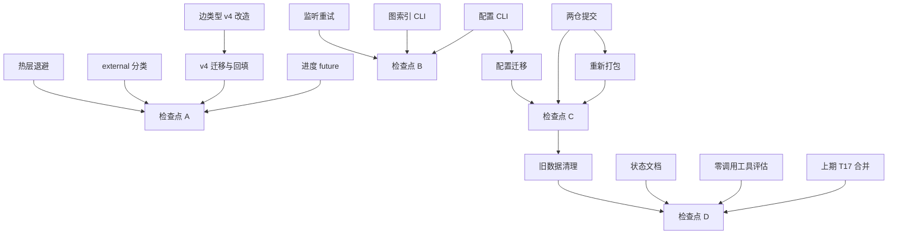

# 项目审查后续行动实施计划

**目标：** 把 2026-11-16 项目审查 README 的 10 条建议动作与记忆边类型拆分落地，两仓代码、数据、提交与打包对齐。
**背景：** 两个 P2 连续三期未关闭（热层初始化被 Qdrant 本地锁阻断、图索引未解析率 70.32% / 62.62%），生产 app 1.2.15 超前 HEAD 1.2.13，配置缺 18 键且浮点仍是科学计数法，记忆边类型增长到 23,421 种。本期建成后，HEAD 可复现线上行为，未解析率有可解释基线，配置与图数据可脚本化修复。
**架构：** 分四段：gateway 运行时与索引修复（热层退避、external 分类、边类型 v4、进度 future），utility 编辑器与配置入口修复，提交打包与配置迁移，数据清理与文档同步。每段结束有检查点。
**技术栈：** Swift 6 / AppKit / SPM（utility）、Python 3.12 / mem0 / Qdrant / tree-sitter（agent-gateway）、SQLite / GRDB。
**计划状态：** 待批准
**依据：** `~/Documents/selfdata/notes/Review/2026-11-16/README.md` 与 01~17 分域明细；`/Users/yuanyxh/Documents/selfdata/projects/utility/.agent/status.md`；两仓 `CLAUDE.md`。

## 非目标

- **RSS 未知日期 494 条不回填**：上期计划 T11 用户已决定不处理，本期只保留遗留记录。
- **`read_url` 5/24 失败与 `websearch_engine` p95 13.9 s 不修**：审查 08 未列为建议动作，需要按 `fetch_top` 分层重新取证后才能定方案。
- **9 个项目缺基座、`yjzt-wms-app` 路径规则对齐失败不处理**：不在 README 的 10 条建议动作内，用户选择「10 条全做」即未纳入本期。
- **冷层 `source_memory_ids`、`search: 0.35` 消费方、note 层写入方不复核**：连续两期无查询入口，列入下期审查。
- **MCP RSS 2 GiB 判定不追**：审查已明确进程启动不足 6 分钟，需要同一生命周期 30 分钟后复采。

## 全局约束

- 两仓改动按主题提交，只提交暂存区，`git commit` 不加 `-a`；提交前逐项确认。
- 所有删除改为移动到 `~/.Trash/`，不执行 `rm`。
- 迁移脚本先 `VACUUM INTO` 备份，禁止直接在原库上试跑。
- schema 变更必须同时更新 `SCHEMA_VERSION` 与 `ensure_columns`，旧库走 ALTER，新库建表即含新列。
- 代码内注释、日志、测试名一律英文；用户可见文案走既有 i18n 链路。
- Python 侧验证只在 agent-gateway 仓执行；Swift 侧最小集为 `swift build` + `scripts/run-tests.sh`。
- 提交与打包含 L3 手测项时，必须标注证据级别，未达 L3 时列待验项。

## 复杂度追踪

无。本计划未违反 `CLAUDE.md` 硬规则。

## 假设

- 假设 A：`memory_edges.type` 的自由谓词全部来自 `entities.merge_fact`，没有第三个写入方。若不成立，T3 迁移前先按 `from_id`/`to_id` 前辍抽样复核。
- 假设 B：Qdrant 本地锁在重启重叠期由旧实例持有，mem0 初始化抛出的异常文本包含锁路径。若日志不含路径，T1 只做退避，不自动删除锁。
- 假设 C：`FileTreeWatcher` 的增量索引入口可用，不需要新增宿主协议。若不成立，T7 改为 CLI `sync` 触发。
- 假设 D：上期 T17 的 `episode_sandbox.py` 不直接写缓存，污染来源只可能是服务端日志。若实测发现脚本写缓存，T14 扩为独立 `GATEWAY_CACHE` 改造。

## 取舍

| 决策 | 代价 | 什么证据会让我改主意 |
|---|---|---|
| 边类型拆到 `predicate` 列并重建表 | 需要停服迁移，旧版本读到 v4 后事实边不可见 | 迁移后 `current_facts` 出现错值，或回滚耗时超过 10 分钟 |
| 未解析符号新增 `external` 分类而不是穷举绑定规则 | 外部符号不产生边，调用链仍不完整 | `external` 占比超过 60%，说明分类过宽 |
| 配置迁移走新增 CLI 子命令 | 多一个对外命令面，需要长期维护 | CLI 无法覆盖设置窗口的写入路径 |
| 工作区索引用 CLI `sync` 触发，不接文件保存回调 | 需要手动执行，不能实时 | 用户要求保存即索引 |

## 交付分档

| 阶段 | 范围 | 交付标准 |
|---|---|---|
| MVP | T1-T4、T10 | 热层退避、external 分类、边类型 v4、配置迁移可执行，两仓测试通过 |
| 完整版 | T1-T14 | 全部代码修复、提交、打包、数据清理、文档同步完成 |
| 增强 | 后续 | 零调用工具下线、9 个项目基座补齐、RSS 日期回填 |

## 存储与迁移

| 场景 | 行为 |
|---|---|
| 首次运行（无 `memory_graph.sqlite`） | 建表即含 `predicate` 列，`user_version=4` |
| 有 v3 数据 | 停服后 `VACUUM INTO memory_graph.pre-v4-<ts>.sqlite`，重建表并复制，事实边 `type='fact'`、`predicate=旧 type` |
| 数据文件解码失败 | 迁移脚本任一步失败即回滚：关闭连接、把备份复制回原名、记录 `memory_edges_v4.log` |
| 旧版本程序写回 | v3 代码读到 `user_version=4` 不触发重建，写入只产生 6 类结构边；事实边写回会因 `type` 不在旧查询条件内而「消失」 |
| 旧版本读到新数据 | 事实边查询为空；恢复命令：停服后 `cp memory_graph.pre-v4-<ts>.sqlite memory_graph.sqlite`，并重启 MCP |

配置迁移同样先写 `config.yaml.bak`，写失败不覆盖原文件。

## 性能与资源预算

| 项 | 上限 | 超限行为 | 验收基线 |
|---|---|---|---|
| 热层初始化退避 | 总等待 3.5 s（0.5/1/2），整体不超过 30 s | 记 ERROR 并保持热层不可用 | 3 次尝试内不阻塞 MCP 启动 |
| 编辑器监听重试 | 0.5 s × 3 次 | 停止重试并记 debug 日志 | 删除后 1 s 内重建能恢复刷新 |
| `memory_edges` 迁移 | 300 s | 中止并回滚备份 | 101,789 边全量迁移 < 60 s |
| `utility config --migrate` | 单文件 1 MB | 拒绝并提示 `fileTooLarge` | 145 键配置读取 < 1 s |

## 文件结构

| 文件 | 动作 | 职责 |
|---|---|---|
| `agent-gateway/src/agent_gateway/services/mcp/server_memory.py` | 修改 | 热层初始化退避与失败诊断 |
| `agent-gateway/src/agent_gateway/services/graph/resolver.py` | 修改 | 未解析符号 external 分类 |
| `agent-gateway/src/agent_gateway/services/graph/constants.py` | 修改 | 语言内置符号表 |
| `agent-gateway/src/agent_gateway/services/graph/parsers/python.py` | 修改 | 外部调用标记 |
| `agent-gateway/src/agent_gateway/services/graph/parsers/swift.py` | 修改 | 外部类型与动态派发标记 |
| `agent-gateway/src/agent_gateway/services/memory/store.py` | 修改 | v4 schema 与列迁移 |
| `agent-gateway/src/agent_gateway/services/memory/entities.py` | 修改 | 事实边写 `predicate` 列 |
| `agent-gateway/src/agent_gateway/services/memory/graph.py` | 修改 | 边类型枚举与查询 |
| `agent-gateway/scripts/memory_edges_v4.py` | 新建 | 停服迁移、备份、回填 |
| `agent-gateway/src/agent_gateway/services/mcp/server.py` | 修改 | 进度 future 异常吞掉 |
| `utility/Sources/Workspace/FileEditorPane.swift` | 修改 | 删除后监听重试 |
| `utility/Sources/Core/ConfigManager.swift` | 修改 | 写入前统一备份 |
| `utility/Sources/CLI/ConfigCommand.swift` | 新建 | `utility config --migrate` |
| `utility/Sources/Resources/{en,zh-Hans}.json` | 修改 | CLI 命令文案唯一数据源 |
| `utility/Sources/Resources/L10nKeys.swift` | 生成 | 由 `scripts/gen-l10n.py` 重新生成 |
| `utility/Sources/CLI/UtilityCLI.swift` | 修改 | 注册 config 子命令 |
| `utility/Sources/CLI/GraphCommand.swift` | 新建 | `utility graph --sync` |
| `utility/Tests/UtilityTests/FileEditorWatchTests.swift` | 修改 | 删除重建用例 |

## 依赖图

## 任务

任务清单与勾选项见 [tasks.md](./tasks.md)。本文件只保留索引。

| 编号 | 任务 | 规模 |
|---|---|---|
| T1 | 热层初始化退避与锁诊断 | S |
| T2 | 图索引 external 分类 | M |
| T3 | 记忆边类型 v4 schema 与写入改造 | M |
| T3b | v4 迁移、重复清理与 importance 回填 | M |
| T4 | 进度上报 future 异常处理 | XS |
| T5 | 编辑器删除重建监听重试 | S |
| T6 | 配置写入备份与 `config --migrate` | M |
| T7 | `graph --sync` 增量索引入口 | S |
| T8 | 两仓按主题提交工作区改动 | M |
| T9 | 重新打包并校验资源 | S |
| T10 | 执行配置迁移 | XS |
| T11 | 旧 Qdrant 与记忆快照移废纸篓 | XS |
| T12 | 两仓 `.agent/status.md` 更新 | XS |
| T13 | 8 个零调用工具评估 | S |
| T14 | 上期 T17 合并项 | XS |
| T15 | lume VM 端到端验证 | M |

## 检查点

### 检查点 A（T1-T4 后）

- [ ] `pytest tests/ -q` 全过，`ruff check` 通过
- [ ] 重建两仓图库后 `external` 分类生效，`project_lookup ConfigManager` 仍命中
- [ ] 迁移脚本在副本上演练通过，原库未动

### 检查点 B（T5-T7 后）

- [ ] `swift build` 与 `scripts/run-tests.sh` 全过
- [ ] `utility config --migrate --dry-run` 输出 18 缺键与 2 处浮点
- [ ] 删除后重建文件的监听用例通过

### 检查点 C（T8-T10 后）

- [ ] 两仓 `git status` 干净，HEAD 含 1.2.15
- [ ] DMG 内 `Utility.app` 版本与二进制符号一致
- [ ] `config.yaml` 缺键 0、`pollInterval` 为 `0.3`、`.bak` 存在

### 检查点 D（T11-T14 后）

- [ ] 配置目录体积下降且 MCP `/health` 为 `ok`
- [ ] 两仓状态文档目标与进行中段落已更新
- [ ] 零调用工具评估表落盘，`memory_expand` 观察期写明

## 未覆盖输入类

| 输入或条件 | 期望行为 | 对应任务 |
|---|---|---|
| Qdrant 锁持续被占用 | 30 s 后放弃并保持可用性降级，不退出进程 | T1 |
| 未知语言文件 | 不标记 external，按原逻辑进 unresolved | T2 |
| 迁移中途断电 | 重启后按 `user_version` 判断，未完成不标记 v4 | T3 |
| 配置文件只读 | CLI 报错退出码非 0，不写 `.bak` | T6 |
| 删除后 1 s 内未重建 | 停止重试，切焦点或重开文件时恢复 | T5 |

## 风险与回滚

| 风险 | 影响 | 缓解 | 回滚 |
|---|---|---|---|
| 边表重建失败 | 高 | 迁移前 `VACUUM INTO` 备份，单事务 | 停服后 `cp memory_graph.pre-v4-<ts>.sqlite memory_graph.sqlite`，重启 MCP |
| external 分类过宽 | 中 | 首次只标语言内置表与已知系统类型，按 reason 统计复核 | `git revert` 对应提交并重建图库 |
| 配置迁移写坏 YAML | 高 | 先校验再写，写前生成 `.bak` | `cp config.yaml.bak config.yaml`，重启 app |
| 提交遗漏主题 | 中 | 逐主题 `git status` 复核后再 commit | `git reset --soft HEAD~1` 重新分批 |
| 打包资源缺失 | 高 | 打包脚本资源缺失硬失败，校验 bundle 大小 | 使用上一次 DMG，不覆盖安装 |

## 开放问题

无。范围、提交授权、边类型实施、上期 T17、配置入口均已在规划期确认。

## 批准记录

- 状态：已批准
- 批准人：用户
- 批准时间：2026-11-16（Asia/Shanghai）
- 验证方式：lume sandbox 端到端验证
