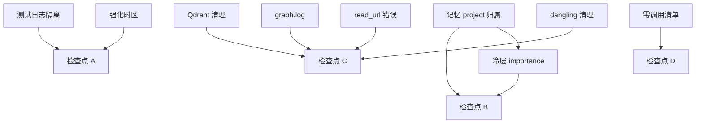

# 2026-11-19 审查修复实施计划

**目标：** 修复 2026-11-19 审查中的 4 个 P2 与 5 个高价值 P3，消除数据链路静默失效。
**背景：** 审查发现记忆 project 归属缺失 86.8%、冷层 importance 恒 5、记忆强化静默失败、生产日志被测试污染；需在不改变既有补齐设计的前提下修复根因。
**架构：** 先修数据写入与时间处理，再补清理与可观测性，最后出治理清单；每批独立验收、可回滚。
**技术栈：** Python 3.12、SQLite、pytest、ruff；macOS 本机数据目录。
**计划状态：** 待批准
**依据：** `~/Documents/selfdata/notes/Review/2026-11-19/` 的 03、04、08、09、12、16、17。

## 非目标

- **不修改 recall 的 `filter_fallback` 补齐机制**：project 硬过滤无内容时回填被过滤行是用户定下的设计（`e2a2c2c`），本计划只修 project 归属缺失。
- 不改 `_fill_filtered`/`_fallback_candidates` 的返回位置与 gate 语义；`fa17d1a` 的行为保持。
- 不做 no_match 归因、mimo 缓存能力新建、上期 6 项未复核；留到下一期。
- 不评估或下线零调用工具，只产出清单。

## 全局约束

- 只读探测与副本演练优先；任何持久化写操作先 `VACUUM INTO` 备份。
- 两个仓的改动分别提交，禁止跨仓混合提交；提交需用户明确允许。
- 不打印任何密钥；日志只记键名与错误类型。
- Python 侧测试统一 `pytest`，静态检查 `ruff check`，禁止 `--fix`。

## 复杂度追踪

无。

## 假设

- 假设 A：86.8% 缺失 project 主要来自历史写入未传字段；若新写入覆盖率仍低，T1 需扩展到调用方提示词。若 A 不成立，T1 的回填范围缩小到 source_files 可解析的记录。

## 取舍

| 决策 | 代价 | 什么证据会让我改主意 |
|---|---|---|
| project 由写入侧兜底推断（source_files → project） | 推断可能把跨项目记忆归错 | 抽检 50 条推断结果错误率 >5% |
| 历史回填写库 | 需备份与演练，增加一次性风险 | 副本演练出现不可逆错误 |
| 测试日志隔离用独立 cache 根 | 测试日志不再出现在生产路径，排障需看临时目录 | 测试需要复现生产日志行为时 |
| dangling 清理放周期任务 | 孤儿最长存活一个周期 | 写入路径仍持续产生新孤儿 |

## 交付分档

| 阶段 | 范围 | 交付标准 |
|---|---|---|
| MVP | T3、T4 | 强化失败归零、测试不再污染生产日志 |
| 完整版 | T1、T2、T5-T8 | 记忆归属、分级、清理与错误可观测全部验收 |
| 增强 | T9 与下期项 | 治理清单落盘，不阻塞本次验收 |

## 存储与迁移

| 场景 | 行为 |
|---|---|
| 首次运行（无数据文件） | 不涉及新建库，沿用现有 `memory_graph.sqlite` |
| 有旧格式数据 | T1 回填前 `VACUUM INTO` 备份，旧值不覆盖，只补空 project |
| 数据文件解码失败 | 回填脚本中止并保留备份，日志记失败条数 |
| 旧版本程序写回 | project 为空时保持空，不写 `unknown` 占位，避免污染统计 |
| 旧版本读到新数据 | 只新增 metadata 字段，旧版本忽略未知键，不破坏读取 |

## 性能与资源预算

| 项 | 上限 | 超限行为 | 验收基线 |
|---|---|---|---|
| project 推断单条 | 5 ms | 跳过该条并计入失败 | 7674 条回填 <60 s |
| 孤儿清理 | 单次 10 s | 中止并记 warning | 不阻塞 MCP 请求 |
| 测试 cache 目录 | 单次运行 50 MB | 运行结束删除 | 生产日志新增测试行 0 |

## 文件结构

| 文件 | 动作 | 职责 |
|---|---|---|
| `agent-gateway/src/agent_gateway/services/memory/strength.py` | 修改 | 统一 UTC aware 时间 |
| `agent-gateway/tests/conftest.py` | 新建/修改 | 测试期隔离 `GATEWAY_CACHE` |
| `agent-gateway/src/agent_gateway/services/mcp/server_memory.py` | 修改 | 冷层 importance 透传、写入 project 兜底 |
| `agent-gateway/src/agent_gateway/services/mcp/server_tool_schema.py` | 修改 | remember 增加 project/importance 说明与参数 |
| `agent-gateway/src/agent_gateway/services/memory/lifecycle.py` | 修改 | 孤儿 activation 清理 |
| `agent-gateway/src/agent_gateway/services/read/read_service.py` | 修改 | 失败结果映射 trace error |
| `agent-gateway/src/agent_gateway/services/graph/indexer.py` | 修改 | graph.log 结构化 |
| `notes/MCP/Skills/projects_review/scripts/collect_metrics.py` | 修改 | 测试污染指纹扩展 |
| `.agent/plans/2026-11-19-review-fixes/tasks.md` | 新建 | 任务清单 |

## 依赖图

## 任务

详细步骤、接口与验收见 [tasks.md](./tasks.md)。任务摘要：

- T1：记忆 project 归属取证、写入兜底与历史回填（需二次批准）。
- T2：冷层 `record_cold_memory` 透传 importance。
- T3：修复强化路径 naive/aware 时间相减。
- T4：测试隔离日志根，采集器扩展测试指纹。
- T5：清理 dangling `memory_activation` 并接入周期巡检。
- T6：read_url 失败时把 `error_code` 写入 trace。
- T7：graph.log 统一 JSONL。
- T8：Qdrant 脏数据移入废纸篓。
- T9：13 个零调用工具评估清单。

## 检查点

- A（T3-T4）：pytest 相关用例通过；跑测试后生产日志新增测试样例为 0。
- B（T1-T2）：副本回填演练通过；新写入 project 覆盖 ≥95%；冷层 importance 非默认 >0。
- C（T5-T8）：孤儿计数 0；read_url 失败 trace 有 error；graph.log 100% 含 ts；health 不变。
- D（T9）：清单落盘，逐项含替代工具与建议。

## 未覆盖输入类

| 输入或条件 | 期望行为 | 对应任务 |
|---|---|---|
| project 为空且 source_files 为空 | 保持空，不写占位 | T1 |
| last_activated_at 为 naive 或 aware | 都能计算，不抛异常 | T3 |
| 测试以并发运行 | 各自独立 cache 根 | T4 |
| read_url 返回空正文 | trace.error 为 `empty` | T6 |

## 风险与回滚

| 风险 | 影响 | 缓解 | 回滚 |
|---|---|---|---|
| 历史回填误归属 | 中 | 副本演练、抽检 50 条、只补空值 | `cp memory_graph.sqlite.bak-<ts> memory_graph.sqlite` 并重启 MCP |
| gateway 工作区有未提交改动 | 中 | 执行前 `git diff > /tmp/gateway-pre.patch` | `git checkout -- <file>` 仅限本计划改动 |
| 测试 env 时序错误 | 低 | conftest 在 import 前设置 | 删除 conftest 改动 |
| 孤儿清理误删活跃行 | 高 | 只删 `LEFT JOIN nodes IS NULL` | 从备份恢复并回滚清理任务 |

## 开放问题

- T1 历史回填需要用户在执行时二次批准；本计划批准不等于批准写库。
- 11-16 计划仍为「待批准」，其 T9 零调用评估与本计划 T9 重叠；执行前需用户决定旧计划继续或作废。

## 批准记录

- 状态：已批准，执行中（代码完成，待部署验证）
- 批准人：用户（2026-11-19 指令「开始，端到端验证」）
- 批准时间：2026-11-19
- 部署状态：未部署。运行中的 MCP 进程仍加载 venv 内旧 wheel，源码改动未生效；需重装 wheel 并重启后做 L3 验证。
