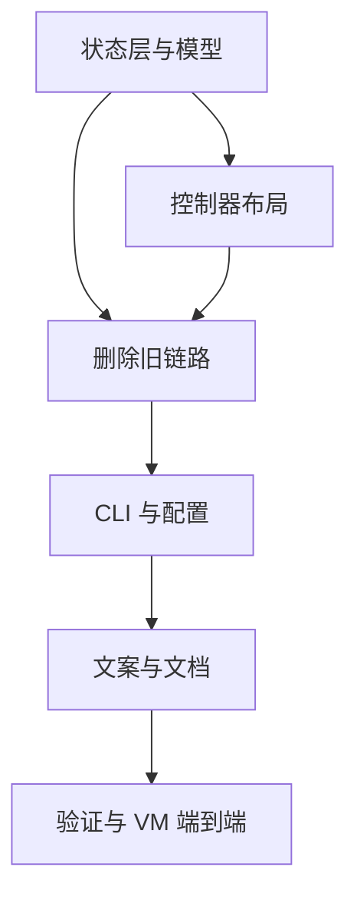

# 工作区精简为终端布局 实施计划

**目标：** 工作区只保留「工作区列表 + 主终端 + 子终端区域」，删除文件列表、文件树、Git 面板、编辑器与预览的全部代码、配置、文案与测试。
**背景：** 文件区使用频率低、代码与状态层占比重；2026-11-19 的 Markdown 工作台计划经用户确认作废（移入废纸篓），本次直接回到终端最小形态。
**架构：** 状态层收缩为 `TerminalUIState`；`WorkspaceWindowController` 改为三栏 `sidebar + mainHost + subPane`；`GitService` 只保留 `branch()` 供子终端底部状态栏。
**技术栈：** Swift 6 / AppKit / SwiftPM / tmux
**计划状态：** 已执行（2026-11-20），待用户验收与提交授权
**依据：** 本会话用户要求与四项确认；`.claude/docs/architecture/workspace.md`；`.agent/plans/2026-11-19-workspace-markdown-workbench/plan.md`（作废）

## 非目标

- 不改主终端、子终端、工作区列表的交互与会话恢复逻辑（用户 2026-11-20 确认保留工作区列表与子终端现状）。
- 不删 `Sources/Components/MarkdownPreviewView.swift`：知识面板复用（代码证明）。
- 不删 `Sources/Core/ProcessRunner.swift`：CLI、安装器等复用（代码证明）。
- 不提交代码（用户规则：未经允许不提交）。

## 全局约束

- 文件删除一律移到 `~/.Trash`，不 `rm`。
- 代码注释/日志用英文；UI 文案只改 `Sources/Resources/<lang>.json`，`L10nKeys.swift` 由 `scripts/gen-l10n.py` 生成。
- 生产进程 `/Applications/Utility.app` 正在运行，验证不重启、不覆盖它，不使用其 tmux 会话。
- `workspaces.json` 版本保持 2；旧字段按「未知键忽略」处理。

## 复杂度追踪

无。

## 假设

- 假设 A：旧 `workspaces.json` 中的 `ui`、`lastOpenedRelativePath`、`subTerminalHeight`、`fileListWidth`、`subListWidth` 删除解码后，旧文件仍可加载（Swift Codable 忽略未知键）；若不成立，在 `Workspace` 解码器里保留忽略逻辑。
- 假设 B：用户不需要 Git 面板，但子终端底部状态栏的分支显示保留；若不需要，删除 `WorkspaceStatusBar` + `GitService` + `terminals.branch`。

## 取舍

| 决策 | 代价 | 什么证据会让我改主意 |
|---|---|---|
| 保留分支状态栏 | 保留 `GitService.branch()` 与一次进程调用 | 用户要求状态栏也不显示分支 |
| 删除 `WorkspaceUIState` 整个类型 | 旧 UI 状态（展开/光标/滚动/页签）永久丢弃，无法恢复 | 用户要求恢复旧 UI 状态 |
| 右子终端整列全高 | 失去「文件区在上、子终端在下」的上下分割 | 用户要求子终端仍只占右下 |

## 交付分档

| 阶段 | 范围 | 交付标准 |
|---|---|---|
| MVP | 任务 1-4 | 代码可编译，窗口只显示工作区列表/主终端/子终端 |
| 完整版 | 任务 1-6 | 旧链路、配置、文案、CLI、测试、文档全部清理，全量验证通过 |
| 增强 | 后续 | 无（本次为收敛，不新增能力） |

## 存储与迁移

| 场景 | 行为 |
|---|---|
| 首次运行（无 `workspaces.json`） | 与现状一致：由 `terminal-sessions.json` 迁移出工作区 |
| 有旧格式数据 | `ui` 等未知键解码时忽略；下次写盘自然丢失这些键 |
| 数据文件解码失败 | 沿用 `WorkspaceStore` 的 `.corrupt-<ts>` 隔离，不改 |
| 旧版本程序写回 | v2 结构仍兼容；旧版本会写回 `ui` 字段，新版本忽略 |
| 旧版本读到新数据 | 新数据只是缺 `ui` 键，旧版本按默认空 UI 状态解码，不破坏终端会话 |

## 性能与资源预算

| 项 | 上限 | 超限行为 | 验收基线 |
|---|---|---|---|
| 分支查询 | 5 s | 返回 nil，状态栏隐藏分支 | 无仓库/慢命令不阻塞 UI |
| 会话轮询 | 2 s | 保持现状 | 不变 |

## 文件结构

| 文件 | 动作 | 职责 |
|---|---|---|
| `Sources/Workspace/State/WorkspaceSnapshot.swift` | 修改 | 只保留 `TerminalUIState` 与两个 `PanelID` |
| `Sources/Workspace/State/WorkspaceUIState.swift` | 删除（移废纸篓） | 旧 UI 状态 |
| `Sources/Workspace/State/IgnoreRules.swift` | 删除（移废纸篓） | 仅文件树使用 |
| `Sources/Workspace/WorkspaceModel.swift` | 修改 | 精简 `WindowLayout` 与 `Workspace` 字段 |
| `Sources/Workspace/WorkspaceWindowController.swift` | 修改 | 三栏布局、只接两个窗格 |
| `Sources/Workspace/WorkspaceManager.swift` | 修改 | 去掉编辑器/草稿/UI 状态接线 |
| `Sources/Workspace/GitService.swift` | 修改 | 只保留 `branch()` 与 `GitError` |
| `Sources/CLI/WorkspaceCheckCommand.swift` | 修改 | 删文件树/编辑器/Git 检查选项 |
| `Sources/Core/ConfigTypes.swift` | 修改 | 删除 `WorkspaceConfig` 与 `Config.workspace` |
| `Sources/Resources/default-config.yaml` | 修改 | 删除 `workspace` 段 |
| `Sources/Resources/{zh-Hans,en}.json` | 修改 | 删除文件区/编辑器/Git/预览文案 |
| 16 个 `Sources/Workspace/*.swift` + 2 个测试 | 删除（移废纸篓） | 见任务 3 |
| `.claude/docs/architecture/workspace.md` | 重写 | 与最小布局一致 |
| `README.md` / `README.zh.md` / `AGENTS.md` / `terminal.md` | 修改 | 删除文件区描述 |
| `.agent/plans/2026-11-19-workspace-markdown-workbench/` | 删除（移废纸篓） | 已作废计划 |

## 依赖图

## 任务

### 任务 1：状态层与模型精简

**文件**

- 修改：`Sources/Workspace/State/WorkspaceSnapshot.swift`
- 修改：`Sources/Workspace/WorkspaceModel.swift`
- 删除：`Sources/Workspace/State/WorkspaceUIState.swift`、`Sources/Workspace/State/IgnoreRules.swift`

**接口**

- 产出：`enum PanelID { case mainTerminal, subTerminals }`
- 产出：`struct WorkspaceSnapshot { var terminals = TerminalUIState() }`
- 产出：`WindowLayout { sidebarWidth, rightPaneWidth }`
- 产出：`Workspace { id, name, path, mainSessionID, subSessionIDs, selectedSubSessionID, createdAt }`

**验收**

- [ ] 旧 `workspaces.json` 可解码，未知 `ui` 键被忽略
- [ ] `swift build` 通过

**验证**

- 命令：`swift build`
- 期望：`Build complete!`

**依赖 / 规模**：无 / S

### 任务 2：控制器布局改造

**文件**

- 修改：`Sources/Workspace/WorkspaceWindowController.swift`

**接口**

- 消费：`WorkspaceState`（mainView/subView/workspaces）
- 产出：`rootSplit = WorkspaceSplitView(isVertical: true, minimums: [180, 360, 320])`，子视图 `[sidebar, mainHost, subPane]`

**验收**

- [ ] 启动后只见工作区列表、主终端、子终端区域
- [ ] 拖动分隔条后布局落盘并在重启恢复

**验证**

- 命令：`swift build`
- 期望：`Build complete!`

**依赖 / 规模**：T1 / M

### 任务 3：删除旧链路（移废纸篓）

**文件**

- 删除：`DiffView.swift`、`EditorDraftDiffWindow.swift`、`EditorDraftStore.swift`、`FileDocument.swift`、`FileEditorPane.swift`、`FileExplorerPane.swift`、`FileTreeModel.swift`、`FileTreeWatcher.swift`、`GitPane.swift`、`GitStatusModel.swift`、`GitStatusProvider.swift`、`ImagePreviewView.swift`、`LineNumberRulerView.swift`、`SyntaxDefinitions.swift`、`SyntaxHighlighter.swift`、`SyntaxProvider.swift`、`WorkspaceActivityBar.swift`
- 删除：`Tests/UtilityTests/FileEditorWatchTests.swift`、`Tests/UtilityTests/FileTreeScannerTests.swift`
- 修改：`Sources/Workspace/GitService.swift`（只留 `branch()`、`GitError`）

**验收**

- [ ] `swift build` 无对已删符号的引用
- [ ] `bash scripts/run-tests.sh` 通过
- [ ] 被删文件存在于 `~/.Trash`

**验证**

- 命令：`swift build && bash scripts/run-tests.sh`
- 期望：构建与测试通过

**依赖 / 规模**：T1、T2 / M

### 任务 4：CLI 与配置清理

**文件**

- 修改：`Sources/CLI/WorkspaceCheckCommand.swift`
- 修改：`Sources/Core/ConfigTypes.swift:43,65,120-138`
- 修改：`Sources/Resources/default-config.yaml:389-397`

**接口**

- 保留：`--sessions/--dry-run/--roundtrip/--state/--reattach/--restore/--live`
- 删除：`--tree/--save/--draft/--highlight/--git/--dirty/--ui`

**验收**

- [ ] `workspace-check --state <file>` 正常输出
- [ ] `workspace-check --git .` 报未知选项

**验证**

- 命令：`.build/debug/utility workspace-check --state ~/.config/utility/workspaces.json`
- 期望：输出 `workspaces:` 行

**依赖 / 规模**：T3 / S

### 任务 5：文案、文档与作废计划

**文件**

- 修改：`Sources/Resources/zh-Hans.json`、`Sources/Resources/en.json`（删文件区/编辑器/Git/预览键）
- 生成：`Sources/Core/L10nKeys.swift`（脚本）
- 修改：`.claude/docs/architecture/workspace.md`、`terminal.md`、`README.md`、`README.zh.md`、`AGENTS.md`
- 删除：`.agent/plans/2026-11-19-workspace-markdown-workbench/`（移废纸篓）

**验收**

- [ ] `gen-l10n.py --check` 与 `check-l10n-contract.py` 退出码 0
- [ ] 文档不再描述文件树/Git/编辑器/预览

**验证**

- 命令：`python3 scripts/gen-l10n.py && python3 scripts/gen-l10n.py --check && python3 scripts/check-l10n-contract.py`
- 期望：两项检查通过

**依赖 / 规模**：T4 / S

### 任务 6：全量验证与 lume 端到端

**文件**

- 无代码改动

**验收**

- [ ] `swift build`、`run-tests.sh`、`swift-format lint` 全过
- [ ] lume `utility-env` 内 dev 构建启动，窗口只剩工作区列表/主终端/子终端，截图留证
- [ ] 生产 `/Applications/Utility.app` 与 tmux 会话未受影响

**验证**

- 命令：`swift build && bash scripts/run-tests.sh && xcrun swift-format lint --recursive --configuration .swift-format Sources`
- 期望：全部通过

**依赖 / 规模**：T1-T5 / M

## 检查点

### 检查点 A（任务 1-3 后）

- [ ] `swift build` 通过
- [ ] 已删符号零引用

### 检查点 B（任务 4-6 后）

- [ ] l10n 双检查通过
- [ ] VM 内 L3 截图确认

## 未覆盖输入类

| 输入或条件 | 期望行为 | 对应测试任务 |
|---|---|---|
| 旧 `workspaces.json` 含 `ui` | 正常加载并忽略 | 任务 1 |
| 无 tmux | 沿用现有空态与提示 | 任务 2 |
| 非 git 仓库 | 状态栏隐藏分支 | 任务 3 |

## 风险与回滚

| 风险 | 影响 | 缓解 | 回滚 |
|---|---|---|---|
| 删除编辑器后仍有引用 | 高 | 编译驱动，逐项清零 | `cp ~/.Trash/<file> Sources/Workspace/` 后 `swift build` |
| 旧数据解码失败 | 中 | 未知键忽略 + CLI 验证 | 从 `workspaces.json.bak` 恢复 |
| 误碰生产 | 高 | 只在隔离 HOME 与 VM 验证 | 不重启生产进程；`lume stop utility-env` |

## 开放问题

- 无。四项边界已由用户 2026-11-20 确认。

## 批准记录

- 状态：已确认
- 批准人：用户
- 批准时间：2026-11-20
