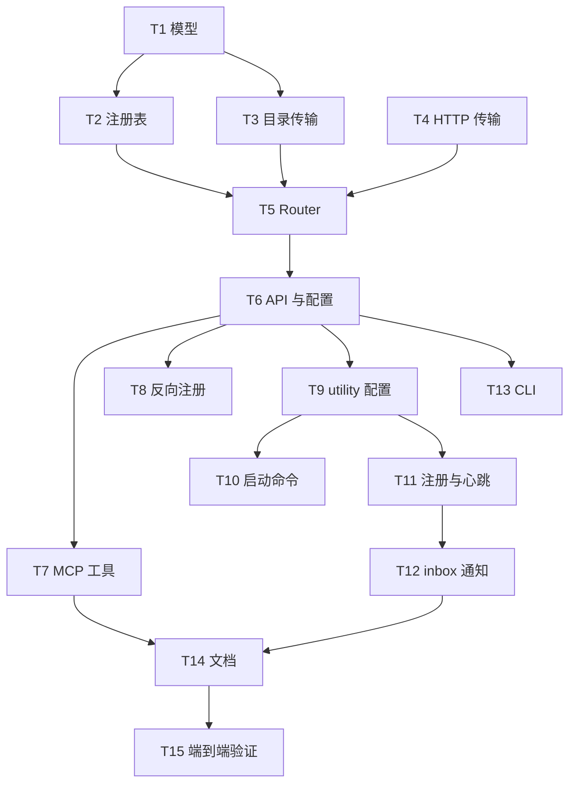

# Agent Mesh 实施计划

**目标：** 在 agent-gateway 建立通用 agent 通信层（服务注册 + 代理 + 存活探测 + 多机转发），utility 在其上实现工作区协议。
**背景：** 多个项目的 `utility -a` agent 需要互相派任务、回报阻塞与结果，当前没有任何会话间通信机制；已定「agent 只连自己的 gateway，gateway 承担代理」，需把通信基础下沉为 gateway 能力，utility 只做工作区语义。
**架构：** gateway 新增 `services/mesh`：文件注册表 + 目录/HTTP 双传输 + Router（本地投递 / 兄弟 gateway 转发，转发前 probe）+ 挂载在既有 Starlette 服务上的 `/mesh/*` API 与 MCP 工具；utility 把工作区注册为服务卡，首次创建主会话时执行启动命令，监听 inbox 产生终端通知。
**技术栈：** Python 3.12 / Starlette（已有）/ pydantic（已有）/ unittest；Swift 6 / AppKit / FSEvents；lume 0.7.0 验证环境。
**计划状态：** 待批准
**依据：** 2026-11-25 用户四点拍板（不保投递、文件注册表、多机做全、lume 验证）；`.claude/docs/architecture/workspace.md`、`terminal.md`；agent-gateway `CLAUDE.md` 验证命令。

## 非目标

- **不实现完整 A2A 规范**：不实现 JWS 签名、OAuth 2.0、多租户、JSON-RPC 绑定。依据：用户「参考 A2A 协议」，取 Card/Message 概念，不取规范兼容。
- **不做消息持久化与重试**：send 失败立即返回错误码，gateway 与 utility 都不重试、不落 outbox。依据：用户明确「不保，重试机制不应落在 gateway 头上，utility 也不应该处理」。
- **不做审批 UI**：提交/验证类流转只作为消息 `kind` 传递，不做面板。依据：本期核心闭环定位。
- **不做注册表数据库**：只用目录文件。依据：用户选「文件」。
- **不自动清理 inbox**：inbox 文件是送达凭证，由消费方删除。依据：与「不重试」一致，避免隐式重放语义。

## 全局约束

- 不改 utility 既有终端/工作区不变量：面板零引用 PanelManager、跨模块走 EventBus、`didResignKey` 用 `DispatchQueue.main.async`。
- gateway 新代码非用户可感知文本一律英文；utility 用户可见文案走 `Sources/Resources/<lang>.json` 并由 `gen-l10n.py` 生成。
- mesh 与 MCP 同进程、同端口，路由挂到 `build_asgi` 合并前的 `rest_app`（`server.py:1105`）。
- 心跳 TTL 120 s，刷新周期 30 s；probe 超时 1.5 s；send 总超时：本机 1 s、跨机 3 s。
- 单条消息 ≤ 64 KB；注册服务 ≤ 500；超限返回错误码，不截断。
- 未启用 gateway（`config.mcp.enabled != true` 或 `PythonScriptRunner.isGatewayAvailable == false`）时，utility 工作区协议整体不启用。
- 一个工作区就是一个服务：Card id = 工作区 id，卡内带启动命令与状态。
- 状态模型：`offline/starting/ready/pending` 由宿主观测；`busy/blocked` 只能由 agent 主动上报，不上报即不可见。
- gateway 测试命令：`PYTHONPATH=src python -m unittest discover -s tests -t .`；utility：`swift build` + `bash scripts/run-tests.sh`。

## 复杂度追踪

无。

## 假设

- 假设 A：gateway 的 Starlette `rest_app` 可直接追加 `/mesh/*` 路由且与 MCP 路由共存。若不成立，mesh 独立 uvicorn 端口 `server.mesh.port`。
- 假设 B：跨机时把 uvicorn bind 从硬编码 `127.0.0.1` 改为配置项即可，不影响 MCP 客户端。若不成立，仅本机模式交付，跨机标为待验。
- 假设 C：workspaces.json 增加可选 `protocol` 字段可被旧版本忽略（`decodeIfPresent`）。若不成立，升到 version 3 并备份。

## 取舍

| 决策 | 代价 | 什么证据会让我改主意 |
|---|---|---|
| 文件注册表（每服务一个 JSON） | 大量服务时 IO 放大；无法事务化 | 注册服务数 > 500 或出现并发写坏文件 |
| 代理为唯一主路径 | gateway 可用性 = 通信可用性 | gateway 崩溃频率高于每周一次，或需离线投递 |
| 不保投递 | 目标离线时消息丢失，调用方自行重发 | 实际使用中出现大量因瞬时离线导致的重发 |
| Card 结构参考 A2A 而非兼容 | 无法直接接入外部 A2A agent | 出现明确的外部 A2A 互操作需求 |
| 本机 127.0.0.1 免鉴权、跨机 Bearer | 本机同用户进程可投递任意消息 | 多用户同机场景出现 |

## 交付分档

| 阶段 | 范围 | 交付标准 |
|---|---|---|
| MVP | T1-T5、T9-T12 | 单机：注册、probe、send、inbox、通知、门控可独立验收 |
| 完整版 | T6-T8、T13 | 多机 peers 转发、鉴权、MCP 工具面、`utility workspace` CLI |
| 增强 | 后续 | A2A Agent Card 兼容、消息查询、批量投递、inbox 自动归档 |

## 存储与迁移

| 场景 | 行为 |
|---|---|
| 首次运行（无数据文件） | 创建 `<data>/mesh/services/` 与 `inbox/`，首次注册时写 Card |
| 有旧格式数据 | 无旧 mesh 数据；workspaces.json v2 新增可选字段，旧文件直接可读 |
| 数据文件解码失败 | Card 解码失败视为无效条目，跳过并记日志，不删除文件 |
| 旧版本程序写回 | 旧 utility 写 workspaces.json 会丢弃 `protocol` 字段；协议配置需重新填写 |
| 旧版本读到新数据 | 旧 gateway 无 mesh 代码，忽略 `<data>/mesh/`；旧 utility 忽略未知 JSON 字段；回滚只需删除 mesh 目录并关闭配置 |

## 性能与资源预算

| 项 | 上限 | 超限行为 | 验收基线 |
|---|---|---|---|
| probe 单目标 | 1.5 s | 返回 offline | 不可达目标 2 s 内返回错误 |
| send 本机 | 1 s | 返回 `target_offline` 或写失败错误 | 100 条连续投递无丢失 |
| send 跨机 | 3 s | 返回 `peer_unreachable` | peers 不可达时 4 s 内返回 |
| 单消息 | 64 KB | 拒绝，`payload_too_large` | 65 KB 消息被拒 |
| 注册服务数 | 500 | 拒绝注册，`registry_full` | 第 501 个返回错误 |
| 心跳 TTL | 120 s | 视为 offline | 停止心跳 130 s 后 list 显示 offline |
| 注册表文件数扫描 | 每次 list ≤ 10 ms（5 服务） | 超过 200 ms 记 warn 日志 | 本机实测记录 |

## 文件结构

| 文件 | 动作 | 职责 |
|---|---|---|
| `agent-gateway/src/agent_gateway/services/mesh/models.py` | 新建 | ServiceCard / MeshMessage / 错误码 |
| `agent-gateway/src/agent_gateway/services/mesh/registry.py` | 新建 | 文件注册表、TTL、原子写 |
| `agent-gateway/src/agent_gateway/services/mesh/transport.py` | 新建 | DirectoryTransport / HTTPTransport / probe |
| `agent-gateway/src/agent_gateway/services/mesh/router.py` | 新建 | 本地投递与 peers 转发、反向注册 |
| `agent-gateway/src/agent_gateway/services/mesh/api.py` | 新建 | `/mesh/*` 与 `/.well-known/agent-card.json` |
| `agent-gateway/src/agent_gateway/services/mesh/tools.py` | 新建 | MCP 工具 `service_*` |
| `agent-gateway/src/agent_gateway/services/mcp/server.py` | 修改 | 挂载 mesh 路由与工具、bind 配置化 |
| `agent-gateway/src/agent_gateway/core/config.py` | 修改 | `server.mesh.*` 解码 |
| `agent-gateway/src/agent_gateway/core/paths.py` | 修改 | mesh 数据目录 |
| `utility/Sources/Workspace/Mesh/WorkspaceProtocolConfig.swift` | 新建 | 工作区协议配置模型与门控 |
| `utility/Sources/Workspace/Mesh/MeshClient.swift` | 新建 | 调 `/mesh/*` 的 HTTP 客户端 |
| `utility/Sources/Workspace/Mesh/WorkspaceInboxWatcher.swift` | 新建 | FSEvents 监听 inbox → EventBus 通知 |
| `utility/Sources/Workspace/Mesh/WorkspaceMeshCoordinator.swift` | 新建 | 注册/心跳/注销编排 |
| `utility/Sources/CLI/WorkspaceCommand.swift` | 新建 | `utility workspace enable/disable/status/send/list/inbox` |
| `utility/Sources/Workspace/WorkspaceModel.swift` | 修改 | 增加 `protocol` 字段 |
| `utility/Sources/Workspace/WorkspaceManager.swift` | 修改 | 注册时机、启动命令注入、注销 |
| `utility/Sources/Terminal/TerminalBackend.swift` | 修改 | `prepare` 支持初始命令 |
| `utility/Sources/CLI/UtilityCLI.swift` | 修改 | 注册 `workspace` 子命令 |
| `utility/Sources/Core/Constants.swift` | 修改 | mesh 客户端路径/超时常量 |
| `utility/default-config.yaml` | 修改 | gateway 侧 mesh 注释与门控说明 |
| `utility/.claude/docs/architecture/agent-mesh.md` | 新建 | 架构、协议、门控与坑 |
| `utility/CLAUDE.md` | 修改 | 文档索引与不变量 |
| `agent-gateway/CLAUDE.md` | 修改 | mesh 模块不变量与验证命令 |

## 依赖图

## 任务

详见 `tasks.md`：T1-T5 gateway 内核，T6-T8 gateway 对外层，T9-T13 utility 适配，T14 文档，T15 端到端验证。

## 检查点

- **A（T1-T5 后）**：gateway mesh 单测全绿，无网络依赖。
- **B（T6-T8 后）**：`curl` 完成注册/查询/发送/探测；MCP `tools/list` 出现 5 个 `service_*` 工具。
- **C（T9-T13 后）**：utility 构建与单测通过；本机单 gateway 端到端跑通注册、通知、CLI。
- **D（T14-T15 后）**：双 gateway peers 转发通过；lume `utility-env` 内验证通过并落证据。

## 未覆盖输入类

| 输入或条件 | 期望行为 | 对应测试任务 |
|---|---|---|
| 非法 kind / 缺字段 Card | 注册被拒，返回 `invalid_card` | T1 |
| 65 KB 消息 | 拒绝 `payload_too_large` | T1 |
| 目标未注册 | `target_unknown`，不写任何文件 | T5 |
| 目标心跳过期 | `target_offline`，不写 inbox | T5 |
| peers 全部不可达 | `peer_unreachable`，3 s 内返回 | T6 |
| 无 token 的远程请求 | 401，不注册 | T6 |
| gateway 未启用 | utility 协议不注册、不监听 | T9 |
| inbox 目录被删除 | 重新创建并记日志，不崩溃 | T12 |

## 风险与回滚

| 风险 | 影响 | 缓解 | 回滚 |
|---|---|---|---|
| Starlette 路由与 MCP 冲突 | 中 | 独立前缀 `/mesh/` 与 `/.well-known/` | 删除 `mesh` 路由注册并重启 gateway；判据为 MCP 客户端 initialize 失败 |
| bind 改动影响本机客户端 | 中 | 默认仍 127.0.0.1，仅跨机配置改 0.0.0.0 | 配置改回 `server.mcp.bind: 127.0.0.1` 并重启 |
| 跨机明文 token | 高 | 仅内网使用，文档写明不暴露公网 | 关闭 `server.mesh.enabled` 并移除 peers |
| workspaces.json 新字段丢失 | 低 | 字段可重填，不影响终端 | 手改 workspaces.json 删除 `protocol` 键 |
| inbox 无限增长 | 中 | 文档约定消费方删除；`inbox` 单服务文件数 > 1000 时记 warn | 手动清理 `<data>/mesh/inbox/<service>/` |
| lume VM 网络限制 | 中 | 跨机验证先本机双实例，VM 只验隔离运行 | VM 内改回单机模式并记录待验项 |

## 开放问题

无。

## 批准记录

- 状态：待批准
- 批准人：
- 批准时间：
