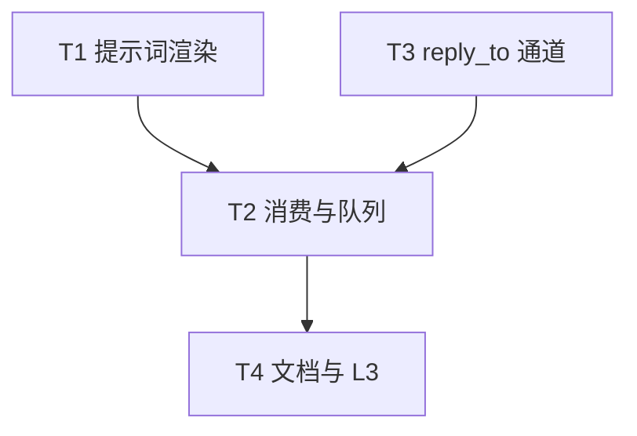

# Mesh 任务载荷与回执 实施计划

**目标：** `service_send(kind=task)` 的消息能自动进入目标工作区的 agent 会话执行，agent 完成后以 `kind=reply` 回执调用方。
**背景：** 2026-11-27 确认 Agent Mesh 只有通信与拉起；inbox 消费只通知，任务文本无处注入、无回执，用户判定交付不合格。卡状态判据修复后 `service_start` 已能真实拉起 agent，剩余缺口是载荷与回执。
**架构：** 复用 gateway 已支持的 `task/reply` 消息类型与 `reply_to` 字段；utility 侧解析 inbox，按卡状态注入主会话，未就绪时先拉起并排队；回执由 agent 调用 `service_send` 或 `utility workspace send --reply-to` 发出。
**技术栈：** Swift 5.9 / AppKit / tmux / Python gateway（不改代码）
**计划状态：** 已批准，任务 1-3 与文档已完成，待 L3 验证
**依据：** `.claude/docs/architecture/agent-mesh.md`、`agent-gateway/src/agent_gateway/services/mesh/models.py:23`、`.agent/plans/2026-11-25-agent-mesh/`

## 非目标

- 不做任务执行状态的持久化与重试（投递仍不保送达，沿用 `agent-mesh.md:70`）
- 不做内容安全过滤（跨机使用依赖 token 与可信网络）
- 不改 gateway 代码：`MessageKind` 已含 `task/reply`，`reply_to` 已支持
- 不做 agent 侧自动回执：回执由注入提示词要求 agent 主动发送

## 全局约束

- 注入文本必须单行：tmux `send-keys` 中的换行会被 TUI 当作多次提交
- 只注入 `kind=task` 与 `kind=reply`；`kind=notify` 保持系统通知
- 注入目标必须是前台进程匹配 `agentCli` 的主会话（复用 `MeshAgentState`）
- 跨项目文档改动派发给 agent-gateway 服务卡，不在本仓直接改 gateway
- 代码内文本英文；用户可感知文本走 `Resources/<lang>.json`

## 复杂度追踪

无。

## 假设

- 假设 A：agent 会话能调用 `service_send`（`MESH_SERVICE_ID`/`MESH_GATEWAY_URL` 由 `agentLaunchCommand` 注入）；若不成立，回执改用 CLI 绝对路径
- 假设 B：同一工作区同一时刻只有一个主会话；若不成立，注入到 `mainSessionID`
- 假设 C：gateway `/mesh/send` 接受任意 `kind` 字符串，非法值返回 `invalid_message`

## 取舍

| 决策 | 代价 | 什么证据会让我改主意 |
|---|---|---|
| 仅 task/reply 注入 | notify 无法驱动 agent，需调用方显式改 kind | 真实使用中多为 notify 驱动任务 |
| 未就绪自动拉起 | 可能拉起用户不想要的会话 | 出现误拉起投诉 |
| 队列入内存不落盘 | 进程重启丢失未注入任务 | 出现任务丢失导致业务损失 |
| 回执由 agent 主动发 | 不保证回执，可能无响应 | 多次任务无回执需改为 utility 代发 |

## 交付分档

| 阶段 | 范围 | 交付标准 |
|---|---|---|
| MVP | 任务 1-3 | task 消息注入已就绪会话；reply_to 可用；构建与单测通过 |
| 完整版 | 任务 4 | 未就绪自动拉起并排队、回执闭环、文档同步、L3 验证 |
| 增强 | 后续 | 任务状态查询、超时回执、批量任务 |

## 存储与迁移

不落盘新数据。`pendingTasks` 为内存队列，进程退出即丢弃；无旧版本兼容问题。

## 性能与资源预算

| 项 | 上限 | 超限行为 | 验收基线 |
|---|---|---|---|
| 单条任务文本 | 8 KB | 截断并 `debugLog` | 超限任务仍注入前 8 KB |
| 队列长度 | 10 条/工作区 | 丢弃最旧并 `debugLog` | 第 11 条到达时队列仍为 10 |
| 等待 agent 就绪 | 15 s | 丢弃队列并 `debugLog` | 超时后 `pendingTasks` 为空 |
| 注入间隔 | 1 s | 不适用 | 同一工作区连续任务不重叠 | 

## 文件结构

| 文件 | 动作 | 职责 |
|---|---|---|
| `Sources/Workspace/Mesh/MeshTaskPrompt.swift` | 新建 | 渲染单行注入提示词与回执指令 |
| `Sources/Workspace/WorkspaceManager.swift` | 修改 | 解析 task/reply、队列、就绪后 flush、注入 |
| `Sources/Workspace/Mesh/MeshClient.swift` | 修改 | `send(...)` 增加 `replyTo` 并写入 `reply_to` |
| `Sources/CLI/WorkspaceCommand.swift` | 修改 | `Send` 增加 `--reply-to` |
| `Tests/UtilityTests/WorkspaceMeshTests.swift` | 修改 | 覆盖渲染、单行化、回执指令 |
| `.claude/docs/architecture/agent-mesh.md` | 修改 | 任务载荷与回执语义 |
| `README.md` / `README.zh.md` | 修改 | CLI 与任务示例 |

## 依赖图

## 任务

### 任务 1：注入提示词渲染

**文件**

- 新建：`Sources/Workspace/Mesh/MeshTaskPrompt.swift`
- 测试：`Tests/UtilityTests/WorkspaceMeshTests.swift`

**接口**

- 产出：`MeshTaskPrompt.render(id: String, sender: String, serviceID: String, text: String) -> String`
- 产出：`MeshTaskPrompt.truncate(_ text: String, limit: Int = 8192) -> String`

**验收**

- [ ] 输出为单行，含 `id`、`sender`、任务正文
- [ ] 末尾含 `service_send` 回执指令与 `reply_to` 值
- [ ] 超过 8192 字节的正文被截断并追加 `...`

**验证**

- 命令：`bash scripts/run-tests.sh`
- 期望：新增用例通过

**依赖 / 规模**：无 / S

- [ ] 步骤 1：写失败测试，断言换行被替换、回执字段存在
- [ ] 步骤 2：运行测试确认失败
- [ ] 步骤 3：实现 `MeshTaskPrompt`
- [ ] 步骤 4：运行测试确认通过

### 任务 2：task/reply 消费、队列与注入

**文件**

- 修改：`Sources/Workspace/WorkspaceManager.swift`（`handleMeshMessage`、`startRequested`、`finishAgentCheck`）
- 测试：`Tests/UtilityTests/WorkspaceMeshTests.swift`

**接口**

- 消费：`MeshTaskPrompt.render`、`TmuxBackend.sendCommand(_:to:) -> Bool`、`MeshAgentState.isRunning`
- 产出：`deliverMeshPrompt(serviceID:sender:messageID:text:)`、`flushPendingTasks(serviceID:)`

**验收**

- [ ] `kind=task`/`kind=reply` 到达且 agent 就绪时，文本注入主会话
- [ ] agent 未就绪时先 `startRequested`，15 s 内就绪后按 FIFO 注入
- [ ] 队列超限丢弃最旧，超时丢弃全部并记日志

**验证**

- 命令：`swift build && bash scripts/run-tests.sh`
- 期望：BUILD SUCCEEDED、测试全过

**依赖 / 规模**：任务 1 / M

- [ ] 步骤 1：新增 `pendingTasks` 与 `deliverMeshPrompt`
- [ ] 步骤 2：`handleMeshMessage` 增加 task/reply 分支
- [ ] 步骤 3：`finishAgentCheck` 就绪路径调用 `flushPendingTasks`，超时路径清空
- [ ] 步骤 4：构建与测试

### 任务 3：回执通道

**文件**

- 修改：`Sources/Workspace/Mesh/MeshClient.swift:125-136`
- 修改：`Sources/CLI/WorkspaceCommand.swift:60-68,185-211`

**接口**

- 产出：`MeshClient.send(sender:recipient:kind:text:replyTo:)`（`replyTo: String? = nil`）
- 产出：`utility workspace send --to --kind --text [--reply-to]`

**验收**

- [ ] HTTP body 含 `reply_to`
- [ ] CLI 省略 `--reply-to` 时行为不变

**验证**

- 命令：`swift build`
- 期望：BUILD SUCCEEDED

**依赖 / 规模**：无 / S

- [ ] 步骤 1：扩展 `send` 与 `sendMessage`
- [ ] 步骤 2：CLI 增加 `--reply-to`
- [ ] 步骤 3：构建

### 任务 4：文档与端到端验证

**文件**

- 修改：`.claude/docs/architecture/agent-mesh.md`、`README.md`、`README.zh.md`

**验收**

- [ ] 文档写明 task/reply 注入规则、回执方式、通知与任务的区别
- [ ] 对 agent-gateway 卡执行 `service_send(kind=task)` 后会话内出现任务文本
- [ ] 调用方 inbox 收到 agent 发出的 `kind=reply`

**验证**

- 命令：`swift build && bash scripts/run-tests.sh && swift-format lint --strict <改动文件>`
- 期望：全过；L3 用真实卡与真实 agent

**依赖 / 规模**：任务 2、3 / M

- [ ] 步骤 1：同步文档
- [ ] 步骤 2：部署或隔离 HOME 启动新构建
- [ ] 步骤 3：发一条 task 消息，截图确认注入
- [ ] 步骤 4：确认回执到达发送方 inbox

## 检查点

### 检查点 A（任务 1-2 后）

- [ ] `swift build` 成功
- [ ] `run-tests.sh` 全过
- [ ] 单测覆盖渲染与队列边界

### 检查点 B（任务 3-4 后）

- [ ] L3：真实 `service_send(kind=task)` 注入成功
- [ ] L3：回执到达发送方 inbox
- [ ] 文档与实现一致

## 未覆盖输入类

| 输入或条件 | 期望行为 | 对应测试任务 |
|---|---|---|
| 空文本 | 忽略并记日志 | 任务 2 |
| 8 KB 以上文本 | 截断后注入 | 任务 1 |
| 目标卡 `startable=false` | 保留队列至超时后丢弃 | 任务 2 |
| 前台被 vim 占用 | 不注入，记 `pane busy` | 任务 2 |
| 队列 10 条已满 | 丢弃最旧 | 任务 2 |
| `reply_to` 指向不存在消息 | 正常投递，不校验 | 任务 3 |

## 风险与回滚

| 风险 | 影响 | 缓解 | 回滚 |
|---|---|---|---|
| 注入文本被当作 prompt injection | 中 | 仅可信网络；非回环强制 token | 回退 `WorkspaceManager.swift` 的 task 分支 commit，`kind=task` 退回通知 |
| 多行任务被 TUI 拆成多次提交 | 中 | `MeshTaskPrompt` 单行化 + 单测 | 回退 `MeshTaskPrompt.swift` |
| 未就绪反复拉起 | 中 | 复用 `startingServices` 去重与 15 s 预算 | 删除 `deliverMeshPrompt` 中的 `startRequested` 调用 |
| 队列内存丢失 | 低 | 文档写明不保送达 | 无需回滚 |

## 开放问题

- 无。

## 执行记录

- 2026-11-27：任务 1-3 与文档完成；`swift build` 通过、`run-tests.sh` 65 tests 0 failures、`swift-format lint --strict` 通过
- 三轮独立审查收敛为可合并；已修回执乒乓、入队无冲刷、清理代次、缺 text 注入信封、sender 未净化、注入间隔六项
- 偏差：未单独跑「确认测试失败」基线；队列窗口、代次清理、ready 竞态仅代码审查覆盖
- 未完成：L3（需部署后发真实 `kind=task` 并确认回执）

## 批准记录

- 状态：已批准
- 批准人：用户
- 批准时间：2026-11-27（「开始，改完 review」）
