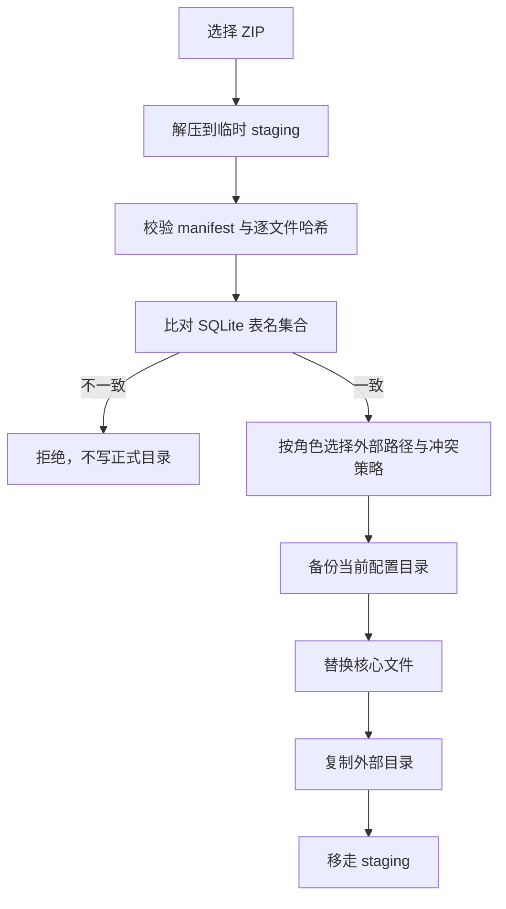

# 换机迁移、数据归档与首启引导

本文回答：如何把一台 Mac 上的 Utility 用户数据迁移到另一台机器，以及首启时如何导入、检测并安装依赖。

## 入口

- 设置 →「数据与迁移」→「导出用户数据…」：选择范围并生成 ZIP。
- 首次启动（`~/.config/utility/config.yaml` 不存在）：初始化向导，顺序为导入 → 检测 → 安装 → 完成。
- 命令行：`utility archive-check` 与 `utility setup-check`，用于无界面验证。

## 归档格式

ZIP 根目录固定四类内容：

| 路径 | 内容 |
|---|---|
| `manifest.json` | 格式版本、应用版本、范围、文件哈希、外部目录记录 |
| `config/` | `config.yaml`、`agent-gateway.yaml`、`prompts/`、`retrieval_thresholds.json` |
| `data/` | 记忆、知识库、剪贴板、提醒、工作区、终端会话等 SQLite/JSON |
| `external/<role>/` | 笔记目录、知识卡目录、RSS 产出（`notes` / `liked` / `rss`） |

`manifest.json` 的关键字段：

- `formatVersion`：当前为 1；更高版本直接拒绝。
- `gatewayWheel`：导出时的 wheel 文件名；导入后与本机不一致即作废安装戳，强制重装。
- `includesSecrets`：是否保留了 `apiKey`。
- `files[]`：归档内每个文件的相对路径、sha256 与字节数。
- `external[]`：每个外部角色的原绝对路径、归档路径、文件数与字节数。
- `sourcePaths`：`notesDir`、`knowledgeBasePath`、`likedSaveDir`、`rssOutputDir`、`qdrantPath` 的原值。

## 导出

1. 按配置计算可选范围；知识库与终端工作区分别受 `knowledge.enabled`、`terminal.enabled` 控制，用量库仅在文件存在时出现且默认不选。
2. SQLite 用 GRDB `DatabaseReader.backup(to:)` 做在线快照，包含 WAL 内容；非 SQLite 文件直接复制。读取器先以只读打开，若遇到 WAL 库缺少 `-shm`（`SQLITE_CANTOPEN`，错误 14）则回退为读写打开，让 SQLite 创建 sidecar；备份本身只读。
3. 外部目录递归枚举，跳过符号链接、`.git/`、`.DS_Store`、`.trash/`、`*.tmp`、`*.lock`；`liked`/`rss` 位于笔记目录内时不重复打包。
4. 未勾选「包含 API 密钥」时，`config.yaml` 与 `agent-gateway.yaml` 内所有名为 `apiKey` 的键置空。
5. 计算每个文件的 sha256，写 `manifest.json`，用 `ditto -c -k --norsrc` 生成 ZIP。

## 导入



安全约束：

- 归档路径只能是 `config/`、`data/`、`external/` 下的相对路径；出现 `..`、绝对路径或反斜杠即拒绝。
- `external[].archivePath` 必须严格等于 `external/<role>`，`originalPath` 必须是绝对路径；否则在校验阶段拒绝。
- 表名集合（排除 `sqlite_%`）与当前库不一致时拒绝，并列出差异表。
- 外部目标目录在替换核心文件前做可写性预检，失败不落盘。
- 校验失败立即移走 staging；重新选择压缩包或关闭向导也会清理未消费的 staging。
- 备份目录为 `~/.config/utility.backup-<yyyyMMddHHmmss>`，SQLite 同样用在线备份，跳过 `mcp-venv` 与 WAL/SHM。
- 替换 SQLite 前先移走同名 `-wal`/`-shm`；未出现在归档中的现有文件不删除。

## 外部目录与路径改写

- 默认恢复到 manifest 记录的原路径。
- 目标路径缺失或用户改选时，只改写三个键：`mcp.knowledgeBasePath`、`knowledge.likedSaveDir`、`rss.daily.outputDir`。
- `mcp.qdrantPath` 不在外部角色内，归档也不含向量数据：归档记录的路径在本机不存在时，导入页单独展示该路径并要求另选目标，导入前改写 `mcp.qdrantPath`；新目录为空，记忆需重新嵌入。
- `likedSaveDir` / `rss.daily.outputDir` 若位于旧笔记目录内，notes 改路径时按相对路径一并平移；显式给出的角色路径优先。
- 同名文件按角色选择「跳过已存在」或「覆盖」；覆盖前把被覆盖文件备份到 `<backup>/external-<role>/`。
- 外部目录复制使用逐文件复制，失败时保留已完成文件与备份，可重试。

## 首启检测与安装

检查项与判据：

| 项 | 判据 |
|---|---|
| Xcode 命令行工具 | `xcode-select -p` 指向存在的路径 |
| Homebrew | `/opt/homebrew/bin/brew`、`/usr/local/bin/brew` 或 PATH 中的 `brew` |
| Python | 候选解释器 `--version` ≥ 3.12，返回实际路径与版本 |
| tmux | 可执行文件存在；`terminal.enabled` 为 false 时只作可选项 |
| Python 依赖 | venv 内 `site-packages/agent_gateway` 存在且未写 broken 标记 |
| 嵌入模型 | fastembed 缓存目录下存在匹配目录，`models--Qdrant--all-MiniLM-L6-v2-onnx` 这类别名也算命中 |
| 重排模型 | `RERANK_MODEL_DIR` 或 `~/.cache/utility/models/bge-reranker-base-int8` 下 `tokenizer.json` 与 `onnx/model_int8.onnx` 同时存在 |

安装顺序：Homebrew → `brew install python@3.12` → `brew install tmux` → gateway wheel/extras → 嵌入模型 → 重排模型。Homebrew 缺失时，安装页先展示官方脚本 URL 与完整命令，用户点「开始安装」后写临时 `.command` 并用 `open -a Terminal` 执行，app 不阻塞；其余步骤必须由用户确认后执行，每步输出 `[Setup]` 日志与退出码。Xcode 命令行工具是可选提示项，由 Homebrew 安装脚本自行处理。

下载走 `SetupInstaller.downloadEnvironment`：`proxyEnabled=true` 或首启（`config.yaml` 不存在）时读系统代理并注入 `HTTP(S)_PROXY`，curl 与 fastembed 共用。重排模型下载后校验 SHA256（`tokenizer.json` 与 `onnx/model_int8.onnx` 各一个常量），不匹配即移走临时文件并标记失败。

## 依赖与缓存清单

完整运行分四层：系统工具、Python venv、模型缓存、用户数据。前三层可删除重建，用户数据必须保留。

### 系统依赖

| 依赖 | 要求 | 缺失时 |
|---|---|---|
| Homebrew | `brew` 在 `/opt/homebrew/bin` 或 `/usr/local/bin` | 必需，安装页给出官方脚本 |
| Python | ≥ 3.12 | 必需 |
| tmux | 任意版本 | 终端启用时必需 |
| Xcode CLT | `xcode-select -p` 有效 | 可选 |

### Python 运行时

| 内容 | 位置 | 说明 |
|---|---|---|
| gateway wheel | 随 app 分发（`Sources/Gateway`） | 首启装进 venv |
| venv | `~/.config/utility/mcp-venv` | extras `proxy,memory,server` |
| 基础依赖 | PyPI | httpx、pathspec、PyYAML、tree-sitter 与各语言语法包 |
| proxy / memory / server | PyPI | aiohttp、Brotli、mem0ai、fastembed、qdrant-client、mcp、uvicorn、trafilatura 等 |

SwiftPM 依赖编译进 app，不需要用户单独安装。

### 模型缓存

| 模型 | 默认位置 | 来源 |
|---|---|---|
| 重排 `bge-reranker-base-int8` | `~/.cache/utility/models/<name>` | HuggingFace `Xenova/bge-reranker-base` |
| 嵌入 | `~/.cache/utility/fastembed`，可用 `mcp.fastembedCacheDir` 覆盖 | fastembed 按模型解析，目录名可能是 `Qdrant/<name>-onnx` |

模型缓存可删除重建；重排模型缺失只让 recall 退回融合排序，不影响启动。

### 用户数据与运行缓存

- 数据：`~/.config/utility` 下的 `config.yaml`、`agent-gateway.yaml`、`data.sqlite`、`memory_graph.sqlite`、`knowledge.sqlite`、`notices.sqlite`、`token_usage.sqlite`、`tool_output.sqlite`、`workspaces.json`、`terminal-sessions.json`、`retrieval_thresholds.json`
- 向量库：`mcp.qdrantPath` 指向的 Qdrant 本地目录
- 项目图：各项目根 `.agent-gateway/graph.sqlite`
- 日志与调试：`~/.cache/utility/*.log`、`agent_debug/`、`clip/`、`stage/`
- 导入备份：`~/.config/utility.backup-<yyyyMMddHHmmss>`

## 预算与限制

| 项 | 上限 | 超限行为 |
|---|---|---|
| 导出包 | 8 GB | 中止，不留下半成品 ZIP |
| 文件数 | 100,000 | 中止并提示缩小范围 |
| 整体导出 | 600 s | 中止并保留日志 |
| 单个 SQLite 备份 | 120 s | 中止整个导出 |
| 解压与校验 | 300 s | 中止导入，保留 staging |
| 模型下载 | 1800 s | 终止进程，标记失败，不阻塞启动 |

## 回滚

- 配置与数据库：`ditto ~/.config/utility.backup-<时间戳>/ ~/.config/utility/` 后重启。
- 外部目录：从 `<backup>/external-<role>/` 覆盖回目标目录。
- 旧 venv：`python-venv` 重建前移入废纸篓，可从废纸篓恢复。

## 验证

```bash
swift build
bash scripts/run-tests.sh
"$(swift build --show-bin-path)/utility" archive-check --roundtrip
"$(swift build --show-bin-path)/utility" setup-check
```

`archive-check --roundtrip` 覆盖导出、校验、导入、外部路径改写、密钥剥离、schema 拒绝与范围过滤；`setup-check` 输出七项依赖状态（含重排模型）。
