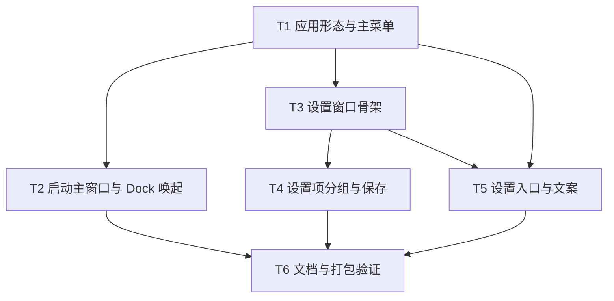

# Utility GUI 化重构实施计划

**目标：** 把 Utility 从纯菜单栏 accessory 应用重构为标准 macOS GUI 应用，保留菜单栏常驻与全部现有功能。
**架构：** 运行时 `setActivationPolicy` 决定 regular / accessory；主窗口复用终端窗口；设置窗口用 SwiftUI Form 承载在 `NSHostingController` 中，经 `ConfigManager` 读写 `config.yaml`。
**技术栈：** Swift 5.9、macOS 14、AppKit、SwiftUI（仅设置窗口）、Yams、GRDB，不新增依赖。
**计划状态：** 待批准
**依据：** 现状代码与 `.claude/plans/gui-app-conversion.md`（本计划替代该文件）。

本文回答一个问题：怎样在不重写剪贴板、翻译、知识、Stage 面板的前提下，让 Utility 具备正常 GUI 应用的形态与可视化设置。

## 非目标

- 不重写现有 `NSPanel` 面板与 `PanelManager` 面板栈。
- 不新增 Workspace 侧边栏主窗口，终端窗口继续承担主窗口职责。
- 不改 tmux 终端后端、会话存储与恢复。
- 不改 Python / agent-gateway 侧任何代码。
- 不改 CLI 参数分支（`Sources/App/main.swift`）。
- 不做多 SPM target 拆分。

## 全局约束

- 最低 macOS 14，沿用 `Package.swift` 的单 `executableTarget`，不新增 target 与依赖。
- 用户可见文案只走 `Sources/Resources/<lang>.json`，Swift 访问器由 `scripts/gen-l10n.py` 生成，禁止手改 `L10nKeys.swift`。
- 代码注释、日志、内部错误消息用英文；配置注释与 README 保持项目既有语言。
- 配置默认值同时满足三处一致：属性初值、`decodeIfPresent` 兜底、`default-config.yaml`。
- 设置窗口保存会重写整个 YAML，注释丢失；保存前必须备份原文件。
- 热键只在启动时 `registerAllHotkeys()`，设置窗口修改热键后必须提示重启。
- 所有删除改为移动到废纸篓；本计划无删除操作。

## 复杂度追踪

无。

## 假设

- 假设 A1（最脆弱）：`nonactivatingPanel` 面板在 regular 应用下仍能按原方式获取键盘输入。若不成立，回退 `app.hideDockIcon: true`，并追加面板激活时序任务，该任务不在本计划范围。
- 假设 A2：终端窗口足以作为主窗口，不新增独立主窗口。
- 假设 A3：设置窗口只覆盖常用配置项，其余仍通过现有「打开配置文件」编辑器修改。
- 假设 A4：用户接受设置窗口保存后 YAML 注释丢失，窗口内明确提示并提供备份。
- 假设 A5：`config.yaml` 中缺失 `app` 段时按默认值 `hideDockIcon=false`、`showTerminalOnLaunch=true` 处理。

## 文件结构

| 文件 | 动作 | 职责 |
|---|---|---|
| `Sources/Core/AppBehaviorConfig.swift` | 新建 | `app` 段配置类型与默认值 |
| `Sources/App/AppMainMenu.swift` | 新建 | 应用主菜单构建与语言切换重建 |
| `Sources/App/SettingsWindowController.swift` | 新建 | 设置窗口生命周期与关闭语义 |
| `Sources/App/SettingsView.swift` | 新建 | 分组设置表单 |
| `Sources/App/SettingsModel.swift` | 新建 | 配置副本、校验、保存与状态提示 |
| `Sources/Core/ConfigTypes.swift` | 修改 | `AppConfig` 增加 `app` 段解码 |
| `Sources/Core/ConfigManager.swift` | 修改 | 新增 `apply(_:)` 与保存前备份 |
| `Sources/App/AppDelegate.swift` | 修改 | 激活策略、主菜单、启动主窗口、Dock 唤起 |
| `Sources/Core/MenuBarManager.swift` | 修改 | 菜单栏新增设置入口 |
| `scripts/package-utility.sh` | 修改 | 删除 `LSUIElement` |
| `Sources/Resources/default-config.yaml` | 修改 | 新增 `app` 段与注释 |
| `Sources/Resources/zh-Hans.json`、`en.json` | 修改 | 主菜单与设置文案 |
| `Sources/Core/L10nKeys.swift` | 生成 | 由脚本生成，不手改 |
| `README.md`、`README.zh.md`、`AGENTS.md`、`.claude/CLAUDE.md` | 修改 | 应用形态说明 |
| `.claude/docs/architecture/panel-ui.md` | 修改 | 激活策略与主窗口行为 |

## 依赖图

## 任务索引

详细步骤、接口与验收见同目录 `tasks.md`。

| 编号 | 标题 | 依赖 | 规模 |
|---|---|---|---|
| T1 | 应用形态、配置段与主菜单 | 无 | M |
| T2 | 启动主窗口与 Dock 唤起 | T1 | S |
| T3 | 设置窗口骨架与保存通道 | T1 | M |
| T4 | 设置项分组与校验 | T3 | M |
| T5 | 设置入口与中英文案 | T1、T3 | S |
| T6 | 文档同步与打包验证 | T2、T4、T5 | S |

## 检查点

### 检查点 A（T1-T2 后）

- [ ] `swift build` 通过。
- [ ] 默认启动出现 Dock 图标、Cmd+Tab 入口与三组主菜单。
- [ ] 启动展示终端主窗口；关闭窗口后应用不退出；点 Dock 图标可恢复。
- [ ] 菜单栏图标、全局热键、剪贴板/翻译/知识/Stage 面板行为不变。

### 检查点 B（T3-T5 后）

- [ ] 主菜单与菜单栏两处入口打开同一个设置窗口。
- [ ] 修改终端字号并保存后，新会话使用新字号；`config.yaml` 值已更新。
- [ ] `hideDockIcon` 从设置窗口保存后即时生效，无需重启。
- [ ] `gen-l10n.py --check` 与 `check-l10n-contract.py` 通过。

### 检查点 C（T6 后）

- [ ] `bash scripts/run-tests.sh` 全过。
- [ ] 打包脚本成功，`.app` 的 `Info.plist` 无 `LSUIElement`。
- [ ] L1、L2、L3 证据按三级分别记录，未完成项单列。

## 未覆盖输入类

| 输入或条件 | 期望行为 | 对应任务 |
|---|---|---|
| `hideDockIcon=true` 时打开设置窗口 | 窗口可见，无 Dock 图标 | T3 |
| tmux 未安装且启动主窗口 | 窗口显示缺失提示，不崩溃 | T2 |
| `config.yaml` 不可写 | 保存失败弹错误，内存配置不变 | T3 |
| 热键格式非法 | 保存成功，启动注册失败并写日志 | T4 |
| 语言切到 `en` | 主菜单与设置窗口文案即时刷新 | T5 |
| `config.yaml` 缺少 `app` 段 | 使用默认值，启动不报错 | T1 |

## 风险与回滚

| 风险 | 影响 | 缓解 | 回滚 |
|---|---|---|---|
| regular 下 nonactivatingPanel 无法获取键盘输入 | 高 | L3 优先验证剪贴板与翻译面板 | `app.hideDockIcon: true` |
| 设置保存丢失 YAML 注释 | 中 | 保存前备份 `config.yaml.bak`，窗口内提示 | 用备份覆盖 |
| SwiftUI 与 AppKit 生命周期冲突 | 中 | 用 `NSHostingController`，不用 `Settings` scene | 改为纯 AppKit 表单 |
| 打包漏资源导致启动崩溃 | 高 | 沿用打包脚本现有的硬失败校验 | 恢复脚本与旧包 |
| 热键修改后不生效 | 低 | 设置窗口标注「需重启」 | 文档说明 |

## 开放问题

- `NEEDS CLARIFICATION:` 是否作废 `.claude/plans/gui-app-conversion.md`，由本计划完全替代？旧计划状态为「已批准，待实施」，仓库中未发现对应改动。
- `NEEDS CLARIFICATION:` 设置窗口是否纳入本次范围？若只要求 GUI 形态，可只执行 T1、T2、T6，T3-T5 延后。

## 批准记录

- 状态：待批准
- 批准人：
- 批准时间：
