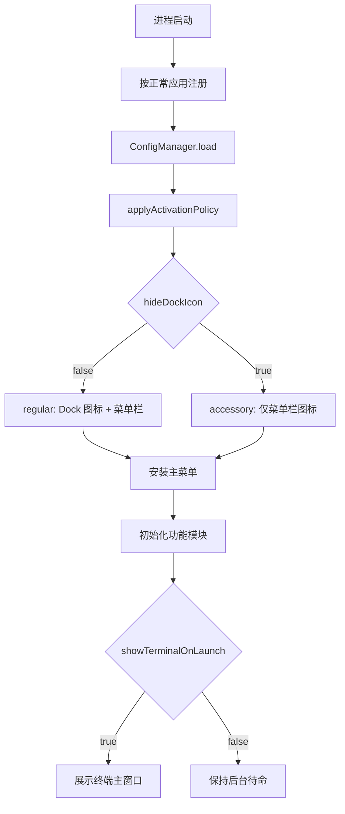

# Utility 改造为正常 GUI 应用

本文回答一个问题：如何把 Utility 从仅菜单栏的 accessory 应用改造成默认正常的 Dock 应用，同时保留既有功能，并让 Dock 隐藏可以配置。

## 元信息

| 项 | 值 |
|---|---|
| 状态 | 已批准，待实施 |
| 日期 | 2026-11-01 |
| 影响范围 | 应用激活策略、主菜单、终端主窗口 |
| 前置假设 | 终端窗口即主窗口；其余功能不变；不引入设置界面 |

## 目标与成功标准

改造后，应用默认以正常 GUI 应用启动：有 Dock 图标、Cmd+Tab 入口、系统菜单栏与主菜单，启动展示终端主窗口。

成功标准：

- `config.yaml` 的 `app.hideDockIcon` 决定是否隐藏 Dock 图标，默认 `false`。
- `config.yaml` 的 `app.showTerminalOnLaunch` 决定启动是否展示终端窗口，默认 `true`。
- 菜单栏图标、全局热键、剪贴板/翻译/知识/Stage 面板、tmux 终端后端行为不变。
- 关闭终端窗口不退出应用，点 Dock 图标可重新唤起。
- 「重新加载配置」可即时切换 Dock 显隐，不需要重启。

## 现状事实

- `Sources/App/AppDelegate.swift:15` 在启动第一行固定调用 `setActivationPolicy(.accessory)`。
- `scripts/package-utility.sh:128` 写死 `LSUIElement` 为 `true`；仓库根的 `Utility.app` 是未跟踪的打包产物。
- 应用没有 `mainMenu`，所有入口由 `NSStatusItem` 提供（`Sources/Core/MenuBarManager.swift`）。
- 功能面板统一是 `NSPanel` 加 `.nonactivatingPanel`；终端窗口是普通 `NSWindow`。
- 终端窗口已实现「关闭仅 `orderOut`、不退出应用」与失焦恢复兜底（`Sources/Terminal/TerminalWindowController.swift:248`）。
- 运行日志写入 `~/.cache/utility/debug.log`（`Sources/Core/Log.swift:3`）。

## 方案

### 配置模型

`config.yaml` 新增 `app` 段。`AppConfig` 这个 Swift 类型名已被根配置占用，因此新类型命名 `AppBehaviorConfig`，YAML 键仍用 `app`。

```yaml
# ---------- App ----------
app:
  # true = hide the Dock icon. This also removes the app menu bar and the
  # Cmd+Tab entry (macOS accessory app), i.e. the legacy menu-bar-only mode.
  hideDockIcon: false
  # Show the terminal window (the main window) when the app launches.
  showTerminalOnLaunch: true
```

```swift
public struct AppBehaviorConfig: Codable {
    var hideDockIcon: Bool = false
    var showTerminalOnLaunch: Bool = true

    public init() {}

    public init(from decoder: Decoder) throws {
        let c = try decoder.container(keyedBy: CodingKeys.self)
        hideDockIcon = try c.decodeIfPresent(Bool.self, forKey: .hideDockIcon) ?? false
        showTerminalOnLaunch = try c.decodeIfPresent(Bool.self, forKey: .showTerminalOnLaunch) ?? true
    }
}
```

`AppConfig` 增加属性 `var app: AppBehaviorConfig = .init()`，并在 `init(from:)` 里按现有模式解码：

```swift
app = (try? c.decodeIfPresent(AppBehaviorConfig.self, forKey: .app)) ?? .init()
```

`hideDockIcon` 的语义不止 Dock 图标：`.accessory` 同时移除应用菜单栏与 Cmd+Tab 入口。配置注释必须写明这一点。

### 启动与策略切换

`Info.plist` 不再写 `LSUIElement`，系统按正常应用启动；配置读取完成后立即应用激活策略。



应用策略的方法挂在 `AppDelegate`：

```swift
private func applyActivationPolicy() {
    let hideDockIcon = ConfigManager.shared.config.app.hideDockIcon
    let policy: NSApplication.ActivationPolicy = hideDockIcon ? .accessory : .regular
    let applied = NSApplication.shared.setActivationPolicy(policy)
    debugLog("[App] activation policy=\(hideDockIcon ? "accessory" : "regular") applied=\(applied)")
}
```

调用点：

- `applicationDidFinishLaunching`：在 `ConfigManager.shared.load()` 的 `do/catch` 之后、初始化各模块之前调用一次。
- `onConfigReloaded()`：末尾调用，使「重新加载配置」即时生效。

从 `regular` 切到 `accessory` 时 Dock 图标与菜单栏消失，窗口不受影响；反向切换时 Dock 图标出现。

### 主菜单

新增 `Sources/App/AppMainMenu.swift`，构建正常 GUI 应用需要的最小主菜单，并在语言切换时重建。

| 菜单 | 条目与快捷键 |
|---|---|
| 应用菜单 | About、Hide（`Cmd+H`）、Hide Others（`Opt+Cmd+H`）、Show All、Quit（`Cmd+Q`） |
| 编辑菜单 | Undo（`Cmd+Z`）、Redo（`Shift+Cmd+Z`）、Cut、Copy、Paste、Select All |
| 窗口菜单 | Minimize（`Cmd+M`）、Close（`Cmd+W`）、Zoom、Bring All to Front |

实现要点：

- 应用菜单标题取 `Bundle.main.object(forInfoDictionaryKey: "CFBundleName")`，取不到时用 `"Utility"`。
- 编辑与窗口条目用标准 selector，`target` 保持 `nil` 走响应链：`Selector(("undo:"))`、`Selector(("redo:"))`、`#selector(NSText.cut(_:))`、`#selector(NSText.copy(_:))`、`#selector(NSText.paste(_:))`、`#selector(NSText.selectAll(_:))`、`#selector(NSWindow.performMiniaturize(_:))`、`#selector(NSWindow.performClose(_:))`、`#selector(NSWindow.performZoom(_:))`、`#selector(NSApplication.arrangeInFront(_:))`。
- 窗口菜单赋值给 `NSApp.windowsMenu`。
- `install()` 在 `applicationDidFinishLaunching` 中调用一次，监听 `L10n.languageDidChange` 重建 `NSApp.mainMenu`。
- 应用以 `.accessory` 启动时主菜单仍然构建，只是不可见；切回 `.regular` 后立即出现。

新增 i18n key（`Sources/Resources/zh-Hans.json` 与 `en.json`）：

| key | zh-Hans | en |
|---|---|---|
| `menu.app_about` | 关于 {name} | About {name} |
| `menu.app_hide` | 隐藏 {name} | Hide {name} |
| `menu.app_hide_others` | 隐藏其他 | Hide Others |
| `menu.app_show_all` | 全部显示 | Show All |
| `menu.edit` | 编辑 | Edit |
| `menu.edit_undo` | 撤销 | Undo |
| `menu.edit_redo` | 重做 | Redo |
| `menu.edit_cut` | 剪切 | Cut |
| `menu.edit_copy` | 拷贝 | Copy |
| `menu.edit_paste` | 粘贴 | Paste |
| `menu.edit_select_all` | 全选 | Select All |
| `menu.window` | 窗口 | Window |
| `menu.window_minimize` | 最小化 | Minimize |
| `menu.window_close` | 关闭 | Close |
| `menu.window_zoom` | 缩放 | Zoom |
| `menu.window_bring_all_to_front` | 前置全部窗口 | Bring All to Front |

退出菜单复用已有的 `menu.quit`。修改 JSON 后运行 `python3 scripts/gen-l10n.py` 重新生成 `Sources/Core/L10nKeys.swift`，禁止手改生成文件。

### 终端主窗口

终端窗口即主窗口，复用现有 `TerminalWindowController`，不改窗口结构与 tmux 后端。

启动展示，放在 `applicationDidFinishLaunching` 末尾、`debugLog("[Utility] Ready")` 之前：

```swift
if ConfigManager.shared.config.app.showTerminalOnLaunch,
   ConfigManager.shared.config.terminal.enabled {
    MainActor.assumeIsolated { TerminalManager.shared.showWindow() }
}
```

Dock 图标唤起，新增 delegate 方法：

```swift
func applicationShouldHandleReopen(_: NSApplication, hasVisibleWindows flag: Bool) -> Bool {
    guard !flag else { return true }
    MainActor.assumeIsolated {
        if ConfigManager.shared.config.terminal.enabled {
            TerminalManager.shared.showWindow()
        } else {
            AppWindowRegistry.frontmostWindow?.makeKeyAndOrderFront(nil)
        }
    }
    return false
}
```

`TerminalManager.showWindow()` 内部已调用 `NSApplication.shared.activate(ignoringOtherApps: true)`，启动展示会主动激活应用，符合主窗口预期。

### 已知行为差异

- `hideDockIcon: true` 时进程先以正常应用身份启动，配置读取完成前 Dock 图标短暂出现再消失。该现象已确认接受。
- `PanelManager.hideIfEmpty()` 与 `finishPaste()` 在无可见工具窗口时调用 `NSApplication.hide(nil)`（`Sources/Core/PanelManager.swift:79,119`）。正常应用下这会隐藏整个应用而非退出，Dock 图标仍在、可点回；终端主窗口可见时走 `AppWindowRegistry.hasVisibleWindow` 分支，不触发。本次不修改，列入端到端验证项。

## 关键决策

1. **用运行时 `setActivationPolicy` 决定形态**：`LSUIElement` 是静态 plist 键，读不到用户配置；运行时切换是唯一能兼顾「默认正常应用」与「可配置隐藏」的方式。
2. **plist 默认 regular，而不是保留 `LSUIElement: true` 再切 regular**：默认语义正确，也避免系统在启动早期按辅助应用处理通知与登录项；代价是隐藏模式下的图标闪现。
3. **不改 `nonactivatingPanel` 面板模型**：面板栈、粘贴回退、失焦关闭都依赖不抢焦点的面板行为，改动会超出「其他不变」。
4. **主窗口复用终端窗口**：已有窗口、会话恢复、关闭不退出等语义，新增独立主窗口没有收益。

## 已拒绝的替代方案

- **按配置文件生成或改写 Info.plist**：需要改动签名绑定，且配置文件在启动后才能读，无法解决启动前决策问题。
- **保留 `LSUIElement: true` 并在启动后切 `.regular`**：系统在启动早期仍按辅助应用处理，且默认形态与「正常 GUI 应用」相反。
- **新增独立主窗口**：与终端窗口职责重叠，还要重新处理会话恢复与关闭语义。

## 文件改动清单

| 文件 | 改动 |
|---|---|
| `scripts/package-utility.sh` | 删除 `LSUIElement` 键 |
| `Sources/Core/ConfigTypes.swift` | 新增 `app` 段解码与 `AppBehaviorConfig` |
| `Sources/Resources/default-config.yaml` | 新增 `app` 段与注释 |
| `Sources/App/AppDelegate.swift` | 策略应用、主菜单安装、reopen、启动展示终端 |
| `Sources/App/AppMainMenu.swift` | 新增主菜单 |
| `Sources/Resources/zh-Hans.json`、`en.json` | 新增菜单文案 |
| `Sources/Core/L10nKeys.swift` | 脚本生成，不手改 |
| `README.md`、`README.zh.md` | 更新应用形态说明 |
| `AGENTS.md`、`.claude/CLAUDE.md` | 更新项目概述 |
| `.claude/docs/architecture/panel-ui.md` | 记录激活策略与主窗口行为 |

文档同步的具体改写：

- `README.md:3-5`：把「A macOS menu-bar tool」与「No Dock icon, no main window.」改成默认 Dock 应用、启动展示终端主窗口、可用 `app.hideDockIcon` 回到菜单栏模式。
- `README.zh.md:3-5`：同步上述说明。
- `AGENTS.md:11-12`、`.claude/CLAUDE.md:6-7`：去掉「LSUIElement（无 Dock 图标）」，改为「默认 Dock 应用，可配置 `app.hideDockIcon` 隐藏」。
- `.claude/docs/architecture/panel-ui.md:45`：把「LSUIElement 下用 CGEventTap 拦截 ESC」改为「非激活 overlay 用 CGEventTap 拦截 ESC」，行为本身不变。

## 实施阶段

两个阶段都可以独立合并。

### 阶段 1：正常 GUI 形态

完成后应用是可直接使用的 Dock 应用，热键与菜单栏入口不受影响。

任务：

1. 删除 `scripts/package-utility.sh` 中的 `LSUIElement` 键与对应 `<true/>`。
2. `ConfigTypes.swift` 新增 `AppBehaviorConfig` 与 `AppConfig.app` 解码。
3. `default-config.yaml` 在 `# ---------- General ----------` 之前插入 `# ---------- App ----------` 段。
4. `AppDelegate.swift` 删除首行的 `setActivationPolicy(.accessory)`，新增 `applyActivationPolicy()`，在配置加载后调用，并在 `onConfigReloaded()` 末尾调用。
5. 新增 `AppMainMenu.swift`，在 `applicationDidFinishLaunching` 中安装主菜单。
6. 两个语言 JSON 增加菜单 key，运行 `python3 scripts/gen-l10n.py` 生成访问器。
7. 同步四份文档。

验收标准：Dock 图标与 Cmd+Tab 出现；主菜单三组条目可用；`hideDockIcon: true` 并重新加载配置后 Dock 图标消失；热键与菜单栏功能不变。

依赖：无。

### 阶段 2：终端主窗口

完成后点 Dock 图标或启动应用都会展示终端主窗口。

任务：

1. `AppDelegate.swift` 在启动末尾按 `app.showTerminalOnLaunch` 与 `terminal.enabled` 展示终端窗口。
2. 新增 `applicationShouldHandleReopen`，无可见窗口时打开终端窗口，终端关闭时兜底前置已有工具窗口。
3. 手工验证关闭终端窗口后应用仍驻留、点 Dock 图标可恢复、与菜单栏入口并存。

验收标准：启动展示终端窗口；关闭终端窗口后应用不退出；点 Dock 图标重新展示；`showTerminalOnLaunch: false` 时启动不弹窗。

依赖：阶段 1 的配置段与主菜单。

## 验证

### L1 存在性

```bash
swift build
plutil -p Utility.app/Contents/Info.plist
strings .build/debug/utility | grep hideDockIcon
```

期望：构建成功；`Info.plist` 中不再出现 `LSUIElement`；`strings` 命中 `hideDockIcon`。

### L2 行为

```bash
python3 scripts/gen-l10n.py --check
python3 scripts/check-l10n-contract.py
bash scripts/package-utility.sh
tail -n 40 ~/.cache/utility/debug.log | grep "activation policy"
```

期望：两项 l10n 检查通过；打包脚本成功（资源 bundle 缺失会硬失败）；日志中出现 `[App] activation policy=regular` 或 `accessory`。

### L3 端到端

1. 默认配置启动：Dock 有图标，Cmd+Tab 可见，菜单栏显示应用菜单。
2. 启动后终端主窗口自动出现，可输入命令并切换会话。
3. 关闭终端窗口：应用不退出，Dock 图标仍在；点击 Dock 图标重新展示终端窗口。
4. 菜单验证：`Cmd+Q` 退出、`Cmd+M` 最小化、`Cmd+W` 关闭、文本框内 `Cmd+C/V/A` 正常。
5. 把 `hideDockIcon` 改为 `true` 并「重新加载配置」：Dock 图标与菜单栏消失，菜单栏图标、全局热键、各面板仍可用。
6. 重启应用后隐藏模式仍生效；改回 `false` 并重载后 Dock 图标恢复。
7. 剪贴板面板：快捷键唤起、选中后粘贴回上一个应用；翻译、知识、Stage 面板行为不变。
8. 无可见工具窗口时关闭面板，确认 `NSApplication.hide(nil)` 的影响：Dock 图标仍在，点回后窗口可恢复。

证据级别：阶段 1、阶段 2 完成后分别报告 L1、L2、L3 结果；L3 未完成的项明确列出。

## 风险与回滚

最脆弱的假设是「`nonactivatingPanel` 面板在 regular 应用下仍能按原方式获取键盘输入」。若第 7 项验证失败，需要追加面板激活时序调整，该项不在本计划范围内，但会直接影响阶段 1 的可用性。

其他风险：

- `hideDockIcon` 从 regular 切到 accessory 后，若当前有面板显示，菜单栏消失但不影响面板；反之亦然。
- 登录启动（`SMAppService`）在隐藏模式下有短暂的 Dock 图标闪现，已确认接受。

回滚：

- 行为回滚：把 `app.hideDockIcon` 设为 `true` 即可回到旧的菜单栏形态，无需改代码。
- 代码回滚：按阶段执行 `git revert`；`Info.plist` 由打包脚本生成，回滚脚本即可恢复。
- 无数据迁移、无 schema 变更、无外部状态残留。

## 明确不做

- 不改面板的 `nonactivatingPanel` 模型与 `PanelManager` 的面板栈逻辑。
- 不改 `PanelManager` 在无窗口时的 `hide` 语义。
- 不新增偏好设置界面，配置仍只走 `config.yaml`。
- 不改 CLI 模式（`Sources/App/main.swift` 的参数分支）。
- 不改终端 tmux 后端、会话存储与恢复。
- 不新增登录项行为，`SMAppService` 注册方式不变。

## 决策记录提议

实施并验证通过后，建议在 `.agent/decisions.md` 追加一条 D1，内容为「应用形态由运行时 activation policy 决定：plist 默认 regular，`app.hideDockIcon` 切换为 accessory，终端窗口作为启动主窗口」。该条目待用户确认后再写入，不改动既有决策。
