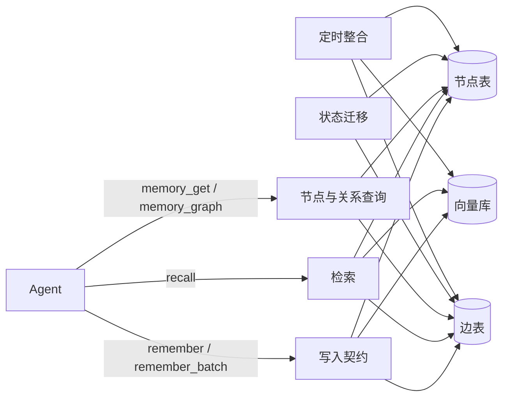

# 记忆体最终形态方案

本文回答一个问题：从当前的分层记忆实现，演进到可追溯、可治理、可移植的记忆体，需要改什么、按什么顺序改。方案只覆盖 `agent-gateway` 的记忆与检索层，不涉及服务端、移动端与任何 Agent 侧的耦合。

## 不可变约束

以下三条是设计前提，任何阶段都不得违背。

1. 记忆写入由 Agent 主动调用 MCP 工具完成，稳定触发依赖注入提示，不依赖自动监听。
2. 形态只做 MCP Tools。内部自治，不耦合任何 Agent，不做 hooks、plugins、skills，保持可移植与通用。
3. 多信号排序禁止任何过拟合阈值。阈值只能来自按嵌入模型标定的 floor、自动算出、用户显式配置。

第 3 条已写入 `.claude/rules/retrieval-no-fitted-thresholds.md`。

## 当前形态

事实来自 `agent-gateway` 当前代码。

| 能力 | 现状 |
|---|---|
| 分层检索 | hot（Mem0）与 cold（Qdrant）合并为一个 tier，notes 兜底 |
| 查询形态 | `keywords` 必填拼主查询，`query` 可选作第二路，RRF 合并 |
| 关系数据 | `episode_id`、`superseded_by`、`supersedes`、`disputed_by` 存在 metadata |
| 版本号 | 新节点写入时 `revision = max(被取代节点 revision) + 1` |
| 生命周期 | `active / superseded / deleted` 三态，均为软标记 |
| 上下文扩展 | `expand_episodes` 按 episode 实时扩展，限定热层与冷层各自一跳 |
| 预算 | `catch_up` 有字符预算，`recall` 只有 `limit` |
| 写入契约 | `content` 承事实与背景，`tags / confidence / episode_id` 可选 |
| 关系遍历 | 没有按 id 取节点的入口，关系字段可见但不可走 |

主要缺口有三处：关系散落在向量库 payload、没有统一的关系权威、没有按节点 id 访问的入口。

## 最终形态

三个存储各管一件事：SQLite 管关系与状态，Qdrant 管向量，Markdown 管长文沉淀。



链路闭环：写入 → 检索 → 使用 → 状态迁移 → 整合。所有入口都是 MCP 工具，没有隐藏的自动通道。

## 数据模型

### 节点表

节点表只存轻量元数据，正文仍在原存储，避免双份正文。

```sql
CREATE TABLE memory_nodes (
  node_id TEXT PRIMARY KEY,
  layer TEXT NOT NULL,
  type TEXT,
  status TEXT NOT NULL,
  content_hash TEXT NOT NULL,
  title TEXT,
  source_file TEXT,
  created_at TEXT NOT NULL,
  updated_at TEXT NOT NULL,
  metadata TEXT
);
CREATE INDEX idx_nodes_hash ON memory_nodes(content_hash);
CREATE INDEX idx_nodes_status ON memory_nodes(status);
```

节点 id 必须稳定，这是关系可追溯的前提。

| 层 | id 规则 | 理由 |
|---|---|---|
| hot | Mem0 id | 状态更新走原地 metadata，禁止 delete + add 重建 |
| cold | `cold:` + sha1(source_file + content_hash) | 替代当前每次 uuid4，重复写入幂等 |
| note | `note:` + 相对路径 | 与现有 notes 标识一致 |

冷层当前每次写入生成 `uuid4`，同内容重复同步会产生多个节点。改为确定性 id 后，写入天然幂等，历史 uuid 保存在 `metadata.legacy_id`。

### 边表

```sql
CREATE TABLE memory_edges (
  edge_id INTEGER PRIMARY KEY AUTOINCREMENT,
  from_id TEXT NOT NULL,
  to_id TEXT NOT NULL,
  type TEXT NOT NULL,
  weight REAL DEFAULT 1.0,
  created_at TEXT NOT NULL,
  metadata TEXT,
  UNIQUE(from_id, to_id, type)
);
CREATE INDEX idx_edges_from ON memory_edges(from_id);
CREATE INDEX idx_edges_to ON memory_edges(to_id);
```

边类型只保留有明确语义的六种：

| 类型 | 语义 |
|---|---|
| `supersedes` | 新节点取代旧节点 |
| `derived_from` | 冷摘要来自哪些热记忆 |
| `episode` | 同一次事件 |
| `disputes` | 矛盾 |
| `relates` | 相似但独立 |
| `mentions` | 提及的文件、项目、URL、工具名 |

不建「相似即连边」的持久图。相似关系由向量检索实时表达，边表只记录向量无法表达的语义关系。

边表位置为 `gateway_home() / "memory_graph.sqlite"`，与向量库分离，便于单独备份与重建。

## 六层设计

### 1 写入契约

现状是 `content` 一段文本同时承载事实与背景，参数描述也要求「有背景时第一行写 [background]」。

目标是拆成两个字段，并让两者都进入检索：

- `content` 只写事实本身，不再写背景、场景或原因。
- `context` 写场景、动机、关联与适用范围。
- 写入时构造嵌入文本 `content + "\nContext: " + context`，作为 Mem0 的 data 传入。这样 context 与 content 一样参与向量检索，不是仅供展示的旁注。
- metadata 同时保存 `fact=content` 与 `context`，检索返回时优先用分段字段展示，避免重复输出拼接文本。
- 去重键改为 `sha1(fact + context)`：同一事实在不同情境下是两条记忆，不能被完全去重。
- 新增 `type`、`source_files`、`source_url`，来源追踪与冷层字段对齐。

`param.memory_content`、新增的 `param.memory_context` 与 `TOOL_DESCRIPTIONS["remember"]` 必须同时修改，保持同源。目标口径：

- content：只写一条事实，不写背景、场景或原因。
- context：写为什么重要、何时适用、与什么相关；与 content 一起参与检索。

历史数据不迁移：旧记忆的 content 仍含背景，检索与返回保持原样；新写入走新规范。

写入路径保持现有顺序：查重 → 写新节点 → 软标记旧节点。边表写入与节点写入放在同一 SQLite 事务，向量写入不参与事务，失败时以节点表为准回滚边。

### 2 检索

保留当前双查询与分层结构，只补两项。

第一项是预算。`recall` 增加 `max_chars`，默认沿用 `catch_up` 的预算值。截断规则：

1. 主结果按分数排序后按字符预算截断。
2. 主结果被截断时，不返回任何关系节点。
3. 主结果完整时，关系节点用剩余预算。

第二项是关系展开。`related` 从「仅同 episode」扩展为「同 episode + 边表一跳邻居」，按边类型标注。主结果排序不变。

`context` 不单独建索引。它与 `content` 拼接后进入同一向量，检索逻辑不变，只是候选的语义覆盖范围变大。返回时按 metadata 的 `fact` 与 `context` 分段展示，旧数据没有分段字段时保持原样。

多信号排序不进入主链。若将来要做，必须作为可单独关闭的实验分支，附带同一评测集的前后对比，默认关闭。

### 3 生命周期

状态机从三态扩为四态：`active → superseded → archived → deleted`，全部软删除。

- `set_memory_status` 补齐 `archived`，恢复入口保留。
- 矛盾检测改为两段：相似度带 0.4–0.75 先筛候选，再交 LLM(关闭思考模式) 判定，写 `disputes` 边并把旧节点标记为 `superseded`。
- 补 `disputed_at`，与 `superseded_at` 对齐。
- 受控遗忘按质量分档，到期先 `archived`，不物理删除：

| 质量 | 保留期 |
|---|---|
| ≥ 0.7 | 365 天未访问 |
| 0.5–0.7 | 180 天 |
| < 0.5 | 30–90 天 |

质量分先只用可解释的隐式信号：访问次数、最近访问时间、字段完整度。不引入模型自评分。

### 4 写入入口

不做 hooks、plugins、skills，也不做自动监听。捕获统一走 MCP 工具：

- Agent 在会话中按注入提示调用 `remember` 或 `remember_batch`。
- 需要一次写多条时用批量接口，减少往返。
- 不新增 `harvest` 工具：它会形成第二个写入入口，破坏「写入只有一条路」的约束。

提示注入由宿主侧负责，不属于本方案代码。方案只保证工具接口稳定、幂等、失败可解释。

### 5 整合

定时任务按日与按周两档，全部通过内部函数调用，不对外暴露新工具。

- 每日：相关性评分、聚类、关联发现、压缩。
- 每周：矛盾检测、受控遗忘。

关联发现用随机采样 pair，不做全量两两比较。压缩按簇进行，少于 2 条不压缩；服务自己生成的摘要不参与再压缩。所有整合产物走同一写入契约，并写 `derived_from` 边。

### 6 接口

保留现有工具，新增两个只读工具。

| 工具 | 用途 |
|---|---|
| `memory_get` | 按节点 id 取任意层节点，支持已归档 |
| `memory_graph` | 按边类型与方向遍历，版本链走到头，事件链按 episode 全量，来源链一层全量后接版本链 |

`memory_graph` 不设统一 depth 参数，边界由链类型决定，节点数设硬上限防爆炸。工具面净增 2。

## 检索响应瘦身

记忆体改造之外，单独做一轮 MCP 内置检索工具的响应字段收敛。目标不是删功能，而是把「Agent 决策需要」与「诊断需要」分开。

### 现状字段

| 工具 | 默认返回 |
|---|---|
| `recall` | status / results / related / count / related_count / hot_count / cold_count / notes_count / trace_id / hint |
| `recall.results[]` | id / kind / score / score_kind / content / layer / match_kind / locator / extra |
| `catch_up` | results / count / returned / offset / limit / truncated / truncated_by / has_more / next_offset |
| `project_search` | name / kind / signature / file / line / score / visibility / module / importedBy / importCount |
| `project_notes` | file / line / content / score |

`recall.results[].extra` 还包含 created_at、updated_at、agent_id、attributed_to、heat_score、metadata、episode_id；metadata 内含 tags、confidence、access_count、status、superseded_by、disputed_by 等。

### 调用方事实

| 调用方 | 实际消费字段 |
|---|---|
| Swift `MCPClient` | 只消费 project search / structure / read，不消费 recall 与 catch_up |
| `scripts/known_item_eval.py` | `results[].id` |
| `scripts/export_judge_batch.py` | `results[].layer`、`results[].score`、`results[].content` |
| gateway 测试 | `trace_id`、`score_kind`、`match_kind` |
| 外部 Agent | 通过 MCP 协议消费，提示词引用无法静态穷举 |

### 收敛规则

响应体只保留决策必需字段，诊断字段直接写检索日志，不通过开关返回。

保留：

- `recall` 顶层：status / results / related / count / hint
- 结果项：id / kind / score / content / layer / locator / episode_id
- `catch_up`：全部分页字段保留，分页是调用必需
- `project_search`：name / kind / signature / file / line / score / importedBy
- `project_notes`：file / line / content / score
- `websearch_engine`、`read_url`：已最小，不动

删除：

- trace_id、related_count、hot_count / cold_count / notes_count
- score_kind、match_kind
- extra 中的 created_at、updated_at、agent_id、attributed_to、heat_score
- metadata 只保留 tags、status、confidence

上述诊断信息写入检索日志，需要时从日志查，不从响应体取。

### 同步检查调用方

字段一旦删除，外部 Agent 的提示词可能在无人察觉时失效。执行顺序固定：

1. 逐字段扫描 `utility/Sources`、`utility/examples`、`utility/scripts`、`agent-gateway/tests`、`agent-gateway/scripts` 与提示词文档。
2. 每个字段给出「保留 / 删除」结论，写入变更清单。
3. 新增响应字段白名单测试：工具响应的键集合必须与清单一致，增删字段必须同时改测试。
4. 跑 `known_item_eval.py` 与 `export_judge_batch.py`，确认 id / layer / score / content 仍可用。
5. 引用已删字段的提示词一并改掉；外部 Agent 按新契约调整，不保留兼容期。

## 实施阶段

每个阶段独立可上线，前一阶段不依赖后一阶段。

### P1 关系层

- 新建 `src/agent_gateway/services/memory/store.py`、`graph.py`，实现节点表、边表与遍历。
- 新建 `scripts/migrate_memory_graph.py`，从热层 payload 与冷层 `source_memory_ids` 回填节点与边，幂等可重跑。
- 冷层 id 改为确定性规则，旧 uuid 写入 `metadata.legacy_id`。
- 新增 `memory_get`、`memory_graph` 工具。
- 验收：版本链可从任意节点走到头；冷摘要可追到原始热记忆；回填后节点数与边数可对账。

### P2 写入契约

- `remember` 增加 `context / type / source_files / source_url`。
- `content` 参数只写事实；写入时拼接 `content + "\nContext: " + context` 作为嵌入文本。
- metadata 保存 `fact` 与 `context` 分段，返回时优先使用。
- 同步修改 `param.memory_content`、新增 `param.memory_context`、`TOOL_DESCRIPTIONS["remember"]`。
- 节点表随写入同步落库，边表与节点同事务。
- 验收：同一事实配不同 context 不被完全去重；检索能用 context 中的词命中；返回结果不重复输出拼接文本；旧数据不受影响。

### P3 检索预算

- `recall` 增加 `max_chars`。
- 关系展开接入边表一跳邻居。
- 验收：超预算结果被截断；主结果截断时关系为空；主结果排序与改动前一致。

### P4 生命周期

- 四态状态机与恢复入口。
- 矛盾检测改为相似度带预筛。
- 受控遗忘任务与质量分档。
- 验收：矛盾只在带内触发；到期节点变 `archived` 且可恢复；恢复不重置 processed 位。

### P5 整合

- 每日与每周两个调度入口。
- 相关性、聚类、关联采样、压缩四个阶段。
- 验收：仿生验证全部断言通过；整合产物带 `derived_from` 边；重复运行不产生元关联；停调度后系统仍可正常读写。

### P6 多信号排序（可选）

不设默认权重，不新增拟合阈值。只有满足以下条件才进入主链：

- 同一评测集上首位命中率不低于现状；
- 返回上下文字数不高于现状；
- 每个信号可单独关闭；
- 降级路径不改变主结果顺序。

未满足时保持关闭，代码可以留在实验分支。

### P7 检索响应瘦身

- `recall` 直接按收敛规则裁剪，不新增开关。
- `project_search` 去掉 visibility、module、importCount；`catch_up` 的分页字段保持不变。
- 同步更新 `known_item_eval.py`、`export_judge_batch.py`、测试断言与引用这些字段的提示词。
- 新增响应字段白名单测试，键集合固定。
- 验收：响应键集合与清单一致；两个脚本可正常运行；检索指标不变。

## 实施记录（2026-11-01）

P1、P2、P3、P4、P5、P7 已实现，P6 未实现并保持关闭。

| 阶段 | 状态 | 落地位置 |
|---|---|---|
| P1 关系层 | 完成 | `services/memory/{store,graph,link}.py`、`server_memory_graph.py`、`scripts/migrate_memory_graph.py` |
| P2 写入契约 | 完成 | `_embed_text`、`_build_metadata`、`_active_similar`、`remember` schema |
| P3 检索预算 | 完成 | `_handle_recall`、`expand_episodes`、`_expand_edges` |
| P4 生命周期 | 完成 | `memory_lifecycle`、`retention.py`、`server_archive.py` |
| P5 整合 | 完成 | `consolidate.py`、`POST /api/consolidation/run` |
| P6 多信号排序 | 未实现 | 默认关闭，无实验分支 |
| P7 响应瘦身 | 完成 | `types.py`、`recall.py`、`project_tools.py`、`test_response_contract.py` |

实施中的偏差：

- 矛盾检测的候选从随机采样改为全量带内候选：500+ 节点中随机 pair 命中矛盾对的概率过低，实测随机采样 60 对产生的带内候选全部是无关对。改为向量矩阵全量比较后取带内前 N 对，N 是 LLM 判定预算，不是排序权重。
- 压缩候选排除 `generated_by=consolidation` 的节点，已整合的簇通过 `derived_from` 反查跳过。不做这两步时，每次新增摘要都会打乱采样，重复触发会不断产生新簇与新边。
- 冷层节点 id 为 `cold:` + sha1(source_file|content_hash)，Qdrant point id 用同一键的 uuid5；旧 uuid 记入 `metadata.legacy_ids`，`memory_get` 可按旧 point id 找到节点。
- 结果项额外保留 `context` 与 `edge`：前者是 P2 写入契约的一半，后者是关系展开的语义标注；`metadata` 只保留 tags/status/confidence。
- `project_search` 的 `score` 只在来源层提供分数时返回（向量层有，FTS 层没有）。
- 新增内部维护入口 `POST /api/consolidation/run`（`job=daily|weekly`，可传固定 `now`）。它不是 MCP 工具，不增加对外工具面。
- 归档入口 `run_archive_sync_impl` 增加固定 `now` 参数；归档仍为软标记，不物理删除。
- 矛盾检测补 `disputed_at`，与 `superseded_at` 对齐；冷层 payload 同步写入。
- 记忆模型当前没有 pin/importance 字段，方案中的「受保护节点」落地为「整合产物不进入矛盾候选」：`generated_by=consolidation` 的节点被排除在矛盾检测之外，普通节点之间不再有额外保护。
- 迁移脚本写 `metadata.legacy_id`，运行期新写入写 `legacy_ids`；`memory_get` 的 point id 解析同时匹配 `point_id`、`legacy_id` 与 `legacy_ids`，两种历史数据都能找到节点。

### 仿生验证结果

环境：独立 `GATEWAY_HOME`、`GATEWAY_CACHE`、`QDRANT_PATH`（生产快照副本）、`NOTES_DIR`（副本）、`MCP_PORT`、`MODEL_PROXY_PORT`、`MEMORY_SERVER_URL`、独立 `UTILITY_USER_ID`。

数据规模：747 热节点、10 冷摘要、4260 条边、74 个 episode、20 组版本链（60 条）、20 组冲突观点、40 条事实冲突、20 条 2023 年低访问旧记忆。

| 断言 | 结果 |
|---|---|
| 悬空边 | 0 |
| 版本链完整 | 37/37 可走到头 |
| 冷摘要溯源 | 10/10 可追到热节点 |
| 矛盾判定 | 带内候选 20 对，确认 1 条，边两端节点存在 |
| 受控遗忘 | 20 条旧记忆归档，恢复为 active 成功，再归档成功 |
| 压缩产物 | 181 条摘要，459 条 derived_from 边 |
| 日任务幂等 | 连续三次 compressed 依次 0/0/0，边数不变 |
| known-item 召回 | 60 条样本 hit@1 0.700、hit@5 1.000 |
| 停调度读写 | 未触发整合时 `remember` 返回 success，`recall` 首位命中同一 id |
| context 参与检索 | 只在 context 出现的独特词可直接召回该记忆 |
| 去重键 | 同一事实配两个 context 得到两个不同 id |
| 返回分段 | 结果 `content` 不含 `Context:` 拼接文本 |
| 检索预算 | 小预算触发截断并清空 `related`；有预算与无预算的主结果顺序一致 |
| 恢复保留位 | 归档后恢复为 active，`processed` 的 bit0 仍保留 |
| 隔离 | 仿生进程未打开生产数据文件；生产 MCP 进程 PID 与 9001 端口未变 |

`migrate_memory_graph.py --dry-run` 需要 Qdrant 副本或停服：Qdrant local mode 对目录加独占锁，生产进程运行时会拒绝第二个实例。本次回填在 104M 的生产快照副本上完成，得到 5640 节点、11435 边，重跑数量不变。

### 调用方扫描与验收命令

逐字段扫描 `utility/Sources`、`utility/examples`、`utility/scripts`、`agent-gateway/tests`、`agent-gateway/scripts` 与提示词目录，`trace_id`、`score_kind`、`match_kind`、`hot_count`、`cold_count`、`notes_count`、`related_count`、`importCount`、`visibility` 均无引用；已删字段的结论是删除，无需改提示词。

验收命令实跑：

| 命令 | 结果 |
|---|---|
| `unittest discover -s tests -t .` | 343 通过，跳过 1 |
| `ruff check src tests scripts` | 通过 |
| `migrate_memory_graph.py --dry-run` | 生产快照 5645 节点（4778 热 + 867 冷） |
| `known_item_eval.py` | 退出码 0，100 样本 hit@1 0.690、hit@5 0.920 |
| `export_judge_batch.py` | 30 条查询输出 3 批，id/layer/score/content 可用 |

`export_judge_batch.py` 原本未建立 MCP 会话、只传 `query`，在当前协议下返回空响应。已改为先 `initialize` 再调用，并改用 `keywords` 与 `max_chars=0`。

## 仿生验证

构建、lint 与单元测试是前置门槛，不是通过标准。按日与按周策略必须在隔离环境中用仿生数据跑通，才算验证完成。

### 环境隔离

生产 utility 进程承载 proxy 与 MCP，本机 Agent 的连接挂在上面，测试不得触碰。

| 项 | 生产 | 仿生 |
|---|---|---|
| `GATEWAY_HOME` | 生产默认 | 独立临时目录 |
| `GATEWAY_CACHE` | 生产默认 | 独立临时目录 |
| `QDRANT_PATH` | 生产向量库 | 生产快照的副本 |
| `NOTES_DIR` | 生产笔记 | 生产笔记的副本 |
| `MCP_PORT` | 当前服务端口 | 空闲端口 |
| `MODEL_PROXY_PORT` | 当前代理端口 | 空闲端口 |
| `MEMORY_SERVER_URL` | 生产地址 | 仿生 MCP 地址 |

执行规则：

- 只复制、不修改生产数据。生产数据在测试期间会因当前 Agent 的正常写入与检索而变化，不能以总量或哈希不变作为判据。
- 仿生进程使用独立 `UTILITY_USER_ID`（如 `biomimetic-<run_id>`）、独立目录与独立端口；启动前打印并审计解析后的配置，确认没有任何生产路径或生产端口。
- 仿生进程独立启动，不重启、不停止、不重配生产进程。
- 测试期间记录仿生进程监听的端口与打开的文件，结束核对：未监听生产端口、未打开生产目录中的文件。

### 造数

通过仿生 MCP 端点跑大批量 Agent 任务，产生真实形态的记忆。最低覆盖：

- 500 条以上记忆；
- 40 个以上 episode；
- 20 组以上版本链，每组含 supersedes；
- 20 组以上冲突观点；
- 若干旧时间、低访问记忆，供遗忘阶段使用。

任务类型随机混合：代码阅读与修改、方案决策、排错、偏好表达、观点变更。写入走 `remember` / `remember_batch`，检索走 `recall`，保证与真实使用同路径。

### 触发

不依赖真实时钟。日任务与周任务通过内部入口以固定 `now` 触发：

- 日：相关性、聚类、关联采样、压缩。
- 周：矛盾检测、遗忘。

同一批数据上至少各触发两次，验证幂等。

### 断言

- 每条新边都能追到来源节点，没有悬空边。
- 版本链可从任意节点走到头，冷摘要可追到原始热记忆。
- 矛盾只命中相似度带内候选，受保护节点不被取代。
- 遗忘只命中到期项，归档后可恢复。
- 压缩产物带 `derived_from`，重复触发不产生元关联。
- `recall` 在仿生数据上的首位命中率不低于基线。
- 隔离判据不依赖生产总量：仿生配置全部指向仿生目录与端口；仿生 `UTILITY_USER_ID` 在生产库中查询为 0 条；仿生进程未打开生产目录中的文件。
- 当前 Agent 在测试期间产生的新记忆、访问计数与热度变化属于正常使用，不计为污染。

### 通过标准

仿生验证全部断言通过才算通过。缺一项，P5 不得合入；单元测试全绿不替代仿生结果。

## 验收与验证

```bash
cd /Users/yuanyxh/Documents/selfdata/projects/agent-gateway
PYTHONPATH=src .venv/bin/python -m unittest discover -s tests -t .
ruff check src tests scripts
PYTHONPATH=src .venv/bin/python scripts/migrate_memory_graph.py --dry-run
PYTHONPATH=src .venv/bin/python scripts/known_item_eval.py
```

证据分级：

- P1 到 P4 至少到 L2，用测试断言链路、预算与状态迁移。
- P5 到 L3，必须在隔离仿生环境跑通日任务与周任务，且生产零影响。
- P6 只认评测集数据，没有对比不进入主链。
- 构建、lint、单元测试全绿只是前置门槛，不构成任何阶段的通过证据。

## 风险与回滚

| 风险 | 处置 |
|---|---|
| 节点与向量库不一致 | 写入以节点表为准，向量失败可重放；回填脚本幂等 |
| 冷层旧 id 断链 | 保留 `metadata.legacy_id`，回填生成映射 |
| 两步写入非事务 | 节点与边同事务；向量单独写，失败记录待补偿 |
| 整合产生自引用 | 服务生成的记忆打标，不进入候选池 |
| 排序实验污染主链 | 实验分支默认关闭，未评测不得合入 |
| 瘦身删掉调用方字段 | 逐字段扫描引用并同步修改提示词；白名单测试锁定键集合 |
| 仿生测试污染生产 | 独立目录、端口与 `UTILITY_USER_ID`；审计进程打开的文件，不以生产哈希不变为判据 |

回滚方式：边表是新增产物，删表不影响现有检索；检索预算与关系展开均可通过参数关闭；生命周期全部软删除；整合是定时任务，停调度即可。

## 第二轮改进（2026-11-01）

参考 forgetful / mcp-memory-service 的对照结论与生产实测，补齐以下项：

| 项 | 变更 | 默认行为 |
|---|---|---|
| 矛盾候选 | 每节点 Qdrant 近邻（`query_batch_points` 分批 top-k）→ 0.4–0.75 带过滤 → 去重取前 N；全量矩阵仅作异常回退 | 与原结果同源，复杂度 O(n·k) |
| 打分写入 | `store.batch_update_metadata` 单事务 `json_patch` | 结果不变，耗时下降 |
| 受保护记忆 | `remember` 新增 `importance`(1–10) 与 `protected`；矛盾与归档跳过 | 阈值 `MEMORY_PROTECT_IMPORTANCE` 留空时只保护显式 `protected` |
| 矛盾 dry-run | `run_weekly(dry_run=True)` 与 `POST /api/consolidation/run {"dry_run":true}` | 只返回候选与理由，不写边、不作废 |
| 检索归档过滤 | mem0 filters 增加 `NOT archived=true` | 归档条目不再占用 top_k |
| 多信号排序 | `SignalWeightedFusion`：recency / access / quality | 权重默认 0，等价纯分数排序；未评测不开启 |
| 写入长度 | `MEMORY_MAX_CONTENT_CHARS` 超限返回 warning，不拒绝 | 留空不限制 |
| 图库维护 | 周任务成功后 `VACUUM` | 无行为变化 |
| 死代码 | 删除 `HOT_RETENTION_DAYS`、`SUPERSEDED_RETENTION_DAYS` | — |

**配置说明**：新增开关目前只读环境变量，尚未接入 utility 的 `config.yaml` → Swift 注入链。启用时按宿主规则同时修改 `baseEnvironment()` 与 `taskEnvironmentOverrides()`，两处缺一不可。

**验证**：agent-gateway 全量 369 例通过（1 skipped），`ruff` 通过；生产部署后需复验近邻候选耗时、dry-run 不落盘、归档过滤后的召回数量。

## 不做的内容

- 不做 hooks、plugins、skills，也不做自动会话监听。
- 不做多租户、OAuth、云同步、远程 MCP。
- 不做实体层级本体与 12 类记忆类型。
- 不做相似度持久图与图谱可视化。
- 不在本方案内改依赖图；依赖图是独立子系统。
