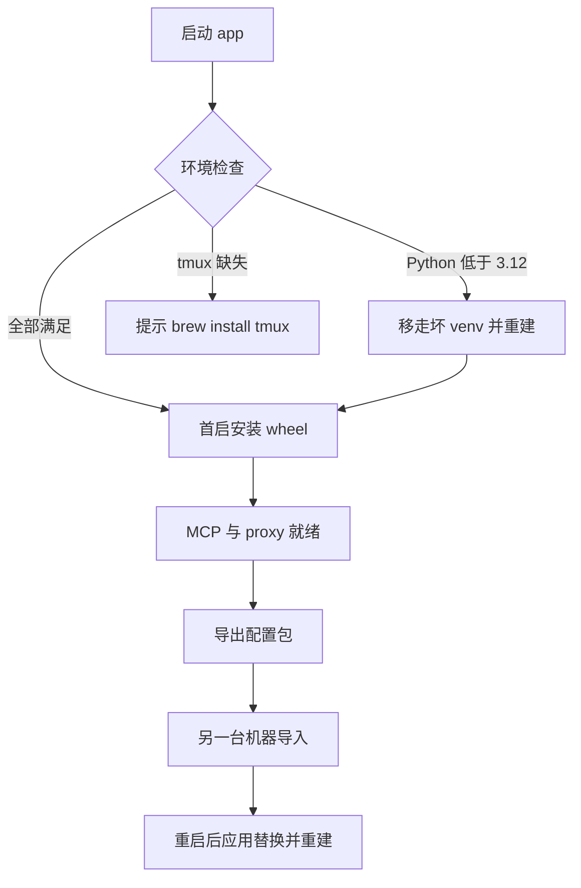

# 可移植性加固计划：自构建环境重建与配置迁移

本文回答：换一台 Mac、从开源仓自构建时，如何可靠重建依赖、配置与数据。可移植的口径是「按依赖与配置重建同等工作流」，不是「陌生用户零配置即用」；不做公签分发。

## 目标与成功标准

目标是让自构建路径可复现，且失败可诊断、可回滚。

成功标准：

- 干净 Mac 上按 README 装好 Xcode CLT 后构建启动，app 能识别 Python 低于 3.12 并引导修复，不再留下永久坏 venv。
- 依赖缺失时，菜单里的环境检查能列出项、状态、版本与修复动作，日志可查。
- 导出包在另一台 Mac 导入后，配置、记忆图、知识库与核心状态一致，无需手工拷贝 SQLite。
- 导入不丢 WAL 数据、不携带 `mcp-venv`、失败能回到导入前状态。

## 不做什么

- 不做公签、公证与分发渠道适配。
- 不迁移 Claude Code 的全局配置（`~/.claude/settings.json`、`~/.claude.json` 属个人配置）。
- 不自动迁移外部 notes 目录，只在导入后检测旧机器路径并提示。
- 不自动安装 Homebrew 本体；只在缺失时给出命令并要求用户确认。
- 不新增 app 配置项；安装检查与导入导出都走菜单动作。

## 假设

- 自构建者能使用终端与 Homebrew。
- 目标系统为 macOS 14 及以上，覆盖 Apple Silicon 与 Intel 两种 Homebrew 前缀。
- 导出数据量在 1 GB 以内，可接受数秒阻塞。
- 若假设不成立（例如目标机器完全离线、连 Homebrew 都没有），Phase 2 的自动安装降级为命令提示，Phase 3 仍可用。

## 现状与缺口

以下均为当前代码事实，不是推测。

| 缺口 | 证据 | 影响 |
| --- | --- | --- |
| 坏 venv 不会重建 | `GatewayInstaller.swift:62-64` 只在 venv 解释器不存在时创建 | 用系统 3.9 建出 venv 后，装了 3.12 也不会重建，pip 永久失败 |
| Python 探测与注释不一致 | `MCPProcessManager.swift:238-245` 注释写 python3.12，实现是 `command -v python3` | 误报已具备环境，用户拿不到正确修复提示 |
| 无导入导出 | `Sources` 内无 export/import 实现 | 换机只能手工拷贝 720 MB 目录，且可能带走 venv 与 WAL |
| 两仓无版本对应记录 | `package-utility.sh:21-35` 现导 gateway wheel 与 contracts | 换机 clone 较新 gateway 可能与旧 app 不兼容 |
| 无 schema 版本 | 各库 `PRAGMA user_version` 均为 0 | 跨版本导入无法自动判断兼容性 |
| 自构建签名路径未写明 | `package-utility.sh:10-16` 硬要求 `SIGNING_IDENTITY` | 新人第一步卡住 |

## 方案总览



## 设计决策

| 编号 | 决策 | 理由 |
| --- | --- | --- |
| D1 | venv 版本以 `pyvenv.cfg` 的 `version` 为判据，低于 3.12 就移到废纸篓重建 | 解释器存在不等于版本正确，这正是当前 bug 的根因 |
| D2 | 探测统一到 `EnvironmentProbe`，接受任意 `>=3.12`，不写死 minor | 避免装了 3.13 被误判缺失 |
| D3 | 导出用 GRDB 只读连接加 `backup(to:)` 做在线快照 | 不依赖停服务，WAL 内容会被包含，实现也统一 |
| D4 | 导入分两阶段：先落到 `.import-staging` 并写待导入标记，重启时在 DB 打开前替换 | app 自身持有 `data.sqlite` 连接，无法热替换 |
| D5 | manifest 记录 app、gateway commit、wheel 指纹与文件 sha256；密钥默认脱敏 | 让包可校验、可追溯，默认不扩散密钥 |
| D6 | 导入不做自动 schema 迁移，表集合有差异时拒绝并提示 | 当前没有统一迁移框架，静默迁移风险高于收益 |

## 分阶段实施

每个 Phase 都可独立合并；Phase 1 单独上线就有价值。本计划共触及 16 个文件（新增 3 个 Swift 文件），按 Phase 拆分提交。

### Phase 1：修复 venv 版本正确性

新增 `Sources/MCP/EnvironmentProbe.swift`，提供：

- `resolvePython(atLeast:) -> URL?`：依次尝试 `/opt/homebrew/bin/python3.13`、`python3.12`、`/usr/local/bin` 同序列、`/usr/bin/python3`，执行 `--version`，返回第一个满足 `>=3.12` 的路径。
- `venvVersion(at:) -> String?`：读取 `mcp-venv/pyvenv.cfg` 的 `version` 字段，缺失时执行 venv 解释器 `--version`。
- `trash(_ url:) -> URL?`：通过 `FileManager.trashItem` 移入废纸篓并返回原路径，供日志记录。

修改 `GatewayInstaller.swift`：

- 删除 `["/usr/bin/env", "python3", "-m", "venv", venv]`。
- 先判断 venv 是否存在：存在且版本低于 3.12 时移入废纸篓并清除 `.agent-gateway-broken`；不存在则用 `resolvePython` 选择解释器创建。
- 找不到合格解释器时写 broken 标记，日志输出 `brew install python@3.12`，并发系统通知，不再尝试用 3.9 创建。

修改 `MCPProcessManager.swift`：`pythonCheck()` 改用 `EnvironmentProbe`，删除与实现不符的注释和 `command -v python3`。

验收：

- 移走现有 `mcp-venv` 后启动，日志出现 `[Gateway] interpreter: ...python3.12`。
- `~/.config/utility/mcp-venv/bin/python3 --version` 为 3.12 或更高。
- `lsof -nP -iTCP:9001 -sTCP:LISTEN` 有输出。
- 构造一个 3.9 venv 后启动，旧 venv 进入废纸篓且被重建。

涉及文件：`EnvironmentProbe.swift`、`GatewayInstaller.swift`、`PythonScriptRunner.swift`、`MCPProcessManager.swift`。

### Phase 2：环境检查与安装引导

新增 `Sources/Core/SetupWindowController.swift`：

- 列表列：项、状态、版本、修复动作。
- 检测项：Python（>=3.12）、tmux（>=3.8）、Homebrew、swiftformat（可选）、Xcode CLT。
- 动作：重新检测、复制命令、打开日志、执行安装。
- 只有 Homebrew 已存在且用户点击确认时，才执行 `brew install tmux`；Homebrew 缺失只展示官方命令。
- 每步把命令、退出码与输出尾部写入 `debug.log`，前缀 `[Setup]`。

修改 `MenuBarManager.swift`：新增「移植与备份」子菜单，容纳「环境检查」「导出配置」「导入配置」。

修改 `Sources/Resources/zh-Hans.json` 与 `en.json`，新增文案 key，随后运行 `scripts/gen-l10n.py` 生成 `L10nKeys.swift`。

验收：

- 菜单能打开环境检查窗口，六项状态与终端命令输出一致。
- 移除 tmux 后重新检测显示缺失；恢复后显示正常。
- 执行安装时日志包含命令与退出码。

涉及文件：`SetupWindowController.swift`、`MenuBarManager.swift`、两个语言 JSON、`L10nKeys.swift`。

### Phase 3：配置与数据导入导出

新增 `Sources/Core/ConfigArchive.swift`。

导出：

- 目标目录用临时目录，完成后用 `/usr/bin/ditto -c -k --keepParent` 生成 zip。
- SQLite 用只读 `DatabaseQueue` 打开源文件，`backup(to:)` 写入目标；覆盖 `data.sqlite`、`knowledge.sqlite`、`memory_graph.sqlite`、`notices.sqlite`、`cold_sync.sqlite`。
- 直接复制：`config.yaml`、`consolidation_state.json`、`terminal-sessions.json`、`retrieval_thresholds.json`、`known_item_baseline.json`、`known_items.jsonl`。
- 附带 `~/.config/agent-gateway/`：只带非空状态文件与 `memory_graph.sqlite`，排除 `eval/`；它是独立 CLI 的状态根，与 `~/.config/utility/memory_graph.sqlite` 不是同一份数据。
- 可选范围：默认只含上述核心项；勾选「包含历史记录」才加入 `token_usage.sqlite` 与 `tool_output.sqlite`。
- 排除：`mcp-venv/`、`*.sqlite-wal`、`*.sqlite-shm`、`*.lock`、`backup-*`、`eval/`、日志与缓存。
- 密钥：默认把 `ai.apiKey` 与 `modelProxy.providers[].apiKey` 置空，manifest 记 `includesSecrets: false`；勾选「包含密钥」才原样导出。

manifest 结构：

```json
{
  "formatVersion": 1,
  "appVersion": "1.1.30",
  "gateway": {
    "version": "0.1.0",
    "commit": "<sha>",
    "wheelSha256": "<sha256>",
    "dirty": false
  },
  "createdAt": "2026-11-01T12:00:00Z",
  "includesSecrets": false,
  "scope": ["config", "core-db"],
  "files": [
    { "path": "config.yaml", "sha256": "<sha256>", "bytes": 14393 }
  ]
}
```

导入：

- 校验 `formatVersion`、每个文件的 sha256，读取 manifest 版本。
- 对比源库与当前库的表名集合；有差异时展示清单并拒绝继续，提示用同版本 app 操作。
- 把当前配置目录备份到 `~/.config/utility.backup-<yyyyMMddHHmmss>`。
- 解压到 `~/.config/utility/.import-staging/`，写 `.import-pending` 标记，提示用户重启。
- 下次启动在 `AppDelegate.applicationDidFinishLaunching` 最前面调用 `ConfigArchive.applyPendingImportIfNeeded()`：此时 `ConfigManager` 与 `AppDatabase` 尚未打开，替换是安全的。
- 替换时保留 `mcp-venv/`；导入包的 gateway 版本与当前不一致时，把轮子安装戳移入废纸篓，触发 `GatewayInstaller` 重装。
- 包内存在 `agent-gateway/` 时一并恢复到 `~/.config/agent-gateway/`，恢复前同样备份。
- 替换失败时从备份目录恢复，并保留 staging 供排查。

打开配置后检测 `mcp.qdrantPath`、`mcp.knowledgeBasePath`、`rss.daily.outputDir` 是否为旧机器绝对路径；是则提示用户重配，不自动改写。

验收：

- 导出包内无 `mcp-venv`、无 `-wal`/`-shm`，manifest 校验通过。
- 导入到新建用户目录后重启，配置、剪贴板历史、知识卡与记忆图可读。
- 导入损坏包时不写任何正式文件，备份目录仍存在。
- 选中「包含密钥」与不选两种包，config 内容符合预期。

涉及文件：`ConfigArchive.swift`、`AppDelegate.swift`、`MenuBarManager.swift`、语言 JSON、`L10nKeys.swift`。

### Phase 4：版本记录与自构建文档

修改 `scripts/package-utility.sh`：

- 打包时生成 `Sources/Gateway/build-info.json`，字段：`utilityVersion`、`gatewayVersion`、`gatewayCommit`、`gatewayDirty`、`wheelSha256`、`swiftVersion`、`builtAt`。
- 校验该文件进入资源 bundle，缺失即硬失败。
- 把 `Sources/Gateway/build-info.json` 加入 `.gitignore`。

修改 `README.md` 与 `README.zh.md`：

- 写明自构建签名三种路径：本机 Developer ID、Apple Development、ad-hoc。
- 写明 Python 3.12 的安装命令，以及与 `command -v python3` 的区别。
- 写明导出与导入的入口、范围与密钥选项。

验收：

- 打包后 `build-info.json` 在资源 bundle 内且字段完整。
- 按 README 从干净 clone 构建成功。

涉及文件：`package-utility.sh`、`README.md`、`README.zh.md`、`.gitignore`、`.agent/environment.md`。

## 风险与回滚

| 风险 | 处理 | 回滚 |
| --- | --- | --- |
| 重建 venv 失败 | 旧 venv 移入废纸篓并记录路径；写入 broken 标记 | 从废纸篓恢复旧 venv |
| 导出时数据被并发写入 | GRDB backup 在线快照，事务一致 | 不影响源数据 |
| 导入后 app 无法启动 | 两阶段替换，替换前已备份；失败自动恢复 | 用备份目录覆盖 |
| 跨版本 schema 不兼容 | 表集合差异时拒绝导入 | 不产生写入 |
| 生态安装命令失败 | 记录退出码与输出尾部，允许重试 | 不改动现有文件 |

## 验证计划

| 级别 | 内容 |
| --- | --- |
| L1 | `swift build` 通过；新增文件存在；i18n 契约通过 |
| L2 | 日志断言 `[Gateway] interpreter`、`[Setup]`、导入导出 manifest；端口 9001 与 8613 监听 |
| L3 | 新建 macOS 用户或干净机器上完成构建、启动、导出、导入全流程 |

命令：

```bash
swift build
bash scripts/run-tests.sh
python3 scripts/gen-l10n.py --check
python3 scripts/check-l10n-contract.py
SIGNING_IDENTITY="$(security find-identity -v -p codesigning | awk 'NR==1{print $2}')" bash scripts/package-utility.sh
```

## 待确认的默认值

以下已选定默认，按需调整：

- 导入默认不包含密钥，需显式勾选。
- 导出默认不含 `token_usage.sqlite` 与 `tool_output.sqlite`。
- 自动安装仅限 `brew install tmux`，且必须用户点击。
- 跨主版本导入允许继续，但必须确认并先备份。

## 决策记录

计划批准后，按项目约定向 `.agent/decisions.md` 追加一条 D1/D2/D3 记录，说明 venv 版本判据与两阶段导入的选择理由；不修改既有条目。
