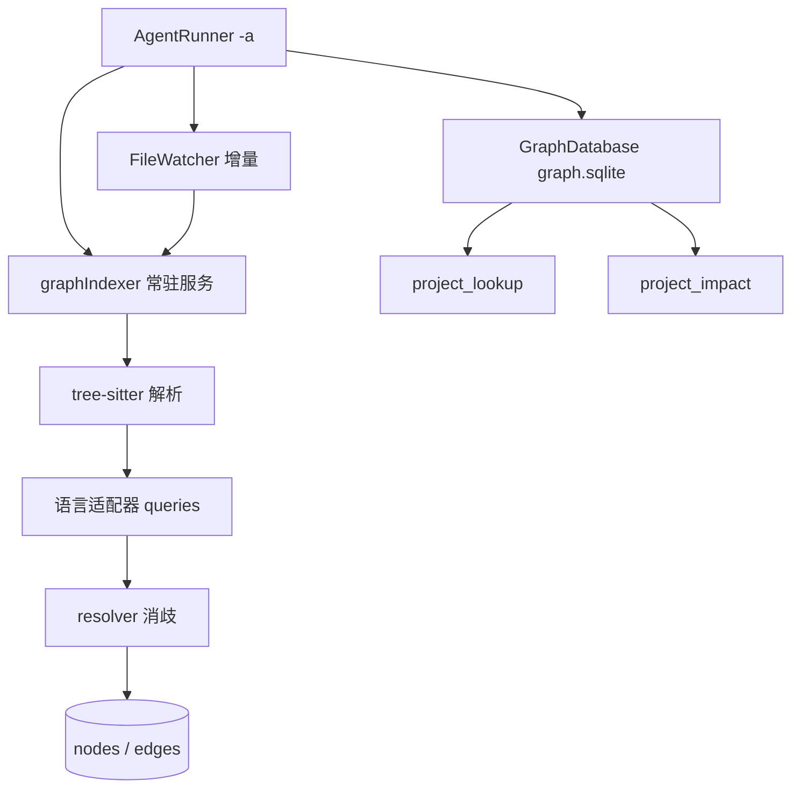

# 项目依赖图引擎重构（project-graph）

目标：把 `project_search` 从“符号检索框”重构为 Agent 的全局依赖图感知能力。Agent 不写 `grep` 就能回答“这个符号在哪、谁调用它、改它会影响什么”。

## 非目标

- 不兼容旧 `.utility/deps.sqlite`，不迁移旧数据。
- 不引入图数据库。
- 不做三方包 SCA。
- 不做跨仓库 HTTP/RPC/MQ 隐式边。
- 不新增面向用户的 CLI 子命令。

## 现状基线

| 仓库 | 文件/符号 | 内部 import 边 | 说明 |
|---|---|---|---|
| utility | 132 / 2654 | 0 | imports 全为外部模块 |
| agent-gateway | 154 / 1850 | 0 | imports 全为外部模块 |
| wms-front | 1877 / 2399 | 881 | 解析率 88% |
| tms-app | 999 / 11223 | 2820 | 解析率 73% |

现有 `imports` 只是显式 import 边。Swift 同模块文件之间无 import，Kotlin/Java 同包引用、Vue 模板组件引用都不在表里。历史 458 次 `project_search` 调用中，80% 调用后仍执行 `grep`，因为工具只返回定义位置，不返回引用关系。

## 唯一启动入口

Agent 模式入口是 `utility -a <cmd>`，可选 `--dir <path>`。`AgentRunner.run` 已经负责：建库 → 全量扫描 → `FileWatcher` 增量 → 拉起 agent 子进程 → agent 退出即退出。

图引擎接在这条流程里，不新增 App 启动逻辑、不新增菜单、不新增 CLI。

启动时读取 `graph.sqlite` 的 `meta`：

- `engine_version`、`schema_version`、`root` 任一不一致，或库不存在：全量建图。
- 全部一致：跳过全量，只启动增量 watcher。

## 架构



- 解析服务在 agent-gateway，注册 `graphIndexer` 到 `contracts/entries.json`。
- 宿主只做监听、调度、SQLite 读写和 MCP 查询，不内嵌 grammar。
- tree-sitter 负责语法结构，resolver 负责名字绑定；LSP/SCIP 只作为可选 `resolver=lsp/scip` 增强，不在主路径。

## 数据模型

新库 `.utility/graph.sqlite`，与旧 `deps.sqlite` 并存，互不读取。

```sql
CREATE TABLE meta (
  key TEXT PRIMARY KEY,
  value TEXT NOT NULL
);

CREATE TABLE files (
  path TEXT PRIMARY KEY,
  lang TEXT NOT NULL,
  size INTEGER NOT NULL,
  mtime REAL NOT NULL,
  content_hash TEXT NOT NULL
);

CREATE TABLE symbols (
  sym_key TEXT PRIMARY KEY,
  path TEXT NOT NULL,
  name TEXT NOT NULL,
  kind TEXT NOT NULL,
  signature TEXT,
  start_line INTEGER NOT NULL,
  end_line INTEGER NOT NULL
);
CREATE INDEX idx_symbols_name ON symbols(name);
CREATE INDEX idx_symbols_path ON symbols(path);

CREATE TABLE edges (
  id INTEGER PRIMARY KEY AUTOINCREMENT,
  from_key TEXT NOT NULL,
  to_key TEXT NOT NULL,
  kind TEXT NOT NULL,
  path TEXT NOT NULL,
  start_line INTEGER,
  end_line INTEGER,
  confidence REAL NOT NULL,
  resolver TEXT NOT NULL,
  status TEXT NOT NULL DEFAULT 'ok'
);
CREATE INDEX idx_edges_to ON edges(to_key, kind);
CREATE INDEX idx_edges_from ON edges(from_key, kind);
CREATE INDEX idx_edges_path ON edges(path);

CREATE TABLE unresolved (
  path TEXT NOT NULL,
  raw_name TEXT NOT NULL,
  kind TEXT NOT NULL,
  line INTEGER,
  reason TEXT NOT NULL
);
CREATE INDEX idx_unresolved_name ON unresolved(raw_name);

CREATE TABLE diagnostics (
  key TEXT PRIMARY KEY,
  value TEXT NOT NULL
);
```

- 符号键：`sha1(rel_path|name|kind|signature)`，禁用自增 id 做跨扫描标识。
- 节点键：`file:<path>`、`sym:<sym_key>`。
- 边类型：`import`、`call`、`type_ref`、`extends`、`implements`、`override`、`component`。
- 每条边必须带证据：`path + start_line + end_line + resolver + confidence`。

## 解析协议

`graphIndexer` 通过 stdin/stdout 交换 JSON Lines。

请求：

```json
{"op":"index_file","root":"/abs/project","path":"rel/path.swift","content_hash":"sha1","lang":"swift"}
{"op":"index_batch","root":"/abs/project","files":[{"path":"rel/a.py","content_hash":"sha1","lang":"python"}]}
{"op":"ping"}
```

响应：

```json
{
  "ok": true,
  "path": "rel/path.swift",
  "symbols": [
    {"name":"ProjectScanner","kind":"class","signature":null,
     "start_line":5,"end_line":120}
  ],
  "edges": [
    {"from_name":"scan","from_line":33,"raw_name":"FileWatcher","kind":"type_ref",
     "line":46,"confidence":0.9,"resolver":"treesitter"}
  ],
  "unresolved": [
    {"raw_name":"dynamicThing","kind":"call","line":88,"reason":"no_binding"}
  ]
}
```

失败响应：`{"ok":false,"path":"...","error":"...","reason":"parse_failed"}`。禁止返回半截结果。

## 消歧规则

提取器只产出 `(raw_name, line, kind)`，resolver 统一消歧，按以下顺序：

1. 同文件同名符号，`resolver=local`。
2. 目标文件在 `imports.to_path` 集合内，`resolver=import_scoped`。
3. Kotlin/Java 按 package 路径、Swift 按目录模块限定，`resolver=module_scoped`。
4. 全仓唯一同名符号，`resolver=global_unique`。
5. 同名多候选且无法限定：写 `unresolved`，不生成边。

不写死相似度阈值。低置信边保留并标注 `confidence`，查询方决定是否采用。

## 查询工具

Phase 1 新增并切换两个工具，保留 `project_search` 作为过渡入口；Phase 3 删除旧工具。描述固定英文。

### project_lookup

定位符号或文件，返回定义位置与一跳上下文。

```json
{
  "status": "ok",
  "query": "ProjectScanner",
  "results": [{
    "name": "ProjectScanner",
    "kind": "class",
    "file": "Sources/Scanner/ProjectScanner.swift",
    "startLine": 5,
    "endLine": 120,
    "callerCount": 7,
    "topCallers": ["Sources/App/AppDelegate.swift"],
    "resolver": "treesitter"
  }],
  "trace_id": "gl_20261101_..."
}
```

参数：`dbPath`、`query`、`kind`、`file_path`、`limit`。

### project_impact

查询调用方/被调用方，支持多跳。

```json
{
  "status": "ok",
  "target": {"name": "ProjectScanner", "file": "Sources/Scanner/ProjectScanner.swift"},
  "direction": "callers",
  "groups": [{
    "resolver": "import_scoped",
    "confidence": 0.9,
    "items": [{
      "file": "Sources/App/AppDelegate.swift",
      "symbol": "applicationDidFinishLaunching",
      "line": 42,
      "kind": "call",
      "status": "ok"
    }]
  }],
  "stale": 2,
  "truncated": false,
  "trace_id": "gi_20261101_..."
}
```

参数：`dbPath`、`target`、`direction`（`callers`/`callees`/`both`）、`depth`（默认 2）、`limit`（默认 30）、`includeStale`（默认 false）。

查询结果必须带 `provenance`（文件、行号、resolver、confidence），不需要额外的 `explain` 命令。

## 增量

1. `FileWatcher` 事件 → 读文件 → 计算 `content_hash`。
2. 与 `files.content_hash` 相同则跳过。
3. 不同则调用 `graphIndexer` 单文件解析。
4. 单事务执行：
   - 删除该文件旧符号、旧出边。
   - 插入新符号、新边。
   - 将 `to_key` 指向旧符号键的入边标记 `stale`。
5. 文件删除：删文件、符号、出边；入边标记 `stale` 并保留 `to_key`。
6. 查询默认过滤 `stale`，`includeStale=true` 时展示。

全量扫描沿用单事务原子替换，不暴露独立清库方法。

## 可调试性（无新增命令）

- `AgentRunner` banner 输出：`Graph: <nodes> nodes / <edges> edges / <stale> stale / <ms> ms`。
- 日志：`~/Library/Logs/Utility/graph.log`，固定字段 `trace_id`、`op`、`project`、`file`、`elapsed_ms`、`edge_count`、`unresolved_count`。
- `graph.sqlite` 的 `diagnostics` 表：schema 版本、引擎版本、最近全量耗时、失败文件、unresolved 前 20。
- 工具返回在降级时带 `degraded: true` 与 `diagnostics` 摘要。
- 测试脚本 `scripts/graph-eval.sh` 只存在于仓库，不作为产品命令。

## 阶段

### Phase 1：引擎底座

- 新 schema 与迁移。
- `graphIndexer` 常驻服务与 JSON 协议。
- Swift、Python 适配器。
- resolver：同文件、import、模块。
- `project_lookup`、`project_impact`。
- `AgentRunner` 接线、增量 watcher。
- 验收：utility 与 agent-gateway 副本可建图、查询、增量更新；`swift build` 通过；gateway 单元测试通过。

### Phase 2：多语言

- TS/JS、Vue、Java、Kotlin 适配器。
- Vue 拆 `script`/`template`，模板组件生成 `component` 边。
- Java/Kotlin package 消歧。
- 验收：wms-front、tms-app 副本建图成功，关键符号可查。

### Phase 3：精确增强与真实测试

- 可选 SCIP（Python/TS/Java/Kotlin）与 sourcekit-lsp（Swift）生成高置信边。
- 10 个真实任务的模型测试，记录 Bash 检索次数并与旧基线对比。
- 验收：Bash 检索次数显著下降，答案正确率不低于基线。

## 测试计划

### 数据准备

```bash
rsync -a --exclude '.git' --exclude 'node_modules' --exclude '.build' \
  <path-to-utility-repo>/ /tmp/graph-eval/utility/
rsync -a --exclude '.git' --exclude 'node_modules' --exclude '.build' \
  <path-to-agent-gateway-repo>/ /tmp/graph-eval/agent-gateway/
rsync -a --exclude '.git' --exclude 'node_modules' --exclude 'dist' \
  <path-to-frontend-repo>/ /tmp/graph-eval/frontend/
rsync -a --exclude '.git' --exclude '.build' --exclude 'build' \
  <path-to-mobile-repo>/ /tmp/graph-eval/mobile/
```

### 建图与增量

```bash
.build/debug/utility --dir /tmp/graph-eval/utility -a "echo graph-smoke"
```

断言：banner 中节点数、边数大于 0；`project_lookup` 能命中 `ProjectScanner`；修改一个文件后增量执行，旧符号消失、新符号出现、相关边 `stale`。

### 模型真实测试

在副本目录用现有入口启动独立会话：

```bash
utility --dir /tmp/graph-eval/utility -a "claude -p '<task>' --output-format stream-json"
```

任务集：

1. utility：`ProjectScanner.scan` 的调用方有哪些？
2. utility：TokenProxy 规则注入在哪些请求路径生效？
3. utility：`HotkeyManager` 注册的快捷键被哪些模块读取？
4. agent-gateway：`project_search` 的实现被哪些模块调用？
5. agent-gateway：`llm_client` 的调用方有哪些？
6. wms-front：修改 `uploadFileCOS` 会影响哪些页面？
7. wms-front：找出所有使用 `OrderNoInput` 的组件。
8. wms-front：`Splitpanes` 在哪些路由页面使用？
9. tms-app：`DialogDownload` 的定义与调用方。
10. tms-app：修改 `MainActivity` 下载逻辑会影响哪些类？

指标：工具调用总数、Bash `grep`/`find` 次数、首次定位正确性、最终答案正确性、输出字符数、耗时。

证据级别：L2 脚本断言 + L3 真实 Agent 会话与人工判定。

## 性能目标

- 全量建图：utility 小于 10 秒，wms-front 小于 90 秒，tms-app 小于 120 秒。
- 单文件增量小于 300 ms。
- 查询 P95 小于 100 ms。
- `graphIndexer` 常驻内存小于 300 MB。

目标写进验收，不写进代码逻辑。

## 风险与回滚

- tree-sitter 是近似解析：同名误连、动态派发、宏生成代码会漏，靠 `resolver`、`confidence`、`unresolved` 标注。
- 常驻服务崩溃：宿主健康检查并重启；失败时查询降级为只读旧图并返回 `degraded: true`。
- 全量扫描耗时：后台执行，期间使用旧图并标注 `indexing: true`。
- 回滚：新库独立；回滚按 git 版本回退二进制，不做数据迁移。

## 文件清单

utility：

- `Sources/Scanner/Graph/GraphProtocol.swift`
- `Sources/Scanner/Graph/GraphDatabase.swift`
- `Sources/Scanner/Graph/GraphIndexerClient.swift`
- `Sources/Scanner/Graph/GraphScanner.swift`
- `Sources/CLI/AgentRunner.swift`（接线）
- `Sources/CLI/FileWatcher.swift`（增量）
- `Sources/MCP/GatewayEntry`（注册 `graphIndexer`）
- `default-config.yaml`（`graph.enabled`、`graph.languages`、`graph.depthLimit`）

agent-gateway：

- `src/agent_gateway/services/graph/indexer.py`
- `src/agent_gateway/services/graph/parsers/swift.py`
- `src/agent_gateway/services/graph/parsers/python.py`
- `src/agent_gateway/services/graph/resolver.py`
- `src/agent_gateway/services/mcp/graph_tools.py`
- `src/agent_gateway/services/mcp/server_tool_schema.py`（工具注册）
- `contracts/entries.json`（新增 `graphIndexer`）
- `tests/graph/`（单元测试）

## 实施约束

- 不提交、不推送、不删除文件，删除操作移动到废纸篓。
- 不改 `VERSION`。
- 代码内注释、日志、测试名用英文；用户可见文案走既有语言资源。
- 单条代码注释不超过 80 字。
- 每个阶段结束时给出：修改文件、验证命令与原始输出、未完成项。

## Phase 1 实施记录（2026-11-01）

已完成：

- `graph.sqlite` schema v1、`graphIndexer` 常驻服务、Swift/Python tree-sitter 适配器、四层 resolver。
- `project_lookup`、`project_impact` 工具注册；旧 `project_search` 保留为过渡入口。
- `AgentRunner -a` 接线：meta 不一致全量建图，一致时 `syncScan()` 只重扫变化文件。
- 契约同步：`contracts/entries.json` 与 `Sources/Gateway/entries.json` 均含 `graphIndexer`。

实测（utility 临时副本）：

- 全量：135 files / 5130 symbols / 4445 edges / 7107 unresolved，2485 ms。
- 增量：删除 1 文件、修改 1 文件后 `syncScan` 361 ms；文件数 135 → 134，被删文件符号为 0。
- 查询：`ProjectScanner` 命中定义，callerCount 2；`GraphScanner` callerCount 5。
- 回归：gateway 415 tests OK；`tests/graph` 24 passed；`swift build` 通过；契约检查通过。

已知缺口：

- unresolved 偏高：Swift 跨文件作用域未实现，只能走 `global_unique` 或落 unresolved。
- `sym_key` 已加入 `start_line` 保证重载唯一，行号变化会使对应入边 stale。
- 模型真实测试与多语言仓库验证留在 Phase 2/3。

## 精度修复与模型测试（2026-11-01）

修复（均在 agent-gateway）：

- `Reference` 增加 `receiver`；Swift 解析成员调用根接收者，resolver 按接收者类型限定，无法确定则落 unresolved，消除 `p.run()` 误连同名方法。
- `sym_key` 增 `start_line`；`property_declaration` 子节点继承外层 enclosing，修复 `from_name="s"`。
- Swift/Python 解析器容忍 ERROR 节点；`_index_batch` 逐文件隔离失败，避免单文件错误拖垮整批。
- `project_lookup`/`project_impact` 拆分 `Class.method`，路径判定改为扩展名列表。

实测（utility 副本）：

- 全量：135 files / 5130 symbols / 4161 edges（local 2604、module_scoped 1210、global_unique 347）/ unresolved 7403。
- `scan` 的 callers 仅剩 `AgentRunner.run` 37/41 与 `InitCommand.run` 28，与源码一致。

模型真实测试（`claude -p` 严格工具隔离，control = `project_search`，exp = `project_lookup` + `project_impact`）：

| 任务 | control Bash | exp Bash | 答案 |
|---|---|---|---|
| ProjectScanner.scan 调用方 | 16 | 2 | 一致（3 处） |
| GraphKey.symbolKey 使用方 | 5 | 2 | 一致 |
| tool_project_impact 引用 | 12 | 2 | 一致 |

- 第一轮（仅 Phase 1 引擎，无 receiver 消歧）为 control 17 vs exp 16，无差异。
- 结论：减少 Bash 的关键是边精度，而非工具是否存在；exp 组 Read 略增，属定位后核对原文。
- 局限：3 任务各 1 次，方向性证据，需扩到 10 任务才算 Phase 3 验收。

未完成：

- Phase 2 多语言（TS/JS、Vue、Java、Kotlin）尚未开始。

## 工具面收敛（2026-11-01）

- MCP schema 删除 `project_search`，模型面只剩 `project_lookup` / `project_impact`。
- `tool_project_search` 与 REST `/api/project/search` 保留为内部面，不注册为模型工具。
- `AgentRunner` 注入 `UTILITY_GRAPH_DB`；`GraphDatabase.databasePath(projectPath:)` 统一路径计算。
- `param.graph_db_path` 文案指向 `$UTILITY_GRAPH_DB`，避免模型先探测目录。
- 验证：`build_tools()` 15 项且无 `project_search`；gateway 413 passed（`test_token_proxy` 的 usage 用例在 HEAD 副本同样失败，非本次引入）；`swift build` 通过。

## 10 题对照测试（2026-11-01）

组：`grep`（Read/Grep/Glob/Bash）对 `graph`（额外 `project_lookup`/`project_impact`），utility 与 agent-gateway 副本各 5 题。

| 指标 | grep | graph |
|---|---|---|
| 检索调用 | 32 | 63 |
| Read | 31 | 24 |
| 输入 token | 883k | 1.46M |
| 成本 | $1.29 | $1.82 |

- 10 题答案实质一致（调用方数量、文件、行号、callees 清单均相同）。
- graph 组每题先花 1 次 Bash 确认 `dbPath`；取回结果后仍 Grep/Read 交叉验证。
- `u5` callees 题额外触发 13 次 `project_lookup`，未减少任何调用。
- 结论：单跳题上图工具不如 grep；matrix2 的下降是相对低效的 `project_search`，不是相对 grep。
- 待验证：多跳影响面题（grep 难做）是否体现图价值；`dbPath` 默认化；callees 一次返回全量。

## 子 Agent 验证与覆盖增强（2026-11-01）

- 子 Agent（`claude -p` + 9101 MCP）在隔离副本跑 2 轮共 24 次任务，模型仍用 Bash 做交叉核对。
- 追问结论：图结果可信，但模型知道图只有静态调用边，改签名时保留一次定向 grep。
- 修复：`GraphScanner.resolveTargetKey` 对无 `toName` 的 import 边返回 `file:<path>`，import 关系此前被整体丢弃。
- `project_impact` 起点增加 `file:<path>`，文件级 import 作为第 1 跳返回。
- `project_impact` 新增 `coverage`（已覆盖/未覆盖边类型）与 `builtAt`（库构建时间）。
- 重建后 gateway 副本 4666 edges（含 639 条 import）；`tests/graph` 27 passed。

## 多语言接入与真实仓验证（2026-11-01）

- 新增解析器：TypeScript/JavaScript（含 JSX）、Vue（拆 script 块，行号回填）、Java、Kotlin。
- 注册表与扩展名：`.ts/.tsx/.js/.jsx/.mjs/.cjs/.vue/.java/.kt/.kts`；默认语言集改为全部七种。
- 依赖：`tree-sitter-javascript/typescript/java/kotlin` 写入 `pyproject.toml`。
- re-export：`resolver` 对模块名 receiver 先查直接定义，再沿 `from x import y` 追到来源，边标 `re_export`。
- 健壮性：fullScan 按 50 文件分批、入库前按 `sym_key` 去重、按引用类型过滤候选（call 不连字段）。
- Kotlin 跳过单字母类型参数；JS 提取顶层 `a.b = function` 赋值为 method/property。

公开仓实测（浅克隆，全量建图）：

| 仓库 | 语言 | 文件 | 符号 | 边 | 耗时 |
|---|---|---|---|---|---|
| express | JS | 142 | 572 | 1370 | 580 ms |
| pinia | Vue/TS | 150 | 537 | 538 | 257 ms |
| spring-petclinic | Java | 50 | 323 | 107 | 206 ms |
| Exposed | Kotlin | 984 | 27033 | 22208 | 10.7 s |

- 抽样查询：pinia `defineStore` 9、petclinic `Pet` 11、Exposed `transaction` 3 条引用可查。
- express `createApplication` 无入边：CommonJS 默认导出不在静态解析范围，已记录为边界。
- 验证：`tests/graph` 43 passed；gateway 432 passed（1 例既有 token_proxy usage 失败）；契约检查通过；`swift build` 通过。

## 覆盖补全与真增量（2026-11-02）

- ObjC 降级解析器：正则提取 @interface/@implementation/方法/属性/#import/消息发送，加入默认语言集。
- Vue 模板：PascalCase 标签生成 type_ref，文件生成 component 符号，组件纳入类型过滤；pinia 出现 9 条组件边。
- CommonJS 导出：module.exports / exports.x 生成 kind=export 引用；express 的 createApplication 获得入边。
- 弱边标记：impact 分组与 lookup 的 topCallers 增加 `weak`（resolver 为 global_unique）。
- syncScan 真增量：只重解析 hash 变化的文件；新符号出现时按 unresolved 表回填引用过该名字的旧文件（force 重解析）。
- 实测：utility 副本无变化时 syncScan 34 ms（原 361 ms）；新增符号后旧文件 unresolved 清零并生成边。
- 验证：graph 54 passed；全量 443 passed（1 例既有 token_proxy usage 失败，HEAD 同样复现）。

## 真实业务仓验证（2026-11-02）

- wms-front（Vue2，1219 文件）：26237 符号 / 17364 边 / 7.9 s。
- yjzt-wms-app（Vue3+TS，156 文件）：2055 符号 / 205 边；自有代码少，组件多经 node_modules 符号链接引入。
- 修复：JS/TS/Vue 的 `this.xxx()` 接收者此前未跳过（只跳过 self/super），全部落 unresolved；跳过 this/cls 后 wms-front 边数 7493 → 17364，local 1277 → 8818。
- 修复：`@/`、`~/` 别名导入与带扩展名路径映射；wms-front import 边 445 → 1081。
- 剩余 unresolved 主要是框架注入（`$t`、`$nextTick`、mapActions、Vuex get/push），属静态解析边界。
- 验证：graph 55 passed；全量 444 passed（1 例既有 token_proxy 失败）。

## 精度收敛（2026-11-02）

- CommonJS 绑定：`const x = require("./m")` 记为 require 类型导入，`x()` 连到模块唯一导出，边标 `commonjs_export`（置信度 0.8）。
- 跨语言族过滤：`global_unique` 只在同族内建边（apple / py / web / jvm），跨族落 `no_binding`。
- `engine_version` 1 → 2：解析器逻辑已多轮变更，旧图不会随文件 hash 未变而重建；bump 后首次启动强制全量。
- 验证：graph 57 passed；全量 446 passed（1 例既有 token_proxy 失败）；express 1532 边，Exposed 28637 边（global_unique 7702）。

## 前端场景补全（2026-11-02）

- Vue 模板事件：`@click` / `@change` / `v-on:xxx` 的处理器生成 call 引用，排除内联赋值与成员链；wms-front 边 17364 → 23507。
- 启动裁剪：非首次不再全量扫描 deps.sqlite（`utility init` 可重建）；wms-front 启动 55 s → 12 s（含图全量重建），无变化时 0.5 s。
- `project_lookup` 空查询返回概览：文件/符号/边计数、语言分布、边类型、构建时间，模型无需再直接读库。
- 验证：graph 59 passed；全量 448 passed（1 例既有 token_proxy 失败）；pinia 562 边。
