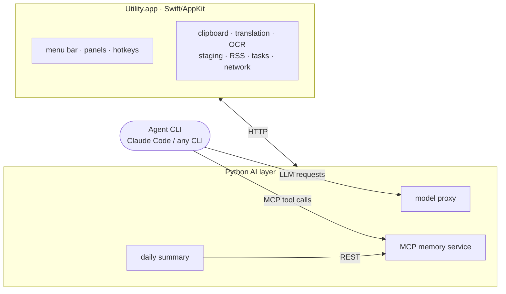
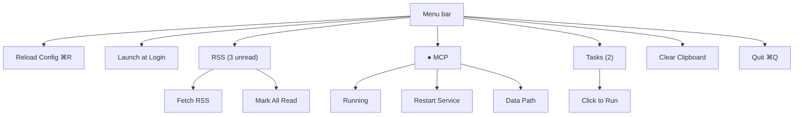
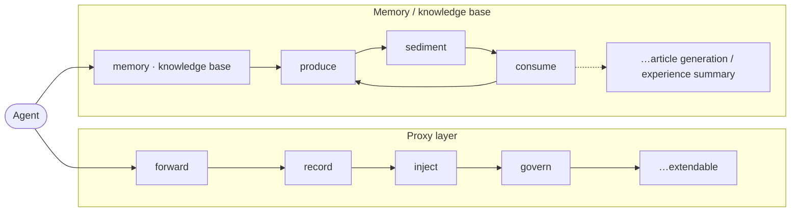
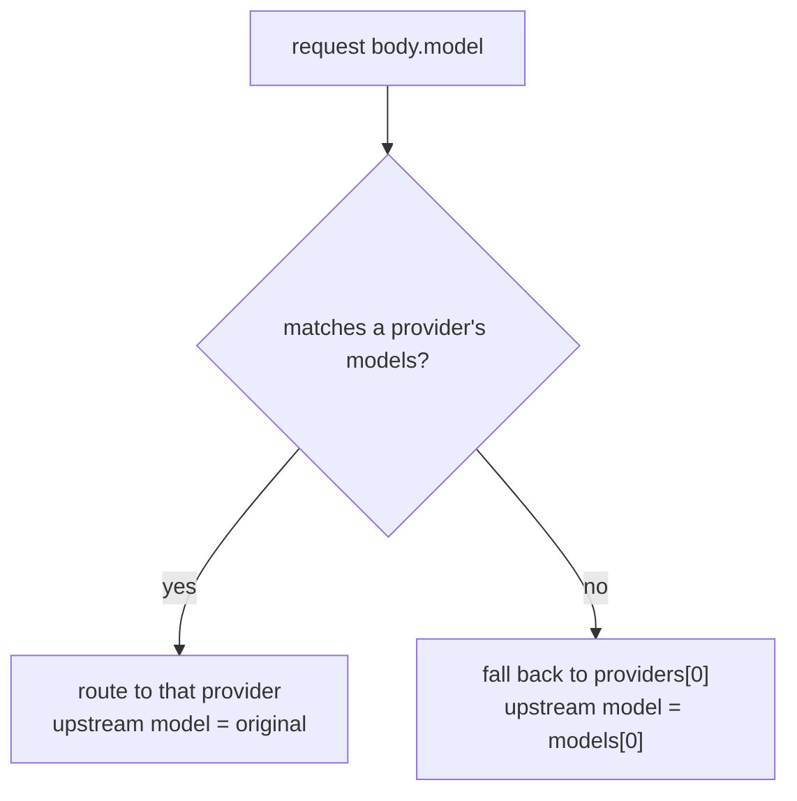
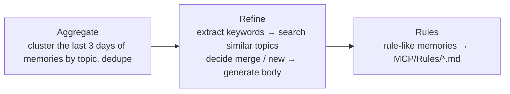
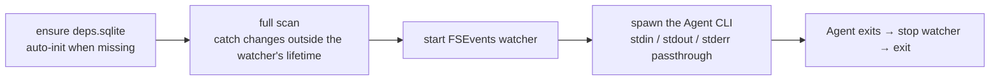

# Utility

A macOS menu-bar tool: clipboard history, AI translation, OCR capture, drag-and-drop staging, RSS, scheduled tasks, network monitor, plus a local AI layer.

No Dock icon, no main window.

[中文说明](README.zh.md)

---

> **⚠️ Features that are on by default and consume tokens**
>
> - **Daily knowledge summary** (`mcp.summaryEnabled: true`, fires at 17:00 by default) — several LLM calls (aggregate, refine, rule extraction)
>
> Turn the relevant switches off in `~/.config/utility/config.yaml` if you don't want them.

---

## Install

```bash
git clone <https://github.com/yuanyxh/utility.git> utility
cd utility
swift build -c release
.build/release/utility &
```

Requirements: macOS 14+, Swift 5.9+ (Xcode Command Line Tools).

The AI layer also needs Python 3.12 and its own virtual environment. The app looks for the interpreter at a fixed path:

```bash
python3 -m venv ~/.config/utility/mcp-venv
~/.config/utility/mcp-venv/bin/pip install -r Sources/MCPScripts/requirements.txt
```

---

## Paths

| Path | Default | Content | Setting |
|---|---|---|---|
| Config dir | `~/.config/utility/` | all config and data | — |
| Config file | `~/.config/utility/config.yaml` | app configuration | — |
| Python venv | `~/.config/utility/mcp-venv/` | AI-layer runtime | — |
| Notes dir | `~/.config/utility/notes/` | sedimented documents; the `MCP/` subdir holds Skills, Rules, DESCRIPTIONS.md | `mcp.knowledgeBasePath` |
| Vector store | `~/.config/utility/data/qdrant/` | hot / cold vectors | `mcp.qdrantPath` |
| App data | `~/.config/utility/data.sqlite` | clipboard, RSS, … | — |
| Token usage | `~/.config/utility/token_usage.sqlite` | recorded by the proxy | — |
| Tool output | `~/.config/utility/tool_output.sqlite` | full tool-output log | — |
| Model cache | `~/.cache/utility/fastembed/` | embedding model | `mcp.fastembedCacheDir` |
| Logs | `~/.cache/utility/` | per-process logs | — |
| Project index | `<project root>/.utility/deps.sqlite` | data source for `project_*` | — |

```bash
tail -f ~/.cache/utility/debug.log         # runtime trace
tail -f ~/.cache/utility/token_proxy.log   # proxy
tail -f ~/.cache/utility/server.log        # memory service
tail -f ~/.cache/utility/summarize.log     # daily summary
tail -f ~/.cache/utility/llm_client.log    # Python-side LLM calls
```

---

## Quick start

| Hotkey | Action |
|---|---|
| `cmd+shift+c` | open clipboard history |
| `option+d` | translate the selection |
| `option+s` | capture a screen region and translate it |
| drag to the bottom-left corner | stage a file, a text selection, or a URL |

---

## Architecture



---

## Other features

### Clipboard history

Copied text, files, images and HTML are recorded.

**Actions**

| Action | Effect |
|---|---|
| `cmd+shift+c` | open the panel |
| `↑` / `↓` | move the selection |
| `Enter` | paste into the app you were in and close |
| `Esc` | close |

**Settings**

| Setting | Default | Purpose |
|---|---|---|
| `clipboard.maxDays` | `3` | entries older than this many days are deleted |
| `clipboard.excludeApps` | `["SecurityAgent", "KeychainAccess"]` | apps never recorded from |
| `clipboard.hotkey` | `cmd+shift+c` | opens the panel |
| `clipboard.pollInterval` | `0.3` | pasteboard poll interval, seconds |

### Translation

Requires `ai.apiKey`.

**Actions**

| Action | Effect |
|---|---|
| `option+d` | translate the selection |
| `cmd+Enter` | translate what you typed |
| `Enter` | paste and close |
| `Shift+Enter` | newline |
| `Esc` | close |

**Settings**

| Setting | Default | Purpose |
|---|---|---|
| `translation.hotkey` | `option+d` | translate the selection |
| `translation.hotkeyOCR` | `option+s` | capture a screen region, then translate it |
| `translation.targetLang` | `auto` | starting target language; `auto` lets the model pick between `firstLang` and `secondLang` |
| `translation.firstLang` | `zh` | one candidate for `auto` |
| `translation.secondLang` | `en` | the other |
| `translation.prompt` | `""` | inline system prompt overriding the template file; `{source}`/`{target}` substituted |

### OCR capture

Needs Screen Recording permission.

**Actions**

| Action | Effect |
|---|---|
| `option+s` | dim the screen, drag a rectangle, release to recognize and translate into the panel |
| `Esc` | cancel |

**Settings**

| Setting | Default | Purpose |
|---|---|---|
| `translation.hotkeyOCR` | `option+s` | trigger the capture |

### Drag-and-drop staging

**Actions**

| Action | Effect |
|---|---|
| drag a file / text selection / URL to the bottom-left corner | stage it |
| drag it out of the floating window into any app | retrieve it |

**Settings**

| Setting | Default | Purpose |
|---|---|---|
| `stage.moveOnDragOut` | `true` | whether dragging out may move the source file: `true` offers copy+move, `false` copy only |

### RSS

**Actions**

| Command | Purpose |
|---|---|
| `utility rss --fetch` | pull new items |
| `utility rss --unread` | list unread as JSON |
| `utility rss --mark-read <id>` | mark one read |
| `utility rss --mark-all-read` | mark everything read |

**Settings**

| Setting | Default | Purpose |
|---|---|---|
| `rss.feeds[].name` | — | label in the menu bar |
| `rss.feeds[].url` | — | feed URL |

```yaml
rss:
  feeds:
    - name: "MDN Blog"
      url: "https://developer.mozilla.org/en-US/blog/rss.xml"
```

### Scheduled tasks

**Actions**

| Action | Effect |
|---|---|
| click a task in the menu bar | run it |
| click again (`manual` mode) | kill the running process |

**Settings**

| Setting | Default | Purpose |
|---|---|---|
| `tasks[].name` | `""` | label in the menu bar |
| `tasks[].trigger` | `""` | 5-field cron: `minute hour day month weekday` |
| `tasks[].exec` | — | `{type: sh \| js \| shortcuts \| py, command: …}`, or a bare string `shortcuts://xxx` (type inferred) |
| `tasks[].enabled` | `true` | whether the scheduler registers it |
| `tasks[].mode` | `cron` | `cron` runs on schedule and catches up after sleep; `manual` runs only on menu click, clicking again kills the process |

```yaml
tasks:
  - name: daily rss digest
    trigger: '0 10 * * *'
    exec: { type: sh, command: ~/.hermes/scripts/utility-rss-daily.sh }
    enabled: true
    mode: cron
```

### Network monitor

**Actions**

| Action | Effect |
|---|---|
| menu bar | shows up/down throughput for active interfaces (`0.00M` when offline) |
| `Cmd`-drag | reposition |

### Menu bar



---

## The AI Agent layer

| Component | Responsibility |
|---|---|
| Model proxy | reverse-proxy LLM requests: routing, protocol conversion, usage recording, token governance |
| MCP memory service | expose memory and codebase search as MCP tools |
| Daily summary | sediment memories into notes |



---

### 1. Model proxy

Reverse-proxies Anthropic / OpenAI protocol requests, with model switching, token governance and usage recording.

**Enable**

```yaml
modelProxy:
  enabled: true
  port: 0
  providers:
    - name: deepseek
      url: "https://api.deepseek.com/anthropic"
      apiFormat: anthropic
      apiKey: "xxxx-xxxx-xxxx-xxxx"
      models: [deepseek-flash]
```

Set the agent's base URL to `http://localhost:[PORT]/open/v1`. `/open/v1` is a compatibility alias, `/v1` is the protocol-native entry.

**Routing**



**Token governance**

| Mechanism | Toggle | Effect |
|---|---|---|
| Full-text de-dup | `skillDedupEnabled` | a short note replaces duplicated content |
| Shell output trimming | `outputFilter.enabled` | shell output filtered, JSON losslessly minified |
| Classifier acceleration | `clientAccel` | disables thinking for safety-classifier requests |

**De-dup**: when a tool result is byte-identical to one already sent, replace the content with a short note:

```
[Tool_Name] result already exists; see above
```

**Shell trimming**: oversized output truncated head/tail (keep 70% + 30%) with a self-labeling marker:

```
[... N bytes truncated ...]
```

**Settings**

| Setting | Default | Purpose |
|---|---|---|
| `modelProxy.enabled` | `false` | start the proxy with the app |
| `modelProxy.port` | `0` | listening port; `0` auto-picks a free one (the `[PORT]` in the URLs above) |
| `modelProxy.url` | `""` | single upstream, used only when `providers` is empty |
| `modelProxy.providers[].name` | — | label in the menu bar |
| `modelProxy.providers[].url` | — | upstream endpoint |
| `modelProxy.providers[].apiFormat` | — | `anthropic` or `openai`; differing from the client's protocol converts both ways |
| `modelProxy.providers[].apiKey` | `""` | key substituted when forwarding; empty passes the client's key through |
| `modelProxy.providers[].models` | — | model IDs routed to this provider |
| `modelProxy.skillDedupEnabled` | `true` | collapse duplicated content |
| `modelProxy.outputFilter.enabled` | `true` | trim oversized shell output |
| `modelProxy.outputFilter.maxBytes` | `12000` | only outputs above this size are trimmed |
| `modelProxy.responseAnnotationEnabled` | `true` | append `model \| rewrote: …` to final replies |
| `modelProxy.clientAccel` | `{enabled: true, clients: []}` | clients that get classifier acceleration |
| `modelProxy.clientText` | — | client-injected continuation/summary text and tags |
| `modelProxy.maxRestarts` / `restartDelayMs` | `3` / `2000` | restart policy after a crash |

---

### 2. MCP memory service

Exposes MCP tools over streamable HTTP at `http://127.0.0.1:[PORT]`. Register it with an MCP client:

```bash
claude mcp add --transport http mino-brain http://127.0.0.1:[PORT]
```

**Three-layer memory**

| Layer | Storage | Content | Lifecycle |
|---|---|---|---|
| hot | mem0 + Qdrant (local) | raw fragment facts | `hotRetentionDays` (default 180 days) |
| cold | Qdrant collection `knowledge_base` | structured knowledge entries | long-lived |
| notes | `.md`/`.txt` under the notes dir | sedimented documents | permanent |

**Tools**

| Tool | Purpose |
|---|---|
| `remember` / `remember_batch` | write memories (hot layer) |
| `recall` | three-layer joint retrieval |
| `catch_up` | pull recent memories |
| `forget` | delete a memory |
| `set_memory_processed` | read/write the processed bit |
| `project_search` | multi-layer codebase search |
| `project_structure` | project directory structure |
| `project_packages` | third-party dependency list |
| `project_exports` | a file's or directory's public interface |
| `project_notes` | search project-local notes |
| `tool_resource` | read a skill's companion resources |
| (dynamic) | each skill under `MCP/Skills` registers as a tool |

**Notes directory**

Configured by `mcp.knowledgeBasePath`, default `~/.config/utility/notes/`:

| Path | Meaning |
|---|---|
| `MCP/Skills/` | each `.md` or directory containing `SKILL.md` registers as an MCP tool |
| `MCP/Rules/` | rules / conventions the daily summary distilled from memories |
| `MCP/DESCRIPTIONS.md` | override built-in tool descriptions by `### <tool name>` |
| `MCP/System_Prompts.md` | rules the proxy injects into each turn's user message |
| `Extracts/` | intermediate extraction products of the daily summary |
| other `.md` / dirs | sedimented knowledge articles |

**Skills**

Each `.md` under `<notes dir>/MCP/Skills/` (or a `SKILL.md` inside such a directory) registers as an MCP tool; `-` in the name normalizes to `_`. Frontmatter:

```markdown
---
name: my-skill
description: when it should trigger and what it does; the model uses this to decide when to call it
---

The body returned when the tool is called.
```

A directory skill may carry companion resources (`references/`, `agents/`, `scripts/` are read via `tool_resource` and are not registered as tools):

```
MCP/Skills/my-skill/
├── SKILL.md
├── references/
├── agents/
└── scripts/
```

**DESCRIPTIONS.md**

Override a tool's description by `### <tool name>` (tool names as in the MCP tools table above):

```markdown
### remember
Write a single fact to shared memory.

### recall
Search memories, the knowledge base, and local notes.
```

**System_Prompts.md**

Plain text, no format requirement; injected verbatim into each turn's user message:

```markdown
## Rules
- Always answer in Chinese
- Move deleted files to the Trash instead of removing them
```

**Rules**

`norms_<level>.md` (e.g. `norms_global`, `norms_backend`), distilled and maintained by the daily summary; each file's own frontmatter registers it as a tool:

```markdown
---
name: norms_global
description: fetch this behavioral spec before acting; global general conventions.
---

# Global conventions

## Entries

### Verify the current code state before reporting a feature's status
- domain: collaboration
- norm: ...
- source: ...
```

**Extracts**

Intermediate extraction products of the daily summary, grouped into topic directories, generated automatically.

**Example configuration**

`examples/` ships complete, ready-to-use examples, one set per language:

| Path | Contents |
|---|---|
| `examples/zh-Hans/MCP/` | Chinese |
| `examples/en/MCP/` | English |

Each set contains `System_Prompts.md`, `DESCRIPTIONS.md`, and 8 skills (`check` / `health` / `hunt` / `read` / `skill-creator` / `think` / `ui` / `websearch-fallback`). To use one, copy it into the notes directory's `MCP/`:

```bash
cp -R examples/en/MCP/* ~/.config/utility/notes/MCP/
```

`Rules/` (maintained automatically by the daily summary) are not included.

Restart the service after adding or changing a skill.

**Settings**

| Setting | Default | Purpose |
|---|---|---|
| `mcp.enabled` | `true` | start the service with the app |
| `mcp.port` | `0` | listening port; `0` auto-picks a free one (the `[PORT]` in the URLs above) |
| `mcp.hotRetentionDays` | `180` | how long raw fragments stay in the hot layer |
| `mcp.archiveDays` | `90` | age at which memories move to the cold layer |
| `mcp.summaryEnabled` | `true` | run the daily summary pipeline |
| `mcp.summaryHour` | `17` | hour of day it runs |
| `mcp.excludeTags` | — | memories carrying these tags skip the knowledge-base pipeline |
| `mcp.synonyms` | `{}` | search synonyms, an increment over the built-in table |
| `mcp.toolDefaults` | e.g. `recall: 6` | default result caps per tool |
| `mcp.qdrantPath` / `knowledgeBasePath` | `""` | storage paths; empty uses the default paths |
| `mcp.embedderModel` | `""` | embedding model; empty uses `sentence-transformers/all-MiniLM-L6-v2` |
| `mcp.fastembedCacheDir` | `""` | model cache; empty uses `~/.cache/utility/fastembed/` |
| `mcp.maxRestarts` / `restartDelayMs` | `3` / `2000` | restart policy after a crash |

Restart from **menu bar → MCP** after changing any of these.

---

### 3. Daily summary

Fired daily at `mcp.summaryHour` (default 17:00) by the TaskScheduler; sediments hot-layer memories into notes and syncs into the cold layer.



Written articles go into the notes directory, then an automatic `git commit` runs. Log: `~/.cache/utility/summarize.log`.

---

### 4. Prompt system

Each LLM call site's system / user text is not hardcoded but externalized to `Sources/MCPScripts/prompts/<lang>/<feature>.md`, one file each for system and user.

| Call site | feature | Purpose |
|---|---|---|
| Daily summary · value judgement | `quality_judge` / `quality_judge_user` | decide whether a memory is worth sedimenting |
| Daily summary · aggregate | `aggregate` / `merge_cross_batch` | cluster by topic, merge and dedupe within and across batches |
| Daily summary · refine | `extract_keywords` / `decide_merge` / `gen_new` / `gen_merge` | extract keywords, decide merge or create, generate the body |
| Daily summary · rule extraction | `extract_rules` | write rule memories to `MCP/Rules/*.md` |
| MCP memory service | `contradiction` | detect contradictions against similar memories on write |
| Menu-bar translation | `translate` / `translate_auto` | translate the selection; `translate_auto` detects the direction |

Lookup order: `<config dir>/prompts/<feature>.md` (user override) → built-in `MCPScripts/prompts/<lang>/<feature>.md` (by language, falling back to `zh-Hans`).

The front-matter's `name` must match the filename; `placeholders` and the body's actual placeholders are cross-validated.

---

### 5. Project index and Agent parasitic mode

The data behind the `project_*` tools comes from `ProjectScanner` (full scan) + `FileWatcher` (incremental), which write to `.utility/deps.sqlite` under the project root. Multi-language extractors register by extension (Swift / JS-TS / Python / Vue / Java / Kotlin); extraction precedence is AST script → regex fallback. Symbols carry `start_line`/`end_line`.

| Command | Purpose |
|---|---|
| `utility init [--path <dir>]` | scan the project (default: CWD) and generate `.utility/deps.sqlite` |
| `utility -a "<agent command>" [--dir <dir>]` | Agent parasitic mode: build the index, start the file watcher, launch the Agent |

What `utility -a` does:



Environment injected into the Agent subprocess: `UTILITY_PROJECT_DIR` (project root), `UTILITY_PROJECT_DB` (index path), `MCP_PORT` / `MINO_BRAIN_MCP_PORT` (MCP service port).

```bash
utility -a "claude -p 'analyze this module'"
utility --dir ~/myapp -a claude
```

---

## Configuration

Config lives in `~/.config/utility/config.yaml`, written with defaults on first launch. After editing, pick **Reload Config** (`⌘R`) in the menu bar. Changes to `mcp.*` or `modelProxy.*` need the matching service restarted from the menu bar.

### Global

| Setting | Default | Purpose |
|---|---|---|
| `general.language` | `""` | UI language; empty follows the system. Also selects the prompt set and the MCP tool-argument text |
| `general.proxyEnabled` | `false` | use the macOS system proxy settings |
| `general.httpTimeout` | `30` | HTTP request timeout, seconds |
| `general.httpRetryCount` | `0` | HTTP retry count |
| `general.aiTimeout` | `120` | agent subprocess timeout, seconds; `0` = unlimited |
| `general.logMaxSize` | `10485760` | max size of one log file, bytes |
| `general.logBackupCount` | `3` | rotated log files kept |
| `notifications.enabled` | `true` | master switch for system notifications |

### AI provider

| Setting | Default | Purpose |
|---|---|---|
| `ai.baseURL` | `""` | OpenAI-compatible endpoint host (e.g. `https://api.deepseek.com`) |
| `ai.apiKey` | `""` | API key; translation and the summary pipeline are unavailable without it |
| `ai.model` | `""` | model name, e.g. `deepseek-v4-flash` |
| `ai.llmTimeout` | `120` | Python-side single LLM inference timeout, seconds; `0` or negative falls back to the default |

```yaml
# DeepSeek
ai: { baseURL: "https://api.deepseek.com", apiKey: "sk-your-key", model: "deepseek-v4-flash" }

# OpenAI
ai: { baseURL: "https://api.openai.com", apiKey: "sk-your-key", model: "gpt-4o-mini" }

# local Ollama
ai: { baseURL: "http://localhost:11434", apiKey: "ollama", model: "llama3.2" }
```

`mcp.*` and `modelProxy.*` are listed in their sections above.

---

## Packaging

```bash
SIGNING_IDENTITY=<cert name or SHA1> ./scripts/package-utility.sh
```

Five steps: clean build → sign the binary → assemble `Utility.app` → sign the bundle (with a hard `codesign --verify`) → produce `Utility-<version>.dmg`.

### Choosing a certificate

`SIGNING_IDENTITY` accepts either the certificate name or its SHA1 hash; look it up with `security find-identity -v -p codesigning`.

| Use | Certificate | Notes |
|---|---|---|
| Local use only | self-signed certificate | generated locally, no Apple involvement; an app signed this way is blocked by Gatekeeper on other Macs and cannot be notarized |
| Distribution | Developer ID Application | issued by Apple, can be notarized; requires an Apple Developer Program membership |

A self-signed certificate is generated locally: Keychain Access → Certificate Assistant → *Create a Certificate…* (type "Code Signing", self-signed), or generate one with `openssl` and import it into the login keychain.

### Getting a Developer ID certificate

Requires an **Apple Developer Program** membership ($99/year). Only the Account Holder can create Developer ID certificates, up to 5.

**Option A — Xcode.** Xcode → Settings → Accounts → add your Apple ID → select your team → **Manage Certificates…** → `+` → **Developer ID Application**.

**Option B — manual CSR.** Keychain Access → Certificate Assistant → *Request a Certificate from a Certificate Authority*, save the `.certSigningRequest`. On [developer.apple.com](https://developer.apple.com/account/resources/certificates/list) → Certificates → `+` → **Developer ID Application** → upload the CSR → download the `.cer` → double-click to install into the **login** keychain.

Confirm it's usable:

```bash
security find-identity -v -p codesigning
# "Developer ID Application: Your Name (TEAMID)"  — the TEAMID is what you need
```

Don't use the *"Developer ID Application **Managed**"* certificate — its private key lives on Apple's servers and it can't be used from the command line.

### Notarization

An un-notarized app is blocked by Gatekeeper on other machines. Notarize and staple the `.dmg`:

```bash
# store credentials once (app-specific password from appleid.apple.com)
xcrun notarytool store-credentials "utility-notary" \
  --apple-id "you@example.com" --team-id "TEAMID" --password "xxxx-xxxx-xxxx-xxxx"

xcrun notarytool submit Utility-<version>.dmg --keychain-profile utility-notary --wait
xcrun stapler staple Utility-<version>.dmg
```

---

## Troubleshooting

| Symptom | Likely cause | Fix |
|---|---|---|
| Memory service crashes or won't start | Python venv missing or broken | Recreate it (see [Install](#install)); check `~/.cache/utility/server.log` |
| Proxy unreachable (`ECONNREFUSED`) | Proxy disabled, or wrong base URL | Set `modelProxy.enabled: true`; confirm `ANTHROPIC_BASE_URL` points at the proxy port |
| OCR selects but returns nothing | Screen Recording not granted | System Settings → Privacy & Security → Screen Recording → enable Utility, restart |
| Hotkeys do nothing | Accessibility not granted, or the combo is taken | Grant Accessibility, or rebind |
| Gateway lists no third-party models | The client filters discovery to `claude*` | Type the model directly: `/model mimo-v2.5-pro` |
| Memory service alive but requests time out | A stale process holds the port | Restart from the menu bar; `lsof -nP -iTCP -sTCP:LISTEN \| grep [PORT]` |
| Upstream 502 out of nowhere | Proxy/upstream compression mismatch | Ensure the venv has Brotli/backports.zstd, restart the proxy |

```bash
tail -f ~/.cache/utility/debug.log
sqlite3 ~/.config/utility/data.sqlite ".tables"
```

---

## Tech stack

| Layer | Choice |
|---|---|
| Language | Swift 5.9+ / Python 3.12 |
| UI | AppKit (menu bar + `NSPanel`) |
| Storage | GRDB (SQLite) + Qdrant (vector DB) |
| Config | Yams (YAML) |
| Hotkeys | Carbon EventHotKey |
| OCR | Vision (`VNRecognizeTextRequest`) |
| Proxy | aiohttp reverse proxy |
| MCP protocol | `mcp.server` + `StreamableHTTPServerTransport` |
| Memory engine | Mem0 (hot) + fastembed + Qdrant (cold) |
| Project index | AST + regex + FTS5 multi-language symbol extraction |
| Network | `getifaddrs` |
| Login item | `SMAppService` |
| CLI | swift-argument-parser |

---

## License

MIT — see [LICENSE](LICENSE).
