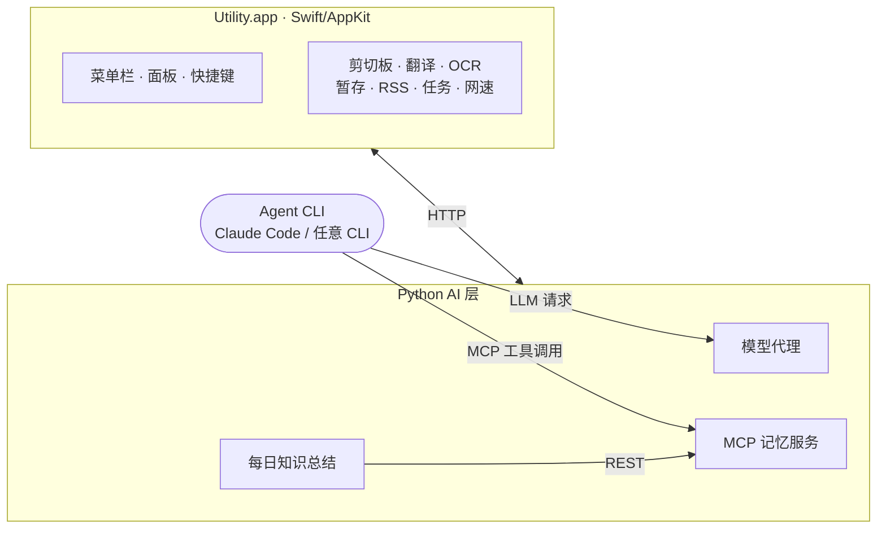
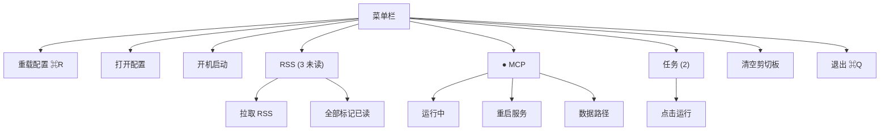
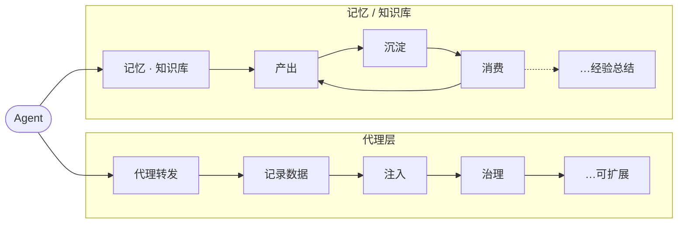
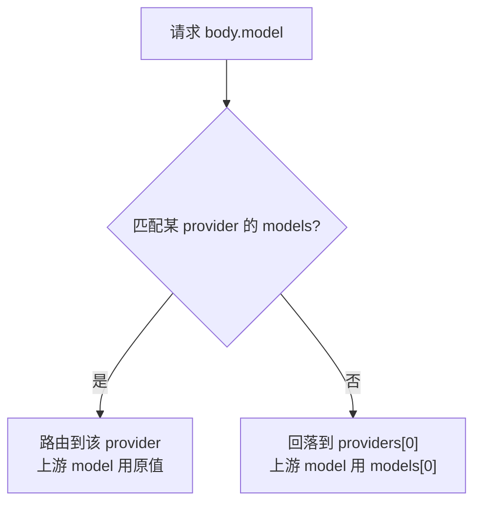
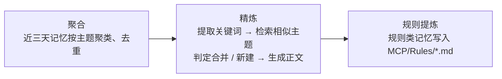
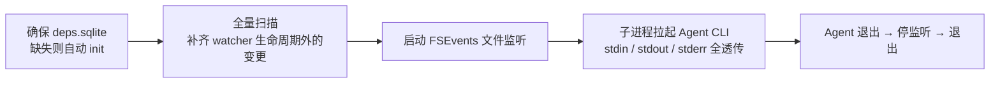

# Utility

macOS 菜单栏工具：剪切板历史、AI 翻译、OCR 区域翻译、拖拽暂存、RSS、定时任务、网速监控，以及本地 AI 层。

无 Dock 图标、无主窗口。

[English](README.md)

---

> **⚠️ 默认开启、可能会消耗大量 token 的功能**
>
> - **每日知识总结**(`mcp.summaryEnabled: true`,默认 17:00 触发)—— 多轮 LLM 调用(聚合、精炼、规则提炼)
>
> 不需要时在 `~/.config/utility/config.yaml` 关掉对应开关。

---

## 安装

```bash
git clone <https://github.com/yuanyxh/utility.git> utility
cd utility
swift build -c release
.build/release/utility &
```

要求：macOS 14+、Swift 5.9+(Xcode Command Line Tools)。

AI 层另需 Python 3.12。运行时来自独立仓 [`agent-gateway`](https://github.com/yuanyxh/agent-gateway)：

- **打包版**：app 内含 gateway wheel，首启自动建 `~/.config/utility/mcp-venv` 并安装（依赖需联网一次，之后断网可用）
- **源码运行**：`GatewayResources` 回退到同级 `../agent-gateway/src/agent_gateway`，无需安装（注意：直接
  `swift build` 出来的 app 不含 wheel，AI 功能靠这份同级仓，发包必须走 `scripts/package-utility.sh`）；也可手动
  `python3 -m venv ~/.config/utility/mcp-venv && ~/.config/utility/mcp-venv/bin/pip install -e '../agent-gateway[proxy,memory,server]'`

---

## 目录与路径

| 路径 | 默认 | 内容 | 配置项 |
|---|---|---|---|
| 配置目录 | `~/.config/utility/` | 全部配置与数据 | — |
| 配置文件 | `~/.config/utility/config.yaml` | 应用配置 | — |
| Python venv | `~/.config/utility/mcp-venv/` | AI 层运行环境 | — |
| 笔记目录 | `~/.config/utility/notes/` | 沉淀的文档；`MCP/` 子目录存 Skills、Rules | `mcp.knowledgeBasePath` |
| 向量库 | `~/.config/utility/data/qdrant/` | 热层 / 冷层向量 | `mcp.qdrantPath` |
| 应用数据 | `~/.config/utility/data.sqlite` | 剪切板、RSS 等 | — |
| Token 用量 | `~/.config/utility/token_usage.sqlite` | 代理记录 | — |
| 工具输出 | `~/.config/utility/tool_output.sqlite` | 工具输出全量日志 | — |
| 模型缓存 | `~/.cache/utility/fastembed/` | 嵌入模型 | `mcp.fastembedCacheDir` |
| 日志 | `~/.cache/utility/` | 各进程日志 | — |
| 项目索引 | `<项目根>/.utility/deps.sqlite` | `project_*` 数据源 | — |

```bash
tail -f ~/.cache/utility/debug.log         # 运行时跟踪
tail -f ~/.cache/utility/token_proxy.log   # 代理
tail -f ~/.cache/utility/server.log        # 记忆服务
tail -f ~/.cache/utility/summarize.log     # 每日总结
tail -f ~/.cache/utility/llm_client.log    # Python 侧 LLM 调用
```

---

## 快速上手

| 快捷键 | 作用 |
|---|---|
| `cmd+shift+c` | 打开剪切板历史 |
| `option+d` | 翻译选中内容 |
| `option+s` | 框选屏幕区域并翻译 |
| 拖到屏幕左下角 | 暂存文件、文本选区或 URL |

---

## 架构



---

## 其他功能

### 剪切板历史

复制的文本、文件、图片、HTML 会被记录。

**操作**

| 操作 | 作用 |
|---|---|
| `cmd+shift+c` | 打开面板 |
| `↑` / `↓` | 选择 |
| `Enter` | 粘贴回原应用并关闭 |
| `Esc` | 关闭 |

**参数**

| 配置项 | 默认 | 作用 |
|---|---|---|
| `clipboard.maxDays` | `3` | 超过天数的记录会被删除 |
| `clipboard.excludeApps` | `["SecurityAgent", "KeychainAccess"]` | 忽略的私密应用 |
| `clipboard.hotkey` | `cmd+shift+c` | 打开面板 |
| `clipboard.pollInterval` | `0.3` | 剪贴板轮询间隔(秒) |

### 翻译

需配置 `ai.apiKey`。

**操作**

| 操作 | 作用 |
|---|---|
| `option+d` | 翻译选中内容 |
| `cmd+Enter` | 翻译输入内容 |
| `Enter` | 粘贴并关闭 |
| `Shift+Enter` | 换行 |
| `Esc` | 关闭 |

**参数**

| 配置项 | 默认 | 作用 |
|---|---|---|
| `translation.hotkey` | `option+d` | 翻译选中内容 |
| `translation.hotkeyOCR` | `option+s` | 框选屏幕区域后翻译 |
| `translation.targetLang` | `auto` | 起始目标语言；`auto` 由模型在 `firstLang`/`secondLang` 间判断 |
| `translation.firstLang` | `zh` | 首选语言 |
| `translation.secondLang` | `en` | 次选语言 |
| `translation.prompt` | `""` | 内联 system prompt，覆盖模板文件；支持 `{source}`/`{target}` 插值 |

### OCR 区域翻译

需屏幕录制权限。

**操作**

| 操作 | 作用 |
|---|---|
| `option+s` | 翻译框选区域 |
| `Esc` | 取消 |

**参数**

| 配置项 | 默认 | 作用 |
|---|---|---|
| `translation.hotkeyOCR` | `option+s` | 触发框选 |

### 拖拽暂存

**操作**

| 操作 | 作用 |
|---|---|
| 拖拽文件 / 文本选区 / URL 到屏幕左下角 | 暂存 |
| 从浮窗拖出到任意应用 | 粘贴 |

**参数**

| 配置项 | 默认 | 作用 |
|---|---|---|
| `stage.moveOnDragOut` | `true` | 拖出时是否可移动源文件：`true` 提供复制+移动，`false` 仅复制 |

### RSS

**操作**

| 命令 | 作用 |
|---|---|
| `utility rss --fetch` | 拉取新条目 |
| `utility rss --unread` | 以 JSON 列出未读 |
| `utility rss --mark-read <id>` | 标记单条已读 |
| `utility rss --mark-all-read` | 全部标记已读 |

**参数**

| 配置项 | 默认 | 作用 |
|---|---|---|
| `rss.feeds[].name` | — | 菜单栏显示名 |
| `rss.feeds[].url` | — | 订阅地址 |

```yaml
rss:
  feeds:
    - name: "MDN Blog"
      url: "https://developer.mozilla.org/en-US/blog/rss.xml"
```

**内置日报**

`rss.daily.enabled: true` 时注册内部任务 `rss-daily`（菜单栏也可手动触发）：抓取 → 历史去重 → LLM 初筛 → 正文抓取与总结 → 写入 `<outputDir>/YYYY/季度/YYYY-MM-DD.md`。

| 配置项 | 默认 | 作用 |
|---|---|---|
| `rss.daily.enabled` | `false` | 是否注册内置日报任务 |
| `rss.daily.cron` | `0 10 * * *` | 五段 cron；空字符串 = 仅手动触发 |
| `rss.daily.outputDir` | `""` | 输出根目录；空 = `$NOTES_DIR/RSS` |
| `rss.daily.markRead` | `true` | 生成成功后把本次处理的条目标记已读 |
| `rss.daily.maxConcurrency` | `4` | 正文并发抓取数 |
| `rss.daily.articleMaxChars` | `12000` | 单篇正文截断长度 |
| `rss.daily.filterBatch` | `40` | 初筛每批条数 |
| `rss.daily.summaryBatch` | `4` | 总结每批条数 |
| `rss.daily.maxAgeDays` | `7` | 只处理最近 N 天发布的条目，`0` 表示不限 |
| `rss.daily.maxDigestLinks` | `10` | 周刊最多拆解外链数 |
| `rss.daily.fetchTimeout` | `20` | 单页抓取超时（秒） |
| `rss.daily.llmTimeout` | `120` | 单次 LLM 调用超时（秒） |
| `rss.daily.clash.enabled` | `false` | 抓取期间切换 Clash 代理组，结束后恢复 |
| `rss.daily.clash.group` / `target` | `""` / `""` | 你自己的 Clash 组与目标节点；两者都填才切换，留空跳过 |

### 定时任务

**操作**

| 操作 | 作用 |
|---|---|
| 菜单栏点击任务 | 运行 |
| 再次点击(`manual` 模式) | 杀掉运行中的进程 |

**参数**

| 配置项 | 默认 | 作用 |
|---|---|---|
| `tasks[].name` | `""` | 菜单栏里的名称 |
| `tasks[].trigger` | `""` | 五段 cron：`分 时 日 月 周` |
| `tasks[].exec` | — | 执行脚本，支持：sh、js、shortcuts、py |
| `tasks[].enabled` | `true` | 是否启用 |
| `tasks[].mode` | `cron` | `cron` 定时 \| `manual` 手动 |

```yaml
tasks:
  - name: daily report
    trigger: '0 10 * * *'
    exec: { type: sh, command: ~/scripts/daily-report.sh }
    enabled: true
    mode: cron
```

### 网速监控

**操作**

| 操作 | 作用 |
|---|---|
| 菜单栏 | 显示活动接口的上/下行速率(离线显示 `0.00M`) |
| `Cmd` 拖动 | 调整位置 |

### 多终端

`option+space` 显示/隐藏终端窗口（可在 `terminal.hotkey` 修改，需重启生效）。

| 操作 | 作用 |
|---|---|
| 左上角 `+` | 新建终端 |
| 点击左侧条目 | 切换会话 |
| 条目右侧 `×` | 关闭会话并结束进程 |
| 进程退出 | 条目自动移除 |
| 未读角标 | 条目右侧红色数字；点击对应系统通知可直接跳转 |

会话后端默认 `auto`：优先 tmux，其次系统自带 screen，都没有时退化为普通 PTY。tmux/screen 下退出 App 会话继续运行，下次打开窗口自动重新附着；`local` 后端退出 App 即结束。

### 菜单栏



---

## AI Agent 层

| 部件 | 职责 |
|---|---|
| 模型代理 | 反向代理 LLM 请求：路由、协议转换、用量入库、token 治理 |
| MCP 记忆服务 | 以 MCP 工具暴露记忆库与代码库检索 |
| 每日知识总结 | 把记忆沉淀成笔记 |



---

### 一、模型代理

反向代理 Anthropic / OpenAI 协议请求，支持模型快速切换、Token 治理、Token 用量记录。

**开启**

```yaml
modelProxy:
  enabled: true
  port: 0
  providers:
    - name: example
      url: "https://api.example.com/anthropic"
      apiFormat: anthropic
      apiKey: "xxxx-xxxx-xxxx-xxxx"
      models: [your-model]
```

将对应 Agent 的 base URL 配置为 `http://localhost:[PORT]/open/v1`。`/open/v1` 是兼容别名，`/v1` 是协议原生入口。

**路由**



**token 治理**

| 机制 | 开关 | 效果 |
|---|---|---|
| 全文去重 | `skillDedupEnabled` | 短提示替代重复内容 |
| shell 输出瘦身 | `outputFilter.enabled` | shell 输出过滤，JSON 无损压缩 |
| classifier 加速 | `clientAccel` | 安全分类器请求关闭思考 |

**全文去重**，Tool Result 数据完全重复时，使用短提示替换内容：

```
[Tool_Name] 的结果已存在，见上文
```

**shell 输出瘦身**，超长输出砍头尾(保留前 70% + 后 30%)，插入自证标记：

```
[前置内容]

已截断 N 字节

[后置内容]
```

**配置项**

| 配置项 | 默认 | 作用 |
|---|---|---|
| `modelProxy.enabled` | `false` | 随 app 启动代理 |
| `modelProxy.port` | `0` | 监听端口；`0` 自动挑空闲端口(即上文 URL 的 `[PORT]`) |
| `modelProxy.url` | `""` | 单一上游地址，仅 `providers` 为空时使用 |
| `modelProxy.providers[].name` | — | 菜单栏显示名 |
| `modelProxy.providers[].url` | — | 上游端点 |
| `modelProxy.providers[].apiFormat` | — | `anthropic` 或 `openai`；与客户端协议不一致时双向转换 |
| `modelProxy.providers[].apiKey` | `""` | 转发时替换的密钥；留空透传客户端 key |
| `modelProxy.providers[].models` | — | 路由到该 provider 的模型 ID |
| `modelProxy.skillDedupEnabled` | `true` | 折叠重复内容 |
| `modelProxy.outputFilter.enabled` | `true` | 瘦身超长 shell 输出 |
| `modelProxy.outputFilter.maxBytes` | `12000` | 超过此大小的输出才处理 |
| `modelProxy.responseAnnotationEnabled` | `true` | 最终回复末尾追加 `模型 \| 已执行: …` |
| `modelProxy.clientAccel` | `{enabled: true, clients: []}` | 享受分类器加速的客户端 |
| `modelProxy.clientText` | — | 客户端注入的续接/摘要文案与标签 |
| `modelProxy.maxRestarts` / `restartDelayMs` | `3` / `2000` | 崩溃后的重启策略 |

---

### 二、MCP 记忆服务

通过 streamable HTTP 暴露 MCP 工具，端点 `http://127.0.0.1:[PORT]`。注册示例：

```bash
claude mcp add --transport http mino-brain http://127.0.0.1:[PORT]
```

**三层记忆**

| 层 | 存储 | 内容 | 生命周期 |
|---|---|---|---|
| hot | mem0 + Qdrant 本地 | 原始碎片事实 | `hotRetentionDays`(默认 180 天) |
| cold | Qdrant 集合 `knowledge_base` | 结构化知识条目 | 长期 |
| notes | 笔记目录的 .md/.txt | 沉淀的文档 | 永久 |

**工具**

| 工具 | 作用 |
|---|---|
| `remember` / `remember_batch` | 写入记忆(热层) |
| `recall` | 三层联合检索 |
| `catch_up` | 拉取近期记忆 |
| `forget` | 删除记忆 |
| `set_memory_processed` | 读写记忆 processed 位 |
| `project_search` | 代码库多层级检索 |
| `project_structure` | 项目目录结构 |
| `project_exports` | 文件或目录的公共接口 |
| `project_dependencies` | 文件的一跳 import 与 importers |
| `project_notes` | 项目本地笔记检索 |
| `tool_resource` | 读取 skill 附属资源 |
| (动态) | `MCP/Skills` 下每个 skill 注册为一个工具 |

**笔记目录**

由 `mcp.knowledgeBasePath` 配置，默认 `~/.config/utility/notes/`：

| 路径 | 意义 |
|---|---|
| `MCP/Skills/` | 每个 `.md` 或含 `SKILL.md` 的目录注册为一个 MCP 工具 |
| `MCP/Rules/` | 每日总结从记忆提炼的规则 / 约定 |
| `MCP/System_Prompts.md` | 代理每轮注入到用户消息的规则 |
| `Extracts/` | 每日总结的中间提取产物 |
| 其余 `.md` / 目录 | 总结沉淀的知识文章 |

**Skills**

`<笔记目录>/MCP/Skills/` 下每个 `.md`(或目录内的 `SKILL.md`)注册为一个 MCP 工具。示例：

```markdown
---
name: my-skill
description: 触发时机与用途，模型据此判断何时调用
---

工具被调用时返回的正文。
```

在 frontmatter 中写 `enable: false` 可跳过注册（文件保留）；缺省或其它值仍注册。

目录式可带附属资源(`references/`、`agents/`、`scripts/` 下的文件经 `tool_resource` 读取，不单独注册为工具)：

```
MCP/Skills/my-skill/
├── SKILL.md
├── references/
├── agents/
└── scripts/
```

**System_Prompts.md**

纯文本，无格式要求，经由 **模型代理** 原样注入每轮用户消息：

```markdown
## 规则
- 一律使用中文
- 所有删除操作改为移动到废纸篓
```

**Rules**

`norms_<级别>.md`(如 `norms_global`、`norms_backend`)，沉淀生成项目规则:

```markdown
---
name: norms_global
description: 操作前，获取本行为规范；全局通用规范。
---

# 全局规范

## 条目

### 汇报功能状态前必须核实当前代码实际状态
- 领域: 协作
- 规范: ...
- 来源: ...
```

**Extracts**

每日总结的中间提取产物，按主题分目录，自动生成，将每日记忆提炼落到持久化的 markdown 文件。

**示例配置**

`examples/` 下有可直接取用的完整示例(中英各一套):

| 路径 | 内容 |
|---|---|
| `examples/zh-Hans/MCP/` | 中文版 |
| `examples/en/MCP/` | 英文版 |

每套含 `System_Prompts.md` 与 7 个 skill(`check` / `health` / `hunt` / `read` / `skill-creator` / `think` / `ui`)。联网搜索已内置为 `websearch_engine` 工具，不再需要 skill。取用时把对应语言目录下的内容复制到笔记目录的 `MCP/`:

```bash
cp -R examples/zh-Hans/MCP/* ~/.config/utility/notes/MCP/
```

不含 `Rules/`(由每日总结自动提炼维护)。

新增或修改后需重启服务。

**配置项**

| 配置项 | 默认 | 作用 |
|---|---|---|
| `mcp.enabled` | `true` | 随 app 启动服务 |
| `mcp.port` | `0` | 监听端口；`0` 自动挑空闲端口(对应上文 URL 的 `[PORT]`) |
| `mcp.hotRetentionDays` | `180` | 原始碎片在热层保留的天数 |
| `mcp.archiveDays` | `90` | 记忆移入冷层的天数阈值 |
| `mcp.summaryEnabled` | `true` | 是否运行每日总结流水线 |
| `mcp.summaryHour` | `17` | 每日总结的运行时刻(小时) |
| `mcp.excludeTags` | — | 带这些 tag 的记忆不进入知识库沉淀 |
| `mcp.synonyms` | `{}` | 检索同义词增量补充(同名覆盖、异名追加) |
| `mcp.toolDefaults` | `recall: 6` 等 | 各工具默认返回条数 |
| `mcp.qdrantPath` / `knowledgeBasePath` | `""` | 存储路径；留空用默认路径 |
| `mcp.noteExcludeDirs` | `[]` | recall/总结跳过的笔记目录；留空不跳过，非空完全覆盖 |
| `mcp.noteExtensions` | `[]` | 笔记文件扩展名；留空用内置通用集合，非空完全覆盖 |
| `mcp.embedderModel` | `""` | 嵌入模型；留空用 `sentence-transformers/all-MiniLM-L6-v2` |
| `mcp.fastembedCacheDir` | `""` | 模型缓存；留空用 `~/.cache/utility/fastembed/` |
| `mcp.maxRestarts` / `restartDelayMs` | `3` / `2000` | 崩溃后的重启策略 |

改动后从**菜单栏 → MCP** 重启服务。

---

### 三、每日知识总结

每天 `mcp.summaryHour`(默认 17:00)由 TaskScheduler 触发，把热层记忆沉淀成笔记并同步进冷层。



产物写入笔记目录后自动 `git commit`。日志：`~/.cache/utility/summarize.log`。

---

### 四、提示词系统

各 LLM 调用点的 system / user 文案不写死在代码里，外置为 agent-gateway 仓的 `prompts/<lang>/<feature>.md`，system 与 user 各占一份。

| 调用方 | feature | 用途 |
|---|---|---|
| 每日总结 · 价值判定 | `quality_judge` / `quality_judge_user` | 判定记忆是否有沉淀价值 |
| 每日总结 · 聚合 | `aggregate` / `merge_cross_batch` | 按主题聚类、组内与跨批合并去重 |
| 每日总结 · 精炼 | `extract_keywords` / `decide_merge` / `gen_new` / `gen_merge` | 提取关键词、判定合并或新建、生成正文 |
| 每日总结 · 规则提炼 | `extract_rules` | 规则类记忆写入 `MCP/Rules/*.md` |
| MCP 记忆服务 | `contradiction` | 新记忆入库时与相似记忆做矛盾检测 |
| 菜单栏翻译 | `translate` / `translate_auto` | 翻译选中内容；`translate_auto` 自动判断语向 |

查找顺序：`<配置目录>/prompts/<feature>.md`(用户覆盖) → 内置 `Gateway/prompts/<lang>/<feature>.md`(按语言，缺则回退 `zh-Hans`)。

front-matter 的 `name` 必须与文件名一致；`placeholders` 与正文占位符双向自校验。

---

### 五、定时提醒

`utility notice` 把提醒写进 `~/.config/utility/notices.sqlite`，常驻的 Utility.app 每 5 分钟查一次到期记录，经系统通知弹出后删除该行。CLI 是短命进程、没有通知授权，所以只负责登记，不负责弹窗。

| 命令 | 作用 |
|---|---|
| `utility notice add --in 10m "标题" "正文"` | 相对延迟登记（单位 s/m/h/d） |
| `utility notice add --at 20:30 "标题"` | 绝对时间登记，已过则顺延到明天 |
| `utility notice add --at "2026-10-29 09:00" "标题"` | 指定日期时间 |
| `utility notice list` | 列出未触发的提醒 |
| `utility notice cancel <id>` | 取消提醒 |

App 未运行时提醒不会响；启动后补发 24 小时内的提醒，更早的合并成一条「错过的提醒」。没有重复提醒能力，周期性提醒请用任务配置的 cron。

---

### 六、项目索引与 Agent 寄生模式

`project_*` 工具的数据来自 `ProjectScanner` 全量扫描 + `FileWatcher` 增量扫描，写入项目根下的 `.utility/deps.sqlite`。多语言提取器按扩展名注册(Swift / JS-TS / Python / Vue / Java / Kotlin)，提取优先级 AST 脚本 → 正则兜底。符号含 `start_line`/`end_line`。

| 命令 | 作用 |
|---|---|
| `utility init [--path <dir>]` | 扫描项目(默认当前目录)，生成 `.utility/deps.sqlite` |
| `utility -a "<agent 命令>" [--dir <dir>]` | Agent 寄生模式:建索引、起文件监听、拉起 Agent |

`utility -a` 的流程:



注入 Agent 子进程的环境:`UTILITY_PROJECT_DIR`(项目根)、`UTILITY_PROJECT_DB`(索引路径)、`MCP_PORT` / `MINO_BRAIN_MCP_PORT`(MCP 服务端口)。

```bash
utility -a "claude -p '分析这个模块'"
utility --dir ~/myapp -a claude
```

---

## 配置

配置文件在 `~/.config/utility/config.yaml`，首次启动写入默认值。菜单栏**打开配置**可直接编辑，`⌘↩` 校验并保存（校验失败不写入）。也可改文件后选**重载配置**(`⌘R`)生效。改动 `mcp.*` 或 `modelProxy.*` 后需从菜单栏重启对应服务。

### 全局

| 配置项 | 默认 | 作用 |
|---|---|---|
| `general.language` | `""` | 界面语言，留空跟随系统；同时决定提示词与 MCP 工具参数文案的语言 |
| `general.proxyEnabled` | `false` | 使用 macOS 系统代理设置 |
| `general.httpTimeout` | `30` | HTTP 请求超时(秒) |
| `general.httpRetryCount` | `0` | HTTP 重试次数 |
| `general.aiTimeout` | `120` | Agent 子进程超时(秒)；`0` = 不限制 |
| `general.logMaxSize` | `10485760` | 单日志文件大小上限(字节) |
| `general.logBackupCount` | `3` | 保留的轮转日志数 |
| `notifications.enabled` | `true` | 系统通知总开关 |

### AI 提供商

| 配置项 | 默认 | 作用 |
|---|---|---|
| `ai.baseURL` | `""` | OpenAI 兼容端点 host(如 `https://api.example.com`) |
| `ai.apiKey` | `""` | API 密钥；缺失则翻译与总结管线不可用 |
| `ai.model` | `""` | 模型名，如 `your-model` |
| `ai.llmTimeout` | `120` | Python 侧单次 LLM 推理超时(秒)；`0` 或负值回退默认 |

```yaml
# Example provider
ai: { baseURL: "https://api.example.com", apiKey: "sk-your-key", model: "your-model" }

# OpenAI
ai: { baseURL: "https://api.openai.com", apiKey: "sk-your-key", model: "gpt-4o-mini" }

# 本地 Ollama
ai: { baseURL: "http://localhost:11434", apiKey: "ollama", model: "llama3.2" }
```

`mcp.*` 与 `modelProxy.*` 见上文对应章节。

---

## 打包与签名

```bash
SIGNING_IDENTITY=<证书名或 SHA1> ./scripts/package-utility.sh
```

五步：清理构建 → 签名二进制 → 组装 `Utility.app` → 签名 bundle(带硬 `codesign --verify`)→ 产出 `Utility-<version>.dmg`。

### 证书选择

`SIGNING_IDENTITY` 填证书名称或 SHA1 哈希均可，用 `security find-identity -v -p codesigning` 查。

| 用途 | 证书 | 说明 |
|---|---|---|
| 本机自用 | 自签证书 | 本地生成，不经过 Apple；签出的 app 拷到其他 Mac 会被 Gatekeeper 拦，也无法公证 |
| 分发给别人 | Developer ID Application | Apple 签发，可公证；需 Apple Developer Program 会员 |

自签证书在本地生成:钥匙串访问 → 证书助理 → *创建证书…*(类型「代码签名」、自签名)，或 `openssl` 生成后导入登录钥匙串。

### 获得 Developer ID 证书

需要 **Apple Developer Program** 会员($99/年)。只有 Account Holder 能创建 Developer ID 证书，最多 5 张。

**方案 A —— Xcode。** Xcode → Settings → Accounts → 添加 Apple ID → 选择团队 → **Manage Certificates…** → `+` → **Developer ID Application**。

**方案 B —— 手动 CSR。** 钥匙串访问 → 证书助理 → *从证书颁发机构请求证书*，存 `.certSigningRequest`。到 [developer.apple.com](https://developer.apple.com/account/resources/certificates/list) → Certificates → `+` → **Developer ID Application** → 上传 CSR → 下载 `.cer` → 双击安装到**登录**钥匙串。

确认可用：

```bash
security find-identity -v -p codesigning
# "Developer ID Application: Your Name (TEAMID)"  —— 需要括号里的 TEAMID
```

不用 *"Developer ID Application **Managed**"* 证书——私钥在 Apple 服务器上，命令行无法使用。

### 公证

未公证的应用在其他机器上会被 Gatekeeper 拦。公证并 stapling 到 `.dmg`：

```bash
# 存一次凭据(专用密码在 appleid.apple.com 生成)
xcrun notarytool store-credentials "utility-notary" \
  --apple-id "you@example.com" --team-id "TEAMID" --password "xxxx-xxxx-xxxx-xxxx"

xcrun notarytool submit Utility-<version>.dmg --keychain-profile utility-notary --wait
xcrun stapler staple Utility-<version>.dmg
```

---

## 故障排查

| 现象 | 可能原因 | 处理 |
|---|---|---|
| 记忆服务崩溃或起不来 | Python venv 缺失或损坏 | 重建(见[安装](#安装))；查 `~/.cache/utility/server.log` |
| 代理不可达(`ECONNREFUSED`) | 代理未启用或 base URL 不对 | 设 `modelProxy.enabled: true`；确认 `ANTHROPIC_BASE_URL` 指向代理端口 |
| OCR 框选后无返回 | 未授予屏幕录制权限 | 系统设置 → 隐私与安全性 → 屏幕录制 → 启用 Utility 并重启 |
| 快捷键无反应 | 未授予辅助功能权限，或组合被占用 | 授予辅助功能，或改绑定 |
| 网关列不出第三方模型 | 客户端把发现结果过滤到 `claude*` | 直接输入模型名：`/model your-model` |
| 记忆服务活着但请求超时 | 陈旧进程占着端口 | 菜单栏重启；`lsof -nP -iTCP -sTCP:LISTEN \| grep [PORT]` |
| 上游 502(来路不明) | 代理与上游压缩编码不匹配 | 确认 venv 装了 Brotli/backports.zstd，重启代理 |

```bash
tail -f ~/.cache/utility/debug.log
sqlite3 ~/.config/utility/data.sqlite ".tables"
```

---

## 技术栈

| 层 | 选型 |
|---|---|
| 语言 | Swift 5.9+ / Python 3.12 |
| UI | AppKit(菜单栏 + `NSPanel`) |
| 存储 | GRDB(SQLite)+ Qdrant(向量库) |
| 配置 | Yams(YAML) |
| 快捷键 | Carbon EventHotKey |
| OCR | Vision(`VNRecognizeTextRequest`) |
| 代理 | aiohttp 反向代理 |
| MCP 协议 | `mcp.server` + `StreamableHTTPServerTransport` |
| 记忆引擎 | Mem0(热)+ fastembed + Qdrant(冷) |
| 项目索引 | AST + 正则 + FTS5 多语言符号提取 |
| 网络 | `getifaddrs` |
| 开机启动 | `SMAppService` |
| CLI | swift-argument-parser |

---

## 许可

MIT —— 见 [LICENSE](LICENSE)。
